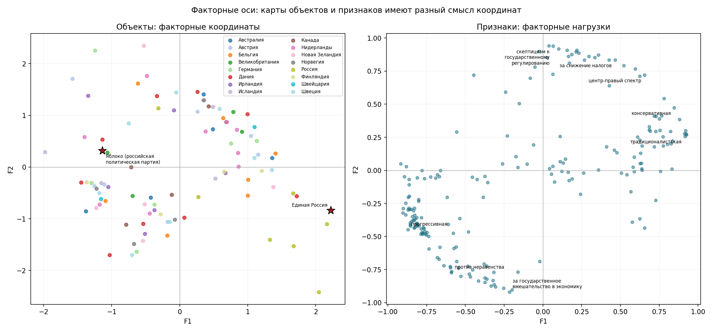
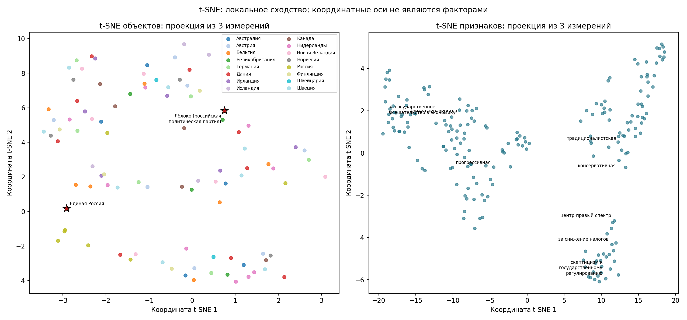

# Проверка нового математического ядра

14 октября 2026 года. Это офлайн-прототип на прежней матрице 95 партий × 200
признаков, оценённых LLM по шкале 0..10. Новые шкалы −5..5, нормализация
семантического уровня и пользовательское утверждение словаря ещё не реализованы.
Исходные `data/` и CLI сохранены. Результат проверяет численный подход, а не
завершает построение пользовательского сервиса или проверку качества оценок.

## Модель и проверка

Gaussian FactorAnalysis с диагональным специфическим шумом; exact SVD LAPACK.
При расчёте координат решается система q×q, эмпирические корреляции не обращаются.
Перебраны q=2..8, 5 разделений 76 train / 19 test с одним фиксированным seed.
Обучение импутации и стандартизации выполняется отдельно на каждом train.
Для проекции и отложенного likelihood отсутствующие признаки маргинализируются.

Все 42 оценки моделей завершились без предупреждений о сходимости.
Положительный floor шума 1e-6 предусмотрен после fit; в полных моделях он не
сработал: минимальные шумовые дисперсии составили 0,017–0,028.
Обусловленность систем для posterior scores составила примерно 5,3–111,1
вместо порядка 10^19 у исходной эмпирической корреляционной матрицы.
Сравнение обусловленности характеризует разные вычислительные задачи;
само по себе оно не доказывает содержательного превосходства новой модели.

Лучшее среднее отложенное likelihood получилось у q=8, верхней границы сетки.
Это не окончательное число смысловых осей: необходимо проверить соседние
размерности, интерпретацию, остатки, выборку и независимые оценки. Диапазоны
по пяти пересекающимся разделениям являются описательными, не доверительными
интервалами. Геометрическое сходство разных fits также не является внешней
репликацией: везде используется одна исходная LLM-матрица.

## Файлы

- `benchmark.json`: параметры, версии, SHA-256, ограничения, численная диагностика.
- `dimension_summary.csv`, `heldout_splits.csv`, `full_fit_diagnostics.csv`: проверки.
- `fa_qN_loadings.csv`: признаки × факторы, ортогональное varimax.
- `fa_qN_scores.csv`: объекты × факторы, согласованное вращение координат.
- `fa_qN_parameters.joblib`: фиксированные параметры обучения и порядок признаков.
- `pca_*`: отдельный PCA/SVD контроль геометрии; PCA не отождествляется с EFA.
- `maps_q3/`: пример карт для трёхфакторной модели, не выбор оптимальной размерности.

Новые объекты проецируются функцией `transform_new_objects` с сохранёнными
mean/scale/нагрузками/шумом, без переобучения. Математическая проекция не гарантирует
покрытия нового объекта исходным словарём. Полностью неизвестный объект имеет
нулевое posterior mean как prior и должен быть отмечен как неизмеренный;
это не наблюдение «нейтральный профиль».

## Пример карт



На левой карте координаты партий; на правой — координаты признаков по нагрузкам.
Масштабы и смысл этих двух карт различаются. Две выделенные партии выбраны только
для демонстрации подробного раздела отчёта; их выделение не меняет fit.
Показаны только F1–F2, поэтому совпадение точек на плоскости не означает совпадение
полных трёхмерных профилей.

Для этого иллюстративного q=3 решения положительный F1 связан с традиционализмом,
отрицательный — с культурной прогрессивностью; F2 — рыночный подход против
государственного вмешательства; F3 — умеренность против антиэстеблишментской
риторики. Это предварительное прочтение нагрузок старого словаря. Смена знака оси
не меняет смысл относительного расположения или расстояния.



Здесь выполнены две отдельные t-SNE проекции полных факторных профилей: объектов
и признаков. Оси t-SNE не имеют интерпретации факторов. Параметры и проверка
локального сохранения соседства записаны в `maps_q3/map_metadata.json`.
Кластеризация по этим двумерным координатам не выполняется.

## Воспроизведение

```powershell
python scripts/latent_space_benchmark.py
python scripts/semantic_maps.py --scores reports/latent_benchmark/fa_q3_scores.csv --loadings reports/latent_benchmark/fa_q3_loadings.csv --output-dir reports/latent_benchmark/maps_q3 --groups data/parties_map.json --focus "Единая Россия" --focus "Яблоко (российская политическая партия)" --label-count 8
python -m unittest discover -s tests -v
```

Использован прежний Python 3.10.8 и зависимости из `requirements-audit.txt`.
Все десять тестов прошли: включая обработку p>n/дубликатов, posterior и likelihood
против sklearn, пропуски, инвариантность вращения и фиксированную проекцию новых
объектов после сериализации.
