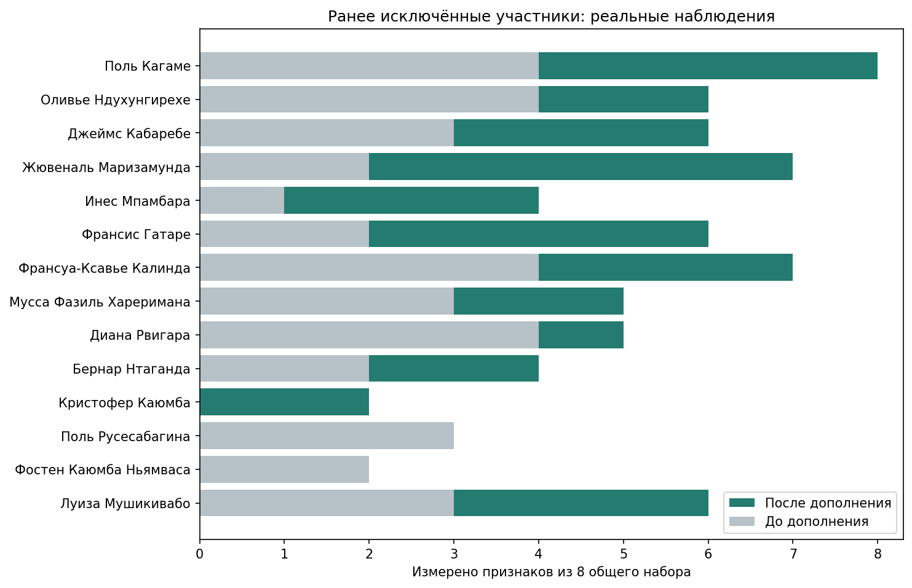

# Руанда: расширение охвата и сравнение способов заполнения пропусков

**42 утверждённых участника · 15.10.2021–15.10.2026 · независимые свойства 0–5.**

После адресного дополнения источников в основную факторную матрицу вошли **37 из 42 участников и 8 признаков** (раньше 28 × 8). Покрытие матрицы — **82,77%**. Все исходные пропуски и прежние наблюдения сохранены отдельно от аналитического заполнения.

## Что удалось дополнить

Проверены все 572 запланированных неизвестных свойства: прежние восемь общих признаков у 14 исключённых участников и российский блок у всех 42. Выбор направлений обусловлен предыдущим покрытием и поручением пользователя: это адаптивное разведочное продолжение. Число добавленных оценок — **41**. Всего известно **589/2016 (29,22%)**, до этого — 548/2016. Уже известные значения не переоценивались, пороги допуска не снижались.

У Кагаме теперь измерены все восемь общих признаков. Поиск ограничен сохранёнными запросами и источниками; оставленные пропуски не доказывают, что соответствующих высказываний вообще не существует.

Впервые прошли допуск: Поль Кагаме, Оливье Ндухунгирехе, Джеймс Кабаребе, Жювеналь Маризамунда, Франсис Гатаре, Франсуа-Ксавье Калинда, Мусса Фазиль Хареримана, Диана Рвигара, Луиза Мушикивабо.

Остались за пределами основной FA: Инес Мпамбара, Бернар Нтаганда, Кристофер Каюмба, Поль Русесабагина, Фостен Каюмба Ньямваса. Исключение означает недостаток сопоставимых измерений, а не нейтральность или отсутствие позиции. [Таблица всех 42 участников](../../studies/rwanda-politicians-2021-2026/output/coverage_by_actor.md).

## Факторные решения после дополнения

| Факторов | Было: 28 × 8 | Теперь: 37 × 8 |
|---|---:|---:|
| 2 | 42,53% | 39,73% |
| 3 | 60,21% | 52,29% |
| 4 | 70,74% | 61,37% |

Доли относятся к общей дисперсии оставленных стандартизованных переменных. Состав объектов изменился, поэтому разность процентов не является отдельным эффектом качества данных или долей нового фактора. В основном расчёте оставшиеся пропуски заполняются средним признака; сравнение альтернатив приведено ниже. Номера и знаки осей между решениями условны.

### 2 фактора — 39,73%

**F1. Преемственность и поддержка курса — 22,21%.** Продолжение действующего курса (−0,992), его публичная поддержка (−0,621) и ценностно-мемориальное обоснование (−0,453) связаны одним направлением. Ось описывает сочетание преемственности, одобрения и обращения к коллективным символам. Меньшая выраженность этой связки не доказывает оппозиционности. Знак минус означает выбранную ориентацию координаты, а не отрицательную оценку политики.

**F2. Программное обновление и раскрытие проблем — 17,52%.** Программное изменение курса (+0,992) сочетается с публичным раскрытием недостатков (+0,461). Это связь предложений обновления с обсуждением проблем исполнения. Первый признак почти непосредственно определяет ось; его высокая нагрузка сама по себе не подтверждает широкий психологический тип.

Два фактора дают компактную схему основных связок, но мало раскрывают различия между ценностной аргументацией, доступностью благ и предупреждением рисков.

[Диаграмма нагрузок 2 факторов](../../studies/rwanda-politicians-2021-2026/output/assets/factor_preview_q2.png)

### 3 фактора — 52,29%

**F1. Преемственность и поддержка курса — 22,40%.** Продолжение курса (−0,966), его поддержка (−0,646) и ценностная аргументация (−0,399) сохраняют общий смысл первой оси двухфакторного решения. Содержательно это публичное подкрепление действующей линии; слабая выраженность не означает автоматически её отрицания.

**F2. Обновление с обсуждением практических проблем — 16,78%.** Изменение курса (+0,946), раскрытие проблем (+0,468) и расширение доступности благ (+0,397) составляют связку обновления с практическими задачами. Она не тождественна оппозиционности: предложения изменений могут исходить от действующих управленцев.

**F3. Доступность благ и предупреждение рисков ↔ ценностная аргументация — 13,11%.** Доступность базовых благ (+0,472) и упреждающая подготовка (+0,463) имеют противоположный знак по отношению к аргументации через память, ценности и символы (−0,706). Появляется контраст практических социальных и профилактических акцентов с ценностно-мемориальными. Это относительная связь в корпусе, а не несовместимость ценностей и профилактики у отдельного человека.

Новый смысл по сравнению с двумя факторами — соотношение практических социальных задач, подготовки к рискам и ценностной аргументации. Первые две линии в основном сохраняются. Все три оси имеют не менее двух нагрузок по модулю ≥0,35, но устойчивость к изменениям источников этим не гарантируется.

[Диаграмма нагрузок 3 факторов](../../studies/rwanda-politicians-2021-2026/output/assets/factor_preview_q3.png)

### 4 фактора — 61,37%

**F1. Преемственность и поддержка курса — 21,58%.** Продолжение курса (−0,979), его публичная поддержка (−0,606) и ценностная аргументация (−0,528) сохраняют общий смысл. Это наиболее узнаваемая линия при смене числа факторов.

**F2. Предупреждение рисков — 13,20%.** Подготовка и упреждающее снижение рисков (−0,903) выделяются в отдельную ось. Других нагрузок по модулю ≥0,35 у неё нет: это фактически одноиндикаторное направление, которое пока нельзя считать надёжно измеренным широким латентным свойством.

**F3. Программное обновление и раскрытие проблем — 16,54%.** Изменение курса (+0,845) и публичное раскрытие проблем (+0,646) остаются связкой обновления с обсуждением недостатков. Номер F3 локален для этого решения; содержательно она близка F2 предыдущих вариантов.

**F4. Доступность благ ↔ ценностная аргументация — 10,05%.** Расширение доступности благ (−0,633) противопоставлено по знаку ценностно-мемориальному обоснованию (+0,358). Вторая опора лишь немного превышает порог описания 0,35. Эта ось особенно чувствительна к способу восстановления пропусков; её смысл остаётся сравнительной гипотезой.

Четырёхфакторный вариант разделяет третью линию q=3 на отдельную профилактику и контраст доступности благ с ценностной аргументацией. При восьми признаках остаётся номинально только 2 степени свободы; рост объяснённой дисперсии не обосновывает выбор сам по себе.

[Диаграмма нагрузок 4 факторов](../../studies/rwanda-politicians-2021-2026/output/assets/factor_preview_q4.png)

На диаграммах нагрузок строки — признаки, столбцы — факторы. Число и цвет показывают направление и силу связи. Один знак у нескольких признаков позволяет описать их совместную выраженность; разные знаки могут обозначать контраст. Меньшая выраженность свойства не создаёт его антоним. Такие оси описывают публичную коммуникацию в выбранном корпусе, а не доказанные частные убеждения.

## Отношение к России

Теперь известны **14/504** отдельных российских свойств у **7 участников**. Прямые высказывания о конкретных действиях России, сотрудничестве, санкциях и дистанцировании различаются по содержанию и роли говорящего. Одно событие с несколькими темами сохраняет один event_id.

**Проверить отдельный российский фактор ≥2% всё ещё нельзя:** собственные российские индикаторы не прошли порог покрытия общей матрицы. Это не нулевой процент и не доказательство отсутствия такой структуры. Заполнение российского блока из должностей или общих политических осей выдало бы модельную догадку за новую информацию.

Для Кагаме добавлена оценка критики конкретного внешнеполитического действия России: в интервью 12 сентября 2023 года он отвергает вторжение одной страны в другую, обсуждая Украину, и одновременно говорит о нейтральной позиции Руанды. Это ограниченное проявление, а не общий антироссийский профиль. [Полный текст интервью](https://www.newtimes.co.rw/article/10916/news/politics/kagame-the-problem-is-not-between-me-and-tshisekedi/amp).

Например, диверсификация поставщиков пшеницы у Нгиренте сохранена как контекст: она недостаточна для оценки ограничения проектов с Россией. Собственные объяснения голосования по Украине кодируются в пределах конкретного заявления; не становятся общей враждебностью или санкционной позицией. [Индивидуальные российские проявления и источники](../../studies/rwanda-politicians-2021-2026/output/russia_profile_evidence.md) · [План и границы дополнения](../../research/rwanda_politicians_2021_2026/COVERAGE_EXPANSION_PLAN.json).

## Можно ли заменять небольшие пропуски

Да, в аналитической копии достаточно измеренной матрицы. Среднее признака прозрачно, но стягивает значения к центру и меняет корреляции. Регрессия использует связи признаков и тоже может их усиливать. Поэтому здесь сравниваются mean, регуляризованная BayesianRidge и KNN; обучение проводится на 75% объектов, а на остальных временно скрываются 12% известных оценок. Ни один метод не видит скрытую истину при обучении.

| Заполнение | MAE | RMSE |
|---|---:|---:|
| mean | 0.575 | 0.798 |
| bayesian_ridge | 0.617 | 0.880 |
| knn | 0.579 | 0.839 |

Это ошибки случайно скрытых известных ячеек, не доказательство правильности настоящих неизвестных позиций. Среднее показало наименьшую ошибку в этой проверке, поэтому оснований автоматически переходить на регрессию нет. В настоящих пропусках важны служебная роль, доступность источников и содержание высказываний; они могут быть неслучайными. Дополнительно выполнены 10 стохастических регрессионных заполнений с отдельным обучением FA и согласованием осей. Разброс показывает чувствительность к восстановлению, а не доверительные интервалы истинных убеждений. [Полное сравнение заполнений и нагрузки](../../studies/rwanda-politicians-2021-2026/output/imputation_review_2026-10-15.md).

Для q=3 медианное сходство профилей нагрузок при этих заполнениях составляет 0,962 / 0,896 / 0,849 по F1–F3. Для q=4 у F2 и F4 — только 0,530 и 0,492: дополнительная детализация особенно зависит от восстановления пустых ячеек. Это описательное сравнение направлений осей, не вероятность правильности модели.

## Ограничения и рабочий выбор

Для содержательного обсуждения предлагается трёхфакторная модель как рабочая гипотеза; двухфакторная полезна как компактное сравнение. При стохастическом заполнении q=3 сохраняется лучше q=4, но проверка без контекстных оговорок подтверждает главным образом линию преемственности, а не всю трёхфакторную структуру. Четыре фактора пока не рекомендуются для окончательного отчёта: профилактика опирается на один сильный индикатор, а две дополнительные оси чувствительны к заполнению. Ни одно решение ещё не является подтверждённой стратификацией политического сознания всей Руанды.

При исключении всех текущих оценок с контекстными оговорками (44) остаётся **34 × 7**. Отдельная FA этой копии дала 43,05% при двух факторах и 55,98% при трёх. Четыре фактора при семи признаках не допускаются по числу ковариационных параметров. Оговорка не объявляет наблюдение ошибочным.

В строгом варианте из общего набора ушёл признак программного изменения курса, а также Хареримана, Мпайимана и Виктуар Ингабире. Линия преемственности основного q=3 сохраняется заметно лучше остальных (сходство нагрузок 0,932 против 0,379 и 0,582). Профилактика в строгих решениях остаётся осью с одним сильным индикатором. Значит, усиление охвата позволяет обучить более строгую модель, но не подтверждает всю прежнюю структуру. Проценты двух матриц имеют разные знаменатели — 8 и 7 признаков — и не измеряют улучшение качества. [Строгая FA и подробное сопоставление](../../studies/rwanda-politicians-2021-2026/output/strict_without_flags/COMPARISON.md).

В методическом приложении отдельно исключён весь слой последующих дополнений. После этого прежний допуск к FA не выполняется: источники дополнения существенно влияют на возможность и состав анализа.

Выборка целевая, управленцы преобладают, международные дипломаты выступают в иной служебной роли. Разметка выполнена ассистентами по источникам, а не независимой группой человеческих экспертов. Расширенный отчёт, кластеры и слайды готовятся после выбора факторного решения.

[Полные факторы и диагностика](../../studies/rwanda-politicians-2021-2026/output/factor_preview.md) · [Матрица с исходными пропусками](../../studies/rwanda-politicians-2021-2026/output/factor_matrix.json) · [Методика работы с пропусками](../../docs/MISSING_DATA.md).
