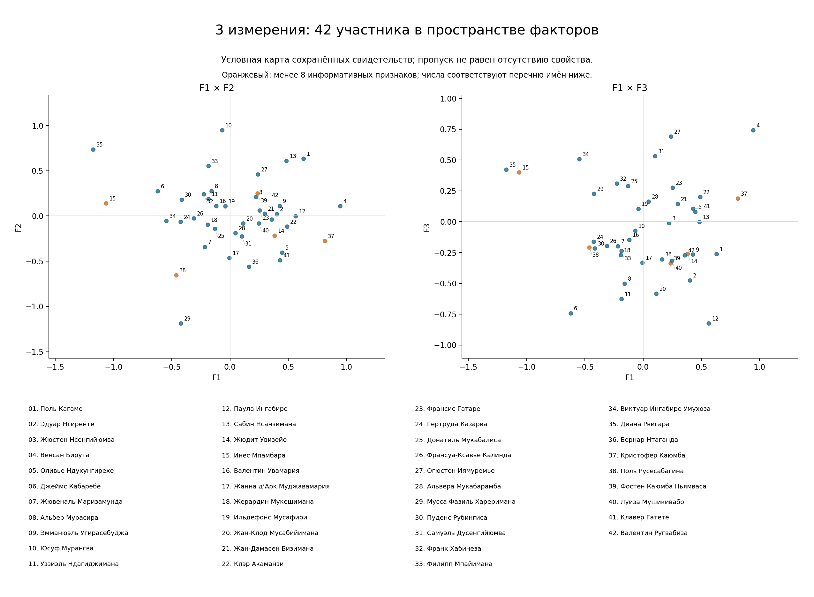
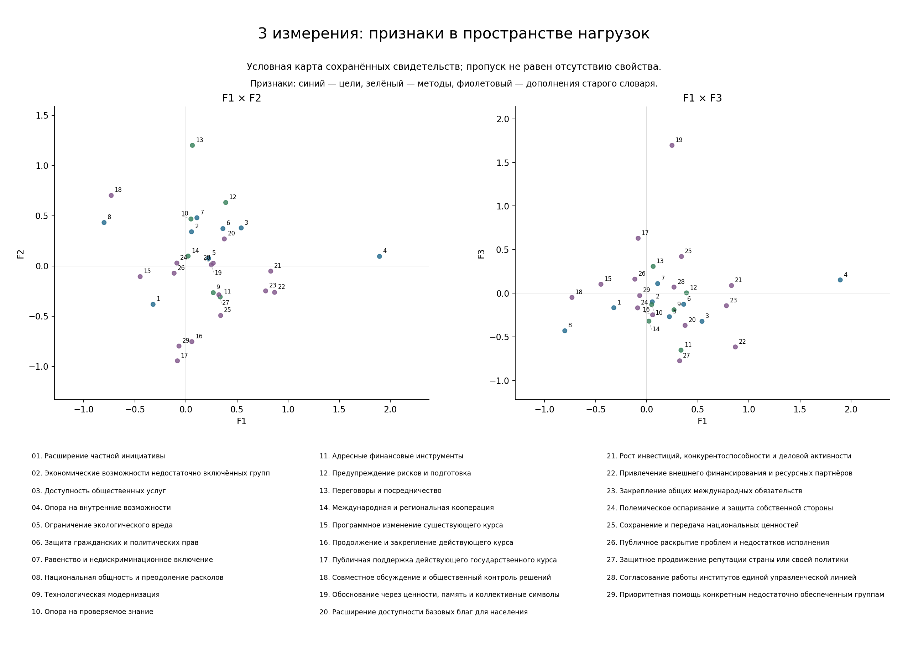
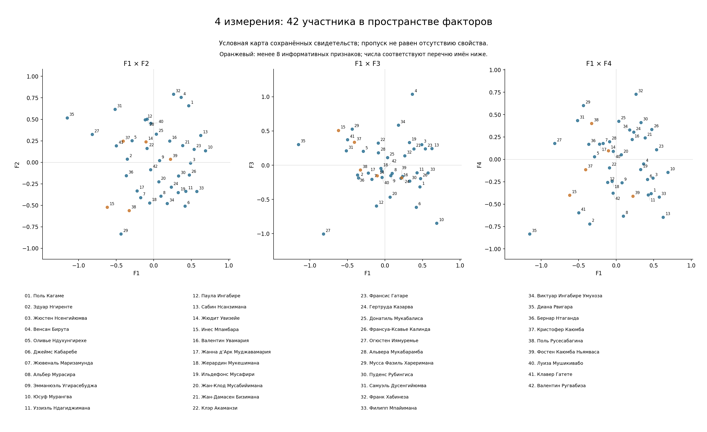
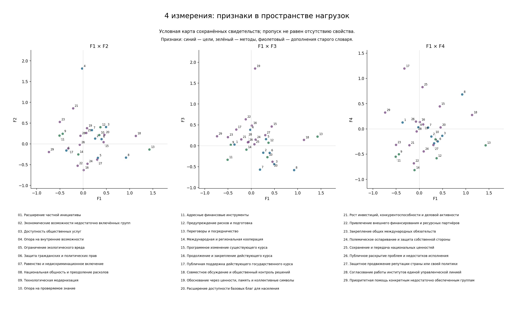
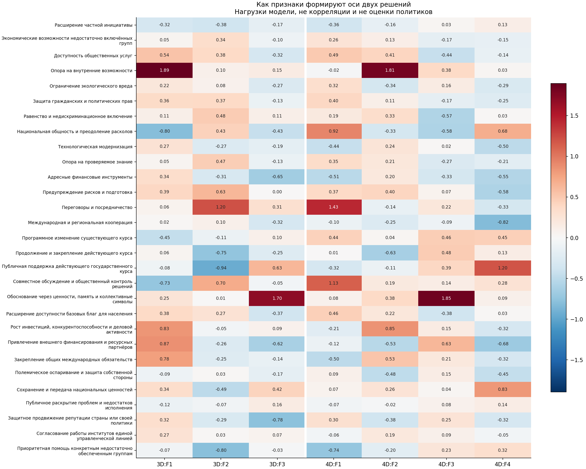

# Руанда: объединённое исследование, 3 и 4 фактора

Версия 18.10.2026. Исследуемое окно: **15.10.2021–15.10.2026**.

## Основные выводы

- Объединены оба словаря: **66 независимых признаков**, включая 12 направлений отношения к России. Совпадающие направления сопоставлены; частичные пересечения сохранены и проверены отдельно.
- **588** пригодных целевых описаний из старых досье заново оценены по содержанию; 18 из них исключены по смысловым границам. Дополнительно выполнено **69** индивидуальных перекодировок свидетельств в признаки другого словаря. Старые численные баллы не перенесены.
- Использован весь ранее оценённый корпус: **236** информативных сочетаний «политик × признак», включая диапазоны. Не все 7 021 просмотренный фрагмент содержали измеряемую позицию.
- В основной карте сохранены **все 42 участника и 29 достаточно распространённых, изменяющихся признаков**. Заполнены **612 из 1218** ячеек (50.2%). 523 имеют совпадающие границы кодировки; остальные 89 введены через условные середины диапазонов. Это не 42 полностью измеренных профиля.
- Трёхмерное решение компактнее объединяет ресурсную стратегию, согласовательные методы и ценностный язык. Четырёхмерное подробнее различает **способ ценностного обоснования** и **публичную поддержку курса / национальную память**. Эти оси не являются готовыми политическими лагерями.
- Самостоятельный фактор отношения к России **не установлен**: по каждому из пяти непустых направлений есть данные лишь о 3–4 участниках. Пустые направления не заменялись нулями; требование ≥2% дисперсии нельзя считать проверенным.
- Новых обращений к платным API: **0**, дополнительных расходов API: **$0**.

## Что именно объединено

Первоначальный словарь включал 24 пары, то есть 48 отдельных полюсов. Корпусный словарь содержит 38 отдельных свойств. Сопоставлены 12 одинаковых российских направлений и 8 содержательно совместимых общих направлений: частная инициатива, внутренние возможности, экологические ограничения, автономия институтов, проверяемое знание, профилактика, переговоры и процессуальная защита прав. Итого 48 + 38 − 20 = 66.

Доступность базовых благ сохранена отдельно от доступности общественных услуг: пища или товар не всегда означают услугу. Получение власти через выборы отделено от расширения допуска к конкуренции. Правовая защита как цель отличается от судебной процедуры как способа действия. [Все определения и соответствия](SCALES.md).

Баллы отражают содержание: общая ориентация слабее конкретного аргумента, предложения или действия; существенное обязательство сильнее обычного заявления. Одно принципиальное высказывание может получить высокий балл. Число публикаций, контактов и повторений отдельно не увеличивает выраженность. Неизвестное остаётся неизвестным. Противоположные свойства оцениваются независимо.

Перекодировка выполнена здесь по сохранённым целевым описаниям со ссылками на источники. 66 исходных контрольных случаев дополнительно прочитаны вместе с выдержками досье; отдельно проверены восстановленные интервальные даты и сильные позиции. Это **не повторная проверка всех исходных сайтов и не независимое оценивание живыми экспертами**. [Журнал решений](semantic_adjudications.json), [дополнительные перекодировки](crosscoded_claims.json).

## Кто вошёл

Сохранён утверждённый состав: центральное руководство, отраслевые министры, парламентские и региональные фигуры, критики власти и международные руководители руандийского происхождения. Выборка описывает заметных публичных участников, а не распределение взглядов населения.

Международная служебная роль не переносится на внутреннюю политику Руанды: поддержка властей ЦАР или координация ООН не становится поддержкой правительства Руанды. Критика работы отдельной услуги не превращается автоматически в критику государственного курса. В новом журнале такие несоответствия исключены. [42 карточки с ролями, оценками и основаниями](ACTOR_CARDS.md).

У 5 участников менее восьми признаков в общей карте: Жюдит Увизейе, Инес Мпамбара, Кристофер Каюмба, Поль Русесабагина, Фостен Каюмба Ньямваса. Их координаты сильнее зависят от модели; несколько признаков могут происходить из одного события.

## Решение с тремя факторами

### F1. Ресурсная стратегия развития

Совместно проявляются опора на внутренние возможности, внешнее финансирование, рост и международные обязательства. Это не выбор «самостоятельность или иностранная помощь»: в документированных позициях они могут дополнять друг друга. Другой край оси связан с участием, общностью и программным обновлением. Ось различает способы представления развития, а не принадлежность к лагерю власти.

Определяющие признаки: Опора на внутренние возможности (+1.89); Привлечение внешнего финансирования и ресурсных партнёров (+0.87); Рост инвестиций, конкурентоспособности и деловой активности (+0.83); Национальная общность и преодоление расколов (-0.80); Закрепление общих международных обязательств (+0.78).

### F2. Согласование и профилактика

Переговоры, участие, подготовка к рискам и включение отделяются от набора преемственности курса, его публичного одобрения и адресной помощи. Нельзя называть эту ось «демократия против авторитаризма»: публичные методы, содержание программ и качество доступных свидетельств здесь смешаны.

Определяющие признаки: Переговоры и посредничество (+1.20); Публичная поддержка действующего государственного курса (-0.94); Приоритетная помощь конкретным недостаточно обеспеченным группам (-0.80); Продолжение и закрепление действующего курса (-0.75); Совместное обсуждение и общественный контроль решений (+0.70).

### F3. Ценностное обоснование

Ценности, коллективная память, культурная преемственность и одобрение курса противопоставлены преимущественно проектно-ресурсной и репутационно-защитной коммуникации. Это различие способов обоснования, а не доказательство отсутствия ценностей у людей с отрицательной координатой.

Определяющие признаки: Обоснование через ценности, память и коллективные символы (+1.70); Защитное продвижение репутации страны или своей политики (-0.78); Адресные финансовые инструменты (-0.65); Публичная поддержка действующего государственного курса (+0.63); Привлечение внешнего финансирования и ресурсных партнёров (-0.62).

## Решение с четырьмя факторами

### F1. Согласование и участие

Более явно выделяется сочетание переговоров, общественного обсуждения, национальной общности и доступности услуг. Это образ согласования интересов. На другой стороне сильнее адресные финансовые решения, специальные группы получателей и отдельные управленческие инструменты; это не обязательно конфликт целей.

Определяющие признаки: Переговоры и посредничество (+1.43); Совместное обсуждение и общественный контроль решений (+1.13); Национальная общность и преодоление расколов (+0.92); Приоритетная помощь конкретным недостаточно обеспеченным группам (-0.74); Адресные финансовые инструменты (-0.51).

### F2. Ресурсная самостоятельность и рост

Опора на собственные возможности объединяется с ростом и доступностью услуг. На другом краю оказываются преемственность, внешние ресурсы и защитная коммуникация. В отличие от трёхмерного решения внешнее финансирование уже не входит в тот же положительный пучок: добавление измерения перераспределяет связи, поэтому оси нельзя считать неизменными политическими сущностями.

Определяющие признаки: Опора на внутренние возможности (+1.81); Рост инвестиций, конкурентоспособности и деловой активности (+0.85); Продолжение и закрепление действующего курса (-0.63); Закрепление общих международных обязательств (+0.53); Привлечение внешнего финансирования и ресурсных партнёров (-0.53).

### F3. Ценностное обоснование

Здесь концентрируется способ аргументации через ценности, память и символы. Его важно отличать от конкретных целей включения и услуг. Такая риторика возможна у сторонников действующего руководства и у критиков: ценностный язык сам по себе не определяет политическую лояльность.

Определяющие признаки: Обоснование через ценности, память и коллективные символы (+1.85); Привлечение внешнего финансирования и ресурсных партнёров (+0.63); Национальная общность и преодоление расколов (-0.58); Равенство и недискриминационное включение (-0.57); Продолжение и закрепление действующего курса (+0.48).

### F4. Поддержка курса и национальная память

Отдельно проявляется сочетание одобрения действующего курса, передачи национальных ценностей и общности. Другой край больше связан с международной кооперацией, внешними ресурсами, профилактикой и финансовыми инструментами. Это дополнительное различение публичного обоснования легитимности и прикладных механизмов развития; оно не равно шкале «за Кагаме — против Кагаме».

Определяющие признаки: Публичная поддержка действующего государственного курса (+1.20); Сохранение и передача национальных ценностей (+0.83); Международная и региональная кооперация (-0.82); Национальная общность и преодоление расколов (+0.68); Привлечение внешнего финансирования и ресурсных партнёров (-0.68).

## Что добавляет четвёртая ось

В трёхмерной карте ценностное обоснование, культурная преемственность и одобрение курса сильнее смешиваются. В четырёхмерной **F3** подробнее описывает язык аргументации, а **F4** — сочетание одобрения курса, национальных ценностей и общности. Практический смысл: общая ценностная риторика ещё не означает одинаковое отношение к власти или одинаковые инструменты политики.

Это не просто добавление одной неизменной оси: прежние оси повернулись и перераспределили признаки. Сопоставление по нагрузкам: 3D:F1 ↔ 4D:F2 (+0.66), 3D:F2 ↔ 4D:F1 (+0.78), 3D:F3 ↔ 4D:F3 (+0.59). Знак оси условен.

Для краткого обзора подходит решение с тремя измерениями; **четыре измерения полезнее для раздельного чтения механизмов согласования, ресурсов, аргументации и легитимационного языка**. Это содержательный выбор детализации, а не доказательство четырёх устойчивых типов сознания.

В частности, высокая координата Франка Хабинезы на F4 **не доказывает его поддержки РПФ**: соответствующая клетка поддержки курса у него неизвестна. Координата получается из остальных известных свойств и модели. По аналогичной причине близость двух точек нельзя автоматически считать политическим союзом. Новая кластеризация в этом сравнении не выполнялась.

## Как читать диаграммы признаков

Каждая точка — **признак**, а не политик. По горизонтали и вертикали отложены его нагрузки на две выбранные оси. Например, близкие точки «ценности, память и символы» и «передача национальных ценностей» означают, что в данной модели эти характеристики сходным образом участвуют в построении осей.

Нагрузка — вклад признака в описание различий, не его распространённость и не количество статей. Положительная нагрузка не означает одобрения; отрицательная не означает отсутствия свойства или его антоним. Все исходные признаки однополюсные. Точка около нуля по F1/F2 может быть выражена по F3/F4, поэтому нужно смотреть несколько проекций и таблицу всех нагрузок.

На диаграмме участников точки — люди. Числа соотносятся с полным перечнем фамилий под рисунком; оранжевым отмечены профили с малым количеством данных. Единицы координат людей и нагрузок признаков различаются: их нельзя сравнивать как оценки на исходной шкале 0–5.

## Насколько решения зависят от исходных условий

Три измерения восстанавливают **58.4%**, четыре — **69.3%** вариации заданных известных значений в выбранном сценарии. Прибавка — 10.9 процентного пункта. Это обучающий R² реконструкции 612 заданных значений, включая середины диапазонов, **не процент общей дисперсии всех 66 переменных и не проверка прогноза**.

Увеличение числа измерений ожидаемо улучшает описание исходной матрицы. Однако карты заметно меняются при использовании только датированных корпусных эпизодов или одного блока источников. Байесовский факторный анализ также не воспроизводит все отдельные оси регуляризованной модели. Поэтому интерпретации относятся к зафиксированной версии источников и кодировки; согласованность методов не выдаётся за доказанную.

В [контрольном широком решении](wide_models.json) использованы те же окончательные данные, все 42 участника и 39 признаков с минимальным охватом пять человек. Сходство расстояний с основной картой: 0.74 для трёх измерений и 0.85 для четырёх. При исключении частично перекрывающегося признака «доступность базовых благ» сходство составляет соответственно 0.98 и 0.91; близость формулировок проверена отдельно.

Первый диагностический расчёт до окончательного сопоставления словарей сохранён в [wide_40_models.json](wide_40_models.json); его нельзя считать чистой проверкой только порога охвата. Основная версия требует данные минимум у 11 из 42 участников. Порог уточнён после диагностики влияния редких индикаторов, а не выбран заранее. Данные о редких признаках остаются в карточках.

## Отношение к России

Сотрудничество в образовании, медицине и дипломатии не равно одобрению внешнеполитических действий России. Например, у Бируты сохраняются свидетельства конкретных образовательных инициатив и контекстного объяснения голосования по Украине; у Кагаме — критическая оценка вторжения при заявленном нежелании выбирать сторону; у Мушикивабо — критика агрессии в роли главы OIF. Из этих эпизодов не выводится поддержка санкций.

Показательный пересмотр: протокольная встреча Маризамунды с российской делегацией не дала оценки военно-технической ориентации без его прямой позиции или содержательного личного решения. У Нсанзиманы подписание медицинского меморандума подтверждает названные направления сотрудничества, но не уже достигнутые результаты.

По каждому российскому направлению проверяется персональное основание, дата и служебная роль. Пять направлений имеют измерения лишь у 3–4 участников; остальные не измерены. Поэтому российский блок сохранён в общем словаре и [карточках](ACTOR_CARDS.md), но **не включён в 29-признаковую карту и не объявлен фактором ≥2%**.

## Файлы и воспроизведение

- [Технический протокол](TECHNICAL.md), [таблица шкал](SCALES.md), [42 карточки](ACTOR_CARDS.md).
- [Матрица оценок](ratings.csv), [координаты](coordinates.csv), [нагрузки](loadings.csv).
- [Байесовские координаты и нагрузки](bayesian_coordinates.csv), [машиночитаемые модели](models.json).
- [Источники и перекодировка](integrated_evidence.json), [каталог публикаций](source_catalog.json), [проверки](validation_receipt.json).

Платные API не использовались; дополнительные расходы $0. Исторические исследования сохранены отдельно.
