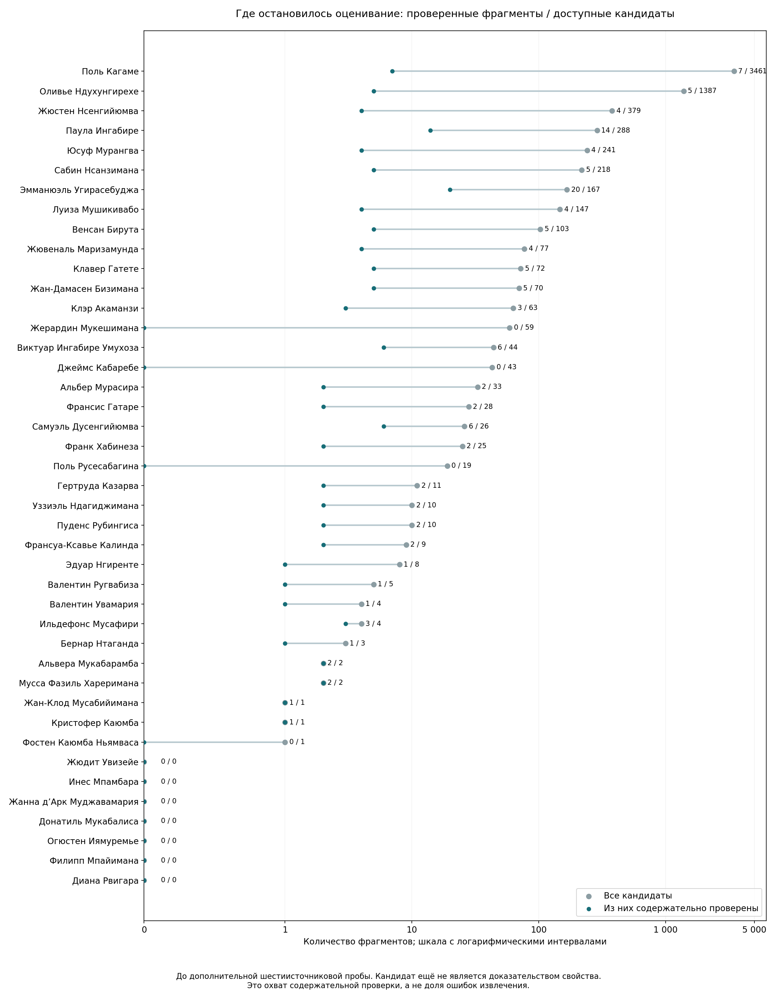
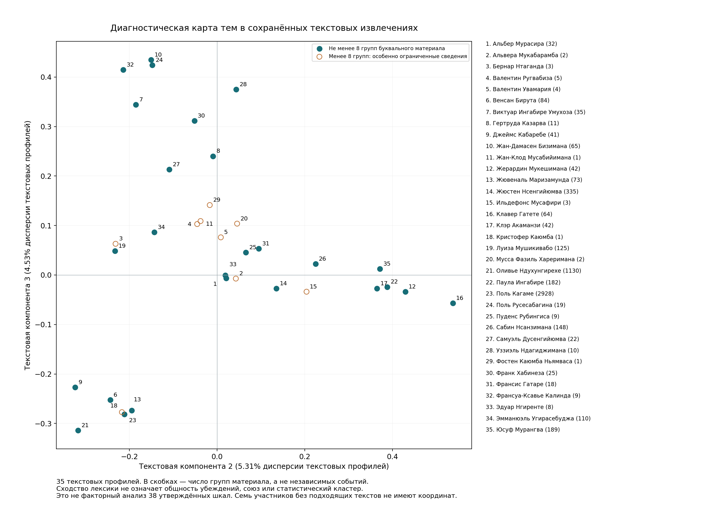

# Почему из 11 тысяч фрагментов получились 39 оценок

Аудит от 18.10.2026. Новых платных API-запросов нет.

**39 — результат небольшой содержательно разобранной выборки, а не предел
пригодности всего корпуса.** Прежняя сборка применила программные проверки ко
всему массиву, но затем агрегировала оценки только 104 рассмотренных случаев.
Обновление по всему корпусу не завершило массовый этап «источник → утверждённый
признак → выраженность». Вывод о недостаточности имеющихся измерений верен;
вывод о недостаточности информации во всём извлечённом массиве был преждевременным.

## Точная цепочка

| Этап | Число | Что именно посчитано |
|---|---:|---|
| Всё ранее извлечённое | 11 285 | Фрагменты: собственные слова/действия, внешний образ и контекст |
| Кандидаты после общих проверок | 7 021 | Материал для содержательного оценивания, ещё не баллы |
| Из них содержательно рассмотрены и остаются пригодными | 124 | Фрагменты из проверенных случаев |
| Пригодные кандидаты, не прошедшие смысловое оценивание | **6 897 (98,23%)** | Неоценённый запас, а не доказанно негодные тексты |
| Предварительные оценки по 104 случаям | 129 | Сочетания «случай × признак» |
| Оценки с подтверждённым временем внутри окна | 53 | Та же единица, после проверки времени и допустимости |
| После объединения одного события | 50 | Сочетания «эпизод × признак» |
| После агрегации по людям | **39** | Ячейки «политик × признак» у 18 участников |

В одном источнике могут быть несколько признаков. Несколько источников могут
описывать один эпизод, а несколько эпизодов — давать одну итоговую ячейку.
Поэтому делить 39 на 11 285 и называть это качеством очистки нельзя.

Сценарий с неопределённым временем даёт 71 ячейку у 28 человек: 123 оценки
случаев, 104 эпизодных значения, затем 71 личная ячейка. Он не является простым
расширением строгих 39: четыре строгие ячейки в нём удерживаются, поскольку
добавляются отличающиеся баллы без подтверждённого разделения событий. Всего
по этой причине удержаны семь ячеек. Это отдельное ограничение реализации
агрегации, а не отсутствие соответствующих высказываний.



## Что мешает использовать весь массив

**Массовое оценивание ещё не было выполнено.** Программа пересчёта читала
проверенный пакет случаев, а не все допустимые извлечения. Платный предыдущий
прогон в основном создал фрагменты и черновые характеристики. Эти результаты
теперь можно повторно использовать, не оплачивая извлечение заново. Их
черновые формулировки, однако, ещё не являются оценками по новым 38 определениям.

**Неравномерность материала.** У Кагаме 3 461 кандидат, у Ндухунгирехе 1 387:
вместе 69,05% массива. У 11 участников лишь 1–9 кандидатов. У семи нет
пригодного собственного высказывания или действия: Жюдит Увизейе, Инес Мпамбара,
Жанна д’Арк Муджавамария, Донатила Мукабалиса, Огюстен Иямуремье,
Филипп Мпайимана и Диана Рвигара. Неизвестность нельзя заменить средним баллом
других руководителей. Досье всех 42 сохраняются.

**Фактический охват времени уже заявленного.** Метаданные сохранённых публикаций
охватывают 01.10.2025–17.10.2026. Изучаемое пятилетие начинается в 2021 году.
Исторические перепечатки частично помогают, но текущая выгрузка не является
равномерным архивом пяти лет. Для бывших руководителей и участников выборов
2024 года это особенно существенное ограничение.

**Время события часто не восстановлено.** У 356 кандидатов есть дата или интервал,
у 6 665 — неизвестное время. Это во многом незавершённое уточнение по полному
контексту, а не доказанное отсутствие даты в источнике. Для пятилетнего окна
необязательно знать день: достаточно обоснованного года или месяца. Относительная
привязка допустима после содержательной проверки исходной датировки документа
и связи именно этого события с выражением «в этом году». Сама дата публикации
без такой связи не датирует речь; поздняя перепечатка требует дополнительной проверки.

**Измеряются разные вещи.** Исходная цель включала публичный образ. Утверждённый
протокол V2 измеряет собственные публичные цели и способы действия. В исходном
извлечении также были 2 371 фрагмент внешнего образа и 1 866 контекстных записей.
Это не обязательно мусор, но обвинение оппонента нельзя незаметно превратить
в убеждение обвиняемого. Образ в медиа можно исследовать отдельным каналом
с указанием, кто приписывает характеристику, а не смешивать с нынешними оценками.

**Публикации дают условную и преимущественно положительную выраженность.** В новостях
часто говорится, что человек поддержал сотрудничество, технологии или услуги.
Остальные признаки не обсуждаются. Unknown не равен нулю, а одинаковые оценки 3
по нескольким заявлениям не создают различающую людей переменную. Даже полное
оценивание не гарантирует плотную и вариативную матрицу по всем 38 признакам.

## Что уже сделано для бесплатного оценивания всего массива

1. Построен полный индекс всех 11 285 записей с сохранением оригиналов. Из
   7 021 кандидата 4 105 имеют хотя бы одно поисковое совпадение по признакам;
   2 916 сохранены в отдельной очереди смыслового просмотра. Они не выброшены.
2. Сформированы все **42 × 38 досье поиска доказательств**: полный список
   кандидатов и короткий список разнообразных опор. Начальная подборка содержит
   **751 уникальный фрагмент**. Совпадения и ранги — только навигация для чтения,
   не семантические решения, баллы или основание нуля.
3. Для российских направлений обе полярности получают один поисковый материал.
   Реальное направление позиции предстоит установить по содержанию; слово
   «Россия» не означает положительную установку.
4. На шести ранее неоценённых источниках Кагаме проведена дополнительная проба
   здесь, без API. Четыре случая дали **шесть эпизодных оценок**, два не дали
   достаточного основания для утверждённых шкал. Это демонстрация недоиспользованного
   материала, а не завершение массового оценивания.

В пробе найдены основания для гендерного равноправия, служебной этики,
технологического решения, международной кооперации, образовательной услуги и
диалога. Для гендерного высказывания подтверждён 2024 год; для открытия
конференции — интервал 2025 года по явному «этогодняя MWC25» и исходной
датировке документа. Точные дни не выдуманы. В отдельном диагностическом
пересчёте строгий вариант получает 41 ячейку, чувствительность — 76.
Основная опубликованная версия 39/71 не перезаписана.

Практически далее нужно читать досье пакетами по людям и недопокрытым признакам,
проверять атрибуцию и период, давать баллы с исходными опорами и разбирать
неразрешённый остаток. Можно использовать текущий чат: дополнительный API
для такого чтения не требуется. Это содержательная работа, которую готовый
индекс организует, но сам не выполняет. Повторять все 11 тысяч извлечений
или просматривать каждую перепечатку целиком не нужно.

## Что удалось посчитать сразу по всему массиву

Отдельно построена **диагностическая текстовая модель LSA**. Она использует
все 7 021 кандидата, объединяет буквальные повторы в 5 778 единиц и формирует
35 текстовых профилей; для остальных семи координаты неизвестны. Имена,
варианты имён, должности и служебные формулы удалены. Материал — сохранённые
англоязычные сводки и черновые метки прежнего извлечения, а не новая независимая
переводческая или фактическая экспертиза оригиналов. Вес профиля человека
нормирован, чтобы количество статей не давало Кагаме автоматически больший вес.

| Число текстовых компонент | Доля центрированной дисперсии текстовых профилей |
|---|---:|
| 2 | 8,69% |
| 3 | 13,22% |
| 4 | 17,34% |

Это **другой знаменатель**, не общая дисперсия 38 оценочных шкал. Эти проценты
нельзя сравнивать с прежними 39,73/52,29/61,37% факторного анализа оценок.
LSA не центрирует исходную матрицу; в файле отдельно сохранены доля
центрированной текстовой дисперсии и доля нецентрированной энергии.
[Описание метода в документации scikit-learn](https://scikit-learn.org/stable/modules/generated/sklearn.decomposition.TruncatedSVD.html).

Видны общий словарь международного сотрудничества и развития, различие
технологической/экономической и внешнеполитической/оборонной повесток,
а также исторической памяти и внутренней политики относительно тем безопасности.
Четвёртая компонента заметно отражает язык ОИФ и франкофонии. Это темы и
служебная специализация; они не доказывают идеологические расколы, общность
убеждений, избирателей или политические союзы.



Трёхмерная текстовая геометрия устойчивее четырёхмерной в сделанных проверках:
после исключения Кагаме и Ндухунгирехе корреляции межличностных расстояний —
0,974 и 0,902; на 26 участниках с минимум восемью группами материала — 0,989
и 0,788. Это ограниченные проверки чувствительности, а не доказанная
устойчивость кластеров или валидность психологического измерения.
Российский фактор с порогом 2% дисперсии утверждённых шкал этим расчётом не проверен.

## Как получить именно факторное решение оценок

Сначала нужно закончить содержательное оценивание доступного материала по
утверждённым определениям, а затем повторить прежний допуск и сравнение решений.
Нельзя подставить средние или регрессионные значения в ещё не рассмотренные
ячейки: там смешаны отсутствие информации, неподходящий жанр и незавершённая работа.
Число упоминаний и поисковый ранг также не становятся интенсивностью.

Если плотная матрица не получится, разумны два отдельных исследования:
заранее определённая группа участников с достаточным материалом либо
расширение бесплатной источниковой базы программами, выступлениями и интервью
за недостающие годы. Внешний публичный образ — ещё один отдельный канал,
требующий явного измерительного определения. Отбирать людей и признаки по тому,
получатся ли желаемые три фактора, нельзя. Все 42 человека могут оставаться
в справочнике; оценённая модель обязана показывать реальный охват.

**Объём не требует повторного платного извлечения. Основное препятствие —
незавершённое смысловое оценивание, затем неравномерность источников и
сопоставимость измерения. Корректное решение для всех 42 из этого архива
заранее гарантировать нельзя.**

## Данные и воспроизведение

- [Полный аудит по 42 участникам](../../../../reports/rwanda_scoring_bottleneck_2026_10_18.json)
- [Сводка готовых досье](../../../../reports/rwanda_evidence_dossiers_2026_10_18.json)
- [Шестиисточниковая проба](../../../../reports/rwanda_native_probe_2026_10_18.json)
- [Сравнение до/после пробы](../../../../reports/rwanda_native_probe_comparison_2026_10_18.json)
- [Текстовая модель и проверки чувствительности](../../../../reports/rwanda_text_structure_2026_10_18.json)

Из корня проекта:

```powershell
python scripts/audit_rwanda_scoring_bottleneck.py
python scripts/prepare_rwanda_evidence_dossiers.py --publish
python scripts/validate_rwanda_native_probe.py
python scripts/analyze_rwanda_text_structure.py --publish
python scripts/plot_rwanda_scoring_audit.py
```

Содержательные решения пробы уже записаны после чтения здесь; команда лишь
валидирует их и пересчитывает отдельное сравнение. Никакая команда не создаёт
решения ассистента автоматически. Полные досье, исходные цитаты и служебные ID
остаются в `.corpus_runtime`, исходная БД и старые оценки не меняются.

У конфигурации корпуса конец 17.10.2026, у утверждённого исследования —
15.10.2026. Разница составляет один кандидат Кагаме от 16 октября:
7 021 против 7 020. Это отмечено отдельно и не является причиной 39 баллов.
