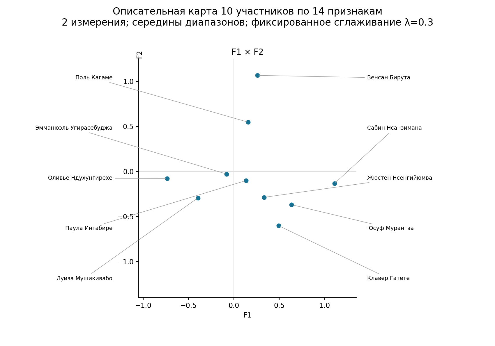
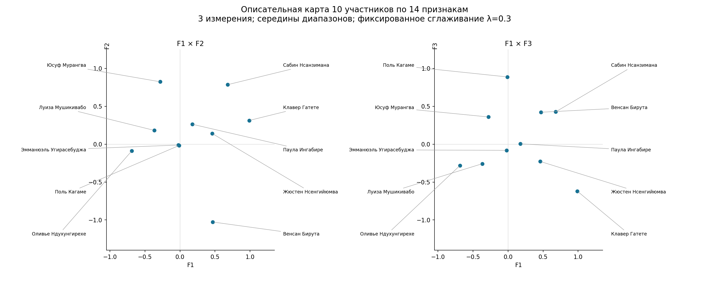
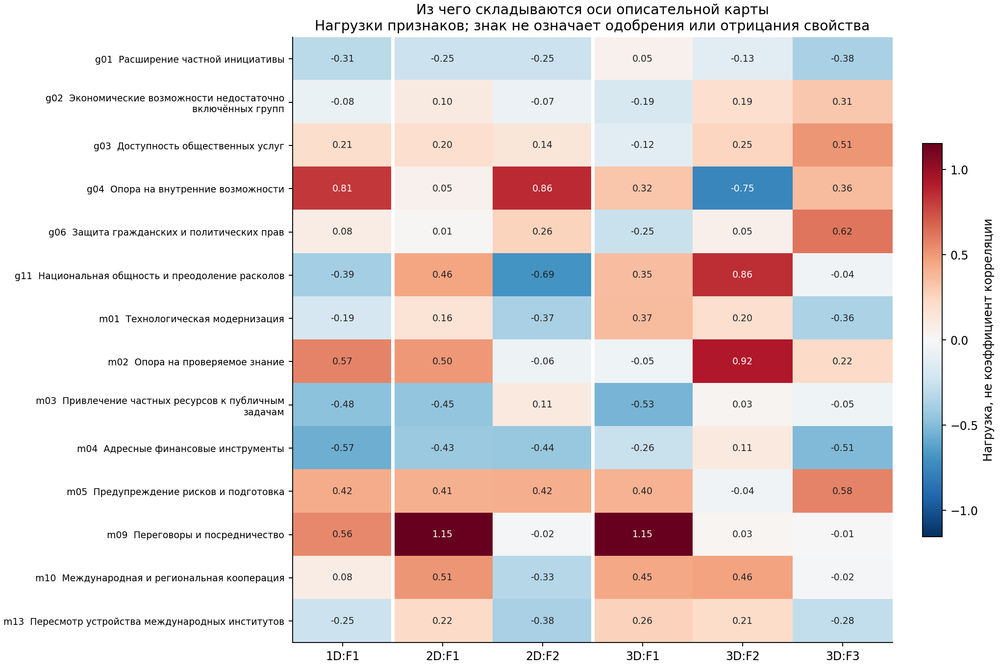

# Руанда: описательный снимок по более полным профилям

18.10.2026. Продолжение [сравнения методов на 31 участнике](../incomplete_latent_2026_10_18/README.md)
с новой постановкой: описать зафиксированные оценки выбранной группы, не требуя
устойчивости решения между альтернативными сценариями или выигрыша в прогнозировании.
Новых платных API-запросов нет, расходы — **$0**.

## Что получилось

**Да, сокращение выборки позволяет получить читаемый описательный срез.**
После отбора осталось **10 участников и 14 общих признаков**, заполненность —
**79,3%**. Двумерная карта выделяет взаимодействие/кооперацию и опору на собственные
возможности; трёхмерная подробнее разделяет знания, общность, права и общественные услуги.

Для общего обзора удобны два измерения; три дают более подробное чтение профилей.
Оба решения сохранены как рабочие описания этой версии материала. Требование
статистической устойчивости не используется как основание запрещать интерпретацию.
Проверка численной сходимости модели при этом сохраняется.

Это **срез публичных акцентов выбранных руководителей, управленцев и международных
представителей**, а не охват всего политического пространства Руанды. Оппозиционные
участники не прошли отбор из-за меньшего количества пригодных измерений в корпусе.
Дата 18.10.2026 — дата фиксации исследовательской версии; исходные высказывания
относятся к разному времени, а часть дат остаётся неизвестной.

## Принцип отбора

Из предыдущего пространства 24 достаточно представленных признаков оставлены
участники с минимум десятью информативными ячейками. Затем оставлены признаки,
по которым есть сведения хотя бы у 60% этой группы. У каждого включённого
человека должно быть заполнено не менее половины итогового профиля.
Это рабочее правило отбора по наличию данных; интенсивность признака и
желательное расположение политика при отборе не учитывались.

В 140 ячейках итоговой матрицы есть **49 точечных оценок, 62 диапазона и 29
пропусков**. Для описательного расчёта диапазоны зафиксированы их серединами.
Поэтому 111 заданных значений — не 111 точных исходных измерений. Пропуски
не заменены средними и не записаны в исходные карточки как новые сведения.

| Участник | Роль в утверждённом списке | Точки | Диапазоны | Пропуски из 14 |
|---|---|---:|---:|---:|
| Поль Кагаме | Президент Руанды; участник президентских выборов 2024 года | 2 | 12 | 0 |
| Жюстен Нсенгийюмва | Назначен премьер-министром в июле 2025 года | 5 | 9 | 0 |
| Венсан Бирута | Министр иностранных дел в апреле 2024 года; назначен министром внутренних дел в августе 2024 года | 8 | 3 | 3 |
| Оливье Ндухунгирехе | Министр иностранных дел и международного сотрудничества в правительстве августа 2024 года | 6 | 7 | 1 |
| Эмманюэль Угирасебуджа | Министр юстиции и генеральный прокурор в 2022 и 2024 годах | 6 | 1 | 7 |
| Юсуф Мурангва | Министр финансов и экономического планирования, вступивший в должность в июне 2024 года | 1 | 8 | 5 |
| Паула Ингабире | Министр информационно-коммуникационных технологий и инноваций в правительстве 2024 года | 7 | 5 | 2 |
| Сабин Нсанзимана | Министр здравоохранения в 2023 году | 3 | 6 | 5 |
| Луиза Мушикивабо | Бывший министр иностранных дел Руанды; генеральный секретарь Франкофонии, переизбрана в 2022 году | 8 | 5 | 1 |
| Клавер Гатете | Постоянный представитель Руанды при ООН в 2023 году; назначен исполнительным секретарём ЭКА ООН в 2023 году | 3 | 6 | 5 |

Проверены и другие пороги количества исходных измерений:

| Минимум информативных признаков до отбора | Участников | Общих признаков | Заполненность | Минимум заполненных в общем профиле |
|---:|---:|---:|---:|---:|
| 4 | 19 | 5 | 76.8% | 1 |
| 6 | 15 | 10 | 74.7% | 3 |
| 8 | 14 | 10 | 77.1% | 3 |
| 10 | 10 | 14 | 79.3% | 7 |
| 12 | 6 | 15 | 90.0% | 11 |

Порог 10 даёт достаточно широкую общую систему признаков и не сокращает состав
до шести человек. Участник с десятью признаками в исходном пространстве после
выбора общих шкал может иметь меньше десяти; в итоговой матрице минимум — семь из 14.
Правило не является универсальным статистическим нормативом «достаточной выборки».

## Одно измерение: укрупнённое различие

В одномерной факторизации опора на внутренние возможности, проверяемое знание
и переговоры оказываются на одной стороне, адресные финансовые инструменты
и частные ресурсы — на другой. В одной оси смешиваются несколько различных
тем. Два измерения позволяют разделить самостоятельность и взаимодействие;
три подробнее выделяют социальные и правовые акценты.

## Два измерения: общая карта

**F1 — взаимодействие, кооперация и экспертное согласование.** Основные положительные
нагрузки: переговоры/посредничество, международная кооперация, проверяемое знание
и национальная общность. На другой стороне сильнее выражена комбинация частных
ресурсов и адресных финансовых инструментов. Это различие профилей инструментов,
а не утверждение о несовместимости переговоров и экономического развития.

В этой фиксированной проекции Нсанзимана, Мурангва и Гатете имеют более
положительные координаты, Ндухунгирехе и Мушикивабо — более отрицательные.
Координата относится к совокупности признаков: у Нсанзиманы, Мурангвы и Гатете
переговоры m09 непосредственно не измерены. Их положение не доказывает личной
переговорной готовности. Например, у Нсанзиманы есть диапазоны по проверяемому
знанию и международной кооперации, а у Гатете — по технологиям и кооперации.

**F2 — опора на собственные возможности в сравнении с интеграционными и
технологическими инструментами.** С одной стороны — развитие внутренних
возможностей и предупреждение рисков; с другой — общность, адресные финансовые
инструменты, технологическая модернизация и пересмотр международных институтов.
Особенно заметен Бирута: в его профиле опора на внутренние возможности имеет
точечный балл 5. Кагаме также расположен на положительной стороне этой оси,
Гатете и Мурангва — на более отрицательной.

Политологический смысл такого рисунка — разные публичные способы обосновывать
развитие и управленческие решения: через собственные ресурсы, через согласование
с другими участниками, через технологические и финансовые инструменты. Для этой
подвыборки это содержательнее деления на власть и оппозицию: оппозиционная часть
в данную карту не вошла. Рабочие оси не являются оценками лояльности власти.

У байесовского FA на той же подвыборке видны сходные темы, хотя номера осей
меняются местами. После сопоставления знаков и порядка осей минимальное сходство
нагрузок — **0,849**, сходство расстояний между участниками — **0,848**. Это
дополнительное описание согласованности двух методов на одних данных, а не
доказательство временной стабильности или истинного числа факторов.

## Три измерения: более подробный снимок

| Ось | Что объединяет | Как читать |
|---|---|---|
| F1 | Переговоры, кооперация, предупреждение рисков, технологии; отрицательная нагрузка привлечения частных ресурсов | Согласование и кооперативные инструменты публичного действия |
| F2 | Проверяемое знание, национальная общность и международная кооперация; отрицательная нагрузка внутренних возможностей | Экспертное согласование и общность в сравнении с акцентом на самостоятельности |
| F3 | Гражданские права, предупреждение рисков, общественные услуги; отрицательные нагрузки финансовых инструментов и частной инициативы | Социальные и правовые акценты в сравнении с экономическими инструментами |

Третье измерение позволяет отдельно рассмотреть социальную и правовую часть
публичного профиля, которая при двух измерениях смешивалась с другими различиями.
Кагаме получает высокую положительную координату F3, Гатете — отрицательную.
Это отражает сочетания заявленных целей и способов из материала, а не независимую
оценку соблюдения прав человека, качества управления или фактических результатов.

Бирута сильнее выделяется на стороне внутренних возможностей, Мурангва и
Нсанзимана — на стороне проверяемого знания и общности; для Мурангвы сама
общность g11 не измерена, поэтому его положение читается через общий профиль,
а не как новое доказательство этой индивидуальной позиции. Угирасебуджа близок
к центру и имеет семь из 14 информативных признаков. Близость к центру не
устанавливает политическую умеренность.

Ндухунгирехе в зафиксированной версии получил середину 2 по переговорам из
диапазона 0–4. В источниках поддержка переговоров и отказ от отдельных форматов
относятся к разным контекстам. Его координату нельзя переводить в общий вывод
«против дипломатии». Здесь особенно важно сохранять исходный диапазон рядом с картой.

Строки — признаки; столбцы — оси решений с одним, двумя и тремя измерениями.
Нагрузка показывает вклад признака в условную ось. Знак обозначает сторону
оси, а не одобрение/неодобрение свойства. Например, отрицательная нагрузка
частной инициативы не означает её отрицательную оценку политиком.

## Насколько полно карта описывает заданные оценки

| Измерений | Регуляризованная факторизация: R² | Байесовский FA: R² |
|---:|---:|---:|
| 1 | 29.4% | 25.5% |
| 2 | 56.8% | 40.0% |
| 3 | 76.4% | 49.5% |

Здесь R² — сокращение квадратичной ошибки восстановления **тех же заданных ячеек**
относительно их средних по признакам. Это качество описания выбранного сценария,
а не процент дисперсии всех 38 шкал, не качество прогноза и не доказательство,
что три измерения «истинны». Три измерения воспроизводят больше различий; два
дают более простую карту с узнаваемыми общими темами в обоих методах.

Для карты использована регуляризованная факторизация с фиксированным умеренно
слабым штрафом λ=0,3. Этот штраф выбран для описательной постановки и не
объявляется оптимальным. Байесовские решения приведены параллельно. Результаты
для λ=0,1 и λ=1 сохранены в JSON; предыдущий выбор сильного штрафа для задачи
предсказания остаётся отдельным корректным результатом той другой постановки.

## Как понимать требование «снимок, а не устойчивое решение»

Для выбранной цели не требуется, чтобы политическое пространство навсегда
оставалось таким же или чтобы карта обязательно выигрывала прогнозную проверку.
Можно зафиксировать источники, правила оценивания, середины диапазонов, метод
и состав участников — и интерпретировать полученный описательный рисунок.

При этом изменение карты от другого допустимого значения диапазона означает
не установленную политическую перемену во времени, а неопределённость самой
реконструкции. Она остаётся в техническом описании, но не закрывает возможность
читать текущую карту. Поэтому результат называется **описательным снимком
выбранной подвыборки при зафиксированных допущениях**.

Конституционная процедура, электоральные процедуры и отношения с Россией были важны
для широкого исследования, но часть этих направлений не прошла отбор по общему
покрытию. В частности, g09 и российские шкалы в итоговые 14 признаков не вошли.
Смысл новой карты поэтому меняется вместе с её предметом: она больше описывает
управленческие и международные акценты хорошо представленной части выборки.

## Данные и воспроизведение

* [Технические условия расчёта](TECHNICAL.md).
* [Полная матрица с исходными точками и диапазонами](MATRIX.md).
* [Сохранённые решения обоих методов](snapshot.json), [координаты](coordinates.csv), [нагрузки](loadings.csv).
* [Проверка состава, исходных данных и численного расчёта](validation_receipt.json).

Команда из корня репозитория: `python -B scripts/rwanda_descriptive_subset.py`.
Корпус, ключи и платные API не требуются. Исходные оценки 42 человек остаются
неизменными; новый результат сохранён отдельно.
