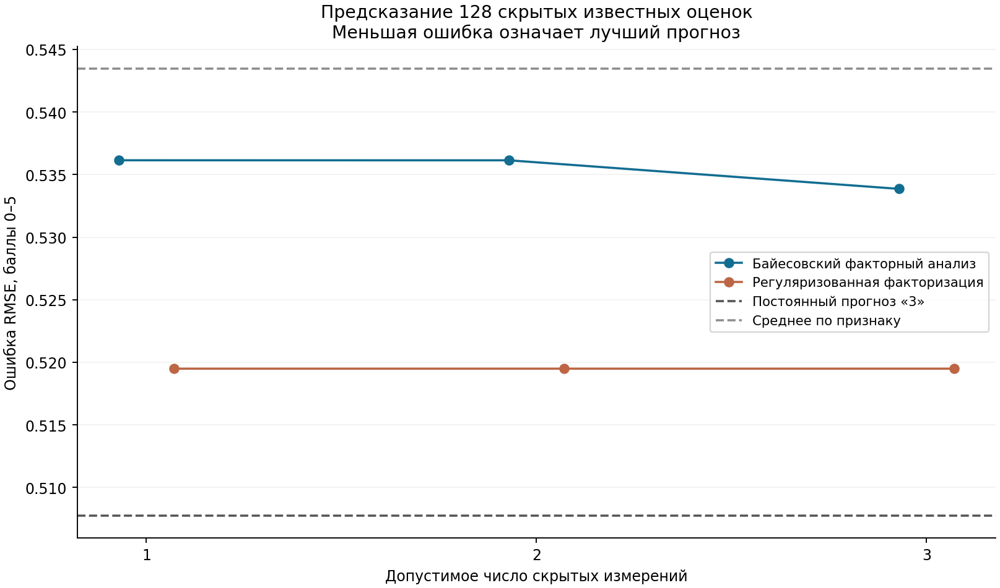
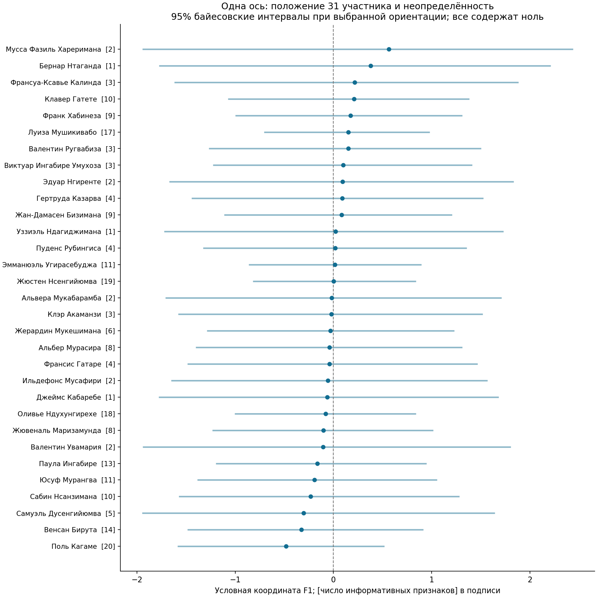
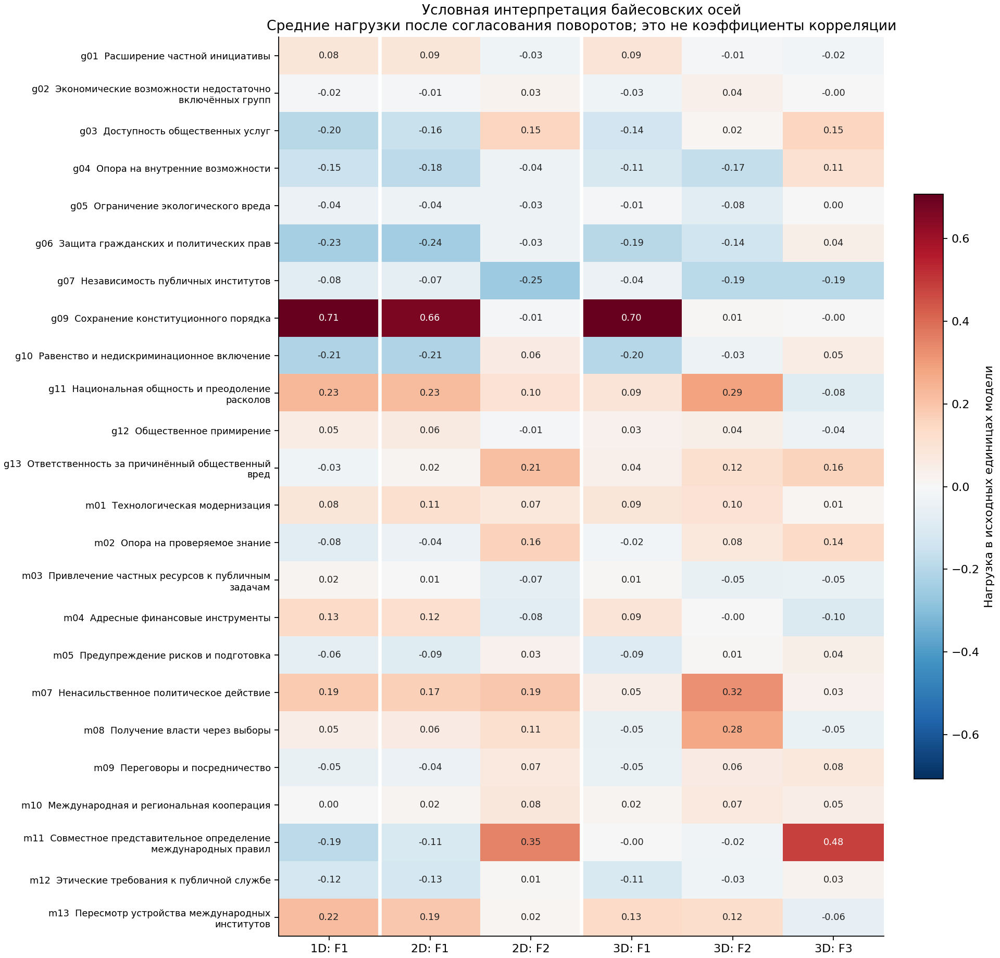
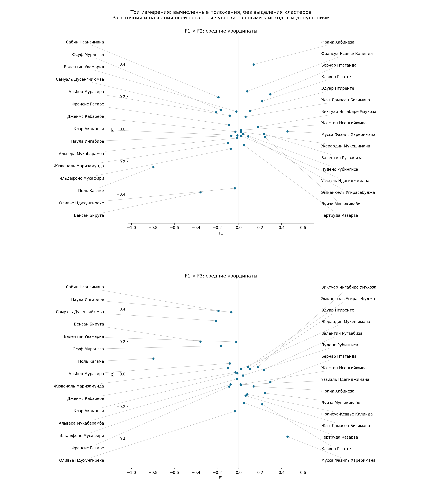
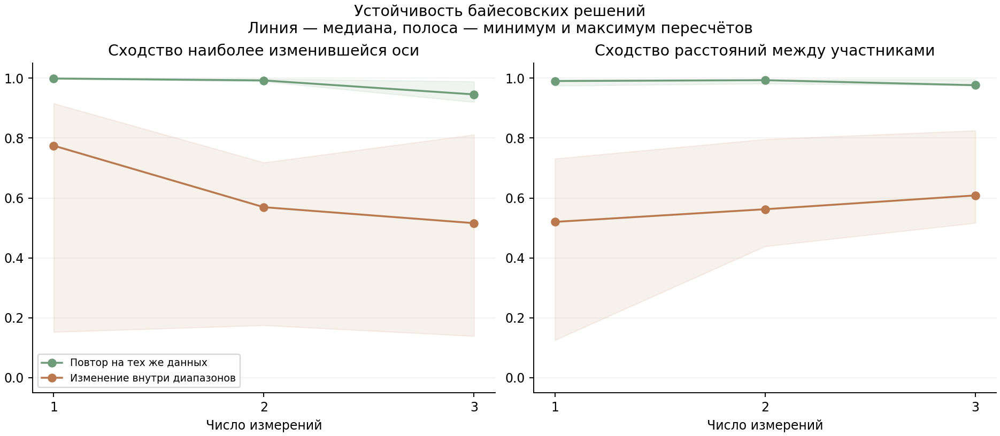

# Руанда: сравнение методов для неполной матрицы оценок

18 октября 2026 года. Байесовский факторный анализ и регуляризованная
факторизация, по 1, 2 и 3 измерения. Расчёты локальные; новых API-запросов и
расходов API — **0 / $0**.

## Основные выводы

**Обойтись без предварительного заполнения пропусков средними удалось.
Устойчивую политологическую типологию имеющиеся данные пока не подтверждают.**
Это разные результаты: вычислимая карта ещё не означает, что её оси надёжно
описывают различия политиков.

* В сравнении участвует **31 человек и 24 признака**. У 11 из утверждённых
  42 участников нет пригодных оценок; индивидуальные координаты для них не заданы.
* Регуляризованная факторизация после подбора штрафа на всех данных практически
  убирает общие измерения: эффективный ранг равен нулю при любом допустимом q.
  Поддерживается уровень каждого признака, но не надёжные индивидуальные отклонения.
* Байесовский анализ даёт условные рисунки: **конституционная процедура**,
  **международные правила**, при трёх измерениях также **участие и ненасилие**.
  Их следует читать как гипотезы для проверки, а не установленные политические лагеря.
* Самая заметная ось существенно зависит от оценок Кагаме. Дополнительные оси
  чувствительны к значениям внутри диапазонов и к условной ориентации модели.
* Отдельный российский фактор с долей ≥2% **по-прежнему не проверен**:
  соответствующие признаки измерены слишком редко. Это не оценка его доли ниже 2%.

## На каких данных проведено сравнение

Использован [завершённый просмотр всего доступного массива](../native_mass_2026_10_18/README.md),
а не первоначальные оценки из общего знания модели. Сохранён утверждённый
словарь 38 самостоятельных признаков: политические цели, способы действия,
направления отношения к России. Должности и краткие справки о всех 42 участниках,
включение шкал и число оценок — в [приложении](PARTICIPANTS_AND_SCALES.md).

В общую расчётную модель вошли признаки со сведениями хотя бы о трёх людях,
затем все участники, имеющие хотя бы одно значение по этим признакам. Состав
выбирался по наличию данных, до интерпретации решений. Это минимальная возможность
расчёта, а не признание каждой карточки достаточно измеренной.

В матрице 31 × 24 есть **131 точечная оценка и 94 диапазона**. Для основного
сценария взяты середины диапазонов; отдельно проверены другие допустимые значения.
Из 744 ячеек информативны 225, остальные остаются неизвестными. Источники
с неизвестной датой допущены только в этом расширенном сценарии; строго
датированные сведения рассмотрены отдельно.

Признаки охватывают частную инициативу, включение недостаточно представленных
групп, общественные услуги, внутренние возможности, экологию, права,
институты, конституционные процедуры, равноправие, общность и примирение;
среди способов действия — технологии, знания, частные ресурсы, финансовые
инструменты, предупреждение рисков, ненасилие, выборы, переговоры,
международную кооперацию, международные правила и этику публичной службы.
Полный словарь с разграничениями — в [утверждённых правилах](../SCALES_FOR_APPROVAL.md).

Обе модели ищут несколько общих измерений непосредственно по доступным ячейкам.
Расчёт не превращает неизвестное в нулевую выраженность свойства. Повторы новостей
не усиливают балл. Модельные прогнозы не записаны в утверждённую матрицу как новые факты.

## Помогают ли скрытые измерения предсказывать оценки

Скрывались только точечные баллы. **128 допустимых оценок проверены по одному
разу**; в обучении оставались другие сведения об этом участнике и признаке.
Три точки не скрывались, потому что соответствующий человек иначе остался бы
совсем без данных. Для регуляризованной модели сила сглаживания подбиралась
внутри обучающей части. Меньшие RMSE и MAE означают меньшую ошибку в баллах 0–5.

| Метод | Измерений | RMSE | MAE |
|---|---:|---:|---:|
| Постоянный прогноз «3» | — | 0.508 | 0.195 |
| Среднее по признаку | — | 0.543 | 0.365 |
| Байесовский FA | 1 | 0.536 | 0.360 |
| Байесовский FA | 2 | 0.536 | 0.359 |
| Байесовский FA | 3 | 0.534 | 0.356 |
| Регуляризованная факторизация | 1 | 0.519 | 0.340 |
| Регуляризованная факторизация | 2 | 0.519 | 0.340 |
| Регуляризованная факторизация | 3 | 0.519 | 0.340 |

Постоянный прогноз «3» включён потому, что **108 из 131 точечного балла равны 3**.
Это содержательная поддержка цели или конкретного действия по правилам оценивания.
Такой контроль позволяет увидеть, находят ли сложные методы дополнительную
информацию, помимо преобладающего типа ответа. Его хорошая точность не доказывает,
что все политики одинаковы. Сравнение относится к доступным известным ячейкам;
качество прогноза отсутствующих позиций таким способом непосредственно не проверено.

Оба метода немного улучшают прогноз среднего по признаку, но уступают постоянному прогнозу «3» по обеим ошибкам. Между байесовскими решениями с одним, двумя и тремя измерениями различие RMSE составляет лишь около 0.002 балла. Регуляризованные решения дают практически одинаковые предсказания. Эти результаты не дают основания выбрать два или три измерения как подтверждённую общую структуру.

## Что означает решение с одним измерением

У байесовской модели главная нагрузка относится к **сохранению конституционного
порядка — g09**. Условное название оси: «приверженность конституционной процедуре».
Но этот признак измерен только у пяти человек. Основное различие создаёт
одна крайняя оценка Кагаме, а остальные сведения по нему преимущественно около 3.
Преобладание одного показателя ещё не устанавливает общий скрытый принцип,
объединяющий несколько независимо подтверждённых характеристик.

Оценка Кагаме 0 по g09 относится к конкретному условному оправданию некоторых
смен власти вне конституционной преемственности, разобранному в
[журнале предшествующего этапа](../native_mass_2026_10_18/README.md).
Она не является сводной оценкой всех его взглядов или практики правления.
В условной проекции он оказывается на отрицательной стороне F1; Хареримана,
Нтаганда и Калинда — на более положительной. Это расположение не устанавливает
их общий политический интерес или принадлежность к одной коалиции.

На другом конце оси встречаются гражданские права, равноправие, услуги и
внутренние возможности. **Нельзя заключать, что конституционный порядок
содержательно противоположен этим ценностям.** При редких пересечениях сведений
модель может так размещать отдельные публичные акценты и исключения в оценках.

Точка — средняя координата при выбранной ориентации; отрезок — 95% байесовский
интервал при фиксированных исходных предположениях. В подписи указано число
информативных признаков из 24. Все интервалы содержат ноль. Участник с одной
известной характеристикой может иметь вычисленную среднюю координату, но данных
для уверенного индивидуального размещения у него мало. Ноль здесь — ориентир
модели, а не политическая умеренность.

## Что добавляют два измерения

Первая ось сохраняет описанный процедурный рисунок. Вторая получает наибольшую
нагрузку от **совместного представительного определения международных правил — m11**.
Её можно предварительно назвать «международные правила и институциональная повестка».

Появляется возможность различать акцент на способах международного управления,
ответственности и публичного решения задач, а не только на внутренней процедуре
политической власти. Однако m11 измерен лишь у четырёх участников. Отрицательная
связь этой оси с независимостью институтов не подтверждает противоречие между
международным представительством и внутренней независимостью учреждений.

Дополнительное измерение математически существует в модели, но его смысл
недостаточно закреплён совместно наблюдаемыми признаками. При изменении допустимых
оценок состав сильных индикаторов и ориентация второй оси заметно меняются.

## Что добавляют три измерения

В выбранной условной ориентации получаются следующие темы:

| Ось | Наиболее заметные признаки | Осторожная интерпретация |
|---|---|---|
| F1 | Конституционный порядок; слабее — противоположные нагрузки равноправия и гражданских прав | Процедура политического действия; сильная зависимость от одного контрастного эпизода |
| F2 | Ненасильственное действие, национальная общность, получение власти через выборы | Участие и ненасилие как заявленные способы политического действия |
| F3 | Представительное определение международных правил; слабее — ответственность, услуги, знания | Международное представительство и способы решения публичных задач |

То, что при двух измерениях находилось на второй оси, при трёх разделяется
между внутренним участием и международными правилами. **Новый смысл — возможное
различие между политической процедурой внутри страны и устройством международных
отношений.** Но показатели выборов и ненасилия доступны всего у трёх человек каждый.
Поэтому выделение двух самостоятельных тенденций остаётся проверяемой гипотезой.

На F2 в этой проекции относительно положительнее расположен Франк Хабинеза,
отрицательнее — Бирута и Ндухунгирехе. На F3 относительно положительнее
Нсанзимана, Паула Ингабире и Дусенгийюмва, отрицательнее — Хареримана, Ндухунгирехе
и Гатете. Это описание средних координат расчёта; оно не заменяет источников
о личных позициях и не позволяет переносить характеристику одного человека на других.

Каждая строка — один признак. Столбцы показывают нагрузки при одном, двух и
трёх измерениях. Большая абсолютная величина означает большую роль признака
в условной оси; знак показывает её сторону. Это позволяет понять, из чего
составлено название оси. Нагрузки не являются коэффициентами корреляции;
их цвет не показывает доказанность политологического вывода.

Вверху показаны F1 и F2, внизу — F1 и F3. Это две проекции одного решения.
Близость точек описывает сходство **средних модельных координат**, а не
доказанное совпадение убеждений. Интервалы не нанесены, чтобы можно было прочитать
все 31 имя; масштаб неопределённости иллюстрирует предыдущая диаграмма.
Линии соединяют подпись с точкой; их длина и положение подписи ничего не измеряют.

## Что получилось у регуляризованной факторизации

Подбор штрафа на всех данных выбирает λ=10 при q=1, 2 и 3. Общая часть матрицы
практически обнуляется. Фактически остаются уровни отдельных признаков и
необъяснённые индивидуальные различия. **Эффективный ранг 0 не означает,
что всё политическое пространство Руанды состоит из одной группы:** он означает,
что при этом способе обучения и проверки данных недостаточно для надёжного
добавления индивидуальной общей структуры.
Небольшое преимущество перед обычным средним здесь объясняется сглаживанием
базовых уровней признаков; его нельзя приписать найденным ненулевым факторам.

При принудительно слабом сглаживании λ=0.1 получаются более выразительные
рисунки: процедурное участие, управленческая модернизация и кооперация,
этические требования и переговоры. Их параметры сохранены в таблицах как
`weak_ridge`, отдельно от основной модели. Ослабление штрафа создаёт карту,
но не обеспечивает её предсказательную пригодность и устойчивость. Назначать
этим дополнительным рисункам статус политических лагерей оснований нет.

## Насколько устойчивы выводы

| Измерений | Сходство осей: те же данные | Сходство расстояний: те же данные | Сходство осей: диапазоны | Сходство расстояний: диапазоны |
|---:|---:|---:|---:|---:|
| 1 | 0.999 | 0.990 | 0.775 | 0.520 |
| 2 | 0.992 | 0.993 | 0.569 | 0.562 |
| 3 | 0.946 | 0.976 | 0.516 | 0.609 |

В таблице — медианы: четыре повторных запуска на тех же данных и 20 возмущений внутри диапазонов. Для осей показано сходство наиболее изменившейся оси. Регуляризованная модель схлопнулась, поэтому сходство её нулевых осей и расстояний не вычисляется.

Сходство осей оценивает сохранение смысла каждого измерения после возможной
смены знака и порядка осей. Сходство расстояний оценивает сохранение взаимного
расположения средних координат независимо от общего поворота. Высокое второе
показание возможно при изменении смысла отдельных осей. Поэтому обе проверки
нужны одновременно.

* **Изменение исходных диапазонов влияет сильнее, чем повтор расчёта на тех же данных.** Одномерная тема воспроизводится лучше дополнительных осей, однако даже её взаимное расположение участников заметно меняется.
* **Выбор разумного масштаба prior не является главным источником расхождений в этом эксперименте:** при 0.4 и 1.2 сходство наиболее изменившейся оси с основным вариантом составляет примерно 0.90–0.99. Это проверка только двух указанных альтернатив, а не всех возможных допущений.
* **Кагаме существенно влияет на смысл осей.** После его исключения сходство одномерной оси — 0.403; в трёхмерном варианте сходство наиболее изменившейся оси падает до 0.043. При этом сходство расстояний между оставшимися участниками в трёхмерном решении — 0.853: поведение отдельных осей и общей геометрии различается.
* **Исключение Ндухунгирехе меньше меняет первую тему:** сходство одномерной оси — 0.979, расстояний — 0.970. Большое число публикаций само по себе не означает определяющего влияния на этот расчёт: модель использует сводные ячейки, а не количество сообщений.
* **Только точечные оценки:** остаются 31 участник, 21 признак и 125 ячеек. Сходство расстояний с основным сценарием — 0.148 / 0.354 / 0.466 при 1 / 2 / 3 измерениях. Следовательно, середины диапазонов заметно участвуют в построении рисунка.
* **Строго датированные данные:** остаются 21 участник, 12 признаков и 59 ячеек. Сходство расстояний с основным вариантом около нуля. Здесь меняется и состав данных; это не изолированная проверка влияния даты на одной и той же выборке.

Для всех трёх основных байесовских моделей численные цепи согласуются между
собой: максимальный R-hat ниже 1.01. Тем не менее **ни у одной из 276 пар
признаков 95% интервал общей ковариации не исключает ноль** в каждом из этих
решений. Это не доказывает отсутствия политических связей: имеющихся наблюдений
недостаточно, чтобы уверенно установить направленность таких связей в этой модели.

## Как использовать результат исследования

Для дальнейшей проверки содержательно полезно различать конституционные
процедуры, участие и ненасилие, международное представительство, управленческую
модернизацию. Сейчас это **темы для целевого сбора сопоставимых свидетельств**,
а не выбранное окончательное факторное решение. Ни одному q не присвоен статус
подтверждённой карты 42 участников; новые кластеры по этим координатам не назначены.

Основное ограничение — редкое пересечение измерений и недостаток контрастных
оценок по одним и тем же признакам. Большой корпус дал много свидетельств
содержательной поддержки целей, но сравнительно мало данных, различающих степень
их приоритетности у разных людей. Обычная замена алгоритма этого недостатка не устраняет.

Для новых источников полезнее искать недостающие сопоставимые позиции конкретных
людей, включая оппозиционных участников и направления отношений с Россией,
и уточнять независимость эпизодов внутри 94 диапазонов. Подтверждённые
индивидуальные оценки уже пригодны для содержательных карточек; пустые места
остаются обозначенными пробелами исследования.

## Файлы и воспроизведение

* [Технический протокол с формулами, допущениями и проверками](TECHNICAL.md).
* [42 участника, их роли и все включённые/исключённые признаки](PARTICIPANTS_AND_SCALES.md).
* [Ошибки предсказания](validation_summary.csv), [нагрузки](loadings.csv),
  [условные координаты и интервалы](actor_coordinates.csv).
* [Полный машиночитаемый результат](benchmark.json) и [проверки исполнения](validation_receipt.json).

Из корня репозитория: `python -B scripts/compare_rwanda_incomplete_latent.py`,
затем `python -B scripts/build_rwanda_incomplete_report.py`.
Полные параметры, seed каждого этапа и ограничения приведены в техническом
протоколе и коде; платные API для воспроизведения не нужны.
