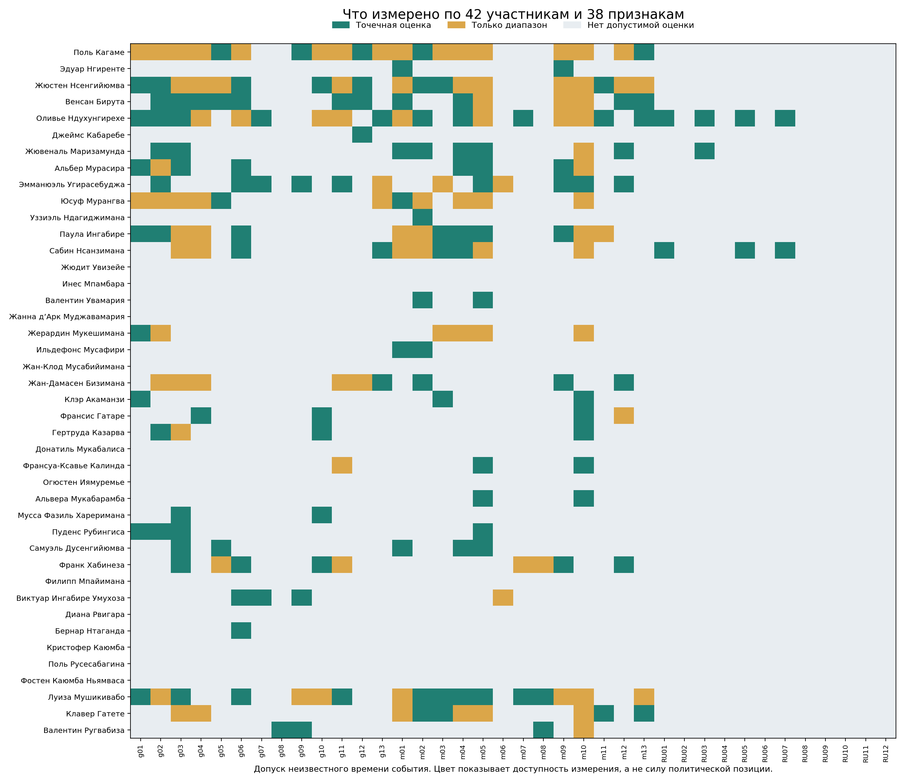
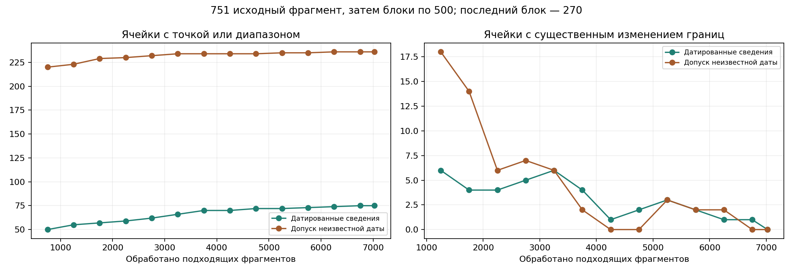
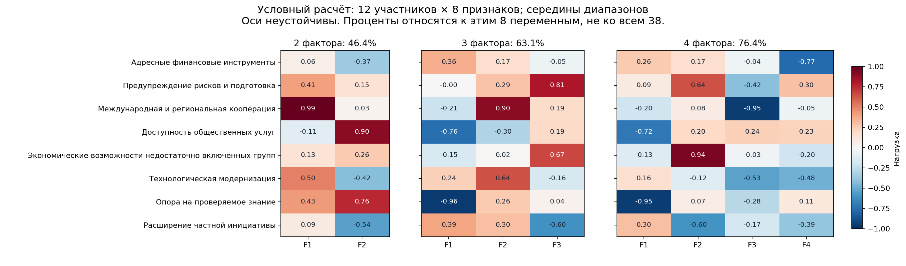

# Руанда: оценивание по всему доступному массиву

## Основные результаты

Обработаны все **7 021 подходящий фрагмент** из ранее извлечённых 11 285. Начали с 751 согласованного для смысловой проверки фрагмента, затем проверяли изменения через каждые 500 случаев. Двух последовательных стабильных полных блоков не получилось: поздние сведения продолжали уточнять оценки. Поэтому завершение произошло по **исчерпанию очереди**, а не по объявленной досрочной стабильности. Последние 270 случаев проверены отдельно; неполный блок не засчитан как стабильные 500.

Сохранены **все 42 карточки × 38 признаков = 1 596 ячеек**. Завершён просмотр доступных оснований для оценивания; это не означает, что для каждой ячейки существуют данные. По содержательно подтверждённым сведениям с допуском неизвестной даты есть **140 точечных оценок и 96 диапазонов**: всего 236 информативных ячеек из 1 596 (14.8%). Остальные 1360 остаются неизвестными. Если требовать подтверждённого времени события внутри 15.10.2021–15.10.2026, остаются **66 точек и 9 диапазонов**.

**Новое устойчивое факторное решение для всех 42 участников не получено.** Для отдельного расчётного эксперимента по доступности сведений выделены 12 участников и 8 признаков. Решения с 2, 3 и 4 факторами вычислены, но сильно зависят от допустимых изменений оценок. Этот эксперимент нельзя выдавать за карту всего политического пространства или использовать для подтверждения прежних кластеров.

Отношение к России содержательно измерено по отдельным направлениям у **трёх участников**, а не у всех 42. Условие отдельного фактора с ≥2% общей дисперсии **не проверяется на этой матрице**: достаточного сопоставимого покрытия российских признаков нет. Это не результат «влияние меньше 2%».

Новых платных API-запросов: **0**, новых расходов API: **$0**.

## Что именно оценивалось

42 участника и 38 самостоятельных однополюсных признаков взяты из утверждённого списка и словаря. Слова о международном мандате Мушикивабо, Гатете, Мукешиманы и Ругвабизы относятся к их соответствующей роли; они не автоматически становятся политикой правительства Руанды. Должности в карточках — справки из согласованного списка, а не новая проверка их актуальности на сегодняшний день.

Цель — описать заявленные цели и способы действия в изученных публичных материалах. Это пока **карта доступных свидетельств**, а не проверенное измерение устойчивых убеждений людей или политического сознания населения. Один и тот же политик может поддерживать переговоры в одном формате и отклонять другое конкретное предложение; это сохраняется как различие эпизодов.

Признаки разбиты на 13 политических целей, 13 способов действия и 12 направлений отношения к России. [Полные определения и правила 0–5](../SCALES_FOR_APPROVAL.md) остаются прежними. Поисковые слова только помогали находить материал; числа ставились после смыслового чтения цитаты и контекста авторства. Простое отсутствие признака не давало нуля.

0 означает явно выраженный отказ в обсуждаемом эпизоде; 3 — конкретную содержательную поддержку или меру; 5 — определяющий приоритет либо существенное обязательство. Частота повторения новости хранится отдельно и не повышает силу позиции.

## Что удалось добавить к содержательной картине

* **Кагаме:** наряду с технологиями, международной кооперацией и самостоятельностью развития встречаются конкретные предложения разделять государством кредитный риск для молодых предпринимателей без залога (B05229), требование контроля государственных программ с уголовной ответственностью (B04962), защита права журналиста проверять утверждения министров (B05949). Это различные заявленные установки; они не доказывают соответствующее качество практики управления.
* **Конституционный порядок:** полный текст материала The Star о пресс-конференции 27 ноября 2025 года содержит условное оправдание некоторых военных переворотов. B06061 получил 0 по g09 именно в сценарии допустимости смены власти вне конституционной преемственности. Это не оценка всех политических прав Кагаме и не утверждение, что он сам совершил описанные перевороты. [Источник из выгрузки](https://www.the-star.co.ke/news/africa/2025-11-30-some-military-coups-are-justified-says-kagame).
* **Ндухунгирехе:** дипломатические договорённости и посредничество сочетаются с отклонением отдельных публичных форматов диалога. Нельзя превращать отказ от одного предложения в общий вывод «против переговоров». Материалы о защите конголезских тутси отражают его заявленные аргументы, а не независимую проверку действий сторон конфликта.
* **Остальные участники:** дополнены основания по социальной доступности, технологиям, профилактике рисков, международным программам, правовым обращениям и экологической повестке. Однако повторные публикации о главе государства не создают сведения о мало представленных участниках. Все их известные и неизвестные признаки перечислены в [42 карточках](ACTOR_CARDS.md).

## Где остаются пробелы

У 31 участника есть хотя бы одна допустимая точка или диапазон. У следующих 11 нет пригодной шкальной оценки в обработанном массиве: Жюдит Увизейе, Инес Мпамбара, Жанна д’Арк Муджавамария, Жан-Клод Мусабийимана, Донатиль Мукабалиса, Огюстен Иямуремье, Филипп Мпайимана, Диана Рвигара, Кристофер Каюмба, Поль Русесабагина, Фостен Каюмба Ньямваса. Это результат недостаточности подходящих собственных высказываний/действий по словарю, а не отсутствие у них политических позиций. В частности, Диана Рвигара не помещена в центр пространства через усреднение пропусков и не отнесена заново к кластеру Кагаме.

На диаграмме цвет показывает **наличие измерения**, не его величину. Зелёный — определённая точечная оценка, жёлтый — пока только диапазон, серый — нет допустимого основания. Столбцы g01–g13 и m01–m13 — общие признаки; RU01–RU12 соответствуют последним 12 определениям словаря в том же порядке.

| Участник | Точки | Только диапазоны | Неизвестно |
|---|---:|---:|---:|
| Поль Кагаме | 5 | 15 | 18 |
| Эдуар Нгиренте | 2 | 0 | 36 |
| Жюстен Нсенгийюмва | 8 | 11 | 19 |
| Венсан Бирута | 11 | 3 | 24 |
| Оливье Ндухунгирехе | 14 | 8 | 16 |
| Джеймс Кабаребе | 1 | 0 | 37 |
| Жювеналь Маризамунда | 8 | 1 | 29 |
| Альбер Мурасира | 6 | 2 | 30 |
| Эмманюэль Угирасебуджа | 9 | 3 | 26 |
| Юсуф Мурангва | 2 | 9 | 27 |
| Уззиэль Ндагиджимана | 1 | 0 | 37 |
| Паула Ингабире | 7 | 6 | 25 |
| Сабин Нсанзимана | 7 | 6 | 25 |
| Жюдит Увизейе | 0 | 0 | 38 |
| Инес Мпамбара | 0 | 0 | 38 |
| Валентин Увамария | 2 | 0 | 36 |
| Жанна д’Арк Муджавамария | 0 | 0 | 38 |
| Жерардин Мукешимана | 1 | 5 | 32 |
| Ильдефонс Мусафири | 2 | 0 | 36 |
| Жан-Клод Мусабийимана | 0 | 0 | 38 |
| Жан-Дамасен Бизимана | 4 | 5 | 29 |
| Клэр Акаманзи | 3 | 0 | 35 |
| Франсис Гатаре | 3 | 1 | 34 |
| Гертруда Казарва | 3 | 1 | 34 |
| Донатиль Мукабалиса | 0 | 0 | 38 |
| Франсуа-Ксавье Калинда | 2 | 1 | 35 |
| Огюстен Иямуремье | 0 | 0 | 38 |
| Альвера Мукабарамба | 2 | 0 | 36 |
| Мусса Фазиль Хареримана | 2 | 0 | 36 |
| Пуденс Рубингиса | 4 | 0 | 34 |
| Самуэль Дусенгийюмва | 5 | 0 | 33 |
| Франк Хабинеза | 5 | 4 | 29 |
| Филипп Мпайимана | 0 | 0 | 38 |
| Виктуар Ингабире Умухоза | 3 | 1 | 34 |
| Диана Рвигара | 0 | 0 | 38 |
| Бернар Нтаганда | 1 | 0 | 37 |
| Кристофер Каюмба | 0 | 0 | 38 |
| Поль Русесабагина | 0 | 0 | 38 |
| Фостен Каюмба Ньямваса | 0 | 0 | 38 |
| Луиза Мушикивабо | 10 | 7 | 21 |
| Клавер Гатете | 4 | 6 | 28 |
| Валентин Ругвабиза | 3 | 1 | 34 |

## Почему точек меньше, чем содержательных фрагментов

В журнале **4263 связок «фрагмент × признак»**, а не столько независимых измерений политиков. Множество сообщений пересказывают одну подпись под соглашением или одну пресс-конференцию. Кроме того, похожие выдержки могут показывать разную часть аргумента: одна поддерживает 3 балла, другая содержит более сильное обязательство на 4.

Если после прежних проверок оценка ячейки определяется однозначно, оставляется точка. Если значения допустимы, но независимость разных событий пока не установлена, сохраняется диапазон возможной медианы просмотренных сведений — между их минимальным и максимальным значением. Это **не доверительный интервал и не диапазон «истинного убеждения»**. Например, 3–4 говорит о неопределённости сводной оценки по проверенным сообщениям; «—» говорит об отсутствии допустимого измерения. Эти состояния нельзя смешивать.

Среднее по другим политикам не добавлено в пустые карточки. Такое заполнение сделало бы сходство мало описанных политиков следствием метода. При последующем подтверждении одинаковых событий диапазоны можно уточнять без повторного платного извлечения.

## Проверки через каждые 500 случаев

Существенны новое или потерянное числовое значение, сдвиг точки минимум на 0,5 и изменение границ диапазона минимум на 0,5; проверяются оба временных сценария. Досрочная остановка требует двух полных стабильных блоков подряд и полного просмотра оставшихся материалов редких участников. Таблица пересчитана на окончательной версии единых правил и датировок; это сохранённые срезы очереди, а не журнал неизменяемых публикаций результатов во времени.

| Просмотрено по очереди | Размер блока | Датировано: точки / всего информативных | Допуск даты: точки / всего информативных | Изменились границы: датировано / допуск |
|---:|---:|---:|---:|---:|
| 751 | 751 | 48 / 50 | 148 / 220 | — / — |
| 1251 | 500 | 52 / 55 | 142 / 223 | 6 / 18 |
| 1751 | 500 | 53 / 57 | 143 / 229 | 4 / 14 |
| 2251 | 500 | 54 / 59 | 142 / 230 | 4 / 6 |
| 2751 | 500 | 56 / 62 | 143 / 232 | 5 / 7 |
| 3251 | 500 | 58 / 66 | 142 / 234 | 6 / 6 |
| 3751 | 500 | 62 / 70 | 141 / 234 | 4 / 2 |
| 4251 | 500 | 61 / 70 | 141 / 234 | 1 / 0 |
| 4751 | 500 | 63 / 72 | 141 / 234 | 2 / 0 |
| 5251 | 500 | 63 / 72 | 141 / 235 | 3 / 3 |
| 5751 | 500 | 64 / 73 | 140 / 235 | 2 / 2 |
| 6251 | 500 | 65 / 74 | 140 / 236 | 1 / 2 |
| 6751 | 500 | 66 / 75 | 140 / 236 | 1 / 0 |
| 7021 | 270 | 66 / 75 | 140 / 236 | 0 / 0 |

Последние блоки в основном уточняли Кагаме. Почти 69% подходящих фрагментов относятся к нему и Ндухунгирехе. Поэтому нулевой прирост в конце не доказывал бы достаточность сведений об остальных участниках.

## Сравнение двух-, трёх- и четырёхфакторного решений

Обычная проверка допуска для всей матрицы 42 × 38 не пройдена ни в строгом, ни в расширенном временном сценарии. Критерии сервиса не снижались: шкала должна иметь не менее 8 и 60% текущих участников с измерениями, затем нужны не менее 12 участников, 6 непостоянных переменных и 75% заполнения. Начальная граница по всей выборке — 26 наблюдений на признак. При такой разреженности замена средними не решает проблему отсутствующего содержания.

Отдельно построен **условный эксперимент**, в котором середины допустимых диапазонов считаются входными предположениями. Панель выбрана по наличию сведений до расчёта факторов: сначала оставлены кандидаты с не менее чем шестью информативными признаками во всём словаре; среди них — максимум участников, затем максимум наиболее покрытых переменных, при тех же численных порогах покрытия. Это дополнительное ограничение выборки и словаря, а не замена основного результата. Глобальная оптимальность подматрицы среди всех возможных сочетаний 42 участников и 38 переменных не утверждается. Эксперимент добавлен после смысловой разметки и не является предрегистрированной основной моделью.

В неё вошли: Поль Кагаме, Жюстен Нсенгийюмва, Венсан Бирута, Оливье Ндухунгирехе, Жювеналь Маризамунда, Альбер Мурасира, Юсуф Мурангва, Паула Ингабире, Сабин Нсанзимана, Жерардин Мукешимана, Луиза Мушикивабо, Клавер Гатете. Восемь переменных: адресные финансовые инструменты, предупреждение рисков и подготовка, международная и региональная кооперация, доступность общественных услуг, экономические возможности недостаточно включённых групп, технологическая модернизация, опора на проверяемое знание, расширение частной инициативы. Заполнение панели до замены оставшихся пропусков — **87,5%**; в обучении 12 пустых ячеек заменены средними по этим 12 участникам. Середины диапазонов также остаются предположениями, хотя они не считаются пропусками в экспериментальной матрице.

| Факторов | Описательная доля дисперсии 8 переменных | Номинальные степени свободы модели | Медиана сходства наиболее изменившейся оси в 20 стресс-пересчётах |
|---:|---:|---:|---:|
| 2 | 46.38% | 13 | 0.567 |
| 3 | 63.06% | 7 | 0.486 |
| 4 | 76.36% | 2 | 0.450 |

Эти проценты **не относятся ко всем 38 признакам**. Число степеней свободы — лишь необходимая проверка числа параметров, не доказательство идентифицируемости и качества модели. При 12 участниках даже численно допустимое решение слишком мало для убедительных выводов о политическом пространстве государства.

Цвет и число в каждой ячейке показывают связь признака с вычисленной осью: положительная нагрузка — в одну сторону, отрицательная — в противоположную; знак всей оси можно перевернуть без изменения решения. Близкие по знаку и большой величине нагрузки означают совместное расположение признаков **в этом расчёте**, а не доказанный политический союз или причинную связь.

В двухфакторном варианте совместно выступают международная кооперация и технологии, а второй набор связывает доступность услуг и проверяемое знание с противоположным расположением части рыночных инструментов. В трёхфакторном варианте отдельно проявляется связка предупреждения рисков и возможностей недостаточно включённых групп. В четырёхфакторном дополнительно отделяется сочетание адресных финансовых инструментов, технологий и частной инициативы. Это предварительные названия сочетаний нагрузок; их нельзя читать как установленные идеологические противоречия.

**Проверка устойчивости не поддерживает выбор окончательного решения.** В 20 воспроизводимых возмущениях внутри сохранённых диапазонов медианное сходство наиболее изменившейся оси составляет лишь 0,45–0,57. Это стресс-тест, не вероятностная выборка и не доверительный интервал. При одновременной подстановке нижних либо верхних границ часть переменных становится постоянной: сравнимое решение на фиксированных восьми переменных тогда вообще не рассчитывается. Следовательно, более высокий процент в четырёхфакторном варианте не служит основанием выбрать его как политологически надёжный.

Прежняя трёхфакторная карта использовала другую систему переменных и другие основания оценок. Она сохранена как исторический результат; новые числа не показывают, что политики «изменили взгляды». Кластеры для всех 42 участников здесь не переоценивались и прежние объединения не подтверждались.

## Отношение к России

В расширенном временном сценарии есть восемь измеренных ячеек по трём участникам:

* **Оливье Ндухунгирехе:** дипломатические контакты, сотрудничество в безопасности, экономике/технологиях и образовании/культуре — по 3 балла. Встречи с Лавровым и явно названные российские направления отделены от общей международной активности. Сообщение о предполагаемой поездке не считается состоявшейся поездкой.
* **Жювеналь Маризамунда:** сотрудничество с Россией в безопасности — 3 балла; вывод ограничен этим направлением.
* **Сабин Нсанзимана:** дипломатическое взаимодействие — 3, экономика/технологии — 4, образование/культура — 3 по материалам о медицинском сотрудничестве. Неустановленное время соответствующих эпизодов отмечено отдельно в карточке.

Высказывания против санкций **в отношении Руанды** не приписаны к шкалам санкций **против России**. Ядерная энергетика без указания российского партнёра не стала российской ориентацией. Работа с Украиной сама по себе не стала антироссийской позицией. Незаполненные российские признаки Кагаме не означают отрицательного отношения к России.

Российские переменные не прошли в условную панель. Объявлять отдельный российский фактор с ≥2% дисперсии на этих данных нельзя, как и переносить отдельное высказывание министра на весь предполагаемый кластер.

## Качество и ограничения

Из 7 021 случая 6 082 прочитаны здесь по цитате и контексту авторства; 830 используют уже проверенное решение для дословно совпадающего атрибутированного текста, 109 коротких протокольных сообщений отсеяны локальным фильтром без создания оценок. Полный источник дополнительно прочитан для спорного эпизода о переворотах. Прежние 110 полных разборов сохранены и не заменены более короткими выдержками. Проверка 4 925 документов подтвердила присутствие всех 7 021 цитат в выгрузке; числовых конфликтов между идентичными атрибутированными текстами — 0.

Это проверяет происхождение извлечения, **не истинность новостей**. Спорные суммы, заявления о заключённых проектах, неясное авторство и конфликтующие даты удерживались отдельно. В журнале 482 случая отложены и 15 имеют неуверенную идентификацию. На случайной контрольной выборке из 30 протокольных сообщений смысловая проверка не обнаружила основания для шкального балла; это ограниченная проверка фильтра, не оценка точности всей разметки. Независимого второго кодировщика в этом этапе не было.

Корпус в основном покрывает публикации 2025–2026 годов, а не равномерно все пять лет исследования. Дата публикации не подменяет дату события. Публичность, должностная специализация, выбор СМИ и преобладание официальных речей влияют на доступные признаки. В частности, отсутствие релевантных собственных заявлений оппозиционного политика не означает его сходства с правительством.

Преобладающий балл в связках «фрагмент × признак» — 3: 3500 из 4263 (82.1%). Поэтому различия силы многих установок малы, а интерпретация искусственно точной факторной геометрии особенно рискованна.

## Файлы и воспроизведение

* [Все 42 карточки и все 38 признаков](ACTOR_CARDS.md).
* [Техническая записка](TECHNICAL.md).
* Публичные журнал, проверенные разборы, профили, диапазоны и расчёты находятся в `reports/rwanda_native_mass*_2026_10_18.json`.
* Полный исходный корпус, цитаты и внутренние идентификаторы документов остаются локально. Публичные разборы используют безопасные номера Bxxxxx.
* Для воспроизведения агрегирования и условного сравнения без корпуса и без API: `python -B scripts/reproduce_rwanda_native_mass.py`.
