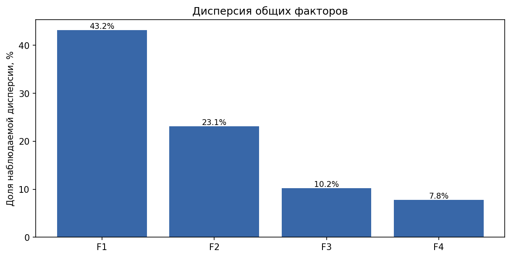
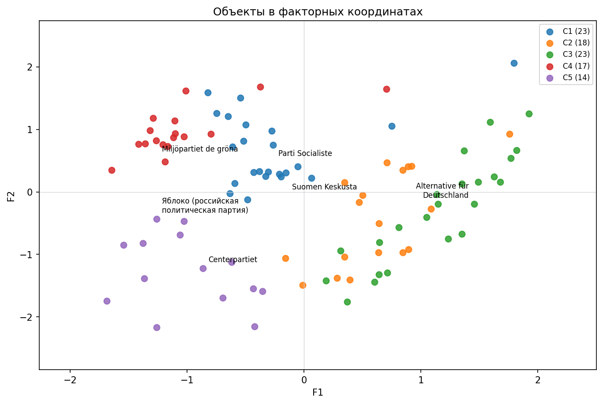
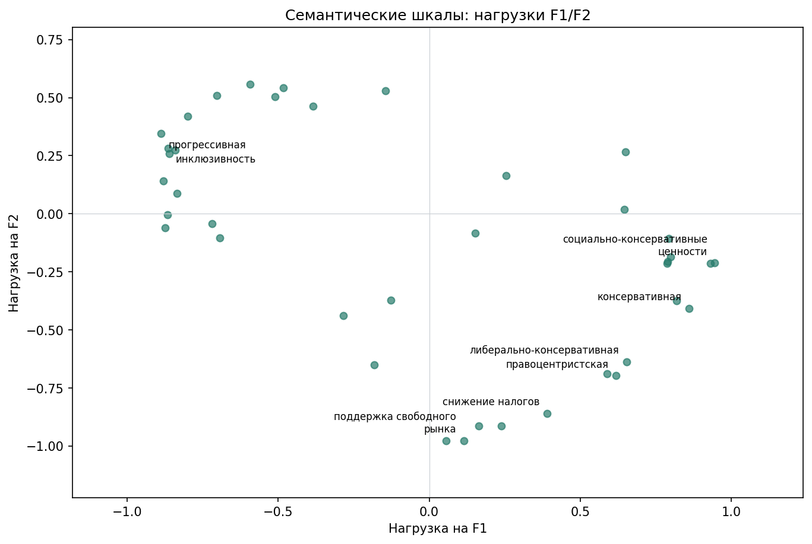
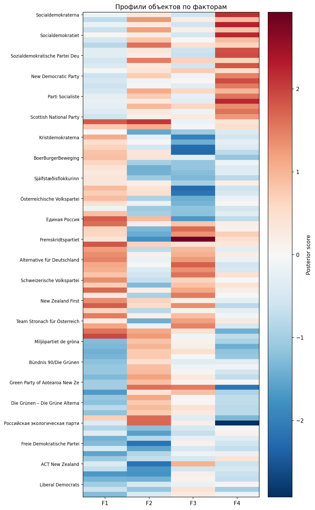
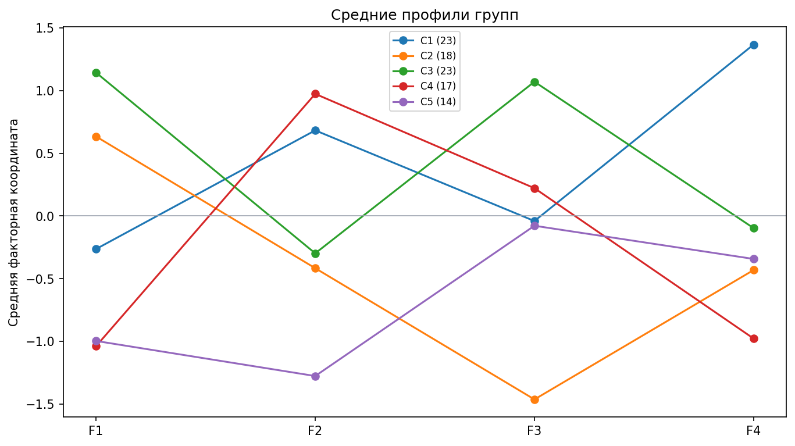
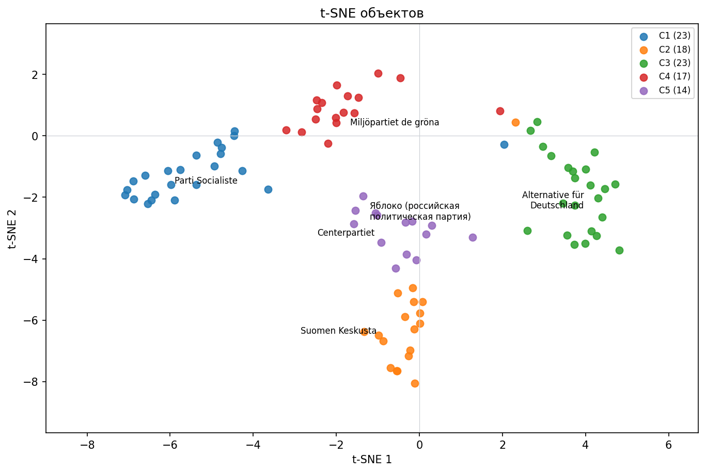
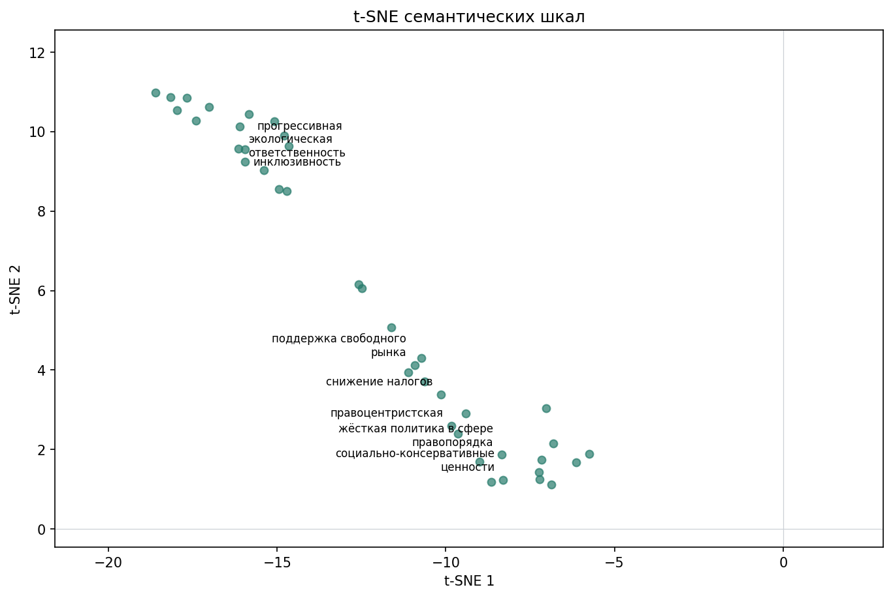

# Пример: ранее собранные партии

## Технический пример: ограничения исходных данных

ТЕХНИЧЕСКИЙ ПРИМЕР НА ПРЕЖНИХ ДАННЫХ. Это повторный анализ ранее сохранённых модельных оценок 95 партий по первым 40 признакам исходного словаря. Это не новое исследование и не результат исследования 70 российских политиков. Новые источники не собирались, LLM не вызывалась, старый словарь не проходил новую нормализацию. Оценка x по прежней шкале 0–10 перенесена как value = x − 5. Два полюса независимо не оценивались; их сумма и смешанность по этим данным не определяются. Ноль в примере означает прежнюю оценку 5, а не доказанную невыраженность обоих свойств. Отметки утверждения принадлежат импортированному примеру, а не пользователю.

Область: Международное пространство политических партий из прежней выборки. Аспект: Старые модельные оценки партий. Исторический период в сохранённой матрице не зафиксирован. Пример не относится к новой выборке российских политиков 2016–2026 годов.

## Основные результаты

Проанализировано 95 объектов по 40 пригодным шкалам. Факторная модель содержит 4 осей; суммарная описанная дисперсия стандартизованных переменных — 84.3%. Получено 5 групп объектов. Это техническая демонстрация нового анализа прежних оценок, а не заново выполненное исследование или валидация исходного измерения.

Группы выделены по численным профилям объектов. Их названия — интерпретации модели; они не доказывают общность реальных электоратов, личных качеств или наличие общественного спроса на незаполненные области.

## Методика

Прежняя целевая международная выборка 95 партий; первые 40 сохранённых шкал взяты только для технической демонстрации, а не как валидированная короткая форма.

Досье и источники в этом примере не пересобирались. Импортированы 95 строк старой матрицы и первые 40 признаков сохранённого словаря. Близкие формулировки и разные уровни описания могли сохраниться; короткая форма не валидирована. Утверждения помечены actor=imported_example_fixture и не являются решениями пользователя.

Импортирована прежняя оценка x из диапазона 0–10; для нового численного конвейера использовано value=x−5. Независимые оценки двух полюсов отсутствуют, сумма полюсов неизвестна. Пропуск сохранён как unknown. Ноль после сдвига означает старую оценку 5, а не невыраженность обоих свойств.

Сохранённых наблюдаемых оценок: 3800 из 3800. Режим legacy_import_example. Эти числа получены прежним модельным оценщиком; новых запросов к моделям и новых человеческих оценок нет. Исходные источники не восстановлены и не проверены.

Используется вероятностная Gaussian факторная модель с диагональным специфическим шумом. Координаты — условные средние факторов; рассчитывается система по числу факторов без обращения вырожденной эмпирической корреляционной матрицы. Нагрузки и баллы согласованно поворачиваются ортогональным varimax.

Доля дисперсии фактора вычислена как сумма квадратов его нагрузок, делённая на число стандартизованных признаков. Сумма долей описывает общую модельную дисперсию в этом решении; это не доля населения и не оценка правильности интерпретации. Конечные шкалы рассматриваются как непрерывная разведочная аппроксимация.

Число факторов сопоставляется с диагностикой размерности, качеством модели и интерпретируемостью. Для кластеризации сравниваются несколько k, силуэт, размеры и устойчивость на подвыборках; k можно изменить и сравнить. t-SNE служит иллюстрацией соседства и не определяет кластеры.

## Словарь измерительных шкал

| Шкала | +5 | −5 | Определение |
| --- | --- | --- | --- |
| социал-демократическая | социал-демократическая | Слабая выраженность: социал-демократическая | Учебный перенос старой шкалы 0..10 через x−5; не заново оценённая пара антонимов |
| центр-левая | центр-левая | Слабая выраженность: центр-левая | Учебный перенос старой шкалы 0..10 через x−5; не заново оценённая пара антонимов |
| прогрессивная | прогрессивная | Слабая выраженность: прогрессивная | Учебный перенос старой шкалы 0..10 через x−5; не заново оценённая пара антонимов |
| ориентирована на рабочий класс | ориентирована на рабочий класс | Слабая выраженность: ориентирована на рабочий класс | Учебный перенос старой шкалы 0..10 через x−5; не заново оценённая пара антонимов |
| поддержка государства всеобщего благосостояния | поддержка государства всеобщего благосостояния | Слабая выраженность: поддержка государства всеобщего благосостояния | Учебный перенос старой шкалы 0..10 через x−5; не заново оценённая пара антонимов |
| интернационализм | интернационализм | Слабая выраженность: интернационализм | Учебный перенос старой шкалы 0..10 через x−5; не заново оценённая пара антонимов |
| солидарность | солидарность | Слабая выраженность: солидарность | Учебный перенос старой шкалы 0..10 через x−5; не заново оценённая пара антонимов |
| гендерное равенство | гендерное равенство | Слабая выраженность: гендерное равенство | Учебный перенос старой шкалы 0..10 через x−5; не заново оценённая пара антонимов |
| экологическая ответственность | экологическая ответственность | Слабая выраженность: экологическая ответственность | Учебный перенос старой шкалы 0..10 через x−5; не заново оценённая пара антонимов |
| реформизм | реформизм | Слабая выраженность: реформизм | Учебный перенос старой шкалы 0..10 через x−5; не заново оценённая пара антонимов |
| прагматизм | прагматизм | Слабая выраженность: прагматизм | Учебный перенос старой шкалы 0..10 через x−5; не заново оценённая пара антонимов |
| сильные профсоюзы | сильные профсоюзы | Слабая выраженность: сильные профсоюзы | Учебный перенос старой шкалы 0..10 через x−5; не заново оценённая пара антонимов |
| инклюзивность | инклюзивность | Слабая выраженность: инклюзивность | Учебный перенос старой шкалы 0..10 через x−5; не заново оценённая пара антонимов |
| антидискриминация | антидискриминация | Слабая выраженность: антидискриминация | Учебный перенос старой шкалы 0..10 через x−5; не заново оценённая пара антонимов |
| европеизм | европеизм | Слабая выраженность: европеизм | Учебный перенос старой шкалы 0..10 через x−5; не заново оценённая пара антонимов |
| правоцентристская | правоцентристская | Слабая выраженность: правоцентристская | Учебный перенос старой шкалы 0..10 через x−5; не заново оценённая пара антонимов |
| либерально-консервативная | либерально-консервативная | Слабая выраженность: либерально-консервативная | Учебный перенос старой шкалы 0..10 через x−5; не заново оценённая пара антонимов |
| экономический либерализм | экономический либерализм | Слабая выраженность: экономический либерализм | Учебный перенос старой шкалы 0..10 через x−5; не заново оценённая пара антонимов |
| поддержка свободного рынка | поддержка свободного рынка | Слабая выраженность: поддержка свободного рынка | Учебный перенос старой шкалы 0..10 через x−5; не заново оценённая пара антонимов |
| снижение налогов | снижение налогов | Слабая выраженность: снижение налогов | Учебный перенос старой шкалы 0..10 через x−5; не заново оценённая пара антонимов |
| жёсткая политика в сфере правопорядка | жёсткая политика в сфере правопорядка | Слабая выраженность: жёсткая политика в сфере правопорядка | Учебный перенос старой шкалы 0..10 через x−5; не заново оценённая пара антонимов |
| проевропейская | проевропейская | Слабая выраженность: проевропейская | Учебный перенос старой шкалы 0..10 через x−5; не заново оценённая пара антонимов |
| ориентация на бизнес | ориентация на бизнес | Слабая выраженность: ориентация на бизнес | Учебный перенос старой шкалы 0..10 через x−5; не заново оценённая пара антонимов |
| рациональный прагматизм | рациональный прагматизм | Слабая выраженность: рациональный прагматизм | Учебный перенос старой шкалы 0..10 через x−5; не заново оценённая пара антонимов |
| реформаторская | реформаторская | Слабая выраженность: реформаторская | Учебный перенос старой шкалы 0..10 через x−5; не заново оценённая пара антонимов |
| ориентация на средний класс | ориентация на средний класс | Слабая выраженность: ориентация на средний класс | Учебный перенос старой шкалы 0..10 через x−5; не заново оценённая пара антонимов |
| поддержка частного сектора | поддержка частного сектора | Слабая выраженность: поддержка частного сектора | Учебный перенос старой шкалы 0..10 через x−5; не заново оценённая пара антонимов |
| скептицизм к расширению социальной политики | скептицизм к расширению социальной политики | Слабая выраженность: скептицизм к расширению социальной политики | Учебный перенос старой шкалы 0..10 через x−5; не заново оценённая пара антонимов |
| традиционные семейные ценности | традиционные семейные ценности | Слабая выраженность: традиционные семейные ценности | Учебный перенос старой шкалы 0..10 через x−5; не заново оценённая пара антонимов |
| ориентация на городское население | ориентация на городское население | Слабая выраженность: ориентация на городское население | Учебный перенос старой шкалы 0..10 через x−5; не заново оценённая пара антонимов |
| националистическая | националистическая | Слабая выраженность: националистическая | Учебный перенос старой шкалы 0..10 через x−5; не заново оценённая пара антонимов |
| правопопулистская | правопопулистская | Слабая выраженность: правопопулистская | Учебный перенос старой шкалы 0..10 через x−5; не заново оценённая пара антонимов |
| антииммиграционная | антииммиграционная | Слабая выраженность: антииммиграционная | Учебный перенос старой шкалы 0..10 через x−5; не заново оценённая пара антонимов |
| евроскептическая | евроскептическая | Слабая выраженность: евроскептическая | Учебный перенос старой шкалы 0..10 через x−5; не заново оценённая пара антонимов |
| консервативная | консервативная | Слабая выраженность: консервативная | Учебный перенос старой шкалы 0..10 через x−5; не заново оценённая пара антонимов |
| протестная | протестная | Слабая выраженность: протестная | Учебный перенос старой шкалы 0..10 через x−5; не заново оценённая пара антонимов |
| критика мультикультурализма | критика мультикультурализма | Слабая выраженность: критика мультикультурализма | Учебный перенос старой шкалы 0..10 через x−5; не заново оценённая пара антонимов |
| социально-консервативные ценности | социально-консервативные ценности | Слабая выраженность: социально-консервативные ценности | Учебный перенос старой шкалы 0..10 через x−5; не заново оценённая пара антонимов |
| защитники шведской идентичности | защитники шведской идентичности | Слабая выраженность: защитники шведской идентичности | Учебный перенос старой шкалы 0..10 через x−5; не заново оценённая пара антонимов |
| скептицизм к глобализации | скептицизм к глобализации | Слабая выраженность: скептицизм к глобализации | Учебный перенос старой шкалы 0..10 через x−5; не заново оценённая пара антонимов |

## Факторная структура

| Ось | Интерпретация | Доля дисперсии |
| --- | --- | --- |
| F1 | социально-консервативные ценности ↔ прогрессивная | 43.2% |
| F2 | солидарность ↔ поддержка свободного рынка | 23.1% |
| F3 | протестная ↔ рациональный прагматизм | 10.2% |
| F4 | ориентирована на рабочий класс, сильные профсоюзы | 7.8% |

### F1 социально-консервативные ценности ↔ прогрессивная

Положительные нагрузки: социально-консервативные ценности, традиционные семейные ценности, консервативная. Отрицательные нагрузки: прогрессивная, ориентация на городское население, реформаторская. Высокая координата связана со свойствами: социально-консервативные ценности, традиционные семейные ценности, консервативная, Слабая выраженность: прогрессивная, Слабая выраженность: ориентация на городское население, Слабая выраженность: реформаторская. Низкая координата связана со свойствами: прогрессивная, ориентация на городское население, реформаторская, Слабая выраженность: социально-консервативные ценности, Слабая выраженность: традиционные семейные ценности, Слабая выраженность: консервативная. Знак оси условен. Названия описывают связи оценок; это не причинное объяснение.

| Полюс | Шкала | Нагрузка |
| --- | --- | --- |
| Положительный | социально-консервативные ценности | +0.945 |
| Положительный | традиционные семейные ценности | +0.932 |
| Положительный | консервативная | +0.860 |
| Положительный | жёсткая политика в сфере правопорядка | +0.818 |
| Положительный | правопопулистская | +0.799 |
| Положительный | националистическая | +0.792 |
| Отрицательный | прогрессивная | -0.888 |
| Отрицательный | ориентация на городское население | -0.880 |
| Отрицательный | реформаторская | -0.875 |
| Отрицательный | реформизм | -0.867 |
| Отрицательный | инклюзивность | -0.865 |
| Отрицательный | антидискриминация | -0.861 |

### F2 солидарность ↔ поддержка свободного рынка

Положительные нагрузки: солидарность, поддержка государства всеобщего благосостояния, ориентирована на рабочий класс. Отрицательные нагрузки: поддержка свободного рынка, экономический либерализм, поддержка частного сектора. Высокая координата связана со свойствами: солидарность, поддержка государства всеобщего благосостояния, ориентирована на рабочий класс, Слабая выраженность: поддержка свободного рынка, Слабая выраженность: экономический либерализм, Слабая выраженность: поддержка частного сектора. Низкая координата связана со свойствами: поддержка свободного рынка, экономический либерализм, поддержка частного сектора, Слабая выраженность: солидарность, Слабая выраженность: поддержка государства всеобщего благосостояния, Слабая выраженность: ориентирована на рабочий класс. Знак оси условен. Названия описывают связи оценок; это не причинное объяснение.

| Полюс | Шкала | Нагрузка |
| --- | --- | --- |
| Положительный | солидарность | +0.557 |
| Положительный | поддержка государства всеобщего благосостояния | +0.543 |
| Положительный | ориентирована на рабочий класс | +0.529 |
| Положительный | центр-левая | +0.510 |
| Положительный | социал-демократическая | +0.504 |
| Положительный | сильные профсоюзы | +0.463 |
| Отрицательный | поддержка свободного рынка | -0.977 |
| Отрицательный | экономический либерализм | -0.977 |
| Отрицательный | поддержка частного сектора | -0.914 |
| Отрицательный | ориентация на бизнес | -0.914 |
| Отрицательный | снижение налогов | -0.860 |
| Отрицательный | правоцентристская | -0.697 |

### F3 протестная ↔ рациональный прагматизм

Положительные нагрузки: протестная, скептицизм к глобализации, правопопулистская. Отрицательные нагрузки: рациональный прагматизм, прагматизм, проевропейская. Высокая координата связана со свойствами: протестная, скептицизм к глобализации, правопопулистская, Слабая выраженность: рациональный прагматизм, Слабая выраженность: прагматизм, Слабая выраженность: проевропейская. Низкая координата связана со свойствами: рациональный прагматизм, прагматизм, проевропейская, Слабая выраженность: протестная, Слабая выраженность: скептицизм к глобализации, Слабая выраженность: правопопулистская. Знак оси условен. Названия описывают связи оценок; это не причинное объяснение.

| Полюс | Шкала | Нагрузка |
| --- | --- | --- |
| Положительный | протестная | +0.797 |
| Положительный | скептицизм к глобализации | +0.539 |
| Положительный | правопопулистская | +0.519 |
| Положительный | критика мультикультурализма | +0.441 |
| Положительный | антииммиграционная | +0.440 |
| Положительный | националистическая | +0.385 |
| Отрицательный | рациональный прагматизм | -0.663 |
| Отрицательный | прагматизм | -0.604 |
| Отрицательный | проевропейская | -0.462 |
| Отрицательный | европеизм | -0.435 |
| Отрицательный | интернационализм | -0.384 |
| Отрицательный | антидискриминация | -0.354 |

### F4 ориентирована на рабочий класс, сильные профсоюзы

Положительные нагрузки: ориентирована на рабочий класс, сильные профсоюзы, социал-демократическая. Сильных отрицательных нагрузок нет; второй полюс отдельно не именуется. Высокая координата связана со свойствами: ориентирована на рабочий класс, сильные профсоюзы, социал-демократическая. Знак оси условен. Названия описывают связи оценок; это не причинное объяснение.

| Полюс | Шкала | Нагрузка |
| --- | --- | --- |
| Положительный | ориентирована на рабочий класс | +0.780 |
| Положительный | сильные профсоюзы | +0.702 |
| Положительный | социал-демократическая | +0.639 |
| Положительный | поддержка государства всеобщего благосостояния | +0.561 |
| Положительный | солидарность | +0.444 |
| Положительный | центр-левая | +0.437 |

## Карты объектов и признаков

### Объекты в факторных координатах

### Семантические шкалы: нагрузки F1/F2

### Профили объектов

### Профили групп

### t-SNE объектов

### t-SNE семантических шкал

## Сравнение кластерных решений

| k | Силуэт | Минимальная группа | Максимальная группа |
| --- | --- | --- | --- |
| 2 | 0.251 | 44 | 51 |
| 3 | 0.326 | 25 | 41 |
| 4 | 0.393 | 22 | 26 |
| 5 | 0.429 | 14 | 23 |
| 6 | 0.435 | 9 | 21 |
| 7 | 0.415 | 9 | 19 |
| 8 | 0.417 | 7 | 16 |
| 9 | 0.407 | 6 | 16 |
| 10 | 0.415 | 2 | 14 |

Выбранное k рассматривается как рабочая типология и сопоставляется с альтернативами.

## Интерпретация групп

### C1 Группа 1

Размер: 23 объектов (24.2% выборки). Отличия от среднего по изученным объектам: «ориентирована на рабочий класс» (+1.57 σ), «сильные профсоюзы» (+1.48 σ), «социал-демократическая» (+1.41 σ). Общность описывается сочетанием оценённых свойств; совпадение электората или причин общности требует внешней проверки.

Состав: Socialdemokraterna, Vänsterpartiet, Arbeiderpartiet, Sosialistisk Venstreparti, Socialdemokratiet, SF – Socialistisk Folkeparti, Enhedslisten, Suomen Sosialidemokraattinen Puolue, Sozialdemokratische Partei Deutschlands, Die Linke, Partij van de Arbeid, Bloc Québécois, New Democratic Party, Australian Labor Party, New Zealand Labour Party, Alliance, Parti Socialiste, Sozialdemokratische Partei Österreichs, Sinn Féin, Labour Party, Scottish National Party, Коммунистическая партия Российской Федерации, Справедливая Россия

Ближайшие к центру представители: Parti Socialiste, New Democratic Party, Labour Party

| Отличительная шкала | Среднее группы | Среднее выборки | Различие в σ |
| --- | --- | --- | --- |
| ориентирована на рабочий класс | +3.00 | -0.59 | +1.57 |
| сильные профсоюзы | +2.61 | -1.11 | +1.48 |
| социал-демократическая | +3.35 | -1.05 | +1.41 |
| поддержка государства всеобщего благосостояния | +4.39 | +1.02 | +1.24 |
| солидарность | +3.57 | +0.89 | +1.18 |
| центр-левая | +3.48 | -0.23 | +1.13 |

### C2 Группа 2

Размер: 18 объектов (18.9% выборки). Отличия от среднего по изученным объектам: «либерально-консервативная» (+1.08 σ), «правоцентристская» (+0.98 σ), «консервативная» (+0.95 σ). Общность описывается сочетанием оценённых свойств; совпадение электората или причин общности требует внешней проверки.

Состав: Moderata samlingspartiet, Kristdemokraterna, Suomen Keskusta, Christlich Demokratische Union Deutschlands, Christen-Democratisch Appèl, BoerBurgerBeweging, Progressive Conservative Party of Canada, Liberal Party of Australia, New Zealand National Party, Sjálfstæðisflokkurinn, Framsóknarflokkurinn, Christelijke Volkspartij, Parti Social Chrétien, Österreichische Volkspartei, Fianna Fáil, Fine Gael, Conservative Party, Единая Россия

Ближайшие к центру представители: Suomen Keskusta, Fianna Fáil, Österreichische Volkspartei

| Отличительная шкала | Среднее группы | Среднее выборки | Различие в σ |
| --- | --- | --- | --- |
| либерально-консервативная | +2.33 | -0.91 | +1.08 |
| правоцентристская | +2.89 | -0.09 | +0.98 |
| консервативная | +2.00 | -0.61 | +0.95 |
| традиционные семейные ценности | +2.22 | -0.34 | +0.94 |
| рациональный прагматизм | +2.61 | +1.29 | +0.92 |
| ориентация на бизнес | +2.17 | +0.13 | +0.86 |

### C3 Группа 3

Размер: 23 объектов (24.2% выборки). Отличия от среднего по изученным объектам: «антииммиграционная» (+1.62 σ), «правопопулистская» (+1.61 σ), «критика мультикультурализма» (+1.57 σ). Общность описывается сочетанием оценённых свойств; совпадение электората или причин общности требует внешней проверки.

Состав: Sverigedemokraterna, Ny demokrati, Fremskrittspartiet, Fremskridtspartiet, Dansk Folkeparti, Nye Borgerlige, Perussuomalaiset, Alternative für Deutschland, Partij voor de Vrijheid, Forum voor Democratie, Lijst Pim Fortuyn, Schweizerische Volkspartei, Reform Party of Canada, Pauline Hanson's One Nation, Palmer United Party, New Zealand First, Vlaams Blok, Nieuw-Vlaamse Alliantie, Freiheitliche Partei Österreichs, Team Stronach für Österreich, UK Independence Party, Либерально-демократическая партия России, Родина (российская политическая партия)

Ближайшие к центру представители: Alternative für Deutschland, Forum voor Democratie, Nye Borgerlige

| Отличительная шкала | Среднее группы | Среднее выборки | Различие в σ |
| --- | --- | --- | --- |
| антииммиграционная | +3.17 | -1.86 | +1.62 |
| правопопулистская | +3.26 | -1.83 | +1.61 |
| критика мультикультурализма | +3.22 | -1.69 | +1.57 |
| инклюзивность | -3.09 | +0.85 | -1.44 |
| антидискриминация | -3.04 | +1.07 | -1.44 |
| националистическая | +2.52 | -1.27 | +1.42 |

### C4 Группа 4

Размер: 17 объектов (17.9% выборки). Отличия от среднего по изученным объектам: «экологическая ответственность» (+1.19 σ), «жёсткая политика в сфере правопорядка» (-1.11 σ), «традиционные семейные ценности» (-1.09 σ). Общность описывается сочетанием оценённых свойств; совпадение электората или причин общности требует внешней проверки.

Состав: Miljöpartiet de gröna, Miljøpartiet De Grønne, Alternativet, Vihreä liitto, Bündnis 90/Die Grünen, GroenLinks, Grüne Partei der Schweiz, Australian Greens, Green Party of Aotearoa New Zealand, Besti flokkurinn, Píratar, Ecolo, Die Grünen – Die Grüne Alternative, Liste Peter Pilz, Green Party, Российская партия пенсионеров, Российская экологическая партия «Зеленые»

Ближайшие к центру представители: Miljöpartiet de gröna, Ecolo, Green Party

| Отличительная шкала | Среднее группы | Среднее выборки | Различие в σ |
| --- | --- | --- | --- |
| экологическая ответственность | +4.06 | +0.84 | +1.19 |
| жёсткая политика в сфере правопорядка | -3.12 | -0.39 | -1.11 |
| традиционные семейные ценности | -3.29 | -0.34 | -1.09 |
| консервативная | -3.59 | -0.61 | -1.08 |
| правоцентристская | -3.35 | -0.09 | -1.07 |
| прогрессивная | +3.65 | +0.19 | +1.05 |

### C5 Группа 5

Размер: 14 объектов (14.7% выборки). Отличия от среднего по изученным объектам: «экономический либерализм» (+1.29 σ), «поддержка свободного рынка» (+1.21 σ), «скептицизм к глобализации» (-1.12 σ). Общность описывается сочетанием оценённых свойств; совпадение электората или причин общности требует внешней проверки.

Состав: Centerpartiet, Venstre, Radikale Venstre, Freie Demokratische Partei, Volkspartij voor Vrijheid en Democratie, Democraten 66, Liberal Party of Canada, ACT New Zealand, Mouvement Réformateur, NEOS – Das Neue Österreich und Liberales Forum, Progressive Democrats, Liberal Democrats, Новые люди (российская политическая партия), Яблоко (российская политическая партия)

Ближайшие к центру представители: Centerpartiet, Progressive Democrats, Radikale Venstre

| Отличительная шкала | Среднее группы | Среднее выборки | Различие в σ |
| --- | --- | --- | --- |
| экономический либерализм | +2.79 | -0.43 | +1.29 |
| поддержка свободного рынка | +3.07 | +0.17 | +1.21 |
| скептицизм к глобализации | -2.71 | -0.42 | -1.12 |
| ориентация на бизнес | +2.64 | +0.13 | +1.06 |
| поддержка частного сектора | +3.36 | +1.27 | +0.94 |
| рациональный прагматизм | +2.57 | +1.29 | +0.89 |

## Интерпретация политического пространства

Структура задаётся совместными изменениями шкал публичного образа. Близость в факторном пространстве означает сходство оценённых профилей; дистанция показывает различия по выбранным измерениям. Кластеры описывают преобладающие сочетания этих измерений, а пограничные объекты могут разделять свойства нескольких групп.

Пустой участок этой международной карты относится только к прежней выборке и первым 40 признакам. Он не доказывает отсутствие соответствующих идей во всём публичном пространстве, полноту сравнения стран или наличие спроса на свободную нишу.

## Выбранные объекты подробнее

### Яблоко (российская политическая партия)

Наиболее выраженные координаты: F1: -1.26; F2: -0.43. Ближайшая группа определяется расстоянием в полном факторном пространстве.

Кластер: C5. Оценено шкал: 40; пропусков: 0.

| Фактор | Координата |
| --- | --- |
| F1 | -1.261 |
| F2 | -0.431 |
| F3 | +0.253 |
| F4 | -0.156 |

## Ограничения и воспроизводимость

Выборка целевая и ограничена заданными критериями. Агрегирование десятилетнего периода может скрыть смену образа. Зависимые источники, смещения поисковой выдачи и оценщика могут влиять на результат. Ни статистическая устойчивость, ни убедительность названия фактора сами по себе не подтверждают его внешнюю валидность.

Сохранены контрольные суммы исходных файлов, состав импортированного примера, преобразованные поэлементные оценки, параметры анализа и отметки imported_example_fixture. Новых досье, независимых оценок полюсов или пользовательских утверждений для этого примера нет.

Численный расчёт: 95 объектов, 40 шкал, 4 факторов и 5 кластеров. Полные показатели качества, правила выбора размерности, пропуски, параметры и seed сохранены в metadata.json рядом с матрицами.

## Объекты и источники

### Socialdemokraterna

Партия из сохранённой международной выборки; страна: Швеция. Импортирована из прежней матрицы для технического примера интерфейса и экспорта; новая выборка не формировалась

### Moderata samlingspartiet

Партия из сохранённой международной выборки; страна: Швеция. Импортирована из прежней матрицы для технического примера интерфейса и экспорта; новая выборка не формировалась

### Sverigedemokraterna

Партия из сохранённой международной выборки; страна: Швеция. Импортирована из прежней матрицы для технического примера интерфейса и экспорта; новая выборка не формировалась

### Miljöpartiet de gröna

Партия из сохранённой международной выборки; страна: Швеция. Импортирована из прежней матрицы для технического примера интерфейса и экспорта; новая выборка не формировалась

### Kristdemokraterna

Партия из сохранённой международной выборки; страна: Швеция. Импортирована из прежней матрицы для технического примера интерфейса и экспорта; новая выборка не формировалась

### Centerpartiet

Партия из сохранённой международной выборки; страна: Швеция. Импортирована из прежней матрицы для технического примера интерфейса и экспорта; новая выборка не формировалась

### Vänsterpartiet

Партия из сохранённой международной выборки; страна: Швеция. Импортирована из прежней матрицы для технического примера интерфейса и экспорта; новая выборка не формировалась

### Ny demokrati

Партия из сохранённой международной выборки; страна: Швеция. Импортирована из прежней матрицы для технического примера интерфейса и экспорта; новая выборка не формировалась

### Arbeiderpartiet

Партия из сохранённой международной выборки; страна: Норвегия. Импортирована из прежней матрицы для технического примера интерфейса и экспорта; новая выборка не формировалась

### Fremskrittspartiet

Партия из сохранённой международной выборки; страна: Норвегия. Импортирована из прежней матрицы для технического примера интерфейса и экспорта; новая выборка не формировалась

### Sosialistisk Venstreparti

Партия из сохранённой международной выборки; страна: Норвегия. Импортирована из прежней матрицы для технического примера интерфейса и экспорта; новая выборка не формировалась

### Miljøpartiet De Grønne

Партия из сохранённой международной выборки; страна: Норвегия. Импортирована из прежней матрицы для технического примера интерфейса и экспорта; новая выборка не формировалась

### Socialdemokratiet

Партия из сохранённой международной выборки; страна: Дания. Импортирована из прежней матрицы для технического примера интерфейса и экспорта; новая выборка не формировалась

### Venstre

Партия из сохранённой международной выборки; страна: Дания. Импортирована из прежней матрицы для технического примера интерфейса и экспорта; новая выборка не формировалась

### Fremskridtspartiet

Партия из сохранённой международной выборки; страна: Дания. Импортирована из прежней матрицы для технического примера интерфейса и экспорта; новая выборка не формировалась

### Dansk Folkeparti

Партия из сохранённой международной выборки; страна: Дания. Импортирована из прежней матрицы для технического примера интерфейса и экспорта; новая выборка не формировалась

### Radikale Venstre

Партия из сохранённой международной выборки; страна: Дания. Импортирована из прежней матрицы для технического примера интерфейса и экспорта; новая выборка не формировалась

### SF – Socialistisk Folkeparti

Партия из сохранённой международной выборки; страна: Дания. Импортирована из прежней матрицы для технического примера интерфейса и экспорта; новая выборка не формировалась

### Enhedslisten

Партия из сохранённой международной выборки; страна: Дания. Импортирована из прежней матрицы для технического примера интерфейса и экспорта; новая выборка не формировалась

### Nye Borgerlige

Партия из сохранённой международной выборки; страна: Дания. Импортирована из прежней матрицы для технического примера интерфейса и экспорта; новая выборка не формировалась

### Alternativet

Партия из сохранённой международной выборки; страна: Дания. Импортирована из прежней матрицы для технического примера интерфейса и экспорта; новая выборка не формировалась

### Suomen Keskusta

Партия из сохранённой международной выборки; страна: Финляндия. Импортирована из прежней матрицы для технического примера интерфейса и экспорта; новая выборка не формировалась

### Suomen Sosialidemokraattinen Puolue

Партия из сохранённой международной выборки; страна: Финляндия. Импортирована из прежней матрицы для технического примера интерфейса и экспорта; новая выборка не формировалась

### Perussuomalaiset

Партия из сохранённой международной выборки; страна: Финляндия. Импортирована из прежней матрицы для технического примера интерфейса и экспорта; новая выборка не формировалась

### Vihreä liitto

Партия из сохранённой международной выборки; страна: Финляндия. Импортирована из прежней матрицы для технического примера интерфейса и экспорта; новая выборка не формировалась

### Christlich Demokratische Union Deutschlands

Партия из сохранённой международной выборки; страна: Германия. Импортирована из прежней матрицы для технического примера интерфейса и экспорта; новая выборка не формировалась

### Sozialdemokratische Partei Deutschlands

Партия из сохранённой международной выборки; страна: Германия. Импортирована из прежней матрицы для технического примера интерфейса и экспорта; новая выборка не формировалась

### Bündnis 90/Die Grünen

Партия из сохранённой международной выборки; страна: Германия. Импортирована из прежней матрицы для технического примера интерфейса и экспорта; новая выборка не формировалась

### Alternative für Deutschland

Партия из сохранённой международной выборки; страна: Германия. Импортирована из прежней матрицы для технического примера интерфейса и экспорта; новая выборка не формировалась

### Freie Demokratische Partei

Партия из сохранённой международной выборки; страна: Германия. Импортирована из прежней матрицы для технического примера интерфейса и экспорта; новая выборка не формировалась

### Die Linke

Партия из сохранённой международной выборки; страна: Германия. Импортирована из прежней матрицы для технического примера интерфейса и экспорта; новая выборка не формировалась

### Volkspartij voor Vrijheid en Democratie

Партия из сохранённой международной выборки; страна: Нидерланды. Импортирована из прежней матрицы для технического примера интерфейса и экспорта; новая выборка не формировалась

### Partij van de Arbeid

Партия из сохранённой международной выборки; страна: Нидерланды. Импортирована из прежней матрицы для технического примера интерфейса и экспорта; новая выборка не формировалась

### Christen-Democratisch Appèl

Партия из сохранённой международной выборки; страна: Нидерланды. Импортирована из прежней матрицы для технического примера интерфейса и экспорта; новая выборка не формировалась

### Democraten 66

Партия из сохранённой международной выборки; страна: Нидерланды. Импортирована из прежней матрицы для технического примера интерфейса и экспорта; новая выборка не формировалась

### Partij voor de Vrijheid

Партия из сохранённой международной выборки; страна: Нидерланды. Импортирована из прежней матрицы для технического примера интерфейса и экспорта; новая выборка не формировалась

### Forum voor Democratie

Партия из сохранённой международной выборки; страна: Нидерланды. Импортирована из прежней матрицы для технического примера интерфейса и экспорта; новая выборка не формировалась

### GroenLinks

Партия из сохранённой международной выборки; страна: Нидерланды. Импортирована из прежней матрицы для технического примера интерфейса и экспорта; новая выборка не формировалась

### BoerBurgerBeweging

Партия из сохранённой международной выборки; страна: Нидерланды. Импортирована из прежней матрицы для технического примера интерфейса и экспорта; новая выборка не формировалась

### Lijst Pim Fortuyn

Партия из сохранённой международной выборки; страна: Нидерланды. Импортирована из прежней матрицы для технического примера интерфейса и экспорта; новая выборка не формировалась

### Schweizerische Volkspartei

Партия из сохранённой международной выборки; страна: Швейцария. Импортирована из прежней матрицы для технического примера интерфейса и экспорта; новая выборка не формировалась

### Grüne Partei der Schweiz

Партия из сохранённой международной выборки; страна: Швейцария. Импортирована из прежней матрицы для технического примера интерфейса и экспорта; новая выборка не формировалась

### Liberal Party of Canada

Партия из сохранённой международной выборки; страна: Канада. Импортирована из прежней матрицы для технического примера интерфейса и экспорта; новая выборка не формировалась

### Progressive Conservative Party of Canada

Партия из сохранённой международной выборки; страна: Канада. Импортирована из прежней матрицы для технического примера интерфейса и экспорта; новая выборка не формировалась

### Reform Party of Canada

Партия из сохранённой международной выборки; страна: Канада. Импортирована из прежней матрицы для технического примера интерфейса и экспорта; новая выборка не формировалась

### Bloc Québécois

Партия из сохранённой международной выборки; страна: Канада. Импортирована из прежней матрицы для технического примера интерфейса и экспорта; новая выборка не формировалась

### New Democratic Party

Партия из сохранённой международной выборки; страна: Канада. Импортирована из прежней матрицы для технического примера интерфейса и экспорта; новая выборка не формировалась

### Australian Labor Party

Партия из сохранённой международной выборки; страна: Австралия. Импортирована из прежней матрицы для технического примера интерфейса и экспорта; новая выборка не формировалась

### Liberal Party of Australia

Партия из сохранённой международной выборки; страна: Австралия. Импортирована из прежней матрицы для технического примера интерфейса и экспорта; новая выборка не формировалась

### Pauline Hanson's One Nation

Партия из сохранённой международной выборки; страна: Австралия. Импортирована из прежней матрицы для технического примера интерфейса и экспорта; новая выборка не формировалась

### Australian Greens

Партия из сохранённой международной выборки; страна: Австралия. Импортирована из прежней матрицы для технического примера интерфейса и экспорта; новая выборка не формировалась

### Palmer United Party

Партия из сохранённой международной выборки; страна: Австралия. Импортирована из прежней матрицы для технического примера интерфейса и экспорта; новая выборка не формировалась

### New Zealand National Party

Партия из сохранённой международной выборки; страна: Новая Зеландия. Импортирована из прежней матрицы для технического примера интерфейса и экспорта; новая выборка не формировалась

### New Zealand Labour Party

Партия из сохранённой международной выборки; страна: Новая Зеландия. Импортирована из прежней матрицы для технического примера интерфейса и экспорта; новая выборка не формировалась

### New Zealand First

Партия из сохранённой международной выборки; страна: Новая Зеландия. Импортирована из прежней матрицы для технического примера интерфейса и экспорта; новая выборка не формировалась

### Alliance

Партия из сохранённой международной выборки; страна: Новая Зеландия. Импортирована из прежней матрицы для технического примера интерфейса и экспорта; новая выборка не формировалась

### ACT New Zealand

Партия из сохранённой международной выборки; страна: Новая Зеландия. Импортирована из прежней матрицы для технического примера интерфейса и экспорта; новая выборка не формировалась

### Green Party of Aotearoa New Zealand

Партия из сохранённой международной выборки; страна: Новая Зеландия. Импортирована из прежней матрицы для технического примера интерфейса и экспорта; новая выборка не формировалась

### Sjálfstæðisflokkurinn

Партия из сохранённой международной выборки; страна: Исландия. Импортирована из прежней матрицы для технического примера интерфейса и экспорта; новая выборка не формировалась

### Framsóknarflokkurinn

Партия из сохранённой международной выборки; страна: Исландия. Импортирована из прежней матрицы для технического примера интерфейса и экспорта; новая выборка не формировалась

### Besti flokkurinn

Партия из сохранённой международной выборки; страна: Исландия. Импортирована из прежней матрицы для технического примера интерфейса и экспорта; новая выборка не формировалась

### Píratar

Партия из сохранённой международной выборки; страна: Исландия. Импортирована из прежней матрицы для технического примера интерфейса и экспорта; новая выборка не формировалась

### Parti Socialiste

Партия из сохранённой международной выборки; страна: Бельгия. Импортирована из прежней матрицы для технического примера интерфейса и экспорта; новая выборка не формировалась

### Christelijke Volkspartij

Партия из сохранённой международной выборки; страна: Бельгия. Импортирована из прежней матрицы для технического примера интерфейса и экспорта; новая выборка не формировалась

### Parti Social Chrétien

Партия из сохранённой международной выборки; страна: Бельгия. Импортирована из прежней матрицы для технического примера интерфейса и экспорта; новая выборка не формировалась

### Vlaams Blok

Партия из сохранённой международной выборки; страна: Бельгия. Импортирована из прежней матрицы для технического примера интерфейса и экспорта; новая выборка не формировалась

### Nieuw-Vlaamse Alliantie

Партия из сохранённой международной выборки; страна: Бельгия. Импортирована из прежней матрицы для технического примера интерфейса и экспорта; новая выборка не формировалась

### Ecolo

Партия из сохранённой международной выборки; страна: Бельгия. Импортирована из прежней матрицы для технического примера интерфейса и экспорта; новая выборка не формировалась

### Mouvement Réformateur

Партия из сохранённой международной выборки; страна: Бельгия. Импортирована из прежней матрицы для технического примера интерфейса и экспорта; новая выборка не формировалась

### Sozialdemokratische Partei Österreichs

Партия из сохранённой международной выборки; страна: Австрия. Импортирована из прежней матрицы для технического примера интерфейса и экспорта; новая выборка не формировалась

### Österreichische Volkspartei

Партия из сохранённой международной выборки; страна: Австрия. Импортирована из прежней матрицы для технического примера интерфейса и экспорта; новая выборка не формировалась

### Freiheitliche Partei Österreichs

Партия из сохранённой международной выборки; страна: Австрия. Импортирована из прежней матрицы для технического примера интерфейса и экспорта; новая выборка не формировалась

### Die Grünen – Die Grüne Alternative

Партия из сохранённой международной выборки; страна: Австрия. Импортирована из прежней матрицы для технического примера интерфейса и экспорта; новая выборка не формировалась

### Team Stronach für Österreich

Партия из сохранённой международной выборки; страна: Австрия. Импортирована из прежней матрицы для технического примера интерфейса и экспорта; новая выборка не формировалась

### NEOS – Das Neue Österreich und Liberales Forum

Партия из сохранённой международной выборки; страна: Австрия. Импортирована из прежней матрицы для технического примера интерфейса и экспорта; новая выборка не формировалась

### Liste Peter Pilz

Партия из сохранённой международной выборки; страна: Австрия. Импортирована из прежней матрицы для технического примера интерфейса и экспорта; новая выборка не формировалась

### Fianna Fáil

Партия из сохранённой международной выборки; страна: Ирландия. Импортирована из прежней матрицы для технического примера интерфейса и экспорта; новая выборка не формировалась

### Fine Gael

Партия из сохранённой международной выборки; страна: Ирландия. Импортирована из прежней матрицы для технического примера интерфейса и экспорта; новая выборка не формировалась

### Sinn Féin

Партия из сохранённой международной выборки; страна: Ирландия. Импортирована из прежней матрицы для технического примера интерфейса и экспорта; новая выборка не формировалась

### Progressive Democrats

Партия из сохранённой международной выборки; страна: Ирландия. Импортирована из прежней матрицы для технического примера интерфейса и экспорта; новая выборка не формировалась

### Green Party

Партия из сохранённой международной выборки; страна: Ирландия. Импортирована из прежней матрицы для технического примера интерфейса и экспорта; новая выборка не формировалась

### Labour Party

Партия из сохранённой международной выборки; страна: Ирландия. Импортирована из прежней матрицы для технического примера интерфейса и экспорта; новая выборка не формировалась

### Conservative Party

Партия из сохранённой международной выборки; страна: Великобритания. Импортирована из прежней матрицы для технического примера интерфейса и экспорта; новая выборка не формировалась

### Liberal Democrats

Партия из сохранённой международной выборки; страна: Великобритания. Импортирована из прежней матрицы для технического примера интерфейса и экспорта; новая выборка не формировалась

### UK Independence Party

Партия из сохранённой международной выборки; страна: Великобритания. Импортирована из прежней матрицы для технического примера интерфейса и экспорта; новая выборка не формировалась

### Scottish National Party

Партия из сохранённой международной выборки; страна: Великобритания. Импортирована из прежней матрицы для технического примера интерфейса и экспорта; новая выборка не формировалась

### Коммунистическая партия Российской Федерации

Партия из сохранённой международной выборки; страна: Россия. Импортирована из прежней матрицы для технического примера интерфейса и экспорта; новая выборка не формировалась

### Единая Россия

Партия из сохранённой международной выборки; страна: Россия. Импортирована из прежней матрицы для технического примера интерфейса и экспорта; новая выборка не формировалась

### Справедливая Россия

Партия из сохранённой международной выборки; страна: Россия. Импортирована из прежней матрицы для технического примера интерфейса и экспорта; новая выборка не формировалась

### Российская партия пенсионеров

Партия из сохранённой международной выборки; страна: Россия. Импортирована из прежней матрицы для технического примера интерфейса и экспорта; новая выборка не формировалась

### Либерально-демократическая партия России

Партия из сохранённой международной выборки; страна: Россия. Импортирована из прежней матрицы для технического примера интерфейса и экспорта; новая выборка не формировалась

### Новые люди (российская политическая партия)

Партия из сохранённой международной выборки; страна: Россия. Импортирована из прежней матрицы для технического примера интерфейса и экспорта; новая выборка не формировалась

### Родина (российская политическая партия)

Партия из сохранённой международной выборки; страна: Россия. Импортирована из прежней матрицы для технического примера интерфейса и экспорта; новая выборка не формировалась

### Российская экологическая партия «Зеленые»

Партия из сохранённой международной выборки; страна: Россия. Импортирована из прежней матрицы для технического примера интерфейса и экспорта; новая выборка не формировалась

### Яблоко (российская политическая партия)

Партия из сохранённой международной выборки; страна: Россия. Импортирована из прежней матрицы для технического примера интерфейса и экспорта; новая выборка не формировалась
