# Публичное политическое пространство России: политики 2016–2026

Область: Публичный политический образ российских политиков и иных заметных политических акторов, включая деятелей за рубежом, активных хотя бы в части периода. Не рейтинг популярности.. Аспект: Публичный политический образ. Период: 2016-10-15 — 2026-10-15.

## Основные результаты

Проанализировано 63 объектов по 17 пригодным шкалам. Факторная модель содержит 2 осей; суммарная описанная дисперсия стандартизованных переменных — 47.1%. Получено 3 групп объектов. Результат представляет разведочную модель публичных образов в выбранном корпусе источников.

Группы выделены по численным профилям объектов. Их названия — интерпретации модели; они не доказывают общность реальных электоратов, личных качеств или наличие общественного спроса на незаполненные области.

### Сравнение моделей q=2, q=3 и q=4: краткий итог

Базовое решение прежнего отчёта q=2 сохранено для сопоставления. Ниже сравниваются модели q=2, q=3 и q=4 на одной матрице. Увеличение q само по себе не доказывает более содержательное решение.

Общая матрица сравнения: 63 объектов и 17 шкал. Для сопоставления составов групп используется одинаковое k=3; численное и содержательное предпочтение k рассматриваются отдельно.

Во всех моделях повторно использована одна сохранённая матрица оценок; нового оценивания объектов не проводилось.

Два основных контраста сохраняются при q=2, q=3 и q=4: отношение к войне, внешней интеграции и мобилизации; институциональная стратегия в сравнении с конфронтацией и персонализацией. При q=3 добавляется сочетание технократического обоснования, идеологических акцентов и электоральной критики. При q=4 оно перестраивается: централизация преимущественно относится к F1, управленческое обоснование и социальная программа — к F4. Модель с большим q повторно оценивает и вращает всю систему, а не просто добавляет неизменную новую ось. Описанная общая дисперсия возрастает с 47,09% до 53,60% и 58,82%; рост сам по себе не обосновывает выбор более сложной модели.

| Факторов q | Общая дисперсия | CV log likelihood | RMS остатков | Численное / рабочее k |
| --- | --- | --- | --- | --- |
| 2 | 47.1% | -31.476 | 0.088 | 3 / 3 |
| 3 | 53.6% | -31.237 | 0.067 | 4 / 4 |
| 4 | 58.8% | -31.529 | 0.055 | 3 / 4 |

Сохранить q=2 как компактный базовый обзор по действующему правилу экономии параметров; q=3 рассмотреть как наиболее ясное содержательное расширение, особенно при k=4. Средняя отложенная log-likelihood q=3 немного лучше q=2 (−31,237 против −31,476), но разница мала, оценена лишь на трёх разбиениях и не доказывает превосходства. q=4 полезна как дополнительная детализация распределения власти и управленческого обоснования; её отложенная log-likelihood не улучшается (−31,529), F1 сильно определяется одной шкалой, F4 имеет лишь два сильных индикатора. Для кластеров показать k=3 как контроль и k=4 как содержательно выбранную типологию обеих расширенных моделей. Изменение q и изменение k следует обсуждать раздельно. Ни одно разбиение не устанавливает общность истинных убеждений или электората.

## Методика

Исследовательская целевая выборка с покрытием федерального управления, парламентских партий, регионов, оппозиции, избирательных кампаний и иных публичных политических акторов. Первичный состав предложен исследователем, биографические основания проверяются вебпоиском. Категории помогают согласовать покрытие и не являются кластерами.

После утверждения объектов собраны досье с источниками, выделены определения, объединены почти одинаковые синонимы и нормализован уровень описания. Словарь шкал утверждается отдельно. Алиасы и решения о нормализации сохраняются.

Каждый полюс шкалы оценён независимо от 0 до 5. Основная координата — разность положительного и отрицательного полюсов от −5 до +5; сумма хранится как показатель смешанности. Недостаток сведений обозначается пропуском. Численный ноль не заменяет неизвестное.

Наблюдаемых оценок: 1260 из 1820 (69.2%). Режим измерения: llm_exploratory. Оценки LLM не являются ответами граждан или независимыми человеческими экспертными оценками. Досье — выборка материалов, а не исчерпывающее описание объекта за десять лет.

Используется вероятностная Gaussian факторная модель с диагональным специфическим шумом. Координаты — условные средние факторов; рассчитывается система по числу факторов без обращения вырожденной эмпирической корреляционной матрицы. Нагрузки и баллы согласованно поворачиваются ортогональным varimax.

Доля дисперсии фактора вычислена как сумма квадратов его нагрузок, делённая на число стандартизованных признаков. Сумма долей описывает общую модельную дисперсию в этом решении; это не доля населения и не оценка правильности интерпретации. Конечные шкалы рассматриваются как непрерывная разведочная аппроксимация.

Число факторов сопоставляется с диагностикой размерности, качеством модели и интерпретируемостью. Для кластеризации сравниваются несколько k, силуэт, размеры и устойчивость на подвыборках. В режиме LLM отдельно сравниваются содержательные профили всех разбиений: насколько новые группы различаются по свойствам, а не только по именам. Это модельное интерпретационное решение, не независимая экспертная проверка; k можно изменить и сравнить. t-SNE служит иллюстрацией соседства и не определяет кластеры.

### Происхождение и нормализация словаря

Досье при подготовке словаря: 70; исходных описательных формулировок: 495. Числа отражают сбор материалов и генерацию словаря, а не независимые экспертные голоса.

До проверки: 30 шкал; после проверки: 26. Изменённый словарь отдельно утверждён пользователем.

Объединены технократичность и административный прагматизм; цифровизация и технологическая модернизация.

Региональная и городская темы заменены переносимыми контрастами распределения полномочий и приоритетов повестки.

Убраны отсутствие темы и молчание как основания противоположного полюса.

Должность, партийное членство и действительные личные качества не используются как автоматические оценки публичной стратегии.

Пары являются содержательными контрастами, а не доказанными антонимами. Полюса оцениваются независимо; их совместная выраженность сохраняется.

Три области — программа, аргументация и стратегия — описывают единый объект: наблюдаемое публичное политическое самопредставление. Общность латентной структуры проверяется, а не предполагается.

| Шкала | Сохранённые близкие формулировки | Объектов происхождения |
| --- | --- | --- |
| Суверенная самостоятельность — международная интеграция | Безопасность и суверенитет; суверенитет; безопасность; антизападная риторика | 7 |
| Историческая преемственность — преобразование будущего | Апелляция к исторической памяти; историческая память; героизация прошлого | 2 |
| Практические результаты — идеологические принципы | Технократичность и управленческая эффективность; технократизм; управленческая эффективность; Административный прагматизм; прагматизм; управленческий стиль | 7 |
| Институциональная работа — протестное действие | Институциональная парламентская роль; парламентская институциональность; законодательная работа | 5 |
| Критика действующей власти — поддержка её курса | Оппозиционность и критика власти; оппозиционность; критика власти | 12 |
| Социальное перераспределение — личная экономическая ответственность | Социальная политика и защита; социальная политика; социальная защита | 4 |
| Централизация — децентрализация | Лояльность федеральному центру; лояльность центру; федеральная вертикаль; Региональная идентичность и локальная повестка; региональная идентичность; локальная повестка | 9 |
| Мобилизационный призыв — обсуждение и убеждение | Мобилизационная риторика; мобилизация; патриотическая риторика | 4 |
| Конфронтация — компромисс | Конфликтность и полемичность; конфликтность; полемичность | 4 |
| Персональный бренд — коллективный институт | Медийная и персонализированная публичность; медийность; персонализация | 4 |
| Противостояние Западу — сближение с Западом | Антизападная риторика; антизападность; критика Запада | 4 |
| Партийная организация — независимая инициатива | Партийное лидерство и мобилизация; партийное лидерство; партийная мобилизация | 4 |
| Открытость решений — закрытость решений | Антикоррупционная риторика; антикоррупция; прозрачность | 3 |
| Традиционные нормы — индивидуальное самоопределение | Семейные и традиционные ценности; семейные ценности; традиционные ценности | 3 |
| Внешняя повестка — внутренняя повестка | Международная активность и дипломатия; международная активность; дипломатия; Городское развитие и инфраструктура; городское развитие; инфраструктура | 6 |
| Прекращение военных действий — их продолжение | Антивоенная риторика; антивоенная позиция; пацифизм | 5 |
| Электоральный мандат — административный мандат | Электоральная легитимация; электоральная легитимность; выборная поддержка | 3 |
| Государственная экономика — частная экономика | Антиолигархическая и антикапиталистическая риторика; антиолигархия; антикапитализм | 3 |
| Технологическое обновление — сохранение освоенных моделей | Экономическая модернизация и инновации; экономическая модернизация; инновации; Цифровизация и инновационные технологии; цифровизация; технологии | 3 |
| Регулирование информации — свобода выражения | Контроль над информационным пространством; информационный контроль; регулирование СМИ | 2 |
| Сохранение границ — территориальный пересмотр | Антиимперская и антиэкспансионистская риторика; антиимпериализм; антиэкспансионизм | 3 |
| Лозунговая простота — развёрнутая аргументация | Популистская риторика; популизм | 3 |
| Дерегулирование — административное регулирование | Антибюрократическая риторика; антибюрократия | 2 |
| Национальная общность — универсальные права | Национально-патриотическая риторика; патриотизм; национальная идентичность | 3 |
| Коалиционное сотрудничество — самостоятельная конкуренция | Коалиционность и объединительная стратегия; коалиционность; объединительная стратегия | 4 |
| Гражданские свободы — ограничения ради порядка | Антирепрессивная риторика; антипреследование; защита прав человека | 2 |

Число объектов происхождения относится к материалам генерации словаря. Оно не измеряет выраженность свойства и не используется как дополнительный вес шкалы.

### Полнота оценок и отбор для расчёта

Исходно задано 70 объектов и 26 шкал; в расчёт вошло 63 объектов и 17 шкал. Доля известных ячеек используемой матрицы: 86.3%. Объекту требуется не менее 60% известных шкал и не менее четырёх оценок; шкале — не менее 60% объектов и восьми оценок. В каждой итерации сначала проверяются шкалы, затем объекты по оставшимся шкалам; отбор повторяется до стабильного состава. Постоянные шкалы исключаются. После отбора требуется не менее 75% известных ячеек. Пропуски не считаются нейтральными ответами. Исключение шкалы из-за нехватки оценок означает ограничение корпуса и измерения, а не отсутствие соответствующих идей в политическом пространстве.

Средняя сумма двух полюсов среди исходных наблюдаемых оценок: 3.25 из 10. В 136 ячейках исходной матрицы разность равна нулю при ненулевой сумме. Такие сочетания отличаются от подтверждённой невыраженности обоих полюсов. Они могут отражать разные контексты или изменение позиции за период, а не внутреннюю психологическую противоречивость.

#### Исключённые из расчёта объекты

| Название | Причина |
| --- | --- |
| Сергей Фургал | insufficient_coverage |
| Валентин Коновалов | insufficient_coverage |
| Сардана Авксентьева | insufficient_coverage |
| Дмитрий Гудков | insufficient_coverage |
| Ксения Собчак | insufficient_coverage |
| Борис Надеждин | insufficient_coverage |
| Николай Харитонов | insufficient_coverage |

#### Исключённые из расчёта шкалы

| Название | Причина |
| --- | --- |
| Историческая преемственность — преобразование будущего | constant_or_insufficient_observations |
| Открытость решений — закрытость решений | constant_or_insufficient_observations |
| Традиционные нормы — индивидуальное самоопределение | constant_or_insufficient_observations |
| Государственная экономика — частная экономика | constant_or_insufficient_observations |
| Технологическое обновление — сохранение освоенных моделей | constant_or_insufficient_observations |
| Регулирование информации — свобода выражения | constant_or_insufficient_observations |
| Сохранение границ — территориальный пересмотр | constant_or_insufficient_observations |
| Дерегулирование — административное регулирование | constant_or_insufficient_observations |
| Гражданские свободы — ограничения ради порядка | constant_or_insufficient_observations |

Для 67 объектов выполнен однократный целевой добор источников по неизвестным шкалам. Повторно оценивались только неизвестные ячейки, первые наблюдаемые оценки сохранены. Исходные досье и первый проход доступны в исследовательских файлах.

Дополнительно для 13 неполных профилей пилота выполнен последний ограниченный аудит: поиск только по неизвестным ячейкам шкал общего ядра. Предыдущие наблюдаемые оценки не менялись; новые основания, остаточные пробелы и журнал аудита сохранены отдельно. Дальнейший автоматический добор не выполнялся.

## Словарь измерительных шкал

| Шкала | +5 | −5 | Определение |
| --- | --- | --- | --- |
| Суверенная самостоятельность — международная интеграция | Суверенная самостоятельность и защита от внешнего влияния | Международная интеграция и взаимозависимость | Публичные аргументы о самостоятельности государства либо о выгодах участия в международных институтах и совместных правилах. |
| Историческая преемственность — преобразование будущего | Историческая преемственность и восстановление традиций | Обновление и разрыв с устаревшим порядком | Обоснование политики наследием и образцами прошлого либо необходимостью преобразовать существующий порядок ради нового будущего. Упоминание истории само по себе не равно традиционализму. |
| Практические результаты — идеологические принципы | Измеримые результаты и управленческая эффективность | Идеологические принципы и символические цели | Чем публично обосновываются решения: показателями и решением конкретных задач либо верностью доктрине и символическим целям. Не оценка реальной компетентности. |
| Институциональная работа — протестное действие | Изменения через действующие правовые и парламентские процедуры | Изменения через внеинституциональное протестное давление | Публично предлагаемая стратегия политического действия. Участие в парламенте как биографический факт не определяет оценку автоматически. |
| Критика действующей власти — поддержка её курса | Публичная критика действующей федеральной власти | Публичная поддержка курса действующей федеральной власти | Явные заявления о политическом курсе и персональной ответственности федерального руководства в рассматриваемый период. Критика отдельных исполнителей не тождественна оппозиции курсу. |
| Социальное перераспределение — личная экономическая ответственность | Государственные социальные гарантии и перераспределение | Личная ответственность и частные механизмы социальной поддержки | Предлагаемый способ решения социальных проблем: расширение государственных гарантий либо преимущественно личная, семейная и частная инициатива. Оба полюса требуют явных позиций. |
| Централизация — децентрализация | Единая вертикаль и концентрация полномочий в центре | Региональная и муниципальная автономия, распределение полномочий | Публичные предложения о распределении власти, бюджетов и самостоятельности территорий. Региональная должность и лояльность конкретному лицу не заменяют программную позицию. |
| Мобилизационный призыв — обсуждение и убеждение | Призывы к единению, дисциплине и чрезвычайной мобилизации | Призывы к открытому обсуждению, сомнению и убеждению | Способ вовлечения аудитории: сплочение вокруг общего вызова либо обсуждение альтернатив. Не оценка поддержки войны и не оценка эмоциональности личности. |
| Конфронтация — компромисс | Конфронтационная полемика и жёсткое противопоставление оппонентам | Компромиссная и согласительная риторика | Наблюдаемые способы публичного обращения с политическими разногласиями. Оценивать высказывания и стратегии, без выводов о характере человека. |
| Персональный бренд — коллективный институт | Личный бренд и обращение от собственного имени | Коллективное представительство и институциональное авторство | Кто представлен субъектом публичного действия: конкретный лидер либо команда, организация и процедура. Наличие соцсетей или должности само по себе не задаёт полюс. |
| Противостояние Западу — сближение с Западом | Противостояние западным государствам и институтам | Сотрудничество и политическое сближение с западными государствами | Явные позиции по отношениям с западными странами в указанный период. Молчание по теме не означает сотрудничества; критика отдельного решения не равна общему антагонизму. |
| Партийная организация — независимая инициатива | Партия как основной инструмент политического действия | Независимые от партий гражданские и персональные инициативы | Публично продвигаемая организационная стратегия и способ мобилизации сторонников. Членство в партии само по себе не определяет публичную стратегию. |
| Открытость решений — закрытость решений | Прозрачность решений, раскрытие информации и общественный контроль | Конфиденциальность решений и ограничение внешнего контроля | Явные заявления и публичные действия относительно доступности сведений о принятии решений и их независимой проверке. Отсутствие антикоррупционных лозунгов не доказывает закрытость, а оценка не означает обвинения в коррупции. |
| Традиционные нормы — индивидуальное самоопределение | Сохранение традиционных семейных и моральных норм | Свобода личного выбора и плюрализм семейных и моральных норм | Программные позиции о допустимых формах частной жизни и роли государства в закреплении норм. Поддержка детей сама по себе не является признаком консерватизма. |
| Внешняя повестка — внутренняя повестка | Приоритет международной и внешнеполитической повестки | Приоритет внутренних общественных и хозяйственных задач | Относительные акценты публичной повестки в доступных материалах. Должность дипломата или губернатора не является самостоятельным основанием оценки. |
| Прекращение военных действий — их продолжение | Публичные призывы прекратить военные действия и перейти к миру | Публичная поддержка продолжения военных действий ради заявленных целей | Явные позиции относительно применения военной силы в конкретных конфликтах рассматриваемого периода; учитывать даты и условия заявлений. Молчание не означает поддержки, мирная риторика не означает принятия любых условий. |
| Электоральный мандат — административный мандат | Конкурентные выборы и воля избирателей как источник полномочий | Назначение, государственная иерархия и управленческая преемственность как источник полномочий | Публичное обоснование права принимать политические решения. Сам факт избрания или назначения не заменяет анализа аргументации. |
| Государственная экономика — частная экономика | Государственная собственность, планирование и ограничение крупного частного капитала | Частная собственность, рыночная конкуренция и свобода предпринимательства | Предлагаемая роль государства и частного капитала в экономике. Критика отдельных предпринимателей не равна антикапитализму; социальные выплаты сами по себе не определяют этот полюс. |
| Технологическое обновление — сохранение освоенных моделей | Ускоренное технологическое обновление и цифровая трансформация | Сохранение проверенных технологий и сложившихся хозяйственных практик | Явные предложения о темпе и характере технологических изменений. Отсутствие цифровой темы не означает неприятия инноваций; реальная успешность проектов не оценивается. |
| Регулирование информации — свобода выражения | Расширение государственного контроля за распространением информации | Защита свободы выражения и самостоятельности СМИ | Публичные позиции о цензуре, информационных ограничениях, редакционной независимости и цифровом регулировании. Отсутствие высказываний не задаёт полюс. |
| Сохранение границ — территориальный пересмотр | Сохранение международно признанных границ и отказ от территориальной экспансии | Пересмотр границ и территориальное расширение государства | Прямые заявления о территориальном устройстве и применении силы для его изменения. Не выводить позицию из национальной символики или общего патриотического языка. |
| Лозунговая простота — развёрнутая аргументация | Краткие лозунги и обещания простых быстрых решений | Развёрнутое объяснение механизмов, ограничений и альтернатив | Наблюдаемая форма публичной аргументации. Простота языка не считается ложью, экспертная лексика не считается доказательством компетентности. |
| Дерегулирование — административное регулирование | Сокращение разрешительных процедур и административного аппарата | Расширение административного регулирования и государственного надзора | Предложения о правилах, разрешениях, контроле и объёме бюрократических полномочий. Отсутствие критики чиновников не означает поддержки расширения аппарата. |
| Национальная общность — универсальные права | Особые интересы национальной общности и защита культурной идентичности | Универсальные права и равное отношение независимо от национальной принадлежности | Явные основания политической солидарности и распределения приоритетов. Любовь к стране и универсальные права могут сочетаться; этническая принадлежность человека не оценивается. |
| Коалиционное сотрудничество — самостоятельная конкуренция | Коалиции, совместные инициативы и объединение разных политических сил | Самостоятельная конкуренция и сохранение организационной обособленности | Наблюдаемая публичная стратегия отношений с другими политическими организациями. Отсутствие сведений о коалициях не считается намеренной изоляцией. |
| Гражданские свободы — ограничения ради порядка | Защита гражданских свобод, правовых гарантий и прав обвиняемых | Расширение принудительных ограничений ради порядка и безопасности | Явные позиции по политическому принуждению, протестам, уголовно-правовым гарантиям и правам человека. Молчание не означает одобрения преследований; не давать правовую оценку отдельным делам без оснований. |

## Факторная структура

| Ось | Интерпретация | Доля дисперсии |
| --- | --- | --- |
| F1 | Антивоенная критика и электоральная легитимность ↔ Антизападная мобилизация и суверенитет | 28.8% |
| F2 | Институциональная партийность и централизация ↔ Конфронтационная персонализация и протест | 18.3% |

### Сопоставление числа факторов

Проверены альтернативы вероятностной модели на трёх отложенных разбиениях объектов. Параллельный анализ перестановок относится к PCA и используется как диагностика размерности, а не как тождественный критерий числа общих факторов. Правило и показатели каждого варианта сохранены в metadata.json.

| Факторов | Средняя log likelihood на отложенных объектах | RMS остаточных корреляций |
| --- | --- | --- |
| 2 | -31.476 | 0.088 |
| 3 | -31.237 | 0.067 |
| 4 | -31.529 | 0.055 |
| 5 | -31.903 | 0.043 |
| 6 | -32.108 | 0.033 |
| 7 | -32.636 | 0.025 |
| 8 | -33.003 | 0.021 |

Словесные выводы проверены по нагрузкам и измеренным шкалам. Редакторские уточнения формулировок и основания проверки сохранены в metadata.json; численные оценки не менялись.

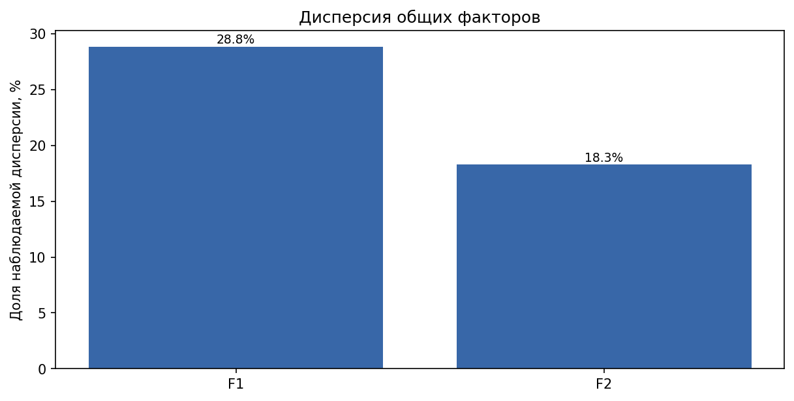

### F1 Антивоенная критика и электоральная легитимность ↔ Антизападная мобилизация и суверенитет

Первая ось пространства отражает противопоставление между публичной антивоенной риторикой, критикой федеральной власти и акцентом на конкурентных выборах — с одной стороны, и акцентом на противостоянии Западу, мобилизационной риторике, суверенитете, национально-патриотических установках и централизации — с другой. Высокие значения по этой оси характерны для образов, где доминируют призывы к миру, критика действующей власти, поддержка электоральной легитимности, открытость к международной интеграции и универсальным правам. Низкие значения связаны с акцентом на противостоянии западным странам, мобилизационными призывами, риторикой суверенитета, защиты интересов национальной общности и поддержкой административной вертикали.

Эта ось определяет ключевое различие между публичными образами, ориентированными на критику власти, электоральный мандат и международную интеграцию, и образами, строящимися на мобилизации, антагонизме к Западу, национальной идентичности и поддержке существующего порядка. Ось не фиксирует причинность между этими свойствами, а лишь отражает их совместное проявление в публичных позициях. Отличие от других осей — в сочетании внешнеполитических, институциональных и риторических признаков, а не только в способах действия или организационной структуре.

| Полюс | Шкала | Нагрузка |
| --- | --- | --- |
| Положительный | Прекращение военных действий — их продолжение | +0.888 |
| Положительный | Критика действующей власти — поддержка её курса | +0.713 |
| Положительный | Электоральный мандат — административный мандат | +0.612 |
| Отрицательный | Противостояние Западу — сближение с Западом | -0.837 |
| Отрицательный | Мобилизационный призыв — обсуждение и убеждение | -0.741 |
| Отрицательный | Суверенная самостоятельность — международная интеграция | -0.696 |
| Отрицательный | Национальная общность — универсальные права | -0.690 |
| Отрицательный | Централизация — децентрализация | -0.609 |
| Отрицательный | Лозунговая простота — развёрнутая аргументация | -0.475 |

### F2 Институциональная партийность и централизация ↔ Конфронтационная персонализация и протест

Вторая ось выделяет различие между акцентом на институциональной работе через парламентские процедуры, партийной организацией и централизацией полномочий — и противоположным полюсом, где преобладают конфронтационная риторика, персонализированный стиль, протестные и внеинституциональные действия. Высокие значения по этой оси соответствуют образам, где изменения связываются с действующими институтами, партийной дисциплиной и вертикалью власти, а публичная риторика склонна к компромиссу и коллективному авторству. Низкие значения характерны для образов с ярко выраженной конфронтационностью, персонализацией, протестной стратегией и акцентом на самостоятельности от партийных структур.

Эта ось позволяет различать публичные образы, ориентированные на коллективные институты и формальные процедуры, и образы, строящиеся на личном бренде, конфликтности и протестной активности. В отличие от первой оси, здесь на первый план выходят способы организации и формы публичного действия, а не внешнеполитические или идеологические установки.

| Полюс | Шкала | Нагрузка |
| --- | --- | --- |
| Положительный | Институциональная работа — протестное действие | +0.786 |
| Положительный | Партийная организация — независимая инициатива | +0.501 |
| Положительный | Централизация — децентрализация | +0.382 |
| Отрицательный | Конфронтация — компромисс | -0.808 |
| Отрицательный | Персональный бренд — коллективный институт | -0.743 |
| Отрицательный | Критика действующей власти — поддержка её курса | -0.558 |
| Отрицательный | Мобилизационный призыв — обсуждение и убеждение | -0.440 |
| Отрицательный | Внешняя повестка — внутренняя повестка | -0.383 |

### Полная матрица факторных нагрузок

Приведены все шкалы, вошедшие в расчёт. Факторный анализ не прикрепляет каждую шкалу к единственной группе: возможны перекрёстные нагрузки и слабая связь со всеми выделенными факторами. Для интерпретации выше используется порог |нагрузки| ≥ 0,35. Знак относится к положительному свойству шкалы; направление каждой оси условно.

| Шкала | F1 | F2 |
| --- | --- | --- |
| Суверенная самостоятельность — международная интеграция | -0.696 | +0.157 |
| Практические результаты — идеологические принципы | -0.146 | +0.290 |
| Институциональная работа — протестное действие | -0.238 | +0.786 |
| Критика действующей власти — поддержка её курса | +0.713 | -0.558 |
| Социальное перераспределение — личная экономическая ответственность | -0.083 | +0.028 |
| Централизация — децентрализация | -0.609 | +0.382 |
| Мобилизационный призыв — обсуждение и убеждение | -0.741 | -0.440 |
| Конфронтация — компромисс | -0.264 | -0.808 |
| Персональный бренд — коллективный институт | +0.227 | -0.743 |
| Противостояние Западу — сближение с Западом | -0.837 | +0.153 |
| Партийная организация — независимая инициатива | -0.394 | +0.501 |
| Внешняя повестка — внутренняя повестка | +0.005 | -0.383 |
| Прекращение военных действий — их продолжение | +0.888 | -0.035 |
| Электоральный мандат — административный мандат | +0.612 | -0.161 |
| Лозунговая простота — развёрнутая аргументация | -0.475 | -0.270 |
| Национальная общность — универсальные права | -0.690 | -0.026 |
| Коалиционное сотрудничество — самостоятельная конкуренция | +0.245 | -0.042 |

## Карты объектов и признаков

### Объекты в факторных координатах

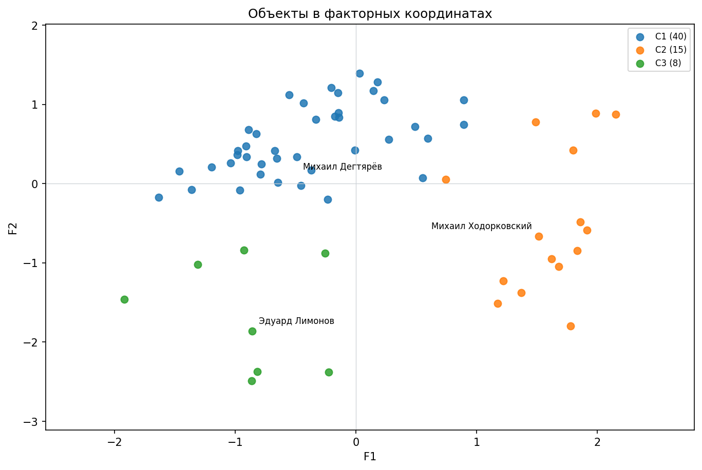

### Семантические шкалы: нагрузки F1/F2

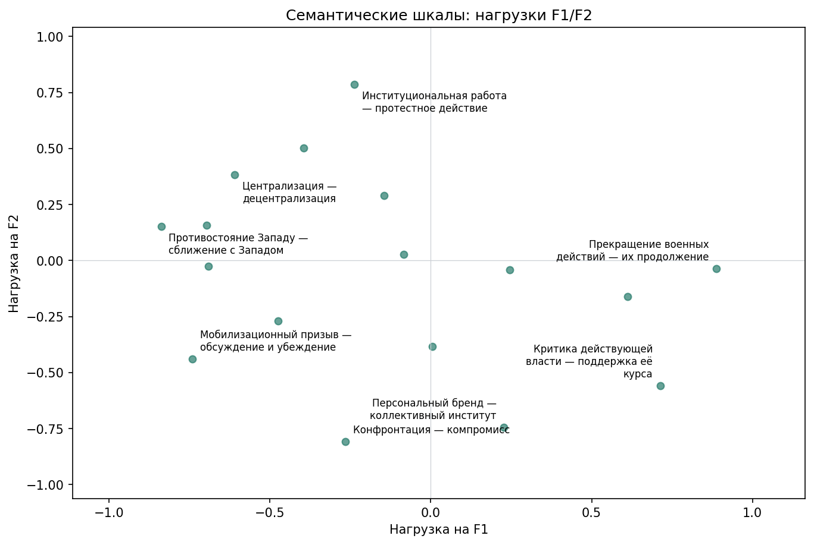

### Профили объектов

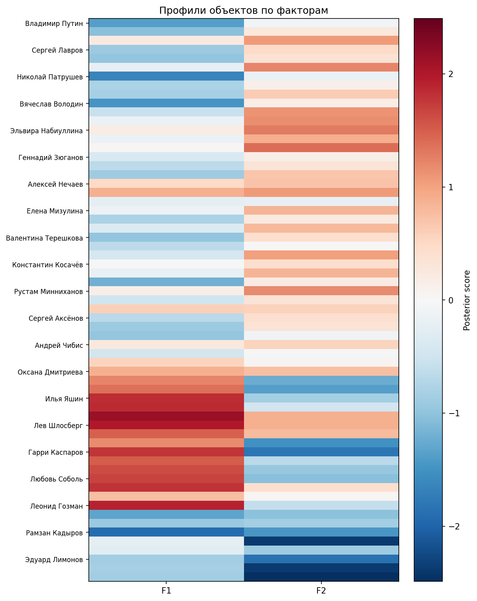

### Профили групп

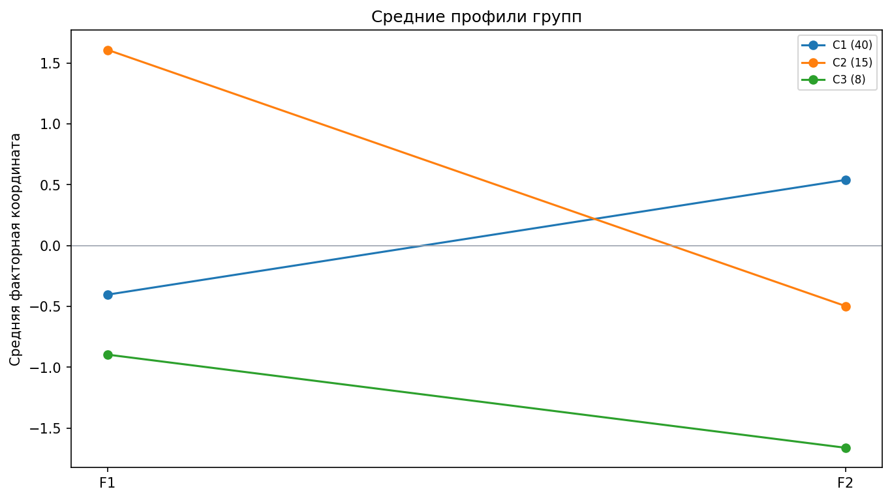

### t-SNE объектов

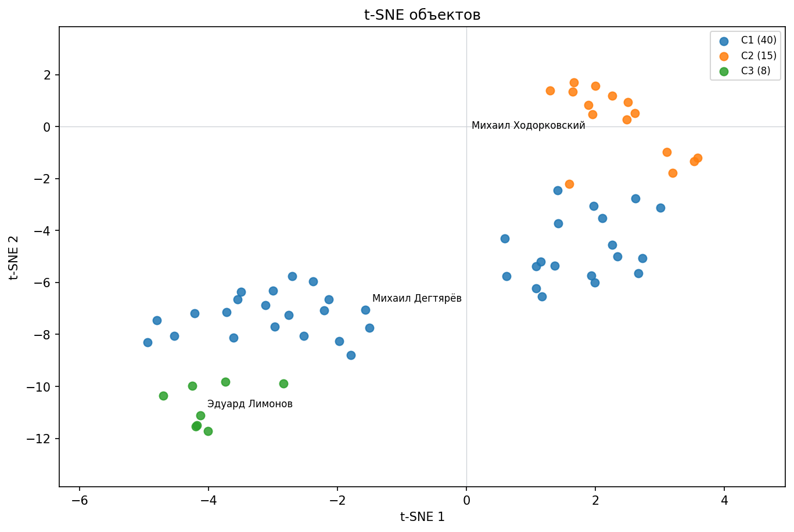

### t-SNE семантических шкал

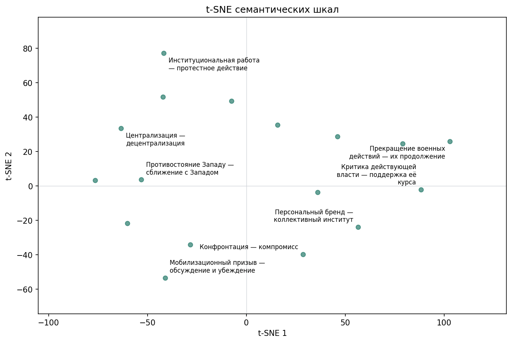

## Сравнение кластерных решений

| k | Силуэт | Мин. группа | Макс. группа | Средний ARI | Мин. медианный Jaccard групп |
| --- | --- | --- | --- | --- | --- |
| 2 | 0.446 | 19 | 44 | 0.766 | 0.938 |
| 3 | 0.508 | 8 | 40 | 0.914 | 1.000 |
| 4 | 0.473 | 8 | 30 | 0.781 | 0.757 |
| 5 | 0.486 | 8 | 21 | 0.948 | 0.944 |
| 6 | 0.509 | 4 | 21 | 0.883 | 0.449 |
| 7 | 0.512 | 4 | 21 | 0.946 | 1.000 |
| 8 | 0.475 | 4 | 16 | 0.846 | 0.312 |
| 9 | 0.458 | 4 | 16 | 0.815 | 0.404 |
| 10 | 0.458 | 3 | 12 | 0.863 | 0.500 |

Трёхкластерное решение выделяет три содержательно различимых профиля, каждый из которых характеризуется уникальным сочетанием нагруженных свойств. Первый кластер объединяет акторов, ориентированных на институциональные процедуры и умеренную поддержку действующей власти, второй — выраженных сторонников антивоенной риторики, критики власти и интеграции с Западом, а третий — группу с выраженной конфронтационностью, мобилизационной риторикой и персонализацией. Эти профили различаются не только по ключевым факторам, но и по ряду шкал с крупными сдвигами относительно всей выборки, что позволяет говорить о содержательной интерпретируемости каждого кластера.

При дальнейшем увеличении числа кластеров (k > 3) происходит преимущественно дробление уже выделенных профилей на более мелкие подгруппы, различия между которыми выражены слабее и часто касаются нюансов внутри уже описанных направлений (например, разделение умеренных и радикальных представителей внутри одного лагеря). При этом новые кластеры зачастую оказываются малы по размеру и менее устойчивы, а их содержательная специфика не столь отчётлива, как у трёх основных профилей. Таким образом, k=3 выбрано как рабочий компромисс между различимостью, интерпретируемостью и ценой дополнительного дробления.

Численная сводка из расчёта: у k=3 силуэт 0.508; наибольший силуэт среди проверенных вариантов — 0.512 при k=7. Медианный ARI выбранного разбиения — 1.000, минимальный по группам медианный Jaccard — 1.000. Содержательное предпочтение не означает максимума всех численных показателей или доказательства естественных классов. Средний ARI — 0.914, минимальный ARI — 0.360; устойчивость оценена при фиксированных факторных координатах, без повторного сбора досье и оценивания.

| k | Содержательное сравнение |
| --- | --- |
| 2 | Два кластера отражают базовое противостояние между сторонниками антивоенной, оппозиционной риторики и группой, поддерживающей действующую власть и мобилизационные установки. Однако внутри обоих кластеров сохраняется значительная внутренняя неоднородность: например, в одном объединяются как умеренные, так и радикальные критики, а в другом — как технократы, так и ярко выраженные конфронтационные фигуры. Это решение полезно для самой общей дихотомии, но теряет важные содержательные различия. |
| 3 | Три кластера дают содержательно различимые профили: 1) институционально-лоялистский, 2) антивоенно-оппозиционный с акцентом на интеграцию и права, 3) радикально-конфронтационный с персонализацией и мобилизационной риторикой. Каждый профиль выделяется по ряду шкал с крупными сдвигами, различия между группами отчётливы и интерпретируемы. Это решение минимизирует дробление близких профилей и сохраняет устойчивость. |
| 4 | При четырёх кластерах происходит разделение умеренно-лоялистской и технократической части институционального лагеря, а также выделение отдельной группы умеренных оппозиционеров. Однако новые группы менее отчётливо различаются по ключевым шкалам, а часть различий становится количественной, а не качественной. Содержательная новизна по сравнению с k=3 ограничена. |
| 5 | Пятикластерное решение выделяет отдельный технократический кластер и более дробно описывает умеренных оппозиционеров и умеренных лоялистов. Однако различия между новыми группами становятся менее выраженными, а часть кластеров близка по профилю к уже существующим. Это решение полезно для более детального анализа, но цена дробления возрастает. |
| 6 | При шести кластерах появляются очень малочисленные группы, различия между которыми часто касаются нюансов внутри уже выделенных направлений (например, разделение радикальных и умеренных в пределах оппозиции или лоялистов). Содержательная интерпретируемость новых кластеров снижается, а устойчивость некоторых из них оказывается ниже. |
| 7 | Семикластерное решение даёт более подробную детализацию, выделяя малые группы с уникальными сочетаниями свойств (например, отдельные радикальные персоналистские профили или специфические технократические подгруппы). Однако различия между некоторыми кластерами становятся не столь отчётливыми, а часть новых групп оказывается очень малочисленной. Это решение оправдано только для задач глубокой типологизации. |
| 8 | Восьмикластерное решение приводит к дальнейшему дроблению, при котором появляются кластеры с минимальным числом участников и неустойчивыми профилями. Содержательная новизна по сравнению с k=7 минимальна, а интерпретируемость новых групп затруднена. |
| 9 | Девятикластерное решение вносит дополнительное дробление, при котором часть кластеров становится избыточно малой и различия между ними теряют содержательную отчётливость. Новые группы в основном повторяют уже выделенные профили с незначительными вариациями. |
| 10 | Десятикластерное решение приводит к появлению очень малых и слабо различимых групп, различия между которыми зачастую не имеют самостоятельного содержательного значения. Это решение не добавляет новых интерпретируемых профилей по сравнению с меньшими k. |

## Интерпретация групп

### C1 Институциональная поддержка курса и партийная централизация

Размер: 40 объектов (63.5% выборки). Общность этой группы определяется устойчивой поддержкой действующей федеральной власти, акцентом на продолжении военных действий, институциональной работой через парламентские процедуры и партийной организацией. Для большинства представителей характерна коллективная, а не персонализированная публичность, а также выраженная антизападная риторика и поддержка вертикали власти. Типичные представители — руководители федеральных органов, парламентских партий и региональные лидеры, чьи публичные образы строятся на лояльности к центру, партийной дисциплине и институциональной легитимности.

Внутри группы возможны различия по степени выраженности отдельных шкал (например, между экономическими технократами и идеологическими партийными лидерами), однако объединяет их именно сочетание институциональной стратегии, поддержки курса и коллективного авторства. Пограничные случаи встречаются среди фигур с частичным акцентом на региональной идентичности или умеренной критикой, но в целом группа отличается от других устойчивым профилем поддержки существующего порядка.

Состав: Владимир Путин, Дмитрий Медведев, Михаил Мишустин, Сергей Лавров, Сергей Шойгу, Андрей Белоусов, Николай Патрушев, Александр Бортников, Сергей Кириенко, Вячеслав Володин, Валентина Матвиенко, Дмитрий Песков, Эльвира Набиуллина, Антон Силуанов, Татьяна Голикова, Геннадий Зюганов, Леонид Слуцкий, Сергей Миронов, Алексей Нечаев, Владислав Даванков, Наталья Поклонская, Елена Мизулина, Виталий Милонов, Нина Останина, Валентина Терешкова, Александр Хинштейн, Алексей Пушков, Константин Косачёв, Сергей Собянин, Александр Беглов, Рустам Минниханов, Михаил Дегтярёв, Сергей Левченко, Сергей Аксёнов, Михаил Развожаев, Вячеслав Гладков, Андрей Чибис, Вадим Шумков, Николай Платошкин, Оксана Дмитриева

Ближайшие к центру представители: Михаил Дегтярёв, Нина Останина, Сергей Аксёнов, Леонид Слуцкий, Геннадий Зюганов

| Отличительная шкала | Среднее группы | Среднее выборки | Различие в σ |
| --- | --- | --- | --- |
| Критика действующей власти — поддержка её курса | -2.79 | -0.42 | -0.64 |
| Прекращение военных действий — их продолжение | -2.29 | -0.43 | -0.57 |
| Институциональная работа — протестное действие | +3.24 | +1.73 | +0.56 |
| Персональный бренд — коллективный институт | -1.12 | -0.03 | -0.51 |
| Партийная организация — независимая инициатива | +1.63 | +0.45 | +0.48 |
| Противостояние Западу — сближение с Западом | +2.07 | +0.98 | +0.45 |

### C2 Антивоенная оппозиция и электоральная легитимность

Размер: 15 объектов (23.8% выборки). Группа объединяет публичные образы с выраженной критикой действующей власти, антивоенной риторикой, акцентом на конкурентных выборах, поддержкой международной интеграции, универсальных прав и децентрализации. Организационные стратегии внутри группы могут различаться: близость по главным факторам не требует единой партийной формы. Типичные профили сочетают критику действующего курса, призывы к прекращению военных действий и электоральный мандат как источник полномочий.

Внутри группы возможны различия по степени акцентирования отдельных тем (например, между либеральными и левоцентристскими позициями), однако всех объединяет сочетание антивоенной, оппозиционной и электорально-легитимистской риторики. Граница группы проходит по выраженности критики власти и антивоенных позиций; пограничные случаи встречаются среди умеренных реформаторов и независимых кандидатов.

Состав: Евгений Ройзман, Алексей Навальный, Илья Яшин, Владимир Кара-Мурза, Григорий Явлинский, Лев Шлосберг, Борис Вишневский, Геннадий Гудков, Гарри Каспаров, Михаил Ходорковский, Владимир Милов, Любовь Соболь, Екатерина Дунцова, Павел Грудинин, Леонид Гозман

Ближайшие к центру представители: Михаил Ходорковский, Владимир Кара-Мурза, Леонид Гозман, Илья Яшин, Владимир Милов

| Отличительная шкала | Среднее группы | Среднее выборки | Различие в σ |
| --- | --- | --- | --- |
| Суверенная самостоятельность — международная интеграция | -2.78 | +1.61 | -1.74 |
| Национальная общность — универсальные права | -1.88 | +1.70 | -1.67 |
| Централизация — децентрализация | -2.89 | +1.17 | -1.61 |
| Критика действующей власти — поддержка её курса | +4.67 | -0.42 | +1.37 |
| Прекращение военных действий — их продолжение | +3.73 | -0.43 | +1.29 |
| Электоральный мандат — административный мандат | +3.45 | +0.18 | +1.20 |

### C3 Конфронтационная мобилизация и персонализация

Размер: 8 объектов (12.7% выборки). Группа характеризуется выраженной конфронтационной риторикой, мобилизационными призывами, персонализированным стилем публичности и протестной стратегией. Здесь преобладают образы, строящиеся на личном бренде, лозунговой простоте, акценте на национальной идентичности и внеинституциональных формах действия. Типичные представители — лидеры радикальных движений, харизматические фигуры и деятели, использующие прямую мобилизацию и конфронтацию как основной инструмент публичной политики.

Внутри группы возможны различия по идеологическим основаниям (от национал-патриотических до левых протестных), однако всех объединяет сочетание персонализации, конфликтности и мобилизационного стиля. Пограничность проявляется у тех, кто сочетает протестную риторику с элементами институциональной работы или коллективного авторства, но в целом группа выделяется по максимальной выраженности конфликтных и мобилизационных признаков.

Состав: Владимир Жириновский, Захар Прилепин, Рамзан Кадыров, Илья Пономарёв, Сергей Удальцов, Эдуард Лимонов, Игорь Стрелков (Гиркин), Евгений Пригожин

Ближайшие к центру представители: Эдуард Лимонов, Игорь Стрелков (Гиркин), Владимир Жириновский, Захар Прилепин, Евгений Пригожин

| Отличительная шкала | Среднее группы | Среднее выборки | Различие в σ |
| --- | --- | --- | --- |
| Конфронтация — компромисс | +3.88 | +0.92 | +1.49 |
| Мобилизационный призыв — обсуждение и убеждение | +3.38 | +0.64 | +1.33 |
| Персональный бренд — коллективный институт | +2.75 | -0.03 | +1.31 |
| Институциональная работа — протестное действие | -1.75 | +1.73 | -1.30 |
| Лозунговая простота — развёрнутая аргументация | +1.14 | -0.55 | +1.01 |
| Национальная общность — универсальные права | +3.71 | +1.70 | +0.95 |

## Интерпретация изученного пространства

Рассчитанное пространство публичных политических образов российских политиков и заметных акторов за 2016–2026 годы структурировано по двум главным осям: первая противопоставляет антивоенную, оппозиционную и электорально-легитимистскую риторику — антизападной мобилизации, суверенитету и поддержке административного порядка; вторая различает институционально-коллективные и партийные стратегии — и конфронтационно-персонализированные, протестные стили публичности.

Выделено три кластера, для которых проверена устойчивость при фиксированных факторных координатах: группа институциональной поддержки курса и партийной централизации, антивоенная оппозиция с акцентом на электоральную легитимность и международную интеграцию, а также конфронтационная мобилизация с персонализированным стилем и протестной стратегией. Основные противопоставления проходят по линиям отношения к власти, способам легитимации, формам публичной риторики и организационной структуре.

Модель позволяет выявить устойчивые сочетания публичных позиций, риторических акцентов и стратегий действия, но не устанавливает причинно-следственных связей между ними. Она не даёт оснований для выводов о личных свойствах, электоральной поддержке или мотивах участников, а также не позволяет судить о распространённости тех или иных позиций в обществе в целом.

Ограничения анализа связаны с разведочным характером исследования, приближённостью линейной факторной модели к порядковым оценкам и условностью кластеризации. Группы могут возникать и в непрерывном пространстве, а устойчивость кластеров не гарантирует полноты охвата всех возможных публичных стратегий.

Интерпретация опирается только на реально выраженные и агрегированные свойства публичных образов, без привязки к партийным ярлыкам или именам. Не все возможные сочетания представлены в выборке, и модель не фиксирует статистическую значимость различий или их причинность.

Слабая заполненность участка этой карты означает отсутствие соответствующего профиля в выбранной выборке и корпусе. Для вывода об идеях, отсутствующих в России по сравнению с другими странами, требуется международная сравнительная выборка, оценённая по тому же словарю. По одному российскому исследованию такой вывод не делается.

## Сравнение факторных моделей: подробности

Номер и знак оси условны. При изменении q нагрузки поворачиваются заново: оси могут менять порядок, направление и распределение содержания. F1 модели q=3 нельзя автоматически считать той же осью, что F1 модели q=2. Соответствие проверяется по полным векторам нагрузок, а не по одинаковому номеру.

Доли дисперсии относятся к модельному описанию стандартизованных шкал. Изменения разбиений сопоставляются при фиксированном числе групп k. Метки групп согласованы по максимальному пересечению составов; простая перестановка C1/C2/C3 не считается переходом объекта.

### Альтернативная модель q=3

Две основные оси q=2 сохраняются. Третий фактор отделяет управленческое обоснование от идеологической, электоральной и децентрализационной аргументации. Описанная общая дисперсия увеличивается с 47,09% до 53,60%, на 6,51 процентного пункта.

Институциональная работа и технократическая результативность перестают восприниматься как одно сочетание. Высокий F3 объединяет идеологическую аргументацию, критику курса и электоральный мандат; это может сближать публичные образы акторов, расходящихся по войне и международной интеграции.

| Ось | Интерпретация | Доля дисперсии |
| --- | --- | --- |
| F1 | Антивоенная критика и интеграция ↔ Антизападная мобилизация и суверенитет | 27.1% |
| F2 | Институциональная и партийная стратегия ↔ Конфронтация и персонализация | 17.8% |
| F3 | Идеологическая критика и выборы ↔ Результативное управление и централизация | 8.7% |

#### q=3, F1: Антивоенная критика и интеграция ↔ Антизападная мобилизация и суверенитет

Первая ось сохраняет главное противопоставление q=2. Высокая координата связана с преобладанием призывов к прекращению военных действий (+0,860), критики федерального курса (+0,602) и электорального мандата (+0,519). Низкая связана с противостоянием Западу (−0,836), мобилизационной риторикой (−0,767), суверенной самостоятельностью (−0,704) и защитой интересов национальной общности (−0,702). Это сочетание оценённых публичных акцентов. Часть связи критики курса с электоральной и управленческой стратегией теперь описывает отдельный F3.

| Полюс | Шкала | Нагрузка |
| --- | --- | --- |
| Положительный | Прекращение военных действий — их продолжение | +0.860 |
| Положительный | Критика действующей власти — поддержка её курса | +0.602 |
| Положительный | Электоральный мандат — административный мандат | +0.519 |
| Отрицательный | Противостояние Западу — сближение с Западом | -0.836 |
| Отрицательный | Мобилизационный призыв — обсуждение и убеждение | -0.767 |
| Отрицательный | Суверенная самостоятельность — международная интеграция | -0.704 |
| Отрицательный | Национальная общность — универсальные права | -0.702 |
| Отрицательный | Лозунговая простота — развёрнутая аргументация | -0.531 |
| Отрицательный | Централизация — децентрализация | -0.506 |
| Отрицательный | Партийная организация — независимая инициатива | -0.407 |

#### q=3, F2: Институциональная и партийная стратегия ↔ Конфронтация и персонализация

Вторая ось сохраняет содержание q=2: высокий полюс объединяет действующие правовые и парламентские процедуры (+0,867) и партию как инструмент действия (+0,660), низкий — конфронтационную полемику (−0,747), персональный бренд (−0,662) и внеинституциональное протестное давление, противоположное первому свойству шкалы институциональной работы. Критика курса дополнительно связана с низкой координатой (−0,516). Ось описывает публичную стратегию и организационную форму действия; наличие должности или партийного билета само по себе не определяет её значение.

| Полюс | Шкала | Нагрузка |
| --- | --- | --- |
| Положительный | Институциональная работа — протестное действие | +0.867 |
| Положительный | Партийная организация — независимая инициатива | +0.660 |
| Отрицательный | Конфронтация — компромисс | -0.747 |
| Отрицательный | Персональный бренд — коллективный институт | -0.662 |
| Отрицательный | Критика действующей власти — поддержка её курса | -0.516 |
| Отрицательный | Внешняя повестка — внутренняя повестка | -0.398 |
| Отрицательный | Мобилизационный призыв — обсуждение и убеждение | -0.377 |

#### q=3, F3: Идеологическая критика и выборы ↔ Результативное управление и централизация

Третья ось отделяет сочетание свойств, ранее распределённое между двумя широкими осями. Высокий полюс объединяет идеологическое обоснование и символические цели, противоположные практической результативности (нагрузка шкалы результативности −0,627), критику курса (+0,554), электоральный мандат (+0,489) и децентрализацию (нагрузка централизации −0,472). На низком полюсе — обратное сочетание с управленческой результативностью и централизацией. Это публичное обоснование программы, а не реальная компетентность управленца.

Новая ось позволяет различать институциональную форму действия и способ её обоснования: парламентская стратегия не обязательно технократична, а идеологическая и электоральная риторика не обязательно означает протест вне институтов. Фактор поддерживают четыре нагрузки с модулем не ниже 0,35; более слабые связи социальной политики и персонализации не должны определять его название. Похожие координаты могут сочетаться с противоположными значениями F1, поэтому общность по F3 не означает единого лагеря или союза.

| Полюс | Шкала | Нагрузка |
| --- | --- | --- |
| Положительный | Критика действующей власти — поддержка её курса | +0.554 |
| Положительный | Электоральный мандат — административный мандат | +0.489 |
| Отрицательный | Практические результаты — идеологические принципы | -0.627 |
| Отрицательный | Централизация — децентрализация | -0.472 |

#### Полная матрица нагрузок q=3

| Шкала | F1 | F2 | F3 |
| --- | --- | --- | --- |
| Суверенная самостоятельность — международная интеграция | -0.704 | +0.233 | +0.004 |
| Практические результаты — идеологические принципы | -0.005 | +0.105 | -0.627 |
| Институциональная работа — протестное действие | -0.179 | +0.867 | -0.084 |
| Критика действующей власти — поддержка её курса | +0.602 | -0.516 | +0.554 |
| Социальное перераспределение — личная экономическая ответственность | -0.138 | +0.123 | +0.314 |
| Централизация — децентрализация | -0.506 | +0.311 | -0.472 |
| Мобилизационный призыв — обсуждение и убеждение | -0.767 | -0.377 | -0.031 |
| Конфронтация — компромисс | -0.344 | -0.747 | +0.135 |
| Персональный бренд — коллективный институт | +0.118 | -0.662 | +0.324 |
| Противостояние Западу — сближение с Западом | -0.836 | +0.236 | -0.075 |
| Партийная организация — независимая инициатива | -0.407 | +0.660 | +0.172 |
| Внешняя повестка — внутренняя повестка | -0.025 | -0.398 | +0.001 |
| Прекращение военных действий — их продолжение | +0.860 | -0.080 | +0.174 |
| Электоральный мандат — административный мандат | +0.519 | -0.071 | +0.489 |
| Лозунговая простота — развёрнутая аргументация | -0.531 | -0.144 | +0.138 |
| Национальная общность — универсальные права | -0.702 | +0.050 | +0.009 |
| Коалиционное сотрудничество — самостоятельная конкуренция | +0.259 | -0.106 | -0.065 |

В контроле k=3 сохраняется антивоенная группа из 15 объектов, а группа поддержки курса сокращается с 40 до 35. Путин, Зюганов, Миронов, Милонов и Платошкин переходят в расширенную мобилизационно-идеологическую группу из 13 объектов. Это не означает, что все 13 используют одинаково конфронтационную или протестную стратегию: у Зюганова и Миронова высока институциональная координата F2. При предпочтительном k=4 возникает отдельная группа институциональной электоральной конкуренции из 10 объектов: пять из прежней группы поддержки курса и пять из антивоенной группы. Прежняя конфронтационная восьмёрка сохраняется полностью; персональная антивоенная группа состоит из 10 объектов.

#### Профили групп q=3 при фиксированном k=3

#### C1 Антивоенная критика и международная интеграция: 15 объектов

Группа сохраняет все 15 объектов антивоенной группы q=2. Высокий средний F1 (+1,49) связан с прекращением военных действий, критикой курса и международной интеграцией; стратегии действия внутри группы различаются. Представители центра — Леонид Гозман, Владимир Кара-Мурза и Илья Яшин. Их близость к центру не делает их наиболее крайними представителями каждого факторного полюса.

Центр в факторных координатах: F1=+1.494; F2=-0.521; F3=+0.477.

Полный состав: Евгений Ройзман, Алексей Навальный, Илья Яшин, Владимир Кара-Мурза, Григорий Явлинский, Лев Шлосберг, Борис Вишневский, Геннадий Гудков, Гарри Каспаров, Михаил Ходорковский, Владимир Милов, Любовь Соболь, Екатерина Дунцова, Павел Грудинин, Леонид Гозман

Ближайшие к центру: Леонид Гозман, Владимир Кара-Мурза, Илья Яшин, Любовь Соболь, Михаил Ходорковский

| Шкала | Среднее группы | Среднее выборки | Различие в σ |
| --- | --- | --- | --- |
| Суверенная самостоятельность — международная интеграция | -2.78 | +1.61 | -1.74 |
| Национальная общность — универсальные права | -1.88 | +1.70 | -1.67 |
| Централизация — децентрализация | -2.89 | +1.17 | -1.61 |
| Критика действующей власти — поддержка её курса | +4.67 | -0.42 | +1.37 |
| Прекращение военных действий — их продолжение | +3.73 | -0.43 | +1.29 |
| Электоральный мандат — административный мандат | +3.45 | +0.18 | +1.20 |

#### C2 Институциональная поддержка курса и управленческие акценты: 35 объектов

Сочетаются сравнительно низкая критика курса, административный мандат, централизация и институциональная работа. Средние координаты F3=−0,57 и F2=+0,47 отделяют эту группу от идеологической и конфронтационной риторики. Представители центра — Михаил Дегтярёв, Константин Косачёв и Сергей Аксёнов. Это агрегированный профиль, а не утверждение об одинаковых позициях всех 35 объектов.

Центр в факторных координатах: F1=-0.229; F2=+0.467; F3=-0.569.

Полный состав: Дмитрий Медведев, Михаил Мишустин, Сергей Лавров, Сергей Шойгу, Андрей Белоусов, Николай Патрушев, Александр Бортников, Сергей Кириенко, Вячеслав Володин, Валентина Матвиенко, Дмитрий Песков, Эльвира Набиуллина, Антон Силуанов, Татьяна Голикова, Леонид Слуцкий, Алексей Нечаев, Владислав Даванков, Наталья Поклонская, Елена Мизулина, Нина Останина, Валентина Терешкова, Александр Хинштейн, Алексей Пушков, Константин Косачёв, Сергей Собянин, Александр Беглов, Рустам Минниханов, Михаил Дегтярёв, Сергей Левченко, Сергей Аксёнов, Михаил Развожаев, Вячеслав Гладков, Андрей Чибис, Вадим Шумков, Оксана Дмитриева

Ближайшие к центру: Михаил Дегтярёв, Константин Косачёв, Сергей Аксёнов, Антон Силуанов, Сергей Кириенко

| Шкала | Среднее группы | Среднее выборки | Различие в σ |
| --- | --- | --- | --- |
| Критика действующей власти — поддержка её курса | -3.06 | -0.42 | -0.71 |
| Электоральный мандат — административный мандат | -1.48 | +0.18 | -0.61 |
| Прекращение военных действий — их продолжение | -2.22 | -0.43 | -0.55 |
| Персональный бренд — коллективный институт | -1.20 | -0.03 | -0.55 |
| Практические результаты — идеологические принципы | +2.09 | +0.95 | +0.54 |
| Институциональная работа — протестное действие | +3.09 | +1.73 | +0.51 |

#### C3 Мобилизационная риторика и идеологические акценты: 13 объектов

Расширенная группа объединяется мобилизационной риторикой (+1,03 σ относительно всей выборки), меньшим преобладанием практических результатов над идеологическими принципами (−0,97 σ) и лозунговой простотой (+0,93 σ). Её центр характеризуют F1=−1,01, F3=+0,97, F2=−0,58; ближайшие представители — Захар Прилепин, Сергей Удальцов и Владимир Жириновский. Добавившиеся Путин, Зюганов, Миронов, Милонов и Платошкин не обязательно разделяют весь стиль исходной восьмёрки. У части из них выражена институциональная стратегия, поэтому k=3 скрывает различия, которые становятся видимыми при k=4.

Центр в факторных координатах: F1=-1.014; F2=-0.584; F3=+0.972.

Полный состав: Владимир Путин, Геннадий Зюганов, Владимир Жириновский, Сергей Миронов, Захар Прилепин, Виталий Милонов, Рамзан Кадыров, Николай Платошкин, Илья Пономарёв, Сергей Удальцов, Эдуард Лимонов, Игорь Стрелков (Гиркин), Евгений Пригожин

Ближайшие к центру: Захар Прилепин, Сергей Удальцов, Владимир Жириновский, Эдуард Лимонов, Виталий Милонов

| Шкала | Среднее группы | Среднее выборки | Различие в σ |
| --- | --- | --- | --- |
| Мобилизационный призыв — обсуждение и убеждение | +2.77 | +0.64 | +1.03 |
| Практические результаты — идеологические принципы | -1.08 | +0.95 | -0.97 |
| Лозунговая простота — развёрнутая аргументация | +1.00 | -0.55 | +0.93 |
| Конфронтация — компромисс | +2.62 | +0.92 | +0.85 |
| Прекращение военных действий — их продолжение | -3.18 | -0.43 | -0.85 |
| Национальная общность — универсальные права | +3.45 | +1.70 | +0.82 |

### Альтернативная модель q=4

Главные два контраста сохраняются как F2 и F3, причём F3 имеет обратную ориентацию относительно F2 базовой модели. Централизация преимущественно выделяется в F1, управленческое обоснование и социальная программа — в F4. Описанная общая дисперсия составляет 58,82%, ещё на 5,22 процентного пункта больше q=3.

q=4 показывает различимость централизации и технократической результативности. Это уточняет, почему некоторые партийные и электоральные образы могут быть близки к антивоенной группе по одним координатам, сохраняя отличие по войне и внешней интеграции. Интерпретация F1 должна учитывать доминирование шкалы централизации, F4 — наличие только двух сильных индикаторов.

| Ось | Интерпретация | Доля дисперсии |
| --- | --- | --- |
| F1 | Децентрализация и персональная инициатива ↔ Централизация | 11.0% |
| F2 | Антивоенная критика и интеграция ↔ Антизападная мобилизация и суверенитет | 24.6% |
| F3 | Конфронтация и персонализация ↔ Институциональная и партийная стратегия | 16.4% |
| F4 | Результативное управление ↔ Идеологическая и социальная программа | 6.8% |

#### q=4, F1: Децентрализация и персональная инициатива ↔ Централизация

Первая ось прежде всего выделяет распределение власти: нагрузка шкалы «Централизация — децентрализация» равна −0,925. Высокая координата связана с децентрализацией, критикой курса (+0,493), персональным брендом (+0,466) и электоральным мандатом (+0,432). Низкая — с преобладанием централизации и обратным сочетанием сопутствующих акцентов. Отношение к войне и внешней интеграции преимущественно относится к F2, поэтому F1 нельзя считать общей шкалой оппозиционности.

Шкала централизации заметно доминирует над остальными индикаторами. Интерпретацию стоит сохранять узкой: распределение полномочий с сопутствующими публичными стратегиями. В q=4 централизация описывается более отдельно от управленческой результативности и отношения к войне. Для проверки широты и переносимости этого измерения нужны дополнительные независимые индикаторы распределения власти и новая выборка; доминирование одной нагрузки само по себе не делает решение непригодным.

| Полюс | Шкала | Нагрузка |
| --- | --- | --- |
| Положительный | Критика действующей власти — поддержка её курса | +0.493 |
| Положительный | Персональный бренд — коллективный институт | +0.466 |
| Положительный | Электоральный мандат — административный мандат | +0.432 |
| Отрицательный | Централизация — децентрализация | -0.925 |

#### q=4, F2: Антивоенная критика и интеграция ↔ Антизападная мобилизация и суверенитет

Вторая ось продолжает F1 решений q=2 и q=3: изменение номера не означает нового политического противопоставления. Высокая координата связана с призывами прекратить военные действия (+0,863), критикой курса (+0,578) и электоральным мандатом (+0,469). Низкая — с противостоянием Западу (−0,834), суверенной самостоятельностью (−0,722), мобилизацией (−0,686) и защитой интересов национальной общности (−0,645). Сохранение сочетания при изменении q поддерживает его описательную роль в данной матрице; это не оценка распространённости позиций в обществе.

| Полюс | Шкала | Нагрузка |
| --- | --- | --- |
| Положительный | Прекращение военных действий — их продолжение | +0.863 |
| Положительный | Критика действующей власти — поддержка её курса | +0.578 |
| Положительный | Электоральный мандат — административный мандат | +0.469 |
| Отрицательный | Противостояние Западу — сближение с Западом | -0.834 |
| Отрицательный | Суверенная самостоятельность — международная интеграция | -0.722 |
| Отрицательный | Мобилизационный призыв — обсуждение и убеждение | -0.686 |
| Отрицательный | Национальная общность — универсальные права | -0.645 |
| Отрицательный | Лозунговая простота — развёрнутая аргументация | -0.511 |
| Отрицательный | Партийная организация — независимая инициатива | -0.421 |

#### q=4, F3: Конфронтация и персонализация ↔ Институциональная и партийная стратегия

Третья ось воспроизводит F2 решений q=2 и q=3 с обратным знаком. Высокая координата соответствует конфронтации (+0,768), персональному бренду (+0,626), мобилизационной риторике (+0,460) и протестному давлению, противоположному парламентским процедурам (нагрузка −0,835). Низкая связана с институциональной работой, партией как инструментом действия (−0,611), компромиссной риторикой и коллективным представительством. Это прежнее различие публичных стратегий, а не новая политическая идеология; знак факторной оси условен.

| Полюс | Шкала | Нагрузка |
| --- | --- | --- |
| Положительный | Конфронтация — компромисс | +0.768 |
| Положительный | Персональный бренд — коллективный институт | +0.626 |
| Положительный | Мобилизационный призыв — обсуждение и убеждение | +0.460 |
| Положительный | Критика действующей власти — поддержка её курса | +0.448 |
| Положительный | Внешняя повестка — внутренняя повестка | +0.394 |
| Отрицательный | Институциональная работа — протестное действие | -0.835 |
| Отрицательный | Партийная организация — независимая инициатива | -0.611 |

#### q=4, F4: Результативное управление ↔ Идеологическая и социальная программа

Четвёртая ось выделяет способ обоснования публичной программы. На высоком полюсе сильнее преобладают измеримые результаты и управленческая эффективность над идеологическими принципами и символическими целями (+0,765). Второй сильный индикатор — социальная политика (−0,426): низкая координата связана с большим приоритетом государственных гарантий и перераспределения относительно личных и частных механизмов поддержки. Противоположный полюс можно описать как идеологическую и социальную программу. Здесь не измеряются фактические социальные расходы или результативность управления.

При пороге |нагрузка| ≥ 0,35 у фактора только два сильных индикатора. Критика власти (−0,343) и электоральный мандат (−0,306) остаются ниже порога и не позволяют называть ось широким противопоставлением власти и оппозиции. По сравнению с q=3 управленческая результативность становится более самостоятельной, а централизация преимущественно относится к F1. Это полезная детализация для данной выборки, требующая проверки воспроизводимости из-за узкой индикаторной основы.

| Полюс | Шкала | Нагрузка |
| --- | --- | --- |
| Положительный | Практические результаты — идеологические принципы | +0.765 |
| Отрицательный | Социальное перераспределение — личная экономическая ответственность | -0.426 |

#### Полная матрица нагрузок q=4

| Шкала | F1 | F2 | F3 | F4 |
| --- | --- | --- | --- | --- |
| Суверенная самостоятельность — международная интеграция | -0.115 | -0.722 | -0.197 | -0.045 |
| Практические результаты — идеологические принципы | -0.163 | -0.045 | -0.104 | +0.765 |
| Институциональная работа — протестное действие | -0.198 | -0.207 | -0.835 | -0.006 |
| Критика действующей власти — поддержка её курса | +0.493 | +0.578 | +0.448 | -0.343 |
| Социальное перераспределение — личная экономическая ответственность | -0.108 | -0.073 | -0.086 | -0.426 |
| Централизация — децентрализация | -0.925 | -0.316 | -0.176 | +0.047 |
| Мобилизационный призыв — обсуждение и убеждение | -0.254 | -0.686 | +0.460 | -0.084 |
| Конфронтация — компромисс | +0.064 | -0.292 | +0.768 | -0.158 |
| Персональный бренд — коллективный институт | +0.466 | +0.072 | +0.626 | -0.114 |
| Противостояние Западу — сближение с Западом | -0.205 | -0.834 | -0.180 | -0.018 |
| Партийная организация — независимая инициатива | -0.108 | -0.421 | -0.611 | -0.209 |
| Внешняя повестка — внутренняя повестка | -0.027 | +0.022 | +0.394 | -0.136 |
| Прекращение военных действий — их продолжение | +0.218 | +0.863 | +0.016 | -0.138 |
| Электоральный мандат — административный мандат | +0.432 | +0.469 | +0.018 | -0.306 |
| Лозунговая простота — развёрнутая аргументация | -0.023 | -0.511 | +0.190 | -0.177 |
| Национальная общность — универсальные права | -0.276 | -0.645 | +0.030 | -0.101 |
| Коалиционное сотрудничество — самостоятельная конкуренция | -0.155 | +0.328 | +0.113 | -0.066 |

При контроле k=3 дополнительно к пяти переходам q=3 Слуцкий перемещается в мобилизационно-идеологическую группу, а Нечаев, Даванков, Левченко и Дмитриева — в расширенную электоральную альтернативу. Последнее не делает всех четырёх антивоенными или проинтеграционными в одинаковой степени: близость учитывает четыре координаты, особенно распределение полномочий и институциональный стиль. При k=4 возникают группы 9/10/31/13. По сравнению с q=3, k=4 персональная антивоенная десятка сохраняется полностью; исходная конфронтационная восьмёрка пополняется Путиным, а институциональная электоральная десятка — Слуцким, Нечаевым и Даванковым. После согласования номеров группы сохраняют 59 из 63 объектов.

#### Профили групп q=4 при фиксированном k=3

#### C1 Электоральная альтернатива и децентрализация: 19 объектов

К прежней антивоенной группе добавляются Нечаев, Даванков, Левченко и Дмитриева. Центр имеет F2=+1,13 и F1=+0,98; различия от выборки особенно заметны по международной интеграции, универсальным правам и децентрализации. Представители центра — Леонид Гозман и Илья Яшин. Средний F3 близок к нулю (+0,05), потому что институциональная и персонально-конфронтационная стратегии внутри группы различаются. Новых участников нельзя автоматически считать одинаково антивоенными; при k=4 институциональная стратегия выделяется отдельно.

Центр в факторных координатах: F1=+0.984; F2=+1.132; F3=+0.048; F4=-0.016.

Полный состав: Алексей Нечаев, Владислав Даванков, Сергей Левченко, Евгений Ройзман, Алексей Навальный, Илья Яшин, Владимир Кара-Мурза, Григорий Явлинский, Лев Шлосберг, Борис Вишневский, Геннадий Гудков, Гарри Каспаров, Михаил Ходорковский, Владимир Милов, Любовь Соболь, Екатерина Дунцова, Павел Грудинин, Леонид Гозман, Оксана Дмитриева

Ближайшие к центру: Леонид Гозман, Илья Яшин, Михаил Ходорковский, Борис Вишневский, Евгений Ройзман

| Шкала | Среднее группы | Среднее выборки | Различие в σ |
| --- | --- | --- | --- |
| Суверенная самостоятельность — международная интеграция | -2.18 | +1.61 | -1.50 |
| Национальная общность — универсальные права | -1.50 | +1.70 | -1.50 |
| Централизация — децентрализация | -2.31 | +1.17 | -1.38 |
| Прекращение военных действий — их продолжение | +3.29 | -0.43 | +1.15 |
| Противостояние Западу — сближение с Западом | -1.65 | +0.98 | -1.08 |
| Критика действующей власти — поддержка её курса | +3.47 | -0.42 | +1.05 |

#### C2 Централизация и управленческое представительство: 30 объектов

Центр характеризуют централизация (F1=−0,62), сравнительно практическое управленческое обоснование (F4=+0,46) и институциональный стиль (F3=−0,35). В сравнении со всей выборкой меньше преобладают электоральный мандат и критика курса. Представители — Михаил Дегтярёв и Сергей Лавров. Это административно-институциональная часть исходной группы из 40 объектов, сохранившаяся после описанных переходов.

Центр в факторных координатах: F1=-0.623; F2=-0.282; F3=-0.354; F4=+0.460.

Полный состав: Дмитрий Медведев, Михаил Мишустин, Сергей Лавров, Сергей Шойгу, Андрей Белоусов, Николай Патрушев, Александр Бортников, Сергей Кириенко, Вячеслав Володин, Валентина Матвиенко, Дмитрий Песков, Эльвира Набиуллина, Антон Силуанов, Татьяна Голикова, Наталья Поклонская, Елена Мизулина, Нина Останина, Валентина Терешкова, Александр Хинштейн, Алексей Пушков, Константин Косачёв, Сергей Собянин, Александр Беглов, Рустам Минниханов, Михаил Дегтярёв, Сергей Аксёнов, Михаил Развожаев, Вячеслав Гладков, Андрей Чибис, Вадим Шумков

Ближайшие к центру: Михаил Дегтярёв, Сергей Лавров, Сергей Шойгу, Михаил Развожаев, Сергей Кириенко

| Шкала | Среднее группы | Среднее выборки | Различие в σ |
| --- | --- | --- | --- |
| Электоральный мандат — административный мандат | -2.11 | +0.18 | -0.83 |
| Критика действующей власти — поддержка её курса | -3.34 | -0.42 | -0.79 |
| Централизация — децентрализация | +2.96 | +1.17 | +0.71 |
| Персональный бренд — коллективный институт | -1.40 | -0.03 | -0.64 |
| Прекращение военных действий — их продолжение | -2.47 | -0.43 | -0.63 |
| Практические результаты — идеологические принципы | +2.17 | +0.95 | +0.58 |

#### C3 Мобилизация и идеологическая программа: 14 объектов

Общность поддерживают лозунговая простота (+0,97 σ), мобилизационная риторика (+0,97 σ) и меньший акцент на практической результативности (−0,93 σ). Центр имеет F2=−1,01, F4=−0,82, F3=+0,55. Ближайшие представители — Сергей Удальцов и Захар Прилепин. Группа включает институциональных партийных акторов и персонально-конфронтационные образы, поэтому её нельзя описывать как однородную протестную организацию или единый политический лагерь.

Центр в факторных координатах: F1=+0.395; F2=-1.007; F3=+0.547; F4=-0.823.

Полный состав: Владимир Путин, Геннадий Зюганов, Владимир Жириновский, Леонид Слуцкий, Сергей Миронов, Захар Прилепин, Виталий Милонов, Рамзан Кадыров, Николай Платошкин, Илья Пономарёв, Сергей Удальцов, Эдуард Лимонов, Игорь Стрелков (Гиркин), Евгений Пригожин

Ближайшие к центру: Сергей Удальцов, Захар Прилепин, Владимир Жириновский, Виталий Милонов, Владимир Путин

| Шкала | Среднее группы | Среднее выборки | Различие в σ |
| --- | --- | --- | --- |
| Лозунговая простота — развёрнутая аргументация | +1.08 | -0.55 | +0.97 |
| Мобилизационный призыв — обсуждение и убеждение | +2.64 | +0.64 | +0.97 |
| Практические результаты — идеологические принципы | -1.00 | +0.95 | -0.93 |
| Прекращение военных действий — их продолжение | -3.17 | -0.43 | -0.85 |
| Национальная общность — универсальные права | +3.42 | +1.70 | +0.81 |
| Конфронтация — компромисс | +2.43 | +0.92 | +0.76 |

### Соответствие осей: q=2 и q=3

| Ось q=2 | Ось q=3 | Конгруэнтность | Согласование знака |
| --- | --- | --- | --- |
| F1 | F1 | 0.992 | Одинаковое направление |
| F2 | F2 | 0.976 | Одинаковое направление |

| q=2 / q=3 | F1 | F2 | F3 |
| --- | --- | --- | --- |
| F1 | 0.992 | -0.309 | 0.440 |
| F2 | -0.143 | 0.976 | -0.518 |

Оси q=3 без отдельной пары в q=2: F3. Отсутствие пары отражает различие размерности; содержательная новизна оценивается по нагрузкам.

Главные углы между факторными подпространствами: 2.6°, 0.6°. Это геометрическая диагностика близости подпространств.

Относительный остаток нагрузок после отображения Прокруста: 0.031. Отображение сопоставляет подпространства и не заменяет исходные именованные оси varimax.

### Соответствие осей: q=2 и q=4

| Ось q=2 | Ось q=4 | Конгруэнтность | Согласование знака |
| --- | --- | --- | --- |
| F1 | F2 | 0.984 | Одинаковое направление |
| F2 | F3 | -0.975 | Обратное направление |

| q=2 / q=4 | F1 | F2 | F3 | F4 |
| --- | --- | --- | --- | --- |
| F1 | 0.724 | 0.984 | 0.194 | -0.132 |
| F2 | -0.528 | -0.156 | -0.975 | 0.374 |

Оси q=4 без отдельной пары в q=2: F1, F4. Отсутствие пары отражает различие размерности; содержательная новизна оценивается по нагрузкам.

Главные углы между факторными подпространствами: 1.7°, 0.4°. Это геометрическая диагностика близости подпространств.

Относительный остаток нагрузок после отображения Прокруста: 0.029. Отображение сопоставляет подпространства и не заменяет исходные именованные оси varimax.

### Соответствие осей: q=3 и q=4

| Ось q=3 | Ось q=4 | Конгруэнтность | Согласование знака |
| --- | --- | --- | --- |
| F1 | F2 | 0.993 | Одинаковое направление |
| F2 | F3 | -0.991 | Обратное направление |
| F3 | F4 | -0.849 | Обратное направление |

| q=3 / q=4 | F1 | F2 | F3 | F4 |
| --- | --- | --- | --- | --- |
| F1 | 0.655 | 0.993 | 0.122 | -0.027 |
| F2 | -0.498 | -0.255 | -0.991 | 0.215 |
| F3 | 0.729 | 0.308 | 0.330 | -0.849 |

Оси q=4 без отдельной пары в q=3: F1. Отсутствие пары отражает различие размерности; содержательная новизна оценивается по нагрузкам.

Главные углы между факторными подпространствами: 8.4°, 0.8°, 0.3°. Это геометрическая диагностика близости подпространств.

Относительный остаток нагрузок после отображения Прокруста: 0.058. Отображение сопоставляет подпространства и не заменяет исходные именованные оси varimax.

### Составы групп при одинаковом k=3

| Модели q | ARI | NMI | Сохранили группу | Сменили группу |
| --- | --- | --- | --- | --- |
| 2 → 3 | 0.777 | 0.800 | 58 | 5 |
| 2 → 4 | 0.549 | 0.603 | 53 | 10 |
| 3 → 4 | 0.753 | 0.765 | 58 | 5 |

Пересечение составов q=2 и q=3 после согласования меток, k=3.

| Исходная / новая группа | C1 | C2 | C3 |
| --- | --- | --- | --- |
| C1 | 35 | 0 | 5 |
| C2 | 0 | 15 | 0 |
| C3 | 0 | 0 | 8 |

#### Все переходы: q=2 → q=3, k=3

| Объект | Исходная группа | Согласованная новая группа |
| --- | --- | --- |
| Владимир Путин | C1 | C3 |
| Геннадий Зюганов | C1 | C3 |
| Сергей Миронов | C1 | C3 |
| Виталий Милонов | C1 | C3 |
| Николай Платошкин | C1 | C3 |

Пересечение составов q=2 и q=4 после согласования меток, k=3.

| Исходная / новая группа | C1 | C2 | C3 |
| --- | --- | --- | --- |
| C1 | 30 | 4 | 6 |
| C2 | 0 | 15 | 0 |
| C3 | 0 | 0 | 8 |

#### Все переходы: q=2 → q=4, k=3

| Объект | Исходная группа | Согласованная новая группа |
| --- | --- | --- |
| Владимир Путин | C1 | C3 |
| Геннадий Зюганов | C1 | C3 |
| Леонид Слуцкий | C1 | C3 |
| Сергей Миронов | C1 | C3 |
| Алексей Нечаев | C1 | C2 |
| Владислав Даванков | C1 | C2 |
| Виталий Милонов | C1 | C3 |
| Сергей Левченко | C1 | C2 |
| Николай Платошкин | C1 | C3 |
| Оксана Дмитриева | C1 | C2 |

Пересечение составов q=3 и q=4 после согласования меток, k=3.

| Исходная / новая группа | C1 | C2 | C3 |
| --- | --- | --- | --- |
| C1 | 15 | 0 | 0 |
| C2 | 4 | 30 | 1 |
| C3 | 0 | 0 | 13 |

#### Все переходы: q=3 → q=4, k=3

| Объект | Исходная группа | Согласованная новая группа |
| --- | --- | --- |
| Леонид Слуцкий | C2 | C3 |
| Алексей Нечаев | C2 | C1 |
| Владислав Даванков | C2 | C1 |
| Сергей Левченко | C2 | C1 |
| Оксана Дмитриева | C2 | C1 |

### Свободный выбор числа групп

Численное предпочтение k — диагностическая рекомендация. Рабочий выбор дополнительно учитывает содержательную различимость полных профилей; увеличение числа групп может лишь дробить близкие сочетания свойств.

#### Кандидаты k при q=2

Численная рекомендация: k=3. Prefer groups >=max(3,ceil(0.05*n)), median resampling ARI>=0.65 and every group's median Jaccard>=0.60; among admissible candidates choose smallest k within 0.02 of the best silhouette. If none qualify, use size-admissible candidates, then all candidates, and explicitly mark uncertainty. User override is allowed.

| k | Силуэт | Мин. группа | Макс. группа | Средний ARI | Мин. медианный Jaccard |
| --- | --- | --- | --- | --- | --- |
| 2 | 0.446 | 19 | 44 | 0.766 | 0.938 |
| 3 | 0.508 | 8 | 40 | 0.914 | 1.000 |
| 4 | 0.473 | 8 | 30 | 0.781 | 0.757 |
| 5 | 0.486 | 8 | 21 | 0.948 | 0.944 |
| 6 | 0.509 | 4 | 21 | 0.883 | 0.449 |
| 7 | 0.512 | 4 | 21 | 0.946 | 1.000 |
| 8 | 0.475 | 4 | 16 | 0.846 | 0.312 |
| 9 | 0.458 | 4 | 16 | 0.815 | 0.404 |
| 10 | 0.458 | 3 | 12 | 0.863 | 0.500 |

#### Кандидаты k при q=3

Численная рекомендация: k=4. Prefer groups >=max(3,ceil(0.05*n)), median resampling ARI>=0.65 and every group's median Jaccard>=0.60; among admissible candidates choose smallest k within 0.02 of the best silhouette. If none qualify, use size-admissible candidates, then all candidates, and explicitly mark uncertainty. User override is allowed.

| k | Силуэт | Мин. группа | Макс. группа | Средний ARI | Мин. медианный Jaccard |
| --- | --- | --- | --- | --- | --- |
| 2 | 0.376 | 21 | 42 | 0.896 | 1.000 |
| 3 | 0.391 | 13 | 35 | 0.805 | 0.727 |
| 4 | 0.428 | 8 | 35 | 0.904 | 1.000 |
| 5 | 0.360 | 8 | 21 | 0.797 | 0.833 |
| 6 | 0.372 | 5 | 21 | 0.850 | 0.757 |
| 7 | 0.367 | 3 | 15 | 0.718 | 0.316 |
| 8 | 0.391 | 2 | 20 | 0.762 | 0.667 |
| 9 | 0.402 | 2 | 16 | 0.735 | 0.388 |
| 10 | 0.373 | 2 | 12 | 0.716 | 0.592 |

| k | Содержательное сравнение при q=3 |
| --- | --- |
| 2 | Крупные группы 42/21 сохраняют общий контраст, но смешивают разные организационные и конфронтационные стратегии. |
| 3 | Компактный контроль 15/35/13; расширенная третья группа смешивает институциональную идеологическую аргументацию и выраженную конфронтацию. |
| 4 | Выделяется самостоятельная институциональная электоральная группа 10; персональная антивоенная группа 10 и конфронтационная группа 8 содержательно различимы. |
| 5 | Группа поддержки курса дополнительно делится на управленческую 14 и курсовую 21; это допустимая детализация, но силуэт ниже, чем у k=4. |
| 6 | Дополнительно различаются программная партийная аргументация и крайняя внеинституциональная персонализация. Содержательно обсуждаемая подробная типология, менее компактная, чем k=4. |
| 7 | Выделяется тройка программно-партийных образов; минимальный медианный Jaccard 0,316 показывает слабое воспроизведение одной из групп. |
| 8 | Детализирует технократические, программные и конфронтационные профили, но появляются группы по 2–3 объекта; их обобщаемость ограничена. |
| 9 | Дополнительное дробление включает группы по 2–3 объекта и слабо устойчивые границы; новых широких сочетаний свойств для общего обзора не требуется. |
| 10 | Подробная типология сохраняет малые группы по 2–3 объекта; для текущего материала она менее удобна и не превосходит k=4 по различимости и воспроизводимости. |

#### Кандидаты k при q=4

Численная рекомендация: k=3. Prefer groups >=max(3,ceil(0.05*n)), median resampling ARI>=0.65 and every group's median Jaccard>=0.60; among admissible candidates choose smallest k within 0.02 of the best silhouette. If none qualify, use size-admissible candidates, then all candidates, and explicitly mark uncertainty. User override is allowed.

| k | Силуэт | Мин. группа | Макс. группа | Средний ARI | Мин. медианный Jaccard |
| --- | --- | --- | --- | --- | --- |
| 2 | 0.303 | 24 | 39 | 0.861 | 0.947 |
| 3 | 0.307 | 14 | 30 | 0.805 | 0.875 |
| 4 | 0.326 | 9 | 31 | 0.856 | 0.757 |
| 5 | 0.280 | 5 | 25 | 0.638 | 0.577 |
| 6 | 0.259 | 4 | 21 | 0.776 | 0.778 |
| 7 | 0.267 | 4 | 17 | 0.660 | 0.167 |
| 8 | 0.286 | 2 | 18 | 0.593 | 0.417 |
| 9 | 0.289 | 3 | 21 | 0.609 | 0.400 |
| 10 | 0.312 | 2 | 16 | 0.712 | 0.667 |

| k | Содержательное сравнение при q=4 |
| --- | --- |
| 2 | Два больших профиля 39/24 полезны как грубый обзор, но смешивают институциональные и персонально-конфронтационные формы действия. |
| 3 | Компактное численное предложение 19/30/14; сохраняет крупные контрасты, но объединяет организационно различающиеся электоральные и мобилизационно-идеологические образы. |
| 4 | Группы 9/10/31/13 яснее разделяют институциональную партийную конкуренцию и персональную антивоенную стратегию, сохраняя сопоставимость с четырьмя группами q=3. |
| 5 | Появляются программно-партийная и крайняя внеинституциональная группы; минимальный медианный Jaccard 0,577 не достигает принятого ориентира 0,60. |
| 6 | Выделяются отдельные управленческая, программная, институционально-электоральная и крайняя протестная стратегии. Подробная содержательная типология возможна, но силуэт 0,259 ниже, чем у k=4. |
| 7 | Дополнительное дробление курсовых и управленческих профилей сопровождается низким минимальным медианным Jaccard 0,167. |
| 8 | Детализирует антивоенные и программные подтипы, но включает группу из двух объектов и более слабую воспроизводимость. |
| 9 | Три малые группы по три объекта и медианный ARI ниже 0,65 ограничивают пригодность подробного разбиения для общего вывода. |
| 10 | Более подробное дробление включает группу из двух объектов; выигрыш силуэта относительно k=4 отсутствует, компактная интерпретация усложняется. |

### Рабочие варианты с отдельно выбранным k

Эти варианты дополняют сравнение при фиксированном k=3. Если число групп различается, таблицы пересечений показывают дробление и объединение составов. Частичное сопоставление групп не превращается в число объектов, якобы сменивших группу; ARI и NMI сравнивают разбиения целиком.

#### Рабочая типология q=3, k=4

Предпочтительно k=4: оно разделяет институциональную электоральную конкуренцию и персональную антивоенную стратегию, которые различаются по F2 и F3, сохраняя отдельную конфронтационную мобилизацию. Размеры групп 10/35/8/10 позволяют описывать сочетания свойств без сведения новых групп к единичным случаям. Силуэт 0,428 выше, чем при k=3 (0,391); средний условный ARI 0,904 против 0,805, медианный ARI и минимальный по группам медианный Jaccard равны 1,000. Это характеристики устойчивости при фиксированных факторных координатах, не независимая проверка исходных оценок.

k=2 чрезмерно укрупняет стратегии; k=3 смешивает институциональные идеологические образы с конфронтационными. При k=5 и k=6 возникают содержательно обсуждаемые подтипы управленческой и программной аргументации, но для общего обзора они требуют большей детализации. Решения k=7…10 дополнительно выделяют малые группы по 2–3 объекта; часть из них слабо воспроизводится. k=4 выбрано как описательная типология, а не доказанные естественные классы.

| Силуэт | Средний ARI | Медианный ARI | Минимальный ARI | Мин. медианный Jaccard |
| --- | --- | --- | --- | --- |
| 0.428 | 0.904 | 1.000 | 0.406 | 1.000 |

С базовой моделью q=2, k=3: ARI=0.739; NMI=0.757.

С базовой моделью q=2, k=3: пересечение составов.

| Исходная / новая группа | C1 | C2 | C3 | C4 |
| --- | --- | --- | --- | --- |
| C1 | 5 | 35 | 0 | 0 |
| C2 | 5 | 0 | 0 | 10 |
| C3 | 0 | 0 | 8 | 0 |

С моделью q=3 при фиксированном k=3: ARI=0.719; NMI=0.654.

С моделью q=3 при фиксированном k=3: пересечение составов.

| Исходная / новая группа | C1 | C2 | C3 | C4 |
| --- | --- | --- | --- | --- |
| C1 | 5 | 0 | 0 | 10 |
| C2 | 2 | 33 | 0 | 0 |
| C3 | 3 | 2 | 8 | 0 |

#### C1 Институциональная электоральная конкуренция: 10 объектов

Группа объединяет парламентскую и правовую стратегию с электоральным мандатом, критикой курса и менее конфронтационной риторикой. Её центр: F3=+1,19, F2=+0,81, F1=+0,71. Представители — Борис Вишневский, Сергей Левченко, Оксана Дмитриева; также входят Зюганов, Миронов, Явлинский, Шлосберг, Дунцова, Грудинин и Платошкин. По отношению к войне и внешней политике участники расходятся. Общность описывает способ конкуренции и аргументации, а не единую идеологию.

Центр в факторных координатах: F1=+0.706; F2=+0.812; F3=+1.185.

Полный состав: Геннадий Зюганов, Сергей Миронов, Сергей Левченко, Григорий Явлинский, Лев Шлосберг, Борис Вишневский, Екатерина Дунцова, Павел Грудинин, Николай Платошкин, Оксана Дмитриева

Ближайшие к центру: Борис Вишневский, Сергей Левченко, Оксана Дмитриева, Павел Грудинин, Екатерина Дунцова

| Шкала | Среднее группы | Среднее выборки | Различие в σ |
| --- | --- | --- | --- |
| Конфронтация — компромисс | -1.00 | +0.92 | -0.97 |
| Электоральный мандат — административный мандат | +2.62 | +0.18 | +0.89 |
| Централизация — децентрализация | -0.88 | +1.17 | -0.81 |
| Критика действующей власти — поддержка её курса | +2.30 | -0.42 | +0.73 |
| Внешняя повестка — внутренняя повестка | -2.12 | -0.37 | -0.72 |
| Прекращение военных действий — их продолжение | +1.86 | -0.43 | +0.71 |

#### C2 Институциональная поддержка курса и управленческое представительство: 35 объектов

Группа сохраняет административную и институциональную общность: низкую критику курса, централизацию, преобладание административного мандата и коллективного представительства. Средние F3=−0,57, F2=+0,45, F1=−0,34. Представители — Михаил Дегтярёв, Сергей Аксёнов и Константин Косачёв. Состав включает Путина и Милонова, вернувшихся сюда относительно контроля q=3, k=3: изменение k перераспределяет границы, поэтому переходы при смене q и при смене k следует различать.

Центр в факторных координатах: F1=-0.336; F2=+0.448; F3=-0.568.

Полный состав: Владимир Путин, Дмитрий Медведев, Михаил Мишустин, Сергей Лавров, Сергей Шойгу, Андрей Белоусов, Николай Патрушев, Александр Бортников, Сергей Кириенко, Вячеслав Володин, Валентина Матвиенко, Дмитрий Песков, Эльвира Набиуллина, Антон Силуанов, Татьяна Голикова, Леонид Слуцкий, Алексей Нечаев, Владислав Даванков, Наталья Поклонская, Елена Мизулина, Виталий Милонов, Нина Останина, Валентина Терешкова, Александр Хинштейн, Алексей Пушков, Константин Косачёв, Сергей Собянин, Александр Беглов, Рустам Минниханов, Михаил Дегтярёв, Сергей Аксёнов, Михаил Развожаев, Вячеслав Гладков, Андрей Чибис, Вадим Шумков

Ближайшие к центру: Михаил Дегтярёв, Сергей Аксёнов, Константин Косачёв, Сергей Кириенко, Антон Силуанов

| Шкала | Среднее группы | Среднее выборки | Различие в σ |
| --- | --- | --- | --- |
| Критика действующей власти — поддержка её курса | -3.29 | -0.42 | -0.77 |
| Электоральный мандат — административный мандат | -1.65 | +0.18 | -0.67 |
| Прекращение военных действий — их продолжение | -2.26 | -0.43 | -0.57 |
| Персональный бренд — коллективный институт | -1.20 | -0.03 | -0.55 |
| Централизация — децентрализация | +2.55 | +1.17 | +0.55 |
| Институциональная работа — протестное действие | +3.09 | +1.73 | +0.51 |

#### C3 Конфронтационная мобилизация и персональный бренд: 8 объектов

Полностью сохраняется восьмёрка q=2: Жириновский, Прилепин, Кадыров, Пономарёв, Удальцов, Лимонов, Стрелков и Пригожин. Общность поддерживают конфронтация (+1,49 σ), мобилизация (+1,33 σ), персонализация (+1,31 σ) и меньший акцент на парламентской стратегии (−1,30 σ). Представители центра — Эдуард Лимонов, Евгений Пригожин и Сергей Удальцов. Это сходство оценённого публичного стиля при различных политических позициях.

Центр в факторных координатах: F1=-1.129; F2=-1.450; F3=+0.748.

Полный состав: Владимир Жириновский, Захар Прилепин, Рамзан Кадыров, Илья Пономарёв, Сергей Удальцов, Эдуард Лимонов, Игорь Стрелков (Гиркин), Евгений Пригожин

Ближайшие к центру: Эдуард Лимонов, Евгений Пригожин, Сергей Удальцов, Игорь Стрелков (Гиркин), Захар Прилепин

| Шкала | Среднее группы | Среднее выборки | Различие в σ |
| --- | --- | --- | --- |
| Конфронтация — компромисс | +3.88 | +0.92 | +1.49 |
| Мобилизационный призыв — обсуждение и убеждение | +3.38 | +0.64 | +1.33 |
| Персональный бренд — коллективный институт | +2.75 | -0.03 | +1.31 |
| Институциональная работа — протестное действие | -1.75 | +1.73 | -1.30 |
| Лозунговая простота — развёрнутая аргументация | +1.14 | -0.55 | +1.01 |
| Национальная общность — универсальные права | +3.71 | +1.70 | +0.95 |

#### C4 Персональная антивоенная оппозиционная стратегия: 10 объектов

Выделяется часть прежней антивоенной группы с критикой курса, прекращением военных действий и персональной либо внепартийной публичной стратегией. Средние F1=+1,49, F2=−1,13, F3=+0,19. Представители — Любовь Соболь, Илья Яшин и Владимир Милов. Все 10 имеют оценки критики курса и антивоенной риторики; некоторые другие шкалы наблюдаются лишь у части группы, поэтому их средние нельзя автоматически приписывать каждому участнику.

Центр в факторных координатах: F1=+1.493; F2=-1.127; F3=+0.193.

Полный состав: Евгений Ройзман, Алексей Навальный, Илья Яшин, Владимир Кара-Мурза, Геннадий Гудков, Гарри Каспаров, Михаил Ходорковский, Владимир Милов, Любовь Соболь, Леонид Гозман

Ближайшие к центру: Любовь Соболь, Илья Яшин, Владимир Милов, Михаил Ходорковский, Алексей Навальный

| Шкала | Среднее группы | Среднее выборки | Различие в σ |
| --- | --- | --- | --- |
| Суверенная самостоятельность — международная интеграция | -3.57 | +1.61 | -2.05 |
| Национальная общность — универсальные права | -2.40 | +1.70 | -1.92 |
| Централизация — децентрализация | -3.00 | +1.17 | -1.65 |
| Критика действующей власти — поддержка её курса | +5.00 | -0.42 | +1.46 |
| Социальное перераспределение — личная экономическая ответственность | +0.33 | +2.45 | -1.38 |
| Прекращение военных действий — их продолжение | +3.80 | -0.43 | +1.31 |

#### Рабочая типология q=4, k=4

Для содержательного сравнения предпочтительно k=4, хотя численное правило предлагает k=3. При k=4 отделяются институциональная партийно-электоральная конкуренция (13) и персональная антивоенная стратегия (10), которые при k=3 объединяются с другими профилями. Отдельно остаются конфронтационная мобилизация (9) и централизация с управленческим представительством (31). Эти четыре сочетания согласуются с q=3, k=4: полностью сохраняется десятка персональной оппозиционной стратегии и ядро из восьми конфронтационных образов, а институциональная электоральная группа расширяется с 10 до 13.

Выбор не сводится к максимуму показателя: при k=4 силуэт 0,326 против 0,307 у k=3, средний ARI 0,856 против 0,805, но минимальный медианный Jaccard ниже — 0,757 против 0,875. Разница силуэтов около 0,019 укладывается в допуск численного правила, поэтому оно предпочитает более компактное k=3; содержательное разделение стратегий оправдывает показ k=4 как дополнительной типологии. k=5…10 выделяют управленческие, партийно-программные и радикальные подтипы, однако часть групп мала или слабо воспроизводится. Это исследовательский выбор, не доказательство естественных классов.

| Силуэт | Средний ARI | Медианный ARI | Минимальный ARI | Мин. медианный Jaccard |
| --- | --- | --- | --- | --- |
| 0.326 | 0.856 | 0.863 | 0.444 | 0.757 |

С базовой моделью q=2, k=3: ARI=0.596; NMI=0.660.

С базовой моделью q=2, k=3: пересечение составов.

| Исходная / новая группа | C1 | C2 | C3 | C4 |
| --- | --- | --- | --- | --- |
| C1 | 1 | 0 | 31 | 8 |
| C2 | 0 | 10 | 0 | 5 |
| C3 | 8 | 0 | 0 | 0 |

С моделью q=4 при фиксированном k=3: ARI=0.766; NMI=0.742.

С моделью q=4 при фиксированном k=3: пересечение составов.

| Исходная / новая группа | C1 | C2 | C3 | C4 |
| --- | --- | --- | --- | --- |
| C1 | 0 | 10 | 0 | 9 |
| C2 | 0 | 0 | 30 | 0 |
| C3 | 9 | 0 | 1 | 4 |

#### C1 Конфронтационная мобилизация и персональный бренд: 9 объектов

К исходной конфронтационной восьмёрке добавляется Путин. Средние F3=+1,30 и F2=−1,17 отражают конфронтацию, мобилизационную риторику и персонализацию при ином полюсе внешнеполитической оси. Представители центра — Сергей Удальцов, Захар Прилепин и Владимир Жириновский. Путин не является наиболее близким представителем конфронтационного полюса: его попадание определяется расстоянием по всем четырём координатам. Общность риторического профиля не означает совпадения отношения к действующей власти, войны или организационного союза.

Центр в факторных координатах: F1=+0.391; F2=-1.169; F3=+1.299; F4=-0.539.

Полный состав: Владимир Путин, Владимир Жириновский, Захар Прилепин, Рамзан Кадыров, Илья Пономарёв, Сергей Удальцов, Эдуард Лимонов, Игорь Стрелков (Гиркин), Евгений Пригожин

Ближайшие к центру: Сергей Удальцов, Захар Прилепин, Владимир Жириновский, Эдуард Лимонов, Игорь Стрелков (Гиркин)

| Шкала | Среднее группы | Среднее выборки | Различие в σ |
| --- | --- | --- | --- |
| Конфронтация — компромисс | +3.67 | +0.92 | +1.38 |
| Мобилизационный призыв — обсуждение и убеждение | +3.33 | +0.64 | +1.31 |
| Персональный бренд — коллективный институт | +2.44 | -0.03 | +1.17 |
| Институциональная работа — протестное действие | -1.22 | +1.73 | -1.11 |
| Лозунговая простота — развёрнутая аргументация | +1.00 | -0.55 | +0.93 |
| Национальная общность — универсальные права | +3.62 | +1.70 | +0.90 |

#### C2 Персональная антивоенная оппозиционная стратегия: 10 объектов

Полностью сохраняется десятка q=3, k=4. Средние F2=+1,43, F3=+0,96 и F1=+0,79 сочетают антивоенную критику, персональную или внеинституциональную стратегию и меньший приоритет централизации. Представители — Илья Яшин, Любовь Соболь и Алексей Навальный. Группа выделяется по измеренным акцентам публичного образа, а не по единству программ или электората.

Центр в факторных координатах: F1=+0.791; F2=+1.429; F3=+0.960; F4=-0.017.

Полный состав: Евгений Ройзман, Алексей Навальный, Илья Яшин, Владимир Кара-Мурза, Геннадий Гудков, Гарри Каспаров, Михаил Ходорковский, Владимир Милов, Любовь Соболь, Леонид Гозман

Ближайшие к центру: Илья Яшин, Любовь Соболь, Алексей Навальный, Михаил Ходорковский, Леонид Гозман

| Шкала | Среднее группы | Среднее выборки | Различие в σ |
| --- | --- | --- | --- |
| Суверенная самостоятельность — международная интеграция | -3.57 | +1.61 | -2.05 |
| Национальная общность — универсальные права | -2.40 | +1.70 | -1.92 |
| Централизация — децентрализация | -3.00 | +1.17 | -1.65 |
| Критика действующей власти — поддержка её курса | +5.00 | -0.42 | +1.46 |
| Социальное перераспределение — личная экономическая ответственность | +0.33 | +2.45 | -1.38 |
| Прекращение военных действий — их продолжение | +3.80 | -0.43 | +1.31 |

#### C3 Централизация и институциональное управленческое представительство: 31 объектов

Основная административно-институциональная группа имеет F1=−0,62, F4=+0,41, F3=−0,36. По сравнению с выборкой сильнее преобладают централизация, поддержка курса и практическое управленческое обоснование; слабее — электоральный мандат и персональный бренд. Представители — Михаил Дегтярёв, Сергей Лавров и Михаил Развожаев. Это группа из 35 объектов q=3, k=4 за вычетом Путина, Слуцкого, Нечаева и Даванкова.

Центр в факторных координатах: F1=-0.620; F2=-0.298; F3=-0.358; F4=+0.410.

Полный состав: Дмитрий Медведев, Михаил Мишустин, Сергей Лавров, Сергей Шойгу, Андрей Белоусов, Николай Патрушев, Александр Бортников, Сергей Кириенко, Вячеслав Володин, Валентина Матвиенко, Дмитрий Песков, Эльвира Набиуллина, Антон Силуанов, Татьяна Голикова, Наталья Поклонская, Елена Мизулина, Виталий Милонов, Нина Останина, Валентина Терешкова, Александр Хинштейн, Алексей Пушков, Константин Косачёв, Сергей Собянин, Александр Беглов, Рустам Минниханов, Михаил Дегтярёв, Сергей Аксёнов, Михаил Развожаев, Вячеслав Гладков, Андрей Чибис, Вадим Шумков

Ближайшие к центру: Михаил Дегтярёв, Сергей Лавров, Михаил Развожаев, Сергей Кириенко, Сергей Шойгу

| Шкала | Среднее группы | Среднее выборки | Различие в σ |
| --- | --- | --- | --- |
| Электоральный мандат — административный мандат | -2.00 | +0.18 | -0.80 |
| Критика действующей власти — поддержка её курса | -3.33 | -0.42 | -0.78 |
| Централизация — децентрализация | +2.97 | +1.17 | +0.71 |
| Прекращение военных действий — их продолжение | -2.47 | -0.43 | -0.63 |
| Персональный бренд — коллективный институт | -1.35 | -0.03 | -0.62 |
| Практические результаты — идеологические принципы | +2.03 | +0.95 | +0.52 |

#### C4 Партийная и электоральная конкуренция через институты: 13 объектов

Институциональная электоральная десятка q=3 дополняется Слуцким, Нечаевым и Даванковым. Центр: F1=+1,03, F3=−0,94, F4=−0,44. Группу объединяют меньшая конфронтационность (−0,97 σ), меньший приоритет централизации (−0,82 σ), электоральный мандат (+0,74 σ) и партийная организация (+0,72 σ). Представители — Сергей Левченко, Оксана Дмитриева и Борис Вишневский. Отношение к войне и внешней политике внутри группы неоднородно: её нельзя подписывать как единый антивоенный или единый провластный лагерь.

Центр в факторных координатах: F1=+1.026; F2=+0.341; F3=-0.942; F4=-0.439.

Полный состав: Геннадий Зюганов, Леонид Слуцкий, Сергей Миронов, Алексей Нечаев, Владислав Даванков, Сергей Левченко, Григорий Явлинский, Лев Шлосберг, Борис Вишневский, Екатерина Дунцова, Павел Грудинин, Николай Платошкин, Оксана Дмитриева

Ближайшие к центру: Сергей Левченко, Оксана Дмитриева, Борис Вишневский, Владислав Даванков, Павел Грудинин

| Шкала | Среднее группы | Среднее выборки | Различие в σ |
| --- | --- | --- | --- |
| Конфронтация — компромисс | -1.00 | +0.92 | -0.97 |
| Централизация — децентрализация | -0.91 | +1.17 | -0.82 |
| Электоральный мандат — административный мандат | +2.20 | +0.18 | +0.74 |
| Партийная организация — независимая инициатива | +2.23 | +0.45 | +0.72 |
| Мобилизационный призыв — обсуждение и убеждение | -0.82 | +0.64 | -0.71 |
| Внешняя повестка — внутренняя повестка | -1.73 | -0.37 | -0.56 |

### Согласованность рабочих типологий: q=3 и q=4, k=4

| ARI | NMI | Сохранили группу | Сменили группу |
| --- | --- | --- | --- |
| 0.813 | 0.837 | 59 | 4 |

Пересечение рабочих типологий q=3 и q=4, k=4, после согласования меток.

| Исходная / новая группа | C1 | C2 | C3 | C4 |
| --- | --- | --- | --- | --- |
| C1 | 10 | 0 | 0 | 0 |
| C2 | 3 | 31 | 1 | 0 |
| C3 | 0 | 0 | 8 | 0 |
| C4 | 0 | 0 | 0 | 10 |

#### Все переходы между рабочими типологиями q=3 и q=4, k=4

| Объект | Исходная группа | Согласованная новая группа |
| --- | --- | --- |
| Владимир Путин | C2 | C3 |
| Леонид Слуцкий | C2 | C1 |
| Алексей Нечаев | C2 | C1 |
| Владислав Даванков | C2 | C1 |

### Дисперсия в решениях с 2, 3 и 4 факторами

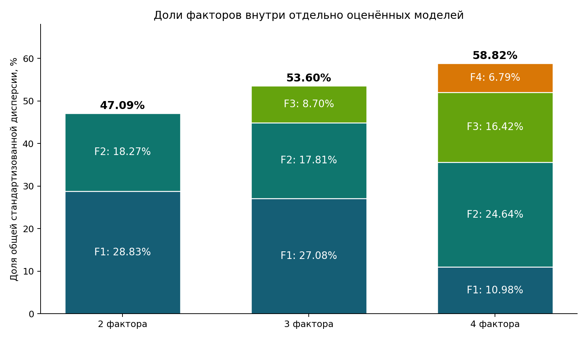

### Сопоставление факторных осей

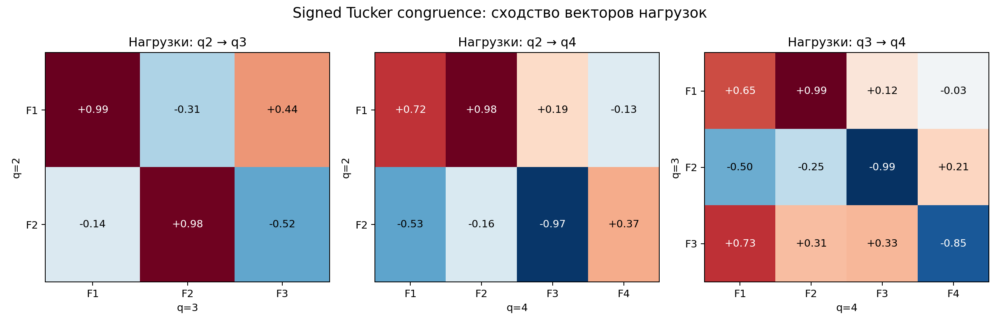

### Изменения состава кластеров при k=3

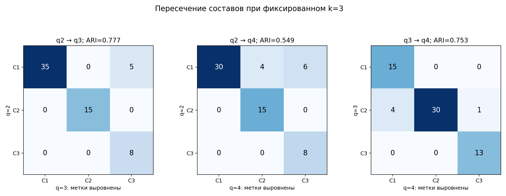

### Кандидаты свободного выбора k

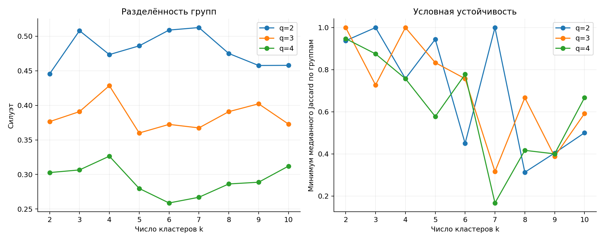

### Новые факторные плоскости объектов

### Полные нагрузки решений q3 и q4

### Переходы q3→q4 при k=4

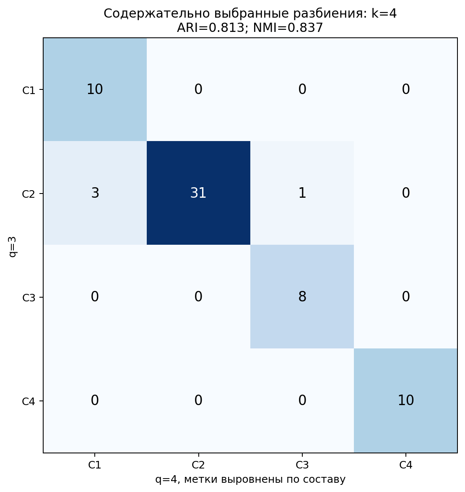

Все модели оценены на одной и той же наблюдаемой матрице; исходные оценки не генерировались заново.

При изменении q переоцениваются и вращаются все факторы: F3/F4 не являются просто добавлением к прежним F1/F2.

Signed Tucker congruence сопоставляет оси с учётом перестановки и знака; Procrustes и углы подпространств дополняют, но не заменяют семантическую интерпретацию.

Фиксированное k=3 отделяет сравнение размерности от одновременного выбора числа групп; это анализ чувствительности, не причинный эксперимент.

Численная рекомендация свободного k предварительна и требует сравнения содержательных профилей.

Устойчивость кластеров условна на уже оценённых факторных координатах. Значимость и внешняя валидность здесь не проверяются.

## Ограничения и воспроизводимость

Исследование разведочное; численные группы могут возникать и в непрерывном пространстве.

Гауссова линейная FA приблизительна для ограниченных порядковых оценок; независимость ошибок шкал может нарушаться.

Сходимость и устойчивость алгоритма не подтверждают точность исходных оценок или полноту пространства.

Кластеризация условна на выбранных факторных баллах; устойчивость всего сбора и анализа отдельно не проверена.

При обучении пропуски заполнены средними обучающей выборки. Это техническое допущение; при проекции неизвестные шкалы маргинализируются.

Выборка целевая и ограничена заданными критериями. Агрегирование десятилетнего периода может скрыть смену образа. Зависимые источники, смещения поисковой выдачи и оценщика могут влиять на результат. Пропуски могут быть систематическими: публичные роли и тематическая освещённость влияют на доступность оценок. Заполнение средним не устраняет это смещение. Сбор досье, оценивание, выбор k и словесная интерпретация моделью не являются независимыми проверками друг друга. Ни статистическая устойчивость, ни убедительность названия фактора сами по себе не подтверждают его внешнюю валидность.

Сохранены версии списков, подтверждения пользователя, источники, досье, поэлементные оценки с основаниями, матрицы и параметры модели. Повторный запуск при неизменном запросе использует кэш; это воспроизведение, а не независимое повторное измерение.

Численный расчёт: 63 объектов, 17 шкал, 2 факторов и 3 кластеров. Полные показатели качества, правила выбора размерности, пропуски, параметры и seed сохранены в metadata.json рядом с матрицами.

## Объекты и источники

### Владимир Путин

Президент России в исследуемый период. Целевая выборка: федеральное управление; разнообразие публичных политических ролей внутри исследуемого периода.

[Президент России — официальная структура](https://kremlin.ru/structure/president)

[Обращение Президента Российской Федерации, 24 февраля 2022 года](http://www.special.kremlin.ru/events/president/transcripts/67843)

[New Year Address to the Nation, 31 декабря 2022 года](http://en.kremlin.ru/events/president/news/70315)

[Послание Федеральному Собранию, 21 февраля 2023 года](http://special.kremlin.ru/events/president/transcripts/70565)

[Итоги года с Владимиром Путиным, 14 декабря 2023 года](http://special.kremlin.ru/events/president/transcripts/72994)

[Послание Федеральному Собранию, 29 февраля 2024 года](http://kremlin.ru/events/president/news/73585)

[Заседание Совета по стратегическому развитию и национальным проектам, 5 декабря 2024 года](http://special.kremlin.ru/events/president/transcripts/75762)

[Заявление для представителей средств массовой информации, 11 мая 2025 года](http://www.special.kremlin.ru/events/president/transcripts/76899)

[Встреча с военнослужащими — участниками СВО](http://special.kremlin.ru/events/president/transcripts/80017)

[Материал исследовательского досье](http://www.special.kremlin.ru/events/president/transcripts/72084)

[Съезд партии «Единая Россия», официальный сайт Президента России](http://www.special.kremlin.ru/events/president/transcripts/80172)

[Supplying Legitimacy: академическое исследование риторики легитимации](https://www.diva-portal.org/smash/get/diva2:2035197/FULLTEXT01.pdf)

[Russia's parliamentary election: What you need to know, Reuters](https://www.reuters.com/world/what-know-about-russias-upcoming-parliamentary-election-2026-09-15/)

[How Putin may leverage Russian ruling party's election win, Reuters](https://www.reuters.com/world/europe/how-putin-may-leverage-predictable-outcome-russias-elections-2026-09-18/)

### Дмитрий Медведев

Председатель правительства до 2020 года; затем заместитель председателя Совета безопасности. Целевая выборка: федеральное управление; разнообразие публичных политических ролей внутри исследуемого периода.

[Дмитрий Медведев — биографическая статья](https://ru.wikipedia.org/wiki/Медведев,_Дмитрий_Анатольевич)

[Экономику ускорят, налоги не снизят: о чем говорили на Гайдаровском форуме-2017](https://tass.ru/ekonomika/3941450)

[Председатель Правительства России Дмитрий Медведев дал поручения по итогам заседания правительства](http://archive.government.ru/docs/21653/print/)

[Дмитрий Медведев: биография, карьера, санкции и заявления 2026](https://netfreedom.org.ua/ru/dmytro-anatoliiovych-medvediev-biohrafiia-posady-i-sanktsii/)

[Цели СВО: как Путин менял их на протяжении трёх лет войны](https://verstka.media/czeli-svo-kak-kreml-menyal-ih-na-protyazhenii-tryoh-let-vojny)

[Совет Безопасности Российской Федерации: научно-технологическое развитие](http://www.scrf.gov.ru/news/allnews/3820/)

[Совет Безопасности Российской Федерации: комплектование Вооружённых сил](http://scrf.gov.ru/news/allnews/3837/)

[Дмитрий Анатольевич Медведев — Байду Энциклопедия](https://baike.baidu.com/ru/item/%D0%94%D0%BC%D0%B8%D1%82%D1%80%D0%B8%D0%B9%20%D0%90%D0%BD%D0%B0%D1%82%D0%BE%D0%BB%D1%8C%D0%B5%D0%B2%D0%B8%D1%87%20%D0%9C%D0%B5%D0%B4%D0%B2%D0%B5%D0%B4%D0%B5%D0%B2/3254451)

[ТАСС: съезд «Единой России» и партийные процедуры](https://tass.ru/politika/5889577)

[Медуза: политическая роль Дмитрия Медведева и кампания 2021 года](https://meduza.io/feature/2023/06/26/chto-proizoshlo-s-dmitriem-medvedevym)

[BBC Russian: выборы в Госдуму и федеральные списки «Единой России»](https://www.bbc.com/russian/articles/c6evw7d22lv0o)

[«Единая Россия»: выступление Дмитрия Медведева о ценностных основах страны](https://er.ru/activity/news/dmitrij-medvedev-edinaya-rossiya-ne-dopustit-razrusheniya-cennostnyh-osnov-strany)

[Wikipedia: обзор ограничений свободы СМИ в России](https://en.wikipedia.org/wiki/Media_freedom_in_Russia)

### Михаил Мишустин

Председатель правительства с 2020 года в исследуемом периоде. Целевая выборка: федеральное управление; разнообразие публичных политических ролей внутри исследуемого периода.

[Михаил Мишустин — Правительство России](https://government.ru/gov/persons/151/travel/?area=KHA)

[Михаил Владимирович Мишустин — Правительство России](http://government.ru/gov/persons/151/biography/)

[Who is Russia's Mikhail Mishustin? — Reuters](https://www.reuters.com/world/europe/who-is-russias-mikhail-mishustin-2024-05-10/)

[Михаил Мишустин: биография, фото, карьера, личная жизнь — Коммерсантъ](https://www.kommersant.ru/doc/4220798)

[Налоги под контролем, хоккей по расписанию: как работает Михаил Мишустин — Ведомости](https://www.vedomosti.ru/politics/galleries/2026/03/03/1179718-nalogi-pod-kontrolem)

[Материал исследовательского досье](http://government.ru/gov/persons/151/travel/?page=5)

[М.Мишустин принял участие в работе Московского финансового форума](http://government.ru/news/46476/)

[XIV международная промышленная выставка «Иннопром»](http://government.ru/news/52063/)

[Пленарное заседание Евразийского экономического форума 2024](http://government.ru/news/52851/)

[Кабмин привлек отдельные госорганы к укреплению традиционных ценностей](https://nangs.org/news/society/kabmin-privlek-otdelnye-gosorgany-k-ukrepleniyu-traditsionnykh-tsennostej)

[Михаил Мишустин вручил премии Правительства в области культуры и искусства](http://government.ru/news/57315/)

### Сергей Лавров

Министр иностранных дел в исследуемый период. Целевая выборка: федеральное управление; разнообразие публичных политических ролей внутри исследуемого периода.

[Сергей Лавров — биография РБК](https://www.rbc.ru/person/617bf30d9a7947f92ee2d266)

[Выступление Лаврова на пресс-конференции по итогам деятельности дипломатии в 2022 году](https://mid.ru/ru/press_service/video/view/1848395/)

[Выступление Лаврова на правительственном часе в Государственной думе, 14 февраля 2024 года](https://mid.ru/ru/foreign_policy/international_organizations/1932076/)

[Выступление Лаврова на пресс-конференции по итогам деятельности дипломатии в 2024 году](https://mid.ru/ru/press_service/minister_speeches/1991476/)

[Выступление Лаврова на Российско-арабском форуме, 20 декабря 2023 года](https://www.mid.ru/ru/press_service/vizity-ministra/1922112/)

[Выступление Лаврова по итогам заседания Совета Безопасности ООН, 24 января 2024 года](https://www.mid.ru/ru/foreign_policy/news/1927568/)

[Выступление Лаврова на форуме о традиционных духовно-нравственных ценностях, 1 ноября 2023 года](https://mid.ru/ru/foreign_policy/news/1912973/)

[Reuters: Lavrov and U.S. proposals on peace, 15 June 2026](https://www.reuters.com/world/europe/russias-lavrov-says-moscow-committed-us-proposals-peace-rejects-europes-2026-06-15/)

[Reuters: Lavrov and possible resumption of Ukraine talks, 23 June 2026](https://www.reuters.com/world/lavrov-says-russia-is-ready-resume-talks-with-ukraine-point-where-they-left-off-2026-06-23/)

[Выступление Лаврова на переговорах с министром иностранных дел Италии, 17 февраля 2022 года](https://mid.ru/ru/press_service/video/view/1799184/)

[Sergey Lavrov — Wikipedia, сводная справочная статья](https://en.wikipedia.org/wiki/Sergey_Lavrov)

[Концепция государственной семейной политики в Российской Федерации на период до 2025 года](https://www.garant.ru/products/ipo/prime/doc/70627660/)

### Сергей Шойгу

Министр обороны в 2016–2024 годах; переход в Совет безопасности в 2024 году. Целевая выборка: федеральное управление; разнообразие публичных политических ролей внутри исследуемого периода.

[Сергей Шойгу — биография РБК](https://www.rbc.ru/person/617fc0679a794761d6170b80)

[Указ Президента Российской Федерации от 12.05.2024 № 328](http://www.kremlin.ru/acts/bank/50544)

[Сергей Шойгу назначен Секретарём Совета Безопасности Российской Федерации](http://special.kremlin.ru/events/president/news/74019)

[Шойгу назначен секретарем Совета Безопасности РФ](https://www.interfax.ru/russia/960081)

[Шойгу объяснил, как будет вестись мобилизация](https://www.rbc.ru/politics/21/09/2022/632ab17c9a794781413c8582)

[Путин решил сменить министра обороны Сергея Шойгу](https://www.bbc.com/russian/articles/c72p0jq04gjo)

[Путин уволил Шойгу с поста министра обороны — и перевел в Совбез](https://meduza.io/feature/2024/05/12/putin-uvolil-shoygu-s-posta-ministra-oborony-i-perevel-v-sovbez)

[Сергей Шойгу назначен Секретарем Совета Безопасности РФ](https://paodkb.org/events/sergey-shoygu-naznachen-sekretarem-soveta-bezopasnosti-rf)

[Указ Президента Российской Федерации от 12 мая 2024 г. № 328 в системе ГАРАНТ](https://base.garant.ru/409005084/)

[Комментарий Секретаря Совета Безопасности Сергея Шойгу по итогам заседания Совета Безопасности](http://special.kremlin.ru/supplement/6345)

[Security Council Secretary Sergei Shoigu’s comment following the Security Council meeting](http://en.kremlin.ru/supplement/6345)

[Сергей Шойгу: Защита традиционных ценностей – это тоже вопрос безопасности](https://www.kp.ru/daily/27656.5/5040576/)

[Сколько тратят власти на укрепление традиционных ценностей](https://www.fontanka.ru/2025/06/10/75574928/)

[Шойгу: все попытки победить Россию силой обречены на провал](https://tass.ru/politika/25506737)

### Андрей Белоусов

Первый вице-премьер в 2020–2024 годах; назначение министром обороны в 2024 году. Целевая выборка: федеральное управление; разнообразие публичных политических ролей внутри исследуемого периода.

[Андрей Белоусов — биография РБК](https://www.rbc.ru/person/6181419c9a7947df128a22f7)

[Интервью Андрея Белоусова РБК. Главное](https://www.rbc.ru/economics/31/05/2021/60b3de5d9a7947f2883f7aa0)

[Что означает выдвижение экономиста Андрея Белоусова на пост министра обороны](https://www.rbc.ru/politics/13/05/2024/6641109a9a7947ab8eebcf7f)

[Андрей Белоусов: «Ядро устроено не из экономики, оно ...»](https://www.rbc.ru/business/13/06/2023/6482d3389a79473805ee8978)

[Куда ведет экономику Андрей Белоусов](https://thebell.io/kuda-vedet-ekonomiku-andrej-belousov-zagadki-dmitriya-medvedeva-i-sposoby-perezhit-sanktsii)

[Первые заявления нового министра обороны](https://72.ru/text/politics/2024/05/14/73575386/)

[Противостояние Западу и потери ВСУ. О чем рассказал Белоусов](https://tass.ru/armiya-i-opk/22683223)

[Материал исследовательского досье](https://www.rbc.ru/society/12/12/2017/5a2f9b5a9a79473649fe0042)

[iStorex: материалы о риторике Белоусова в декабре 2024 — феврале 2025 года](https://www.istorex.org/post/russia-december-2024-february-2025)

[Rosinform: совместная коллегия министерств обороны России и Белоруссии 15 октября 2025 года](https://rosinform.ru/news/andrej-belousov-osoboe-znachenie-pridayom-obespecheniyu-voennoj-bezopasnosti-soyuznogo-gosudarstva)

[Материал о встрече Белоусова с активистами 15 декабря 2025 года](https://xn--b1apnk.xn--p1ai/tpost/nsk7vo4xh1-vstrecha-s-ministrom-oboroni-rossii-i-os)

### Николай Патрушев

Секретарь Совета безопасности до мая 2024 года; затем помощник президента. Целевая выборка: федеральное управление; разнообразие публичных политических ролей внутри исследуемого периода.

[Николай Патрушев — биография РБК](https://www.rbc.ru/person/62d120d89a79475f0ddd8b5e)

[Интервью Н. П. Патрушева «Российской газете»](http://scrf.gov.ru/news/allnews/2148/)

[Патрушева в администрации президента назначили куратором кораблестроения](https://www.rbc.ru/politics/14/05/2024/6643287b9a7947a8f0b8ba78)

[Биография Николая Патрушева](https://tass.ru/info/20789699)

[О деятельности Морской коллегии](https://marine.org.ru/structure/person/56/)

[Председатель Морской коллегии РФ, помощник президента Николай Патрушев — о новых задачах флота](https://marine.org.ru/publication/smi/16108/)

[Патрушев: западные и универсальные ценности неприемлемы для России](https://www.svoboda.org/a/30676123.html)

[Кукловодство к действию. Николай Патрушев — о методах](https://aif.ru/society/safety/kuklovodstvo_k_deystviyu_nikolay_patrushev_o_metodah_cvetnyh_revolyuciy)

[Ценности размывания](https://vkrizis.info/vlast/czennosti-razmyvaniya/)

[Сельское хозяйство: есть результат — будет и пища](https://infranomica.ru/2026/05/19/selskoe-hozyajstvo-est-rezultat-budet-i-pishha/)

### Александр Бортников

Директор ФСБ в исследуемый период. Целевая выборка: федеральное управление; разнообразие публичных политических ролей внутри исследуемого периода.

[Александр Бортников — биография РБК](https://www.rbc.ru/person/660400989a79471b36dbb514)

[Александр Васильевич Бортников — события на сайте Президента России](http://special.kremlin.ru/catalog/persons/100/events)

[Интервью председателя Национального антитеррористического комитета](https://nac.gov.ru/view/eb008ff4-1608-4b47-b2a9-3d604c1833c2)

[Директор ФСБ России провёл заседание Национального антитеррористического комитета](http://pfo.gov.ru/press/events/113336/)

[Alexander Bortnikov — OpenSanctions](https://www.opensanctions.org/entities/Q516824/)

[Агентство: США попробуют возобновить переговоры о мире в Украине через главу ФСБ](https://www.agents.media/ssha-poprobuyut-vozobnovit-peregovory-o-mire-v-ukraine-cherez-glavu-fsb-che-vedomstvo-kak-schitaetsya-svoimi-dokladami-podtolknulo-putina-k-vojne/)

### Сергей Кириенко

Первый заместитель руководителя администрации президента с октября 2016 года в исследуемом периоде. Целевая выборка: федеральное управление; разнообразие публичных политических ролей внутри исследуемого периода.

[Сергей Кириенко — официальные приёмы граждан](https://letters.kremlin.ru/news/receptions/by-section/assignments/by-person/260)

[Сергей Кириенко 20 лет спустя](https://www.kommersant.ru/doc/3612580)

[Кириенко. Любимый холуй Путина](https://fbk.info/ru/investigations/kirienko-kholyi-putina)

[Наследник Суркова. Что Кириенко планирует делать с ...](https://utro02.tv/2022/05/24/kolebaniya-kirienok/)

[«Он пересидел в своем кресле»: в Кремле и правительстве обсуждают, что Сергей Кириенко может лишиться должности в АП после выборов президента](https://meduza.io/feature/2023/12/19/on-peresidel-v-svoem-kresle-v-kremle-i-pravitelstve-obsuzhdayut-chto-sergey-kirienko-mozhet-lishitsya-dolzhnosti-v-ap-posle-vyborov-prezidenta)

[«Как никогда раньше чувствуется русский дух»](https://verstka.media/kak-rossiya-prodvigaet-svoyu-molodezhnuyu-politiku-na-okkupirovannyh-territoriyah)

[Первый заместитель Руководителя Администрации Президента Российской Федерации посетил Донецкую Народную Республику](https://dnrnews.ru/society/2025/09/04/1167117.html)

[Материал исследовательского досье](https://www.tadviser.ru/index.php/%D0%9F%D0%B5%D1%80%D1%81%D0%BE%D0%BD%D0%B0:%D0%9A%D0%B8%D1%80%D0%B8%D0%B5%D0%BD%D0%BA%D0%BE_%D0%A1%D0%B5%D1%80%D0%B3%D0%B5%D0%B9_%D0%92%D0%BB%D0%B0%D0%B4%D0%B8%D0%BB%D0%B5%D0%BD%D0%BE%D0%B2%D0%B8%D1%87)

[ТАСС: Кириенко заявил, что Россию можно победить, лишь оторвав новое поколение от корней](https://tass.ru/politika/18225741)

[Коммерсантъ: Сергей Кириенко рассказал молодежи о свободе](https://www.kommersant.ru/doc/6187168)

### Вячеслав Володин

Председатель Государственной думы VII и VIII созывов. Целевая выборка: федеральное управление; разнообразие публичных политических ролей внутри исследуемого периода.

[Вячеслав Володин: развитие экономики — Государственная дума](https://duma.gov.ru/news/63383/)

[Официальный профиль Вячеслава Володина на сайте Государственной думы](http://duma.gov.ru/en/duma/persons/99100829/news/)

[Vyacheslav Volodin: Russia's economic growth and social standards are the best response to sanctions](http://duma.gov.ru/en/news/62248/)

[Vyacheslav Volodin: a political system based on democratic principles has become a thing of the past in Europe](http://duma.gov.ru/en/news/61352/)

[Vyacheslav Volodin: you can see a real open democracy in Russia](http://duma.gov.ru/en/news/64178/)

[Vyacheslav Volodin: the collective West – occupier – does not need independent Ukraine](http://duma.gov.ru/en/news/64216)

[Vyacheslav Volodin: Western states have failed to isolate our country](http://duma.gov.ru/en/news/64239)

[Vyacheslav Volodin](https://en.wikipedia.org/wiki/Vyacheslav_Volodin)

[Вячеслав Володин: мы недостаточно эффективно используем потенциал Союзного государства](http://duma.gov.ru/news/56060/)

[Вячеслав Володин: парламентариев стран СНГ объединяет общая история](http://duma.gov.ru/news/60448/)

[Володин Вячеслав рассказал о принятых инициативах по защите исторической памяти](http://duma.gov.ru/news/61362/)

[Вячеслав Володин: другие страны стали понимать, насколько важно сохранить историческую память](http://duma.gov.ru/news/61384/)

[Выступление Вячеслава Володина на итоговом пленарном заседании восьмой сессии VIII созыва](http://duma.gov.ru/news/61874/)

[Выступление Вячеслава Володина на пленарном заседании Молодежного форума Союзного государства](http://duma.gov.ru/news/62022/)

[Вячеслав Володин: мы должны быть достойны памяти героев Великой Отечественной войны](http://duma.gov.ru/news/63772/)

### Валентина Матвиенко

Председатель Совета Федерации в исследуемый период. Целевая выборка: федеральное управление; разнообразие публичных политических ролей внутри исследуемого периода.

[Валентина Матвиенко на Евразийском женском форуме — Совет Федерации](https://council.gov.ru/events/news/160466/)

[Валентина Матвиенко — Совет Федерации](http://council.gov.ru/structure/persons/257/)

[Председатель Совета Федерации В. Матвиенко и Президент Ассоциации европейских сенатов](https://interaffairs.ru/news/show/16199)

[Матвиенко Валентина — РБК](https://www.rbc.ru/person/617fb5ef9a79475c6cfc4502)

[Матвиенко рассказала о необходимости противостоять героизации нацистов](https://vksrs.com/publications/matvienko-rasskazala-o-neobkhodimosti-protivostoyat-geroizatsii-natsistov/)

[Валентина Матвиенко: история публичных заявлений — Absatz](https://absatz.media/politika/158438-valentine-matvienko-77-istoriya-uspeha-put-k-vershine-i-samye-yarkie-zayavleniya)

[Материал исследовательского досье](https://www.rbc.ru/society/14/10/2026/6acf597c9a794743e0478a15?from=short_news)

[СФ стремится быть максимально открытым для работы журналистов — Матвиенко](https://senatinform.ru/news/sf_stremitsya_byt_maksimalno_otkrytym_dlya_raboty_zhurnalistov_matvienko/)

[Информация о деятельности Совета Федерации](https://eparlament.irzs.ru/Files/getFile/11853)

[601 заседание Совета Федерации: стенограмма](http://special.council.gov.ru/activity/meetings/170703/transcript/)

[Развитие экономических отношений и стратегическое планирование в цифровой экономике](https://bookonlime.ru/lecture/12-razvitie-ekonomicheskih-otnosheniy-i-strategicheskoe-planirovanie-v-cifrovoy-ekonomike-2)

### Дмитрий Песков

Пресс-секретарь президента в исследуемый период. Целевая выборка: федеральное управление; разнообразие публичных политических ролей внутри исследуемого периода.

[Дмитрий Песков — биографическая статья](https://ru.wikipedia.org/wiki/Песков,_Дмитрий_Сергеевич)

[Kremlin says Ukraine is now paying the price for its own attacks](https://www.reuters.com/world/europe/kremlin-says-ukraine-is-now-paying-price-its-own-attacks-russia-2026-09-28/)

[Kremlin rejects Le Pen/Bardella rebuke, says Russia is no threat to France](https://www.reuters.com/world/europe/kremlin-rejects-le-penbardella-rebuke-says-russia-is-no-threat-france-2026-09-21/)

[Фейк Дмитрия Пескова: Россия никогда не вмешивалась во внутренние дела других стран](https://theins.ru/antifake/295208)

[В Кремле ответили на слова Дональда Трампа о российском вмешательстве](https://expert.ru/news/v-kremle-otvetili-na-slova-donalda-trampa-o-rossiyskom-vmeshatelstve)

[Дмитрий Песков — все публикации](https://www.dw.com/ru/dmitrij-peskov/t-18146676/page-1)

[Песков Дмитрий Сергеевич](https://www.pnp.ru/person/dmitriy--peskov/)

[Песков Дмитрий Сергеевич — биография](https://www.rbc.ua/ukr/dossier/peskov-19032015)

[Кремль сообщил о контактах по вопросу возможного энергетического перемирия](https://www.rbc.ru/politics/12/10/2026/6accae3bb18f4460834ce063)

[Песков назвал демографическую проблему «ахиллесовой пятой» России](https://tass.ru/politika/20355193)

[Песков заявил, что Россия продолжит пропаганду традиционных ценностей](https://www.m24.ru/news/06052024/689412)

[Указ Президента Российской Федерации от 09.11.2022](http://www.kremlin.ru/acts/bank/48502)

[Песков заявил, что память о Победе и заслуженная кара для нацистов очень важны для РФ](https://www.m24.ru/news/11022025/769070)

[Песков заявил о необходимости развития традиционных ценностей](https://www.m24.ru/news/23042026/894202)

### Эльвира Набиуллина

Председатель Банка России в исследуемый период. Целевая выборка: федеральное управление; разнообразие публичных политических ролей внутри исследуемого периода.

[Эльвира Набиуллина — Банк России](https://cbr.ru/about_br/nabiullinaes/)

[Выступление на пленарном заседании Государственной думы по годовому отчету Банка России за 2021 год](https://cbr.ru/press/event/?id=12840)

[Выступление на встрече Ассоциации банков России, 26 мая 2022 года](https://www.cbr.ru/press/event/?id=12904)

[Заявление по итогам заседания Совета директоров 22 июля 2022 года](https://cbr.ru/press/event/?id=14033)

[Заявление по итогам заседания Совета директоров 13 октября 2026 года](https://www.cbr.ru/press/event/?id=12764)

[«Государство не помогает, а подавляет стремление…»](https://kazanfirst.ru/articles/534335)

### Антон Силуанов

Министр финансов в исследуемый период. Целевая выборка: федеральное управление; разнообразие публичных политических ролей внутри исследуемого периода.

[Антон Силуанов — биография РБК](https://www.rbc.ru/person/65e831449a79476cbfd8e5fd)

[Антон Силуанов: Дополнительные деньги бюджету нужны](https://www.interfax.ru/russia/955290)

[Интервью Министра финансов Антона Силуанова газете «Аргументы и факты»](https://minfin.gov.ru/ru/press-center/?id_4=38548-intervyu_ministra_finansov_antona_siluanova_gazete_argumenty_i_fakty)

[Выступление Антона Силуанова на пленарном заседании в Государственной Думе](https://minfin.gov.ru/ru/press-center/?id_4=37667-vystuplenie_antona_siluanova_na_plenarnom_zasedanii_v_gosudarstvennoi_dume)

[Антон Силуанов: РБК: «Принцип «не навреди» — самый правильный»](https://www.rbc.ru/economics/24/10/2022/63529d159a7947efb82a59eb)

[Интервью Антона Силуанова РБК](https://www.rbc.ru/newspaper/2020/02/21/5e4e83289a79474bcf9f8cf9)

[Антон Силуанов назвал срок возвращения к вопросу о прогрессивной шкале НДФЛ](https://www.rbc.ru/economics/20/02/2020/5e4e91919a79475559478893)

[Антон Силуанов представил на парламентских слушаниях в Совете Федерации проект бюджета на 2025–2027 гг.](https://minfin.gov.ru/ru/press-center/?id_4=39336-anton_siluanov_predstavil_na_parlamentskikh_slushaniyakh_v_sovete_federatsii_proekt_byudzheta_na_2025-2027_gg.)

[Силуанов заявил, что нужно соблюдать баланс между СВО, экономикой и поддержкой людей](https://www.interfax.ru/amp/1035506)

[Силуанов: задачи бюджета в 2025 году были полностью обеспечены финансированием](https://tass.ru/ekonomika/28198121)

### Татьяна Голикова

Вице-премьер по социальной политике с 2018 года в исследуемом периоде. Целевая выборка: федеральное управление; разнообразие публичных политических ролей внутри исследуемого периода.

[Татьяна Голикова — биография РБК](https://www.rbc.ru/person/65b9f4369a7947ec8a7f242a)

[Вице-премьер Татьяна Голикова признала неэффективность реформы здравоохранения](https://www.bfm.ru/news/435050)

[Голикова, Татьяна Алексеевна — Рувики](https://ru.ruwiki.ru/wiki/%D0%93%D0%BE%D0%BB%D0%B8%D0%BA%D0%BE%D0%B2%D0%B0,_%D0%A2%D0%B0%D1%82%D1%8C%D1%8F%D0%BD%D0%B0_%D0%90%D0%BB%D0%B5%D0%BA%D1%81%D0%B5%D0%B5%D0%B2%D0%BD%D0%B0)

[Совещание по социальным вопросам](http://www.kremlin.ru/events/president/transcripts/deliberations%20/77439)

[Президент: здравоохранение занимает ключевое место в социальной политике России](https://xn--90aivcdt6dxbc.xn--p1ai/articles/news/prezident-zdravookhranenie-zanimaet-klyuchevoe-mesto-v-sotsialnoy-politike-rossii/)

[Татьяна Голикова: «Единая Россия» — надежный союзник и партнер Правительства](https://xn--90aivcdt6dxbc.xn--p1ai/articles/news/tatyana-golikova-edinaya-rossiya-nadezhnyy-soyuznik-i-partner-pravitelstva/)

[Татьяна Голикова приняла участие в пленарном заседании тематического форума «Единой России»](http://government.ru/news/58648/)

[Правительство России: Татьяна Голикова приняла участие в открытии выставки «Без права на забвение»](http://government.ru/news/54912/)

[Правительство России: Татьяна Голикова приняла участие в заседании коллегии](http://government.ru/news/58000/)

[ТАСС: Голикова назвала провальной попытку Запада изолировать российскую культуру](https://tass.ru/politika/28141547)

### Геннадий Зюганов

Председатель КПРФ и руководитель думской фракции. Целевая выборка: парламентские и партийные фигуры; разнообразие публичных политических ролей внутри исследуемого периода.

[Государственная дума — ежегодник 2024](https://duma.gov.ru/media/files/smUklOtuNPyzwTneQGCfFUHHIsilAqcm.pdf)

[Обзор обращений граждан во фракцию КПРФ в Госдуме в 2018 году](https://kprf.ru/dep/gosduma/activities/187187.html)

[Остановить это ядерное безумие! Выступление Геннадия Зюганова](http://msk.kprf.ru/2022/08/22/222866/)

[Г.А. Зюганов: Мы будем настойчиво воплощать в жизнь программу партии](https://kprf.ru/party-live/cknews/235903.html)

[Мы будем сражаться за Победу! Выступление Г.А. Зюганова](https://kprf.ru/dep/gosduma/activities/236198.html/print)

[Г.А. Зюганов: На заседании фракции КПРФ в Государственной Думе мы подвели итоги 2025 года](https://kprf.ru/dep/gosduma/activities/239812.html)

[Г.А. Зюганов: Изменить социально-экономический курс в интересах большинства](https://kprf-don.ru/index.php/news/facts/12501-2025-09-15-12-58-35.html)

[С.П. Обухов: Только КПРФ говорит правду. Диалог Зюганова и Путина и дискуссия](https://kprf.ru/dep/gosduma/activities/237529.html)

[Путин удивился ходу запущенной им весной муниципальной реформы после слов Зюганова](https://novayagazeta.ru/articles/2025/09/19/putin-udivilsia-khodu-zapushchennoi-im-vesnoi-munitsipalnoi-reformy-posle-slov-ziuganova-kak-regiony-dlia-nee-lomali-cherez-koleno-a-tatarstan-otkazalsia-ee-ispolniat-news)

[Доклад Г.А. Зюганова «О работе КПРФ по выполнению Программы Победы»](https://kprf.ru/official/2025/11/15/15-noiabria-2025-oda-sostoialsia-ii-noiabrskii-plenum-tsk-kprf/473.html)

### Владимир Жириновский

Председатель ЛДПР до смерти в апреле 2022 года. Целевая выборка: парламентские и партийные фигуры; разнообразие публичных политических ролей внутри исследуемого периода.

[Владимир Жириновский — биография РБК](https://www.rbc.ru/person/617bfbb79a7947fc327a3bcb)

[Умер лидер ЛДПР. Его жизнь в цитатах — BBC News Русская служба](https://www.bbc.com/russian/features-60873381)

[Умер лидер партии ЛДПР Владимир Жириновский — Радио Свобода](https://www.svoboda.org/a/umer-lider-partii-ldpr-vladimir-zhirinovskiy-nekrolog/31770134.html)

[Умер Владимир Жириновский — РБК](https://www.rbc.ru/politics/06/04/2022/624d661b9a79473f7416fe26)

[Жириновский опроверг тезис о коллективном управлении ЛДПР — ТАСС](https://tass.ru/politika/3392889)

[В центре предвыборной программы ЛДПР — «русский вопрос» — Парламентская газета](https://www.pnp.ru/politics/2016/06/28/v-centre-predvybornoy-programmy-ldpr-russkiy-vopros.html)

[История партии ЛДПР — официальный сайт ЛДПР](https://ldpr.ru/party/history/)

[Интервью Владимира Жириновского — Говорит Москва](https://govoritmoskva.ru/interviews/1023/)

[Госдума не поможет Жириновскому — Газета.Ru](https://www.gazeta.ru/politics/2017/03/17_a_10580999.shtml)

### Леонид Слуцкий

Председатель ЛДПР с 2022 года; кандидат на выборах 2024 года. Целевая выборка: парламентские и партийные фигуры; разнообразие публичных политических ролей внутри исследуемого периода.

[ЛДПР — партийная газета, май 2022](https://ldpr.ru/upload/iblock/c88/1d6dstdexz6aw7dnwoubeobhr3mnwa1j/a799616e688866c49f2ef6b5b8cfe5c00d45080ae85ce0e5f6d36e2e010681d9.pdf)

[Чем известен Леонид Слуцкий — Коммерсантъ](https://www.kommersant.ru/doc/3579566)

[Люди доверяют ЛДПР — ЛДПР Санкт-Петербург](https://spb.ldpr.ru/event/243915/)

[Программные тезисы ЛДПР — ЛДПР Курская область](https://kursk.ldpr.ru/event/341398)

[Сравнительный анализ предвыборных программ ЛДПР и Леонида Слуцкого — CyberLeninka](https://cyberleninka.ru/article/n/sravnitelnyy-analiz-predvybornyh-programm-ldpr-na-vyborah-2021-g-i-l-e-slutskogo-na-vyborah-2024-g)

[Программные задачи после выборов — ЛДПР Карачаево-Черкесия](https://kcr.ldpr.ru/event/347999/)

[Леонид Слуцкий: ЛДПР предлагает выдавать бесплатные земельные участки семьям с детьми](https://msknews77.ru/society/2025/09/25/73500.html)

[Бесплатный земельный участок для семей: инициатива ЛДПР](https://bagaevka-press.ru/besplatnyj-zemelnyj-uchastok-dlya-semej-inicziativa-ldpr/)

[Слуцкий предложил создать федеральные программы для профилактики зависимостей](https://ldpr.ru/event/437527/)

[Леонид Слуцкий вступился за мультсериал «Маша и Медведь»](https://rg62.info/2025/11/01/leonid-sluczkij-vstupilsya-za-multserial-masha-i-medved/)

### Сергей Миронов

Руководитель «Справедливой России» и её думской фракции. Целевая выборка: парламентские и партийные фигуры; разнообразие публичных политических ролей внутри исследуемого периода.

[Сергей Миронов — официальная биография](https://mironov.ru/officially)

[Сергей Миронов — биография](https://mironov.ru/bio)

[Архив заявлений пресс-центра С. М. Миронова](https://mironov-online.ru/category/zayavleniya/)

[Сергей Миронов — РБК](https://www.rbc.ru/person/69806d279a7947baf86c32c5)

[Сергей Миронов: справедливость — это фундамент](https://spravedlivo.ru/16303010)

[Сергей Миронов: СВО – единственно возможный способ защитить суверенитет России, наших граждан, наши ценности и Русский мир](http://mironov.ru/15133910)

[Сергей Миронов: Президент дал понять, что переговоры ...](http://www.special.spravedlivo.ru/5_140609.html)

[СРЗП предлагает запретить распространение среди детей информации, отрицающей традиционные ценности](https://spravedlivo.ru/14681110)

[Сергей Миронов — о Великой Победе, сохранении памяти о ней и патриотическом воспитании](https://radiokp.ru/podcast/dialogi-na-radio-kp/759263)

[Сергей Миронов: На Руси всегда был очень простой принцип — чужого нам не надо, своего не отдадим](https://mironov.ru/51339910)

[Миронов: на Украине идет битва за будущее всего человечества](https://mironov-online.ru/news/mironov-na-ukraine-idet-bitva-za-budushhee-vsego-chelovechestva-i-pobeda-v-nej-budet-za-rossiej/)

[Материал исследовательского досье](https://spravedlivo.ru/12544510)

### Алексей Нечаев

Основатель партии «Новые люди»; руководитель думской фракции с 2021 года. Целевая выборка: парламентские и партийные фигуры; разнообразие публичных политических ролей внутри исследуемого периода.

[Алексей Нечаев — биография РБК](https://www.rbc.ru/person/6aa3ef199a79475758621730)

[«Новые люди» назвали состав своей думской фракции — РБК](https://www.rbc.ru/politics/24/09/2021/614da73f9a7947b5e3d9399f)

[Партия «Новые люди»: кто лидер, состав, программа и ... — РБК](https://amp.rbc.ru/rbcnews/base/14/08/2026/6a957dfb9a79476ae3d823ba)

[Alexey Nechayev — Wikipedia](https://en.wikipedia.org/wiki/Alexey_Nechayev)

[Что предлагают «Новые люди» на выборах в 2026 году](https://www.gazeta.ru/politics/23422027/novye-lyudi-na-vyborah-2026-goda.shtml)

[Материал исследовательского досье](https://vremya-bir.ru/2026/03/07/dvenadtsat-shagov-k-strane-v-kotoroj-hochetsya-zhit/)

[Материал исследовательского досье](https://www.rbc.ru/politics/08/09/2026/6aa023ec9a79471e4fd55d3c)

[Интерфакс: Алексей Нечаев о защите бизнеса, технологическом и моральном лидерстве России](https://www.interfax.ru/interview/1074248)

[Интерфакс: версия интервью о защите бизнеса и исторических аргументах](https://www.interfax.ru/amp/1074248)

[Ведомости: программа «Новых людей» к выборам 2026 года](https://www.vedomosti.ru/politics/articles/2026/09/09/1227352-novie-lyudi-sformulirovali-programmu)

[Деловой деловой Курск: выступление Нечаева о запретах и традиционных ценностях](https://dddkursk.ru/lenta/2026/07/30/129483/)

[Волга Ньюс: встреча губернатора Самарской области с Алексеем Нечаевым](https://volga.news/article/803292.html)

[Страница Алексея Нечаева с биографическими и санкционными сведениями](https://ru.wikipedia.org/wiki/%D0%9D%D0%B5%D1%87%D0%B0%D0%B5%D0%B2,_%D0%90%D0%BB%D0%B5%D0%BA%D1%81%D0%B5%D0%B9_%D0%93%D0%B5%D0%BD%D0%BD%D0%B0%D0%B4%D1%8C%D0%B5%D0%B2%D0%B8%D1%87)

### Владислав Даванков

Вице-спикер Думы VIII созыва; кандидат на президентских выборах 2024 года. Целевая выборка: парламентские и партийные фигуры; разнообразие публичных политических ролей внутри исследуемого периода.

[Владислав Даванков — биография избирательной кампании 2024](https://www.davankov2024.ru/page_biography/)

[Программа кампании Даванкова](https://davankov2024.ru/program)

[Система анализа результатов голосований Госдумы](http://vote.duma.gov.ru/?convocation=AAAAAAA8&deputy=99113489&sort=date_desc)

[Материал «Холода» о Владиславе Даванкове](https://holod.media/2024/02/14/vladislav-davankov/)

[Материал исследовательского досье](https://davankov2024.ru/)

[Новая газета Европа: Даванков представил предвыборную программу](https://novayagazeta.eu/articles/2024/02/15/davankov-predstavil-predvybornuiu-programmu-bez-amnistii-politzakliuchennykh-i-s-namereniem-dobitsia-mira-na-nashikh-usloviiakh-news)

[Кавказский узел: Выборы президента–2024: Путин и три кандидата](https://www.kavkaz-uzel.eu/articles/398113)

[Эхо FM: Портрет дня — Владислав Даванков](https://echofm.online/portret-dnya/portret-dnya-vladislav-davankov-kandidat-v-prezidenty-rossii)

[Официальный телеграм-канал Владислава Даванкова](https://t.me/s/davankov?before=788)

### Захар Прилепин

Сооснователь «За правду»; сопредседатель объединённой партии с 2021 года. Целевая выборка: парламентские и партийные фигуры; разнообразие публичных политических ролей внутри исследуемого периода.

[Захар Прилепин — официальный сайт, биография](https://zaharprilepin.ru/ru/bio/)

[Захар Прилепин — официальные интервью и выступления](https://zaharprilepin.ru/ru/video/zapisi-vistuplenij/intervju/)

[Прилепин: Независимость Донбасса уже оформлена](https://zaharprilepin.ru/ru/pressa/intervyu/na-harkov.html)

[Захар Прилепин написал партию](https://www.kommersant.ru/doc/4141912)

[Плохой ученик Лимонова». История Захара Прилепина](https://novayagazeta.eu/articles/2023/05/06/plokhoi-uchenik-limonova)

[Миронов, Прилепин и Семигин возглавили список справороссов](https://tass.ru/politika/11761037)

[Захар Прилепин, Вячеслав Никонов и Дмитрий Сватковский не представят Нижний Новгород в новой Госдуме](https://www.nn.ru/text/politics/2021/10/11/70186523/)

[Захар Прилепин не собирается заниматься политикой](https://www.zaks.ru/new/archive/view/267194)

[Захар Прилепин посетил с рабочим визитом Республику Татарстан](https://spravedlivo.ru/11288710)

[Взаправду партия](https://www.kommersant.ru/doc/4241515)

[Радио «Комсомольская Правда», 10.02.2021](https://zaharprilepin.ru/ru/pressa/intervyu/radio-komsomolskaja-pravda-10022021.html)

[Захар Прилепин: Средства массовой информации должны…](https://pozneronline.ru/2024/04/36826/)

### Наталья Поклонская

Депутат Государственной думы VII созыва. Целевая выборка: парламентские и партийные фигуры; разнообразие публичных политических ролей внутри исследуемого периода.

[Наталья Поклонская — биография РБК](https://www.rbc.ru/person/62a85a259a7947b9ae5d6360)

[Поклонская, Наталья Владимировна — ТАСС](https://tass.ru/encyclopedia/person/poklonskaya-natalya-vladimirovna)

[Поклонская, Наталья Владимировна — ТАСС: тематические материалы](https://tass.ru/tag/poklonskaya-natalya-vladimirovna)

[BBC: Марш несогласных. Кто из «Единой России» выступил против пенсионной реформы и что с ними стало](https://www.bbc.com/russian/features-44801571)

[РБК: Поклонская предложила сохранить старые положения в пенсионном законодательстве](https://www.rbc.ru/rbcfreenews/5ba8bd499a794792294ba05d)

[Деловой Петербург: Поклонская отреагировала на предложения Путина по пенсионной реформе](https://www.dp.ru/a/2018/08/31/Poklonskaja_otreazirovala)

[The Moscow Times: Former Crimea Prosecutor Dismissed Amid Anti-War Comments](https://www.themoscowtimes.com/2022/06/13/former-crimea-prosecutor-dismissed-after-anti-war-comments-a77983)

### Елена Мизулина

Сенатор от Омской области в 2016–2023 годах. Целевая выборка: парламентские и партийные фигуры; разнообразие публичных политических ролей внутри исследуемого периода.

[Елена Мизулина покинет Совет Федерации — РБК, 2023](https://www.rbc.ru/politics/30/06/2023/649dee189a79473e3fdc8906)

[Совет Федерации — Елена Борисовна Мизулина: структура](http://council.gov.ru/structure/persons/1044/)

[Совет Федерации — справка о Елене Борисовне Мизулиной](http://council.gov.ru/services/reference/9156/)

[Совет Федерации — обсуждение концепции поправок в Семейный кодекс](http://council.gov.ru/events/news/135415/)

[24СМИ — Елена Мизулина: биография и политическая деятельность](https://24smi.org/celebrity/1156-elena-mizulina.html)

[БФОметр — Елена Мизулина](https://www.bfometr.ru/blog/elena-mizulina)

[РБК: «Мизулина пожаловалась в прокуратуру на видео с ее соболезнованиями Путину»](https://www.rbc.ru/society/30/03/2018/5abe1b849a79470dc3826f68)

[Uznayvse: «Елена Мизулина — биография»](https://uznayvse.ru/znamenitosti/biografiya-elena-mizulina.html)

[Радио КП: «Елена Мизулина»](https://radiokp.ru/people/elena-mizulina)

[Материал исследовательского досье](https://ru.wikipedia.org/wiki/%D0%9C%D0%B8%D0%B7%D1%83%D0%BB%D0%B8%D0%BD%D0%B0,_%D0%95%D0%BB%D0%B5%D0%BD%D0%B0_%D0%91%D0%BE%D1%80%D0%B8%D1%81%D0%BE%D0%B2%D0%BD%D0%B0)

### Виталий Милонов

Депутат Государственной думы VII и VIII созывов. Целевая выборка: парламентские и партийные фигуры; разнообразие публичных политических ролей внутри исследуемого периода.

[Виталий Милонов — биографическая статья](https://ru.wikipedia.org/wiki/Милонов,_Виталий_Валентинович)

[Виталий Валентинович Милонов — ПЕРСОНА ТАСС](https://tass.ru/encyclopedia/person/milonov-vitaliy-valentinovich)

[Милонов Виталий Валентинович — Парламентская газета](https://www.pnp.ru/person/vitaliy-milonov/)

[Милонов Виталий Валентинович — ЗАКС.РУ](https://www.zaks.ru/new/person/view/172)

[Биография Виталия Милонова — Свободная пресса](https://svpressa.ru/persons/vitaliy-milonov/)

[Виталий Милонов: биография, новости, личная жизнь](https://stuki-druki.com/authors/Milonov-Vitaliy.php)

### Нина Останина

Депутат Государственной думы VIII созыва; председатель профильного семейного комитета. Целевая выборка: парламентские и партийные фигуры; разнообразие публичных политических ролей внутри исследуемого периода.

[Нина Останина — ПартАрхив ИНИОН РАН](https://pa.inion.ru/persons/7104/)

[Останина Нина Александровна / Документы — ПартАрхив ИНИОН РАН](https://pa.inion.ru/documents/16503/)

[Дети — высшая ценность — ПартАрхив ИНИОН РАН](https://pa.inion.ru/documents/27860/)

[Нина Останина — КПРФ](https://kprf.ru/personal/ostanina)

[Нина Останина выступила на радио «Комсомольская правда» — ПартАрхив ИНИОН РАН](https://pa.inion.ru/documents/25577/)

[Н.А. Останина рассказала о ряде законопроектов — КПРФ](https://kprf.ru/dep/gosduma/activities/245108.html)

[Защита детского бюджета — Парламентская газета](https://www.pnp.ru/social/zashhita-detskogo-byudzheta-kruzhki-sokhranit-vyplaty-iz-matkapitala-uvelichit.html)

[Нина Останина — о бюджете на 2027—2029 годы — Парламентская газета](https://www.pnp.ru/state-duma/nina-ostanina-o-byudzhete-na-2027-2029-gody-semeynoy-ipoteke-i-matkapitale.html)

[Нина Останина: биография — Узнай всё](https://uznayvse.ru/znamenitosti/biografiya-nina-ostanina.html)

[Останина: борьба за мировоззренческий суверенитет становится государственной политикой](https://dumatv.ru/news/ostanina--borba-za-mirovozzrencheskii-suverenitet-stanovitsya-gosudarstvennoi-politikoi)

[Нина Останина выступила на радио «Комсомольская правда»](https://kprf.ru/dep/gosduma/activities/242132.html)

[Останина: «Звучат упреки: „А вот Сталин запретил аборты!“…»](https://www.business-gazeta.ru/article/625616)

### Валентина Терешкова

Депутат Государственной думы VII и VIII созывов. Целевая выборка: парламентские и партийные фигуры; разнообразие публичных политических ролей внутри исследуемого периода.

[Валентина Терешкова — биография Коммерсантъ](https://www.kommersant.ru/doc/3235400)

[Валентина Терешкова — РБК: биография и общественно-политическая деятельность](https://www.rbc.ru/person/67d838f09a7947cdef0b1a95)

[Валентина Терешкова предложила обнулить президентские сроки Путина — Ведомости](https://www.vedomosti.ru/politics/articles/2020/03/10/824795-tereshkova-predlozhila)

[Как вносились поправки в Конституцию — Государственная дума](http://duma.gov.ru/news/49164/)

[Терешкова о противниках поправки, обнуляющей сроки Путина — Meduza](https://meduza.io/news/2020/03/12/delayut-vse-dlya-togo-chtoby-gadosti-delat-tereshkova-o-protivnikah-popravki-obnulyayuschey-sroki-putina)

[Материал исследовательского досье](https://meduza.io/feature/2020/03/10/gosduma-neozhidanno-dlya-sebya-obespechila-putina-novymi-prezidentskimi-srokami)

### Александр Хинштейн

Депутат Государственной думы и руководитель комитета по информационной политике в 2020–2024 годах. Целевая выборка: парламентские и партийные фигуры; разнообразие публичных политических ролей внутри исследуемого периода.

[Александр Хинштейн — персональная биография](https://hinshtein.ru/biography/)

[Александр Хинштейн — депутат и советник Хинштейн](https://www.vedomosti.ru/politics/articles/2024/12/06/1079852-kto-takoi-aleksandr-hinshtein)

[Александр Хинштейн: биография, фото, карьера](https://www.rbc.ru/person/6752d12a9a7947d62166795e)

[С чем связано назначение Хинштейна главой Курской области](https://www.rbc.ru/politics/06/12/2024/675207239a7947e74994842e)

[Итоги года работы комитета Госдумы по информполитике](https://hinshtein.ru/news/aleksandr-hinshtejn-podvyol-itogi-goda-raboty-komiteta-gosdumy-po-informpolitike-informatsionnym-tehnologiyam-i-svyazi/)

[Александр Хинштейн: итоги работы за VII созыв](https://hinshtein.ru/news/a-hinshtejn-itogi-raboty-za-vii-sozyv/)

[Александр Хинштейн, интервью и политический профиль](https://www.kommersant.ru/doc/4660427)

[Хинштейн вернулся в Самару и был избран депутатом](https://www.kommersant.ru/doc/4104004)

[От имени координатора проекта «Историческая память»](https://www.nvgazeta.ru/news/12383/634260/)

[Курск получит деньги из госбюджета на реставрацию исторической крепости](https://kpravda.ru/2025/02/11/kursk-poluchit-dengi-iz-gosbyudzheta-na-restavracziyu-istoricheskoj-kreposti/)

[Хинштейн попросил Путина поддержать создание музея о событиях в Курской области](https://tass.ru/obschestvo/24001633)

[Хинштейн попросил Путина поддержать создание музея о событиях СВО](https://www.kommersant.ru/doc/7737032)

[«Единая Россия» поможет в реставрации курских памятников](https://kpravda.ru/2025/03/21/edinaya-rossiya-pomozhet-v-restavraczii-kurskih-pamyatnikov/)

[Александр Хинштейн: В год 80-летия Победы продолжаем…](https://news-kursk.ru/society/2025/07/13/65824.html)

[«В Курске будет Аллея Героев»: Хинштейн о музее и мемориале жертвам ВСУ](https://news.ru/russia/v-kurske-budet-alleya-geroev-hinshtejn-o-muzee-i-memoriale-zhertvam-vsu)

### Алексей Пушков

Сенатор с 2016 года; председатель комиссии по информационной политике. Целевая выборка: парламентские и партийные фигуры; разнообразие публичных политических ролей внутри исследуемого периода.

[Алексей Пушков — биографическая статья](https://ru.wikipedia.org/wiki/Пушков,_Алексей_Константинович)

[Алексей Пушков — Совет Федерации](http://council.gov.ru/structure/persons/1316/)

[Отчет Комиссии Совета Федерации по информационной политике](http://council.gov.ru/media/files/xjE2QHRAivCH7onABehAcG7OsnrO6DYb.pdf)

[Постановление Совета Федерации от 01.02.2023](https://base.garant.ru/406310971/)

[Алексей Константинович Пушков — Российский совет по международным делам](https://russiancouncil.ru/aleksey-pushkov/)

[Анонс заседания комиссии о западных СМИ](http://legislation.council.gov.ru/events/announce/)

[Материал Совета Федерации об искусственном интеллекте](http://council.gov.ru/events/news/173810/)

[Материал Совета Федерации о заседании комиссии](http://www.council.gov.ru/events/news/175997/)

[Отчет сенатора Российской Федерации Алексея Пушкова](http://council.gov.ru/media/report/pdf/HtoXfAAzeBJ8JwN0eAduo3rejTAYhqvB.pdf)

[А. Пушков: В западных СМИ происходят сдвиги в оценках ситуации на Украине](http://council.gov.ru/events/news/164749/)

[Алексей Пушков — Telegram](https://t.me/s/alexey_pushkov?before=14914)

[Алексей Пушков. Формирование информационного пространства](http://legislation.council.gov.ru/events/multimedia/video/302078/)

[Отчет Совета Федерации за 2025 год](http://council.gov.ru/media/report/pdf/e8Awe3U6hNouHwSvME53OSPGGWxTeVAl.pdf)

### Константин Косачёв

Сенатор; заместитель председателя Совета Федерации с 2021 года. Целевая выборка: парламентские и партийные фигуры; разнообразие публичных политических ролей внутри исследуемого периода.

[Константин Косачёв — биография Ведомости](https://www.vedomosti.ru/person/1178385-kosachev-konstantin)

[Интерфакс: ситуация в отношениях России и США сравнима с Карибским кризисом](https://www.interfax.ru/interview/812963)

[СенатИнформ: визит российской делегации в Южную Осетию](https://senatinform.ru/news/yuzhnuyu_osetiyu_neobkhodimo_vyvodit_iz_iskusstvennoy_izolyatsii_schitayut_rossiyskie_senatory_/)

[СенатИнформ: парламентская дипломатия и форум БРИКС](https://senatinform.ru/news/kosachyev_rossiya_gotova_rabotat_s_mps_s_uchyetom_ozabochennostey_nashey_strany/)

[BFM.ru: материалы о Константине Косачёве](https://www.bfm.ru/person/61)

[Свободная пресса: биографические и публичные материалы](https://svpressa.ru/persons/konstantin-kosachev/)

[Профиль на Парламентской газете](https://www.pnp.ru/person/konstantin-kosachev/)

[Материал исследовательского досье](https://www.pnp.ru/politics/konstantin-kosachev-dlya-ssha-voyna-s-rossiey-eto-samoubiystvo.html)

[Материал исследовательского досье](https://www.mlg.ru/ratings/vlast/senators/10844/)

[К. Косачев: Продолжается работа законодателей по укреплению общероссийской гражданской идентичности](http://council.gov.ru/events/news/173506/)

[Константин Косачев — Telegram](https://t.me/s/Kosachev62)

[Поддержку отечественных производителей и сферу региональных авиаперевозок обсудили сенаторы](http://council.gov.ru/events/news/177602/)

[Константин Косачев. Сотрудничество России и Эфиопии: итоги визита делегации СФ](https://vmeste-rf.tv/programs/205/konstantin-kosachev-sotrudnichestvo-rossii-i-efiopii-itogi-vizita-delegatsii-sf/)

### Сергей Собянин

Мэр Москвы в исследуемый период. Целевая выборка: региональные и муниципальные фигуры; разнообразие публичных политических ролей внутри исследуемого периода.

[Сергей Собянин — биография РБК](https://www.rbc.ru/person/64b8e1909a79474f30e86f98)

[Сергей Собянин идет на выборы мэра Москвы — «Коммерсантъ»](https://www.kommersant.ru/doc/6041063)

[Сергей Собянин внес в Мосгордуму проект бюджета на 2021–2023 годы](https://www.mos.ru/mayor/themes/6907050/)

[Сергей Собянин рассказал об итогах работы Комплекса градостроительной политики в 2020 году](https://www.mos.ru/mayor/themes/7037050/)

[Мэр Москвы выступил с ежегодным отчетом перед депутатами Мосгордумы](https://www.mos.ru/mayor/themes/8822050/)

[Встреча с мэром Москвы Сергеем Собяниным — Президент России](http://special.kremlin.ru/catalog/persons/38/events/70467)

[Закон города Москвы от 17.05.2017 № 14](https://www.mos.ru/upload/content/files/15af077500dcc5a1547bf728abf25669/15Zakong_Moskviot17_05_2017N14Odopolnitelnihgaranti.pdf)

[РБК: В Москве запретили запускать беспилотники](https://www.rbc.ru/politics/03/05/2023/645245159a794763ce66d990)

[DW: Атака дронов в Москве и Подмосковье](https://www.dw.com/ru/ataka-dronov-v-moskve-i-podmoskove-cto-izvestno/a-65771767)

[РБК: Собянин сообщил о сбитых дронах и повреждении домов](https://www.rbc.ru/politics/01/08/2023/64c856ce9a79471a722e13ad)

[РБК: Беспилотник попал в здание на территории Москва-Сити](https://www.rbc.ru/politics/23/08/2023/64e54f299a794789ddb55c65)

### Александр Беглов

Губернатор Санкт-Петербурга с 2019 года в исследуемом периоде. Целевая выборка: региональные и муниципальные фигуры; разнообразие публичных политических ролей внутри исследуемого периода.

[Александр Беглов — биографическая статья](https://ru.wikipedia.org/wiki/Беглов,_Александр_Дмитриевич)

[Официальный сайт губернатора Санкт-Петербурга: Александр Беглов](https://www.gov.spb.ru/governor/)

[РБК: Беглов заявил об участии в выборах в Петербурге в качестве самовыдвиженца](https://www.rbc.ru/politics/30/05/2019/5cf02cf09a79475ed4d2fa3f)

[The Moscow Times: St. Petersburg Re-Elects Governor Beglov After Controversial Campaign](https://www.themoscowtimes.com/2019/09/11/st-petersburg-re-elects-governor-beglov-after-controversial-campaign-a67240)

[Правительство Санкт-Петербурга: отчет о результатах деятельности за 2019 год](https://www.gov.spb.ru/press/governor/188637/)

[Правительство Санкт-Петербурга: отчет о результатах деятельности за 2020 год](https://www.gov.spb.ru/press/governor/213661/)

[Правительство Санкт-Петербурга: отчет о результатах деятельности за 2022 год](https://www.gov.spb.ru/press/governor/258831/)

[Правительство Санкт-Петербурга: интервью Александра Беглова](https://www.gov.spb.ru/governor/interview/7333/)

[ТАСС: интервью Александра Беглова после переизбрания](https://tass.ru/interviews/21839179)

[Официальное выступление Александра Беглова 28 апреля 2022 года](https://www.gov.spb.ru/press/governor/236663/)

[Телесюжет о заявлении Беглова о частичной мобилизации](https://tvspb.ru/news/2022/09/21/aleksandr-beglov-ukaz-prezidenta-o-chastichnoj-mobilizaczii-byl-trudnym-no-neobhodimym-shagom)

[Сообщение о завершении частичной мобилизации в Петербурге](https://spbvedomosti.ru/news/gorod/gubernator-aleksandr-beglov-obyavil-o-zavershenii-chastichnoy-mobilizatsii/)

[Официальное сообщение о совете по поддержке участников СВО и их семей](https://www.gov.spb.ru/press/governor/253716/)

[Публикация о духовно-нравственных ценностях и суверенитете](https://www.gov.spb.ru/press/governor/290070/)

[Материал исследовательского досье](https://spbdnevnik.ru/news/2022-10-06/aleksandr-beglov-rasskazal-o-prizyve-po-mobilizatsii-peterburzhtsa-s-odnoy-pochkoy)

### Рамзан Кадыров

Глава Чечни в исследуемый период. Целевая выборка: региональные и муниципальные фигуры; разнообразие публичных политических ролей внутри исследуемого периода.

[Рамзан Кадыров — биография РБК](https://www.rbc.ru/person/62c5c0899a79470082fa57eb)

[Кадыров Рамзан Ахматович](https://www.kavkaz-uzel.eu/articles/85366)

[Мы должны забрать всю Украину: что Кадыров говорил об СВО, России, Путине](https://news.ru/regions/my-dolzhny-zabrat-vsyu-ukrainu-chto-kadyrov-govoril-ob-svo-rossii-putine)

[Рамзан Кадыров](https://minval.az/k/ramzan-kadyrov)

[Указ Главы Чеченской Республики от 14.09.2026 № 165](http://publication.pravo.gov.ru/document/2000202609160002)

[Традиционные семейные ценности — основа государства, заявил Кадыров](https://vestikavkaza.ru/amp/291219)

[Кадыров поблагодарил Путина за оценку семейных ценностей народов Кавказа](https://tass.ru/obschestvo/25968415)

[Кадыров поблагодарил Путина за оценку семейных традиций и ранних браков](https://www.rbc.ru/rbcfreenews/694558f89a794775c8b05d2e)

### Рустам Минниханов

Руководитель Татарстана в исследуемый период. Целевая выборка: региональные и муниципальные фигуры; разнообразие публичных политических ролей внутри исследуемого периода.

[Рустам Минниханов — официальный сайт Раиса Татарстана](https://rais.tatarstan.ru/biografiya.htm)

[Рустам Минниханов победил на выборах раиса Татарстана — РБК](https://rt.rbc.ru/tatarstan/freenews/68c7f77d9a79472be550408e)

[ЦИК РТ утвердила победу Рустама Минниханова на выборах](https://rt.rbc.ru/tatarstan/freenews/68c90bdc9a794783273a16b6)

[История выборов и назначений главы Республики Татарстан — ТАСС](https://tass.ru/politika/25045679)

[Что известно о главе Республики Татарстан Рустаме Минниханове — ТАСС](https://tass.ru/info/25058299)

[Рустам Минниханов доложил Владимиру Путину о выборах и темпах экономического роста — Официальный Татарстан](https://tatarstan.ru/index.htm/news/2454245.htm)

[Решение избирательной комиссии Республики Татарстан о результатах выборов 14 сентября 2025 года](https://izbirkom.tatarstan.ru/file/pub/pub_4719790.docx)

[Рустам Минниханов вновь официально вступил в должность главы Республики Татарстан — полномочный представитель Президента РФ в ПФО](http://www.pfo.gov.ru/press/events/112125/)

[Рустам Минниханов: «Санкции не кончатся, пока мы не станем самодостаточными»](https://www.tatar-inform.ru/news/rustam-minnixanov-sankcii-ne-koncatsya-poka-my-ne-stanem-samodostatocnymi-5896958)

[Рустам Минниханов принял участие в итоговой коллегии Министерства информатизации и связи РТ](https://tatarstan.ru/index.htm/news/1916025.htm)

[Цифровой Татарстан в контексте культуры](https://kitaphane.tatarstan.ru/digital.htm)

[Татарстан — самый цифровой регион России](https://kt.tatarstan.ru/index.htm/news/2266706.htm)

[Послание Раиса Республики Татарстан Рустама Минниханова Государственному Совету Республики Татарстан](https://tatarstan.ru/index.htm/news/2460505.htm)

[Раис Республики Татарстан Рустам Минниханов в ежегодном послании обозначил цели цифровизации до 2030 года](https://digital.tatarstan.ru/index.htm/news/2460691.htm)

### Сергей Фургал

Губернатор Хабаровского края в 2018–2020 годах. Целевая выборка: региональные и муниципальные фигуры; разнообразие публичных политических ролей внутри исследуемого периода.

[Чем известен Сергей Фургал — РБК, 2020](https://amp.rbc.ru/rbcnews/politics/09/07/2020/5f06bbb69a79475c40a9a094)

[Первый кассационный суд общей юрисдикции](https://1kas.sudrf.ru/modules.php?name=sud_delo&name_op=doc&number=39453936&delo_id=2450001&case_type=0&new=2450001&text_number=1&srv_num=1)

[Интерфакс: Кассация оставила без изменений приговор Фургалу](https://www.interfax.ru/russia/982916)

[Радио Свобода: Суд оставил в силе приговор Фургалу](https://www.svoboda.org/a/sud-ostavil-v-sile-prigovor-habarovskomu-eks-gubernatoru-sergeyu-furgalu/32686024.html)

[Материал исследовательского досье](https://www.dw.com/ru/kommentarij-furgal-peresidit-putina/a-64670560)

[«Либо мы должны перестроиться, либо люди нас тоже сметут»](https://www.kommersant.ru/doc/3896415)

[Если начался такой вой, значит, я делаю правильно](https://todaykhv.ru/news/policy/19386/)

[Интервью Сергея Фургала. Он победил на выборах в Хабаровском крае](https://meduza.io/feature/2018/09/19/ya-dumayu-chto-situatsiya-kak-v-primorie-u-nas-ne-povtoritsya)

[Сергей Фургал о своей политической линии](https://govoritmoskva.ru/news/174327/)

[Что сказано и что сделано — Сергей Фургал год «у руля»](https://todaykhv.ru/news/policy/22426/?sphrase_id=2620206)

[Фургал, Сергей Иванович](https://ru.wikipedia.org/wiki/%D0%A4%D1%83%D1%80%D0%B3%D0%B0%D0%BB,_%D0%A1%D0%B5%D1%80%D0%B3%D0%B5%D0%B9_%D0%98%D0%B2%D0%B0%D0%BD%D0%BE%D0%B2%D0%B8%D1%87)

[«Не допущу здесь революции»](https://novayagazeta.ru/articles/2018/09/18/77870-ne-dopuschu-zdes-revolyutsii)

[Хабаровский край сделал выбор в пользу перемен](https://opkhv.ru/publications/4888)

[Партия власти здесь — ЛДПР](https://meduza.io/feature/2019/08/26/partiya-vlasti-zdes-ldpr)

[Фургал предложил сделать Хабаровск городом федерального значения](https://tass.ru/obschestvo/5946495)

[У Хабаровска есть все шансы стать городом федерального значения](https://amurmedia.ru/news/775590/)

[В мотивах и последствиях переноса столицы ДФО](https://www.eastrussia.ru/material/ne-planiruyushchim-pereezzhat-sovetuyu-pomolchat/)

[В Хабаровске признали экстремистским движение в защиту Фургала](https://www.dw.com/ru/v-habarovske-priznali-ekstremistskim-dvizenie-v-zasitu-furgala/a-68334442)

### Михаил Дегтярёв

Руководитель Хабаровского края в 2020–2024 годах; министр спорта после назначения 2024 года. Целевая выборка: региональные и муниципальные фигуры; разнообразие публичных политических ролей внутри исследуемого периода.

[Михаил Дегтярёв — биография РБК](https://www.rbc.ru/person/66475fec9a79475c4d9443ad)

[ТАСС — Биография Михаила Дегтярёва](https://tass.ru/info/12453099)

[ТАСС — Биография врио губернатора Хабаровского края Михаила Дегтярёва](https://tass.ru/info/9007455)

[ТАСС — Биография Михаила Дегтярёва](https://tass.ru/info/20795009)

[ТАСС — Энциклопедия: Дегтярёв Михаил Владимирович](https://tass.ru/encyclopedia/person/degtyarev-mihail-vladimirovich)

[РБК — Путин назначил депутата от ЛДПР главой Хабаровского края](https://www.rbc.ru/politics/20/07/2020/5f1586289a794722b2457d61)

[Министерство спорта России — Интервью Михаила Дегтярёва газете «Коммерсантъ»](https://www.minsport.gov.ru/press-center/news/intervyu-mihaila-degtyareva-gazete-kommersant/)

[Министерство спорта России — «Наше место за столом, а не в передней!»](https://minsport.gov.ru/press-center/news/mihail-degtyarev-nashe-mesto-za-stolom-a-ne-v-perednej/)

[News.ru — Дегтярёв призвал не доверять Европе проведение соревнований](https://news.ru/vlast/degtyarev-prizval-ne-doveryat-evrope-provedenie-sorevnovanij)

[Михаил Дегтярёв — кандидат в мэры Москвы: программа и заявления](https://www.interfax.ru/presscenter/622170)

[Михаил Дегтярёв: интервью ТАСС о работе в Хабаровском крае](https://tass.ru/interviews/13152777)

[Интервью Михаила Дегтярёва о спорте, традициях и свободах](https://www.sports.ru/others/blogs/3302024.html)

[Форум «Вера и спорт» о памяти и духовном наследии](https://www.vremyan.ru/news/556863)

### Сергей Левченко

Губернатор Иркутской области до декабря 2019 года; депутат Думы VIII созыва. Целевая выборка: региональные и муниципальные фигуры; разнообразие публичных политических ролей внутри исследуемого периода.

[Сергей Левченко — КПРФ](https://kprf.ru/personal/levchenko)

[Коммунист Левченко попросил у Путина разрешения на участие в выборах губернатора](https://www.rbc.ru/politics/23/06/2020/5ef0bd949a7947b3cd3dcba6)

[Сергей Левченко: «Я всё больше утверждаюсь в решимости идти на выборы»](https://kprf.ru/party-live/regnews/194838.html)

[Сергей Левченко объяснил свой уход с поста губернатора](https://liveangarsk.ru/news/20191214/v-slozhivsheisya)

[Сергей Левченко: «Делай что должно, и будь что будет»](https://kprf.ru/dep/gosduma/activities/240271.html)

[Сергей Левченко: «Экологическая безопасность превращается в ...»](https://kprf.ru/dep/gosduma/activities/241686.html)

[Сергей Левченко выступил с посланием о положении дел в Иркутской области](https://altairk.ru/new/policy/the_message_of_the_governor)

[Сергей Левченко: деятельность и заявления — и их оценка](https://kto-irkutsk.ru/2026/07/20/sergej-levchenko-deyatelnost-i-zayavleniya-i-ix-ocenka/)

[Левченко, Сергей Георгиевич](https://ru.wikipedia.org/wiki/%D0%9B%D0%B5%D0%B2%D1%87%D0%B5%D0%BD%D0%BA%D0%BE,_%D0%A1%D0%B5%D1%80%D0%B3%D0%B5%D0%B9_%D0%93%D0%B5%D0%BE%D1%80%D0%B3%D0%B8%D0%B5%D0%B2%D0%B8%D1%87)

[NEWSru.com: досье губернатора](https://www.newsru.com/dossiers/10330/)

[Левченко попросил у Путина разрешения участвовать в выборах главы Иркутской области](https://www.interfax.ru/russia/714300)

[Как выходцы из МЧС и ФСБ боролись за красный регион](https://www.rbc.ru/politics/14/09/2020/5f5e7dfb9a79477f7753d651)

[Сергей Левченко: «За четыре года сделано больше, чем за предыдущие 15 лет»](https://www.rline.tv/podrobnosti/2019-10-06-sergey-levchenko-za-chetyre-goda-sdelano-bolshe-chem-za-predydushchie-15-let/)

### Валентин Коновалов

Глава Хакасии с 2018 года в исследуемом периоде. Целевая выборка: региональные и муниципальные фигуры; разнообразие публичных политических ролей внутри исследуемого периода.

[Валентин Коновалов — Верховный совет Хакасии](https://vs19.ru/verhovny-sovet/deputati/670-konovalov-valentin-olegovich)

[Интервью Валентина Коновалова о выборах и экологической программе](https://meduza.io/feature/2018/09/10/etu-vlast-nichego-ne-spaset)

[Интервью Коновалова о налогах, промышленности и взаимодействии с «Русалом»](https://kprf.ru/party-live/regnews/188553.html)

[Интервью о партийной программе и политическом процессе](https://www.kommersant.ru/doc/4441936)

[Материал исследовательского досье](http://www.youtube.com/watch?v=eO6lUkFCAqM)

[Материал исследовательского досье](https://ru.wikipedia.org/wiki/%D0%92%D1%8B%D0%B1%D0%BE%D1%80%D1%8B_%D0%B3%D0%BB%D0%B0%D0%B2%D1%8B_%D0%A0%D0%B5%D1%81%D0%BF%D1%83%D0%B1%D0%BB%D0%B8%D0%BA%D0%B8_%D0%A5%D0%B0%D0%BA%D0%B0%D1%81%D0%B8%D1%8F_(2018))

[Материал исследовательского досье](https://ok.ru/group/51615057903766/topic/157744983021718)

[КПРФ: интервью Валентина Коновалова о развитии Хакасии, 2026](https://kprf.ru/party-live/cknews/245343.html)

[Региональный источник о социальной защите в Хакасии](https://r-19.ru/news/politika/190680/)

[Региональный источник о бюджетных доходах Хакасии](https://r-19.ru/news/ekonomika/193031/)

[Материал о докладе главы Хакасии](https://19rusinfo.ru/ekonomika/118670-otchjot)

[Сводка о кандидате Валентине Коновалове](https://iditena.ru/candidates/konovalov-valentin-olegovich/)

[Материал исследовательского досье](https://56.kprf.ru/deyatelnost/tpost/gjjjuy1zi1-glava-hakasii-valentin-konovalov-dal-int)

[Страна победившего коммуниста](https://meduza.io/feature/2019/05/31/strana-pobedivshego-kommunista)

[Встреча с участием Валентина Коновалова в Хабаровске](https://xn--80aac0c2a.xn--p1acf/2026/08/22/vstrecha-s-uchastiem-valentina-konovalova-i-alekseya-kornienko-proshla-v-habarovske)

[Материал исследовательского досье](https://www.vedomosti.ru/politics/characters/2026/07/06/1211370-valentin-konovalov-rossiya-na-moskve-ne-zakanchivaetsya?from=newsline)

### Сергей Аксёнов

Руководитель российской администрации Крыма в исследуемый период. Целевая выборка: региональные и муниципальные фигуры; разнообразие публичных политических ролей внутри исследуемого периода.

[Сергей Аксёнов — биография Ведомости](https://www.vedomosti.ru/person/1215197-aksenov-sergei)

[Сергей Аксенов: биография, фото, карьера, личная жизнь | РБК](https://www.rbc.ru/person/65f020599a79475815e702c9)

[Отчет Главы Республики Крым Сергея Аксёнова о результатах деятельности Совета министров РК за 2017 год](http://crimea.gov.ru/news/30_03_18_10)

[Putin's Man In Crimea: We've 'Returned To Russia Forever' | NPR](https://www.npr.org/sections/parallels/2018/01/27/581114772/putins-man-in-crimea-we-ve-returned-to-russia-forever)

[Глава Республики Крым Сергей Аксёнов представил отчёт о результатах деятельности Совета министров РК за 2018 год](http://crimea.gov.ru/en/news/26_02_19_6)

[Кто поломал инфополе Крыма и не отвечает на вопросы?](https://antifashist.com/item/kto-polomal-infopole-kryma-i-ne-otvechaet-na-voprosy.html)

[Материал исследовательского досье](https://ru.krymr.com/a/news/27913548.html)

[Глава Республики Крым Сергей Аксёнов призвал крымчан к информационной мобилизации](https://simfch.ru/2022/03/02/glava-respubliki-krym-sergej-aksyonov-prizval-krymchan-k-informaczionnoj-mobilizaczii-otkrytomu-i-publichnomu-vyrazheniyu-svoej-patrioticheskoj-poziczii/)

[Аксенов фразой «Крыму ничего не угрожает» ответил про наступление ВСУ](https://www.rbc.ru/politics/29/05/2023/64749e389a7947f3de98dff2)

[Аксенов больше не гарантирует Крыму безопасность?](https://ru.krymr.com/a/krym-sergey-aksenov-pvo-prilety-bavovna-bezopasnost-pvo-udar/32631709.html)

[Сергей Аксёнов: Крым входит в лидеры РФ по темпам роста экономики](https://rostov.rbc.ru/rostov/interview/18/03/2024/65f75c4f9a7947c8b475ab94)

[Глава Крыма: Отмена санкций даст импульс развитию](https://www.kommersant.ru/doc/7715230)

[Сергей Аксенов: «Крым — это Клондайк для предпринимателей»](https://www.kommersant.ru/doc/5154319)

### Михаил Развожаев

Руководитель российской администрации Севастополя с 2019 года в исследуемом периоде. Целевая выборка: региональные и муниципальные фигуры; разнообразие публичных политических ролей внутри исследуемого периода.

[Михаил Развожаев — биография РБК](https://www.rbc.ru/person/660290b19a7947801fe9439b)

[Чем известен Михаил Развожаев — Коммерсантъ](https://www.kommersant.ru/doc/3759211)

[Биография врио губернатора Севастополя Михаила Развожаева — ТАСС](https://tass.ru/info/6656656)

[Отчет губернатора Севастополя Михаила Развожаева](https://sevastopol.er.ru/pages/otchet-gubernatora-sevastopolya-mihaila-razvozhaeva)

[Встреча с губернатором Севастополя Михаилом Развожаевым — Кремль](http://special.kremlin.ru/catalog/persons/579/events/76271)

[Частный бизнес вложил в Севастополь 250 млрд рублей за три года](https://sevastopol.su/news/chastnyy-biznes-vlozhil-v-sevastopol-250-mlrd-rubley-za-tri-goda)

[В Севастополе оценили перспективы Михаила Развожаева на следующих выборах](https://sevastopol.su/news/v-sevastopole-ocenili-perspektivy-mikhaila-razvozhaeva-na-sleduyuschikh-vyborakh)

[Михаил Развожаев: нужно понимать человеческое измерение принимаемых решений](https://tass.ru/interviews/10248577)

[У нас смелые планы: губернатор Севастополя Развожаев о будущем города](https://news.ru/russia/u-nas-smelye-plany-gubernator-sevastopolya-razvozzhaev-o-budushem-goroda)

[Алексей Дюмин принял участие в заседании комиссии Госсовета «Культура и традиционные духовно-нравственные ценности»](http://kremlin.ru/events/administration/80838)

[Развожаев призвал сделать культурное наследие опорой для развития России](https://tass.ru/kultura/28214691)

[Материал исследовательского досье](http://kremlin.ru/events/administration/80591)

### Вячеслав Гладков

Глава Белгородской области после назначения в 2020 году. Целевая выборка: региональные и муниципальные фигуры; разнообразие публичных политических ролей внутри исследуемого периода.

[Вячеслав Гладков — справочник глав регионов](https://governors.ru/glava-regiona/Belgorodskaya-oblast/Gladkov-Vyacheslav-Vladimirovich)

[Гладков, Вячеслав Владимирович — Википедия](https://ru.wikipedia.org/wiki/%D0%93%D0%BB%D0%B0%D0%B4%D0%BA%D0%BE%D0%B2,_%D0%92%D1%8F%D1%87%D0%B5%D1%81%D0%BB%D0%B0%D0%B2_%D0%92%D0%BB%D0%B0%D0%B4%D0%B8%D0%BC%D0%B8%D1%80%D0%BE%D0%B2%D0%B8%D1%87)

[Совет Федерации: Гладков Вячеслав Владимирович](http://council.gov.ru/structure/persons/1543/)

[РБК: Вячеслав Гладков — биография губернатора Белгородской области](https://ufa.rbc.ru/person/648345539a794760fd0c17e8)

[Коммерсантъ: Биография губернатора Белгородской области Вячеслава Гладкова](https://www.kommersant.ru/doc/8571119)

[Коммерсантъ: Путин принял отставку Гладкова с поста губернатора Белгородской области](https://www.kommersant.ru/doc/8655079)

[ТАСС: От экономиста до посла РФ в Абхазии. Путь Вячеслава Гладкова](https://tass.ru/info/27861241)

[Медуза: Ему бы все это разгрести](https://meduza.io/feature/2023/06/08/emu-by-vse-eto-razgresti)

[Встреча с врио губернатора Белгородской области Вячеславом Гладковым](http://www.kremlin.ru/events/president/transcripts/66288)

[Война мечты не отменила. Что Вячеслав Гладков изменил в Белгородской области](https://www.belpressa.ru/politics/vlast/62665.html)

[4 года решений и действий. Как изменилась Белгородская область за это время](https://www.belpressa.ru/politics/vlast/71368.html)

[Диалог с населением – главный приоритет: зачем Гладков регулярно встречается с жителями](https://www.belnovosti.ru/politika/gubernator/127077.html)

[«Нельзя откладывать будущее, решая сложнейшие текущие задачи»](https://chr.plus.rbc.ru/news/694b9fb67a8aa90f9c2ce17d)

[БелПресса: Гладков опроверг новую порцию фейков о ситуации в регионе](https://www.belpressa.ru/society/bezopasnost/43348.html)

[РБК: Гладков обратился в Минобороны после жалоб мобилизованных из региона](https://www.rbc.ru/politics/07/03/2023/640758bf9a7947f6af99d464)

[РБК: Губернатор Гладков призвал охотников не вступать в бой с диверсантами](https://www.rbc.ru/politics/24/05/2023/646d22029a794797c4bac4bf)

[BBC: Губернатор Белгородской области Вячеслав Гладков](https://www.bbc.com/russian/articles/c70dkd0pvrlo)

[Go31: Гладков о прорыве границы в Курской области](https://www.go31.ru/news/proisshestviya/kak-nikto-drugoy-ponimaem-chto-takoe-agressiya-so-storony-ukrainy-gladkov-o-proryve-granitsy-v-kursk/)

[Материал исследовательского досье](https://echofm.online/portret-dnya/portret-dnya-vyacheslav-gladkov-gubernator-belgorodskoj-oblasti-prognozy-o-sudbe-kotorogo-raznyatsya-ot-posta-posla-v-abhazii-do-ugolovnogo-dela)

### Андрей Чибис

Глава Мурманской области после назначения в 2019 году. Целевая выборка: региональные и муниципальные фигуры; разнообразие публичных политических ролей внутри исследуемого периода.

[Андрей Чибис — биографическая справка Коммерсантъ](https://www.kommersant.ru/doc/3917861)

[Около 40% концессионных соглашений в России действует в сфере ЖКХ](https://minstroyrf.gov.ru/press/okolo-40-kontsessionnykh-soglasheniy-v-rossii-deystvuet-v-sfere-zhkkh/)

[Андрей Чибис рассказал, что удерживает людей в Мурманской области](https://newsroom24.ru/murmansk/news/politics/2026/news_323931/)

[Пресс-конференция губернатора Андрея Чибиса для региональных журналистов](https://murmansk.ru/52053)

[Бюджетники жалуются? Чибис ответил, к чему ведет экономия](https://51.ru/text/gorod/2026/01/22/76228112/)

[Андрей Чибис: Арктика требует опережающего развития территорий](https://www.murman.ru/news/2026/05/02/2334/)

[Андрей Чибис представил народную программу «На Севере — жить!»](https://murman.ru/news/2026/09/06/2141/)

[Наш регион для сильных людей: Андрей Чибис поприветствовал участников Международного фестиваля молодежи](https://www.murman.ru/news/2026/09/13/2242/)

[Материал исследовательского досье](https://ru.wikipedia.org/wiki/%D0%A7%D0%B8%D0%B1%D0%B8%D1%81,_%D0%90%D0%BD%D0%B4%D1%80%D0%B5%D0%B9_%D0%92%D0%BB%D0%B0%D0%B4%D0%B8%D0%BC%D0%B8%D1%80%D0%BE%D0%B2%D0%B8%D1%87)

[Чибис заявил, что сотрудничество в Арктике необходимо во имя будущих поколений](https://tass.ru/obschestvo/23491353)

[Реализуя проекты инфраструктурного развития Трансарктического транспортного коридора...](https://www.murman.ru/news/2026/09/03/2243/)

[Андрей Чибис на Восточном экономическом форуме](https://msp.citymurmansk.ru/news/2026/09/03/0930/)

[Губернатору Мурманской области А.В. Чибису, жителям города-героя Мурманска](http://kremlin.ru/events/president/letters/80916)

[Губернатор Андрей Чибис: В центре нашей работы](https://www.murmansk.kp.ru/daily/277813.4/5300258/)

### Сардана Авксентьева

Мэр Якутска в 2018–2021 годах; депутат Государственной думы VIII созыва. Целевая выборка: региональные и муниципальные фигуры; разнообразие публичных политических ролей внутри исследуемого периода.

[Сардана Авксентьева о том, как приблизить власть к народу — Фонтанка, 2021](https://www.fontanka.ru/2021/07/27/70046798/)

[Мэр Якутска Сардана Авксентьева объявила о досрочном уходе. Чем она известна](https://www.kommersant.ru/doc/4639758)

[Мэр Якутска Сардана Авксентьева объявила о досрочном уходе в отставку. Чем она известна](https://www.bbc.com/russian/news-55614829)

[«Новые люди» — страница Сарданы Авксентьевой](https://newpeople.ru/Deputy/sardana-avksenteva)

[Контроль за концессионными соглашениями предложили усилить](https://www.pnp.ru/economics/kontrol-za-koncessionnymi-soglasheniyami-predlozhili-usilit.html)

[«Новые люди» — о праве гражданина на оценку власти](https://www.ng.ru/politics/2024-12-05/1_9150_right.html)

[В «Новых людях» рассказали о главных задачах партии перед выборами](https://news.ru/society/v-novyh-lyudyah-rasskazali-o-glavnyh-zadachah-partii-pered-vyborami)

[Коммерсантъ: форум и программа «Новых людей»](https://www.kommersant.ru/doc/8939397)

### Евгений Ройзман

Глава Екатеринбурга до 2018 года; общественный и оппозиционный деятель. Целевая выборка: региональные и муниципальные фигуры; разнообразие публичных политических ролей внутри исследуемого периода.

[ТАСС: Биография Евгения Ройзмана](https://tass.ru/info/5220823)

[ТАСС: Что известно о Евгении Ройзмане](https://tass.ru/info/15547711)

[BBC Русская служба: Что нужно знать о Евгении Ройзмане](https://www.bbc.com/russian/features-62661643)

[Коммерсантъ: Чем известен Евгений Ройзман](https://www.kommersant.ru/doc/3298219)

[Радио Свобода: Евгений Ройзман не пойдёт на выборы в Госдуму](https://www.svoboda.org/a/31217129.html)

[Интерфакс: Приговор Ройзману по делу о дискредитации армии](https://www.interfax.ru/russia/902059)

[Business FM: Суд над Евгением Ройзманом](https://www.bfm.ru/news/525620)

[Новая газета: Административное дело против Ройзмана](https://novayagazeta.ru/articles/2023/03/16/do-urovnia-myshei-media)

[TJournal: Чем Евгений Ройзман запомнился на посту главы Екатеринбурга](https://tjournal.ru/71076)

[Nakanune.ru: интервью о патриотизме и «мирно-патриотическом» воспитании](https://www.nakanune.ru/articles/111648/)

[ADCM Memorial: «Непротивление расизму»](https://adcmemorial.org/statyi/kolonki/neprotivlenie-rasizmu/)

[Радио Свобода: «Сильный город. Евгений Ройзман и другие жители Екатеринбурга»](https://www.svoboda.org/a/royzman-i-drugie-zhiteli-ekaterinburga/31997151.html)

[E1: «День позора или день триумфа?»](https://www.e1.ru/text/politics/2022/02/24/70466417/)

[DW: «Евгений Ройзман и сила правды»](https://www.dw.com/ru/kommentarij-evgenij-rojzman-i-sila-pravdy/a-62917754)

[Meduza: «Приехали москвичи и думали, что здесь дураки собрались»](https://meduza.io/paragraph/2022/08/26/priehali-moskvichi-i-dumali-chto-zdes-duraki-sobralis)

[Знамя: «Евгений Ройзман. Я не патриот, я Родину люблю»](https://znamlit.ru/publication.php?id=7379)

### Вадим Шумков

Глава Курганской области после назначения в 2018 году. Целевая выборка: региональные и муниципальные фигуры; разнообразие публичных политических ролей внутри исследуемого периода.

[ТАСС: Вадим Шумков — о доверии зауральцев и отставках чиновников](https://tass.ru/interviews/6080499)

[45.RU: Что сделал и не успел Вадим Шумков в Курганской области](https://45.ru/text/politics/2024/09/09/73952072/)

[Кремль: Встреча с губернатором Курганской области Вадимом Шумковым](http://special.kremlin.ru/events/president/news/70638)

[URA.RU: Яркие цитаты Шумкова за восемь лет](https://ura.news/news/1053132902)

[URA.RU: Вадим Шумков — о доверии зауральцев и отставках чиновников](https://ura.news/articles/1036276564)

[ТАСС: Шумков рассказал в Совфеде о курганском бюджете](https://tass.ru/novosti-regionov/28187431)

[FedPress: Шумков Вадим Михайлович](https://fedpress.ru/person/1753607)

[МК-Урал: Жителей Зауралья предупредили о ложных видеороликах с губернатором](https://eburg.mk.ru/social/2026/10/14/zhiteley-zauralya-predupredili-o-lozhnykh-videorolikakh-s-gubernatorom.html)

[Санкционный удар по России и российский ответ Западу — трансляция](https://regnum.ru/news/3530808)

[Митрополит Даниил и Вадим Шумков возглавили делегацию Курганской области на Всемирном русском соборе](https://kurganvera.ru/news/vrns/mitropolit-daniil-i-vadim-shumkov-vozglavili-delegatsiyu-kurganskoy-oblasti-na-vsemirnom-russkom-sob/)

[Глава Зауралья обвинил интернет в кризисе деторождения, предрек мировой переворот и изучил демократию США](https://45.ru/text/politics/2026/06/26/76499700/)

[Выступление губернатора Курганской области Вадима Шумкова](https://niva-kurtamysh.com/news/obshchestvo/vystuplenie-gubernatora-kurganskoy-oblasti-vadima-shumkova)

[Курганская область официально — Telegram](https://t.me/s/kurganskayaobl?before=42616)

### Алексей Навальный

Оппозиционный политик и антикоррупционный активист; деятельность до смерти в 2024 году. Целевая выборка: внепарламентская оппозиция и заметные избирательные кампании; разнообразие публичных политических ролей внутри исследуемого периода.

[BBC: «Боли нет, но вы знаете, что умираете». Навальный дал первое интервью после отравления](https://www.bbc.com/russian/news-54368577)

[BBC: Отравление, голодовка, болезни в ШИЗО. Что происходило со здоровьем Навального](https://www.bbc.com/russian/articles/cp0769dp15eo)

[Навальный: Как мы будем побеждать «Единую Россию» на выборах](https://navalny.com/materials/blogpost-6017)

[BBC: Главный конкурент: почему власти тратят столько сил на борьбу с Навальным](https://www.bbc.com/russian/news-58563592)

[Навальный: Блог — «Умное голосование». Объявляем кандидатов!](https://navalny.com/materials/blogpost-6544)

[BBC: Год отравления Навального. Как усиливалось давление на активистов и СМИ](https://www.bbc.com/russian/news-58270043)

[BBC: От чего умер Навальный? Главные вопросы об эпибатидине](https://www.bbc.com/russian/articles/cvg3p9l1e5ro)

[Материал исследовательского досье](https://www.bbc.com/russian/features-54435835)

[Президентская программа Алексея Навального: экономическое развитие, а не политическая изоляция](https://2018.navalny.com/platform/7/)

[Президентская программа Алексея Навального: достаток для всех](https://2018.navalny.com/platform/3/)

[Президентская программа Алексея Навального: власть народа, а не монархия](https://2018.navalny.com/platform/10/)

[Экономическая повестка Алексея Навального](https://2018.navalny.com/platform/9/)

[Алексей Навальный против войны](https://navalny.com/editorials/aleksey-navalnyy-protiv-voyny)

[Публикация Навального о бедности и экономическом росте](https://navalny.com/?p=149)

### Илья Яшин

Оппозиционный политик; муниципальный депутат Москвы в 2017–2022 годах. Целевая выборка: внепарламентская оппозиция и заметные избирательные кампании; разнообразие публичных политических ролей внутри исследуемого периода.

[Яшин приговорен к 8,5 годам колонии общего режима по делу о фейках об армии](https://www.interfax.ru/russia/876151)

[Срок не за «фейк». Реакции в ФРГ и РФ на приговор Яшину](https://www.dw.com/ru/srok-ne-za-fejk-a-za-politiku-reakcii-v-frg-i-rf-na-prigovor-asinu/a-64049957)

[Russian opposition figure Ilya Yashin: If Ukraine is handed over to Putin, it will be a tragedy](https://www.lemonde.fr/en/international/article/2025/05/27/russian-opposition-figure-ilya-yashin-if-ukraine-is-handed-over-to-putin-it-will-be-a-tragedy-and-the-prologue-to-a-global-confrontation_6741728_4.html)

[Россия совершила крупный обмен заключенными с несколькими западными странами. Что известно о его участниках](https://www.bbc.com/russian/articles/crgl69w9472o)

[Политика Илью Яшина приговорили к 8,5 годам колонии по делу о фейках](https://www.svoboda.org/a/yashin-court/32165539.html)

[Илья Яшин: Путин — предводитель сил мракобесия](https://www.dw.com/ru/ila-asin-putin-predvoditel-sil-mrakobesia/a-69923731)

[Мы не можем требовать, но можем объяснять](https://novayagazeta.eu/articles/2025/08/01/my-ne-mozhem-trebovat-no-mozhem-obiasniat)

[Илья Яшин о протестах в Москве и муниципалитетах — Meduza](https://meduza.io/feature/2019/07/20/to-chto-putin-ne-smog-sdelat-za-20-let-sobyanin-sdelal-za-mesyats)

[Зачем антивоенные россияне вышли на марш в Берлине — Новая газета Европа](https://novayagazeta.eu/articles/2024/11/18/pochuvstvovat-sebia-ne-odinokimi)

[Война, Путин и политзаключённые. Илья Яшин о своих планах — Радио Свобода](https://www.svoboda.org/a/voyna-putin-i-politzaklyuchennye-iljya-yashin-o-svoih-planah/33177839.html)

[Материал исследовательского досье](https://www.dw.com/ru/asin-sejcas-nevozmozno-obedinit-rossijskuu-oppoziciu-da-i-ne-nuzno/a-70291088)

### Владимир Кара-Мурза

Оппозиционный политик и публицист. Целевая выборка: внепарламентская оппозиция и заметные избирательные кампании; разнообразие публичных политических ролей внутри исследуемого периода.

[Vladimir Kara-Murza — Deutsche Welle](https://www.dw.com/ru/vladimir-karamurza/t-37465233)

[Владимир Кара-Мурза — ОВД-Инфо](https://ovd.info/persons/kara-murza-vladimir-vladimirovich)

[Истории освобождённых в рамках обмена — ОВД-Инфо](https://ovd.info/2024/08/03/kogo-rossiya-vydala-v-ramkakh-obmena-zaklyuchennymi-s-zapadom-istorii-osvobozhdennykh)

[Освобождение Владимира Кара-Мурзы в результате обмена — Радио Свобода](https://www.svoboda.org/a/kara-murza-obmen/33059121.html)

[Встреча Владимира Кара-Мурзы с Джо Байденом — Новая газета](https://novayagazeta.ru/articles/2024/08/16/prezident-baiden-prinial-osvobozhdennogo-v-rezultate-obmena-politzakliuchennogo-vladimira-kara-murzu-s-semei-v-belom-dome-news)

[Presentation of Geneva Summit 2018 Courage Award with Vladimir Kara-Murza](https://genevasummit.org/speech/vladimir-kara-murza-speaks-at-2018-geneva-summit-main-event/)

[President’s Lecture Series: Fighting for a free Russia](https://humanrights.ca/event-series/presidents-lecture-series)

[La démocratie doit être protégée chaque minute de chaque jour — Radio France](https://www.radiofrance.fr/franceinter/podcasts/l-info-de-france-inter/la-democratie-doit-etre-protegee-chaque-minute-de-chaque-jour-declare-l-opposant-russe-vladimir-kara-mourza-8105094)

[Dissident-in-residence Vladimir Kara-Murza applies past lessons to present](https://georgetownvoice.com/2025/10/08/dissident-in-residence-vladimir-kara-murza-applies-past-lessons-to-present-day-in-recent-event-discussing-democracy/)

[Vladimir Kara-Murza address to the OSCE PA Winter Meeting](https://www.oscepa.org/en/documents/winter-meetings/2025-vienna/speeches-36/5176-vladimir-kara-murza-address-to-the-osce-pa-winter-meeting-in-vienna-21-february-2025/file)

[VKM – Statement of Facts and Levinson Analysis](https://hrf.org/wp-content/uploads/2024/10/VKM-%E2%80%93-Statement-of-Facts-and-Levinson-Analysis.pdf)

[Congressional Record, June 11, 2024](https://www.govinfo.gov/content/pkg/CREC-2024-06-11/html/CREC-2024-06-11-pt1-PgH3699.htm)

[Statement on the persecution of Vladimir Kara-Murza](https://antiwarcommittee.info/en/statement-on-the-persecution-of-vladimir-kara-murza/)

[Joint Statement on Vladimir Kara-Murza](https://www.norway.no/en/missions/osce/norway-and-the-osce/statements/statements-with--norwegian-alignment-2024/joint-statement-on-vladimir-kara-murza/)

[Kremlin critic decried for racist rant on minorities fighting for Russia](https://www.aljazeera.com/news/2025/4/23/kremlin-critic-decried-for-racist-rant-on-minorities-fighting-for-russia)

[Former Political Prisoner Vladimir Kara-Murza Offers Vision of Hope for Russian Democracy](https://www.rmc.edu/news/former-political-prisoner-vladimir-kara-murza-offers-vision-of-hope-for-russian-democracy/)

### Григорий Явлинский

Сооснователь «Яблока»; кандидат на президентских выборах 2018 года. Целевая выборка: внепарламентская оппозиция и заметные избирательные кампании; разнообразие публичных политических ролей внутри исследуемого периода.

[Президентская программа Григория Явлинского, 2018](https://2018.yavlinsky.ru/campaign/)

[Концепция будущего](http://2018.yavlinsky.ru/programm/)

[Президентская кампания Григория Явлинского. 2018 год](https://campaign2018.yavlinsky.ru/)

[Война — материалы Григория Явлинского](https://www.yavlinsky.ru/position/war/)

[Прекращение огня — материалы Григория Явлинского](https://www.yavlinsky.ru/position/cease-fire/)

[Украина — материалы Григория Явлинского](https://www.yavlinsky.ru/article_tax/ukraina/)

[Биография Григория Явлинского](https://www.yavlinsky.ru/biografiya/)

[Григорий Явлинский выступил в программе «Вечер с Владимиром Соловьёвым»](https://www.yabloko.ru/publikatsii/2018/02/15_0)

[Григорий Явлинский: «Эта власть всё больше похожа на мафию»](https://www.yabloko.ru/publikatsii/2018/06/19)

[«Это референдум!»](https://www.yavlinsky.ru/article/eto-referendum/)

[Григорий Явлинский: «Путин развил и укрепил олигархию»](https://www.svoboda.org/a/27801792.html)

[«Эта власть все больше похожа на мафию»](https://www.svoboda.org/a/29294829.html)

[Интервью Г. Явлинского «Жертвы будут, прорыва — нет»](https://www.yavlinsky.ru/article/intervyu-g-yavlinskogo-zhertvy-budut-proryva-net/)

[«Мы будем идти до конца»](https://www.yavlinsky.ru/article/my-budem-idti-do-kontsa/)

[Президентские выборы-1996. 30 лет спустя](https://www.yavlinsky.ru/article/prezidentskie-vybory-1996-30-let-spustya/)

[Материал исследовательского досье](https://www.forbes.ru/interview/45575-reformatory-prihodyat-k-vlasti-grigorii-yavlinskii)

### Лев Шлосберг

Политик «Яблока»; депутат Псковского областного собрания в части периода. Целевая выборка: внепарламентская оппозиция и заметные избирательные кампании; разнообразие публичных политических ролей внутри исследуемого периода.

[Лев Шлосберг — BBC News Русская служба](https://www.bbc.com/russian/articles/cy8ee2wngd8o)

[Лев Шлосберг: когда нечем дышать — «Яблоко»](https://www.yabloko.ru/regnews/Pskov/2019/01/21-0)

[«Люди перестают видеть перспективы завтрашнего дня» — «Яблоко»](https://www.yabloko.ru/publikatsii/2019/06/14)

[Как в Пскове объясняют дело о листовках «Яблока» — «Медиазона»](https://zona.media/article/2019/02/27/pskov)

[Лев Шлосберг о травле и политической стратегии — Spektr.Press](https://spektr.press/ya-otvechayu-za-vse-mnoj-skazannoe-no-ne-otvechayu-za-izvraschenie-skazannogo-lev-shlosberg-o-travle-i-setkah-telegram-kanalov-odnokletochnyh-politikah-reshivshih-pobedit-putina-rukami-u/)

[Персональная страница Льва Шлосберга — «Яблоко»](https://www.yabloko.ru/Persons/shlosberg.html)

[Материал исследовательского досье](https://pln-pskov.ru/politics/314872.html)

[«То, что говорит Кадыров, может быть в голове у Путина», — Лев Шлосберг о кризисе вокруг Украины](https://www.yabloko.ru/publikatsii/2022/02/18-0)

[«Мы живем внутри катастрофы». Лев Шлосберг — о России, Путине, войне и репрессиях](https://ru.krymr.com/a/rossiya-putin-voyna-repressii-lev-shlosberg-intervyu/31806389.html)

[Политика властей — чтобы люди перестали говорить о «специальной военной операции»](https://www.currenttime.tv/a/politika-vlastey-chtoby-lyudi-perestali-govorit-o-spetsialnoy-voennoy-operatsii-lev-shlosberg-o-dele-protiv-nego-i-nikolaya-kuzmina/31807396.html)

[Последнее слово политика Льва Шлосберга в суде](https://zona.media/article/2026/08/14/schlosberg)

[«Лишний заложник» — вот что им важно. Арест Льва Шлосберга](https://www.svoboda.org/a/lishniy-zalozhnik-vot-chto-im-vazhno-arest-lva-shlosberga/33615624.html)

[Оставшийся. Зампред «Яблока» Лев Шлосберг больше 30 лет в политике](https://novayagazeta.eu/articles/2026/08/17/ostavshiisia)

### Борис Вишневский

Политик «Яблока»; депутат Законодательного собрания Санкт-Петербурга в части периода. Целевая выборка: внепарламентская оппозиция и заметные избирательные кампании; разнообразие публичных политических ролей внутри исследуемого периода.

[Партия «Яблоко»: Вишневский Борис Лазаревич](https://www.yabloko.ru/content/vishnevskii_boris_lazarevich)

[Петербургское «Яблоко» и внутрипартийный конфликт](https://www.dp.ru/a/2018/06/18/Aktivnaja_storona_konflikt)

[BBC: кандидаты-двойники на выборах 2021 года](https://www.bbc.com/russian/features-58481940)

[Деловой Петербург: инициатива по комплексному развитию территорий](https://www.dp.ru/a/2023/01/16/Deputat_Peterburga_Vishnev)

[Эхо FM: политический портрет Бориса Вишневского](https://echofm.online/portret-dnya/portret-dnya-boris-vishnevskij-peterburgskij-politik)

[Материал исследовательского досье](https://spb.yabloko.ru/people/vishnevskij-boris-lazarevich/)

[Материал исследовательского досье](https://www.dp.ru/a/2026/08/26/bitva-nachalas-gde-v-peterburge)

[«Не моя война». Борис Вишневский в программе «Грани недели»](https://www.yabloko.ru/regnews/Spb/2022/02/21)

[Партия «ЯБЛОКО»: предвыборная программа 2021 года](https://www.yabloko.ru/cat-news/2021/08/06-0)

[РБК: В Петербурге предлагают изменить федеральные законы о расселении хрущёвок](https://www.rbc.ru/spb_sz/16/01/2023/63c53d9c9a7947d9bef4b853)

[РБК: Госдума приняла закон о запрете избираться иноагентам](https://www.rbc.ru/politics/06/05/2024/6638a8609a79472c01075a2c)

### Дмитрий Гудков

Оппозиционный политик; участник избирательных и муниципальных политических проектов. Целевая выборка: внепарламентская оппозиция и заметные избирательные кампании; разнообразие публичных политических ролей внутри исследуемого периода.

[Радио Свобода: Политика Дмитрия Гудкова депортировали из Грузии в Украину](https://www.svoboda.org/a/politika-dmitriya-gudkova-deportirovali-iz-gruzii-v-kiev/31679697.html)

[Крым.Реалии: Дмитрий Гудков об отъезде из России](https://ru.krymr.com/a/dmitriy-gudkov-ob-otyezde-iz-rossii/31295079.html)

[Афиша Daily: справочная публикация о политической деятельности Гудкова](https://daily.afisha.ru/news/114366-syn-politika-dmitriya-gudkova-pokonchil-s-soboy-v-emigracii/amp/)

[Life.ru: материалы о Дмитрии Гудкове](https://life.ru/t/dmitriygudkov)

[Материал исследовательского досье](https://uk.wikipedia.org/wiki/%D0%93%D1%83%D0%B4%D0%BA%D0%BE%D0%B2_%D0%94%D0%BC%D0%B8%D1%82%D1%80%D1%96%D0%B9_%D0%93%D0%B5%D0%BD%D0%B0%D0%B4%D1%96%D0%B9%D0%BE%D0%B2%D0%B8%D1%87)

[Материал исследовательского досье](https://mt.gazeta.ru/blog/43692366076/Syin-byivshego-deputata-Gosdumyi-Dmitriya-Gudkova-pokonchil-s-so?utm_referrer=mirtesen.ru)

[«Я не готов на все ради власти». Дмитрий Гудков объяснил отъезд из России — BBC News Русская служба](https://www.bbc.com/russian/news-57381443)

[Kremlin Critic Dmitry Gudkov Flees to Ukraine — The Moscow Times](https://www.themoscowtimes.com/2021/06/06/kremlin-critic-dmitry-gudkov-flees-to-ukraine-a74123)

[Дмитрий Гудков: «После закона Димы Яковлева коллеги ...» — «Яблоко»](https://www.yabloko.ru/publikatsii/2016/09/15)

[«Я привык людям верить». Интервью Дмитрия Гудкова Илье Азару — Новая газета](https://novayagazeta.ru/articles/2018/03/21/75886-ya-privyk-lyudyam-verit)

[Гудков объявил о создании вместе с Собчак Партии перемен](https://www.rbc.ru/politics/15/03/2018/5aaa98049a7947d12d63f1e1)

[Гудков Дмитрий Геннадьевич — политический деятель](https://rus.team/people/gudkov-dmitrij-gennadevich)

[Газовые споры Москвы и Киева. Хроника войны в Украине](https://www.azattyqasia.org/a/chto-proiskhodit-v-donbasse-/31863310/lbl0lbi299676.html)

[Дмитрий Гудков: «Мобилизация вызовет протесты»](https://www.dw.com/ru/dmitrij-gudkov-putin-na-storone-partii-vojny-no-pri-etom-on-trus-21092022/video-63193199)

### Геннадий Гудков

Оппозиционный политик, ранее депутат Государственной думы. Целевая выборка: внепарламентская оппозиция и заметные избирательные кампании; разнообразие публичных политических ролей внутри исследуемого периода.

[Категория:Геннадий Гудков — Викиновости](https://ru.wikinews.org/wiki/%D0%9A%D0%B0%D1%82%D0%B5%D0%B3%D0%BE%D1%80%D0%B8%D1%8F:%D0%93%D0%B5%D0%BD%D0%BD%D0%B0%D0%B4%D0%B8%D0%B9_%D0%93%D1%83%D0%B4%D0%BA%D0%BE%D0%B2)

[Gennady Gudkov — Wikipedia](https://en.wikipedia.org/wiki/Gennady_Gudkov)

[Геннадий Гудков — X](https://x.com/gudkov_g)

[Что Дмитрий Гудков намерен делать в Украине и вернется ли в Россию? — DW](https://www.dw.com/ru/chto-dmitrij-gudkov-nameren-delat-v-ukraine-i-vernetsja-li-v-rossiju/a-57830619)

[Материал исследовательского досье](https://ru.wikipedia.org/wiki/%D0%93%D1%83%D0%B4%D0%BA%D0%BE%D0%B2,_%D0%93%D0%B5%D0%BD%D0%BD%D0%B0%D0%B4%D0%B8%D0%B9_%D0%92%D0%BB%D0%B0%D0%B4%D0%B8%D0%BC%D0%B8%D1%80%D0%BE%D0%B2%D0%B8%D1%87)

[Материал исследовательского досье](https://ru.wikipedia.org/wiki/%D0%93%D1%83%D0%B4%D0%BA%D0%BE%D0%B2,_%D0%94%D0%BC%D0%B8%D1%82%D1%80%D0%B8%D0%B9_%D0%93%D0%B5%D0%BD%D0%BD%D0%B0%D0%B4%D1%8C%D0%B5%D0%B2%D0%B8%D1%87)

[Интервью Геннадия Гудкова о выборах, объединении оппозиции и разделении власти](https://utro02.tv/2022/10/31/navstrechu-sezdu-gennadij-gudkov-o-vyborah-obedinenii-oppoziczii-i-razdelenii-vlasti/)

[Гудков: Путин начал понимать, что наступает…](https://www.unian.net/war/rossiyskiy-oppozicioner-gudkov-putin-nachinaet-ponimat-chto-nastupaet-zh-pa-12031263.html)

[Генадий Гудков — БНТ Новини](https://bntnews.bg/genadiy-gudkov-86846tag.html)

[Гудков, Дмитрий Геннадьевич — энциклопедия ТАСС](https://tass.ru/encyclopedia/person/gudkov-dmitriy-gennadevich)

### Гарри Каспаров

Оппозиционный политический деятель за пределами России. Целевая выборка: внепарламентская оппозиция и заметные избирательные кампании; разнообразие публичных политических ролей внутри исследуемого периода.

[Garry Kasparov on Putin and the ‘Virus of Imperialism’](https://www.kasparov.com/garry-kasparov-on-putin-and-the-virus-of-imperialism-wsj-free-expression-april-11-2022/)

[Garry Kasparov: From Chess Champion to Kremlin Critic](https://www.ilmessaggero.it/en/garry_kasparov_from_chess_champion_to_kremlin_critic-9797261.html)

[Russia — Garry Kasparov](https://www.kasparov.com/category/russia/)

[Politics — Garry Kasparov](https://www.kasparov.com/category/politics/)

[Political activities of Garry Kasparov](https://en.wikipedia.org/wiki/Political_views_of_Garry_Kasparov)

[Каспаров: Все, что делает Трамп, помогает Путину — DW](https://www.dw.com/ru/kasparov-v-intervu-dw-vse-cto-delal-delaet-i-budet-delat-tramp-pomogaet-putinu/a-79633734)

[Материал исследовательского досье](https://www.kasparov.com/)

[A Conversation with Garry Kasparov](https://www.kasparov.com/a-conversation-with-garry-kasparov-thought-economics-with-vikas-shas-may-21-2017/)

[New Yorker Interview: Kasparov on Putin, Trump, and political reform](https://www.kasparov.com/new-yorker-interview-the-chess-grandmaster-and-political-activist-on-putin-trump-and-how-we-are-living-again-through-the-eighteen-fifties/)

[CNBC interview with Garry Kasparov](https://www.cnbc.com/2017/02/13/the-full-interview-with-former-world-chess-champion-garry-kasparov-on-trump-putin.html)

[Reuters: Kasparov calls on world powers to intensify pressure on Russia](https://www.reuters.com/world/europe/kasparov-calls-world-powers-throw-russia-back-into-stone-age-2022-03-03/)

### Михаил Ходорковский

Оппозиционный политический деятель и основатель публичных политических проектов. Целевая выборка: внепарламентская оппозиция и заметные избирательные кампании; разнообразие публичных политических ролей внутри исследуемого периода.

[Open Russia Manifesto — Mikhail Khodorkovsky](https://khodorkovsky.com/open-russia-manifesto/)

[Open Russia — Mikhail Khodorkovsky](https://khodorkovsky.com/programmes/initiatives/openrussia/)

[Page 65 — Mikhail Khodorkovsky](https://khodorkovsky.com/page/65/?m)

[Page 80 — Mikhail Khodorkovsky](https://khodorkovsky.com/page/80/?m)

[Михаил Ходорковский: «Не признаю разделение людей…»](https://angliya.com/publication/mihail-hodorkovskiy-ne-priznayu-razdelenie-lyudey-na-osnovanii-politicheskih-vzglyadov/)

[Михаил Ходорковский: «Боюсь, эта война не будет последней» — Deutsche Welle](https://www.dw.com/ru/mihail-hodorkovski-bojus-jeta-vojna-ne-budet-poslednej/a-61314556)

[Михаил Ходорковский о «драматической ошибке» Европы — Euronews](https://ru.euronews.com/2022/06/21/ru-khodorkovsky-interview)

[Ходорковский: «Европейские лидеры разговаривают с бандитом» — Euronews](https://ru.euronews.com/2022/06/23/mikhail-khodorkovsky)

[Михаил Ходорковский: «Путин не победил» — Полигон](https://poligonmedia.io/mihail-hodorkovskij-putin-ne-pobedil/)

[Ходорковский: у Путина есть причины вести переговоры о прекращении войны на Украине — PAP](https://www.pap.pl/ru/russian/news/khodorkovskiy-u-putina-est-prichiny-vesti-peregovory-o-prekraschenii-voyny-na-ukraine)

### Владимир Милов

Оппозиционный политик и экономический публицист. Целевая выборка: внепарламентская оппозиция и заметные избирательные кампании; разнообразие публичных политических ролей внутри исследуемого периода.

[Дебаты — Владимир Милов](https://milov.org/cat/debates)

[Освободим наш город от власти мафии!](https://milov.org/entry/4188)

[Международные связи — Владимир Милов](https://milov.org/cat/international)

[Милов о санкциях США и политике Трампа](https://tvrain.tv/teleshow/amerikanskie_gonki/tramp_vynashivaet_ideju_primiritsja_s_putinym-453802/)

[Интервью Владимира Милова «Настоящему времени»](https://www.currenttime.tv/a/vladimir-milov-interview/31505887.html)

[Роскомнадзор и каналы соратников Навального](https://ovd.info/express-news/2021/07/27/roskomnadzor-potreboval-ot-youtube-zablokirovat-kanaly-troikh-soratnikov)

[Суд в Москве приговорил Владимира Милова к 8 годам колонии](https://www.dw.com/ru/sud-v-moskve-prigovoril-vladimira-milova-k-8-godam-kolonii/a-67415717)

[Биографическая справка о Владимире Милове](https://ru.wikipedia.org/wiki/%D0%9C%D0%B8%D0%BB%D0%BE%D0%B2,_%D0%92%D0%BB%D0%B0%D0%B4%D0%B8%D0%BC%D0%B8%D1%80_%D0%A1%D1%82%D0%B0%D0%BD%D0%B8%D1%81%D0%BB%D0%B0%D0%B2%D0%BE%D0%B2%D0%B8%D1%87)

[Милов о выборах в Германии](https://gordonua.com/news/worldnews/milov-merkel-molodec-poteryala-vsego-7-8-v-polzu-svezhey-antiimmigrantskoy-partii-na-fone-migrantskogo-krizisa-208758.html)

[«Хочу сказать. Ларина» с Владимиром Миловым](https://echofm.online/programs/hochu-skazat/hochu-skazat-larina-69)

[The Russian Opposition And Ukraine: A Conversation With Vladimir Milov](https://www.hoover.org/plus/research/russian-opposition-and-ukraine-conversation-vladimir-milov)

[«Приказ бомбить Киев был отдан на русском языке…»](https://www.golosameriki.com/a/washington-dialogue-russian-opposition-conference/7648250.html)

[Чат на Главреде. Владимир Милов](https://glavred.info/chat/1337-vladimir-milov.html)

### Любовь Соболь

Оппозиционный политик и юрист антикоррупционных проектов. Целевая выборка: внепарламентская оппозиция и заметные избирательные кампании; разнообразие публичных политических ролей внутри исследуемого периода.

[Юрист Соболь и музыкант Паук официально сняты с выборов в Мосгордуму](https://www.interfax.ru/moscow/669378)

[Любови Соболь отказано в регистрации в качестве кандидата в Мосгордуму](https://tass.ru/politika/6670439)

[Большинству независимых кандидатов в Мосгордуму отказано в регистрации](https://www.rbc.ru/politics/16/07/2019/5d2c8b3b9a794799a7c7d413)

[Отпечатков пальцев нет, нравственные страдания — есть](https://www.bbc.com/russian/news-56269079)

[С юриста ФБК пытались взять подписку о невыезде](https://ovd.info/express-news/2020/12/28/s-yurista-fbk-kotoraya-provela-pochti-dvoe-sutok-v-ivs-pytalis-vzyat)

[Прокуратура утвердила обвинение Соболь по делу о проникновении в квартиру](https://ovd.info/express-news/2021/02/26/prokuratura-utverdila-obvinenie-sobol-po-delu-o-proniknovenii-v-kvartiru)

[Против Алексея Навального возбудили уголовное дело о мошенничестве](https://ovd.info/express-news/2020/12/29/protiv-alekseya-navalnogo-vozbudili-ugolovnoe-delo-o-moshennichestve-iz-za)

[Настоящее время: Любовь Соболь осудила агрессию России и обратилась к матерям](https://www.currenttime.tv/a/sobol/31723600.html)

[Настоящее время: интервью с Любовью Соболь](https://www.currenttime.tv/interview/episodes/2022/2/26)

[Очевидцы: Путин будет воровать до гроба](https://ochevidcy.com/putin-budet-vorovat-do-groba/)

[Радио Свобода: Любовь Соболь о России после Путина](https://www.svoboda.org/a/32881433.html)

[Эхо ФМ: интервью Любови Соболь](https://echofm.online/programs/idyom-po-zvyozdam/idyom-po-zvezdam-s-lyubovyu-sobol)

[Публичный аккаунт Любови Соболь в X](https://x.com/SobolLubov)

[Пересказ программы Любови Соболь](https://stuki-druki.com/authors/sobol-lubov.php)

### Ксения Собчак

Кандидат на президентских выборах 2018 года. Целевая выборка: внепарламентская оппозиция и заметные избирательные кампании; разнообразие публичных политических ролей внутри исследуемого периода.

[Интерфакс: программа «123 трудных шага»](https://www.interfax.ru/elections2018/593143)

[ТАСС: кандидат Собчак на выборах 2018 года](https://elections2018.tass.ru/candidate/sobchak)

[Интерфакс: интерпретация результата как либеральных праймериз](https://www.interfax.ru/elections2018/604186)

[Интерфакс: итог выборов президента РФ](https://www.interfax.ru/elections2018/604908)

[КонсультантПлюс: утверждение итогов президентских выборов 2018 года](https://www.consultant.ru/law/hotdocs/53066.html)

[РБК: итоговый результат выборов](https://www.rbc.ru/newspaper/2018/03/20/5aae9ca49a794739b02918a0)

[Материал исследовательского досье](https://www.interfax.ru/elections2018/604136)

[Материал исследовательского досье](https://www.interfax.ru/elections2018/604190)

[РБК: Как Собчак предлагает реформировать российскую экономику](https://www.rbc.ru/economics/25/12/2017/5a4025f19a79472e3f5f4ad9?from=right_column_materials_3)

[News.ru: Отъезд из РФ, выборы, СВО: в чем призналась Ксения Собчак](https://news.ru/show-business/otezd-iz-rf-vybory-svo-v-chem-priznalas-kseniya-sobchak-v-novom-intervyu)

[RTVI: Собчак ответила на вопрос «Путин или Зеленский?»](https://rtvi.com/news/sobchak-otvetila-na-vopros-putin-ili-zelenskij/)

[Информатор: Арестович дал интервью Собчак](https://informator.ua/ru/kompromissy-iz-rf-legitimnost-zelenskogo-i-gotovnost-pozhat-ruku-putinu-o-chem-govoril-arestovich-v-intervyu-sobchak)

### Екатерина Дунцова

Участница выдвижения на президентские выборы 2024 года. Целевая выборка: внепарламентская оппозиция и заметные избирательные кампании; разнообразие публичных политических ролей внутри исследуемого периода.

[Политическая партия «Рассвет»](https://rassvet-party.info/)

[Yekaterina Duntsova — Wikipedia](https://en.wikipedia.org/wiki/Yekaterina_Duntsova)

[Что нужно знать о Дунцовой, пожелавшей стать президентом РФ — DW](https://www.dw.com/ru/cto-nuzno-znat-o-ekaterine-duncovoj-kotoraa-hocet-stat-prezidentom-rf/a-67832425)

[«Я готова идти до конца» — БАЖ](https://baj.media/ru/ya-gotova-idti-do-konca-zhurnalistka-iz-rossiyskoy-provincii-reshila-stat-prezidentom-i-2/)

[Портрет дня: Екатерина Дунцова — Эхо FM](https://echofm.online/portret-dnya/portret-dnya-ekaterina-dunczova-reshivshaya-vydvinutsya-kandidatom-v-prezidenty-rossii-zhurnalistka-iz-rzheva)

[Как Екатерина Дунцова создает свою партию — Новая газета Европа](https://novayagazeta.eu/articles/2024/03/15/zlost-i-nenavist-vsem-nadoeli)

[Кто такая Екатерина Дунцова — Altapress](https://altapress.ru/politika/story/kto-takaya-ekaterina-duntsova-kotoraya-sobiraetsya-stat-poslednim-prezidentom-rossii-i-kto-eshche-hochet-ballotirovatsya-336526)

[Cherta.media: Екатерина Дунцова выдвигается в президенты](https://cherta.media/interview/ekaterina-duncova-kandidat-v-prezidenty/)

[Новая газета Европа: «Зачем я буду стоять на баррикадах…»](https://novayagazeta.eu/articles/2023/12/05/zachem-ia-budu-stoiat-na-barrikadakh-esli-mogu-zanimatsia-realnymi-delami)

[Холод: интервью Екатерины Дунцовой](https://holod.media/2023/12/20/ekaterina-duntsova-view/)

[Материал исследовательского досье](https://www.dw.com/ru/ekaterina-duncova-o-sozdanii-partii-rassvet-my-mezdu-dvuh-ognej/a-68992724)

[Программа партии «Рассвет»](https://rassvet-party.info/static/program.pdf)

[Интервью о создании партии «Рассвет»](https://www.currenttime.tv/a/ekaterina-duntsova-o-sozdanii-partii-i-svoem-zaderzhanii/32775510.html)

[Инициативная группа: ценности и программа](https://duntsovainitiative.1c-umi.ru/galereya/)

[Манифест политической партии «Рассвет»](https://rassvet-party.info/static/manifest.pdf)

### Борис Надеждин

Участник выдвижения на президентские выборы 2024 года. Целевая выборка: внепарламентская оппозиция и заметные избирательные кампании; разнообразие публичных политических ролей внутри исследуемого периода.

[РБК: Борис Надеждин — биография политика и выборы президента 2024](https://www.rbc.ru/person/65afb4a99a79470e434da73d)

[BBC News Русская служба: ЦИК отказал Борису Надеждину в регистрации](https://www.bbc.com/russian/articles/c84npr0wxx9o)

[РБК: ЦИК отказала Надеждину в регистрации кандидатом](https://www.rbc.ru/politics/08/02/2024/65c3749b9a79479ef5fe7934)

[Бизнес Online: материалы о кампании и выдвижении Надеждина](https://www.business-gazeta.ru/article/622600)

[Семь дней: обзор антивоенной кампании Надеждина](https://semnasem.org/articles/2024/02/02/poslednij-sredi-antivoennyh-kto-takoj-boris-nadezhdin-kotoryj-vse-eshe-nadeetsya-stat-prezidentom)

[Новая газета Европа: «17 марта — начало конца эпохи Путина». Борис Надеждин о программе и мирных переговорах](https://novayagazeta.eu/articles/2024/02/03/17-marta-nachalo-kontsa-epokhi-putina)

[Публичная трансляция с Борисом Надеждиным, Евгенией Альбац и Андреем Нечаевым](https://www.youtube.com/watch?v=mGMdgxBCdns)

[Борис Надеждин: Мой рейтинг растет на 5% в неделю — DW](https://www.dw.com/ru/boris-nadezdin-moj-rejting-rastet-na-5-v-nedelu/a-68154251)

[Надеждин: программа и предвыборная кампания — ОВД-Инфо](https://ovd.info/express-news/2026/07/17/u-menya-dva-puti-lenina-ili-navalnogo-chto-nuzhno-znat-o-borise-nadezhdine)

[Борис Надеждин — биография политика — РБК](https://www.rbc.ru/person/65afb4a99a79470e434da73d?ysclid=mrt22n99to603501119)

[Выборы 2024: что дальше? Борис Надеждин, Станислав Белковский](https://www.youtube.com/watch?v=UNytg_H_1pY)

[НАДЕЖДИН — о Путине, выборах, войне и невозвращении Крыма](https://www.youtube.com/watch?v=DwTC5bilf_8)

[Кто такой Борис Надеждин? О выборах и Путине, жёнах мобилизованных, СВО и будущем России](https://www.youtube.com/watch?v=sG4_THnT9W0)

### Николай Харитонов

Депутат Государственной думы; кандидат КПРФ на президентских выборах 2024 года. Целевая выборка: внепарламентская оппозиция и заметные избирательные кампании; разнообразие публичных политических ролей внутри исследуемого периода.

[РБК: КПРФ выдвинула Харитонова кандидатом в президенты России](https://www.rbc.ru/rbcfreenews/6586cdf49a79479c3cd3d4b3)

[КПРФ: Н. М. Харитонов зарегистрирован кандидатом на должность Президента Российской Федерации](https://kprf.ru/activity/elections/223485.html/print)

[Московское отделение КПРФ: кандидат в президенты Николай Харитонов о поддержке многодетных семей](http://msk.kprf.ru/2024/01/24/247473/)

[Кавказский узел: выборы президента 2024](https://www.kavkaz-uzel.eu/articles/398113)

[Deutsche Welle: выборы президента России 2024](https://www.dw.com/ru/vybory-prezidenta-rossii-2024/a-68528003)

[Википедия: Николай Харитонов](https://ru.wikipedia.org/wiki/%D0%A5%D0%B0%D1%80%D0%B8%D1%82%D0%BE%D0%BD%D0%BE%D0%B2,_%D0%9D%D0%B8%D0%BA%D0%BE%D0%BB%D0%B0%D0%B9_%D0%9C%D0%B8%D1%85%D0%B0%D0%B9%D0%BB%D0%BE%D0%B2%D0%B8%D1%87)

[Н.М. Харитонов: При встрече один на один я передал Путину три письма](https://kprf.ru/party-live/cknews/225170.html)

[Социально-экономическое развитие арктической зоны Российской Федерации: цели, задачи и механизмы достижения](https://kprf.ru/dep/gosduma/activities/232802.html)

[Николай Харитонов: Ключ к развитию России — на Дальнем Востоке](https://kprf35.com/2024/02/17/32710/)

[Предвыборная программа кандидата в президенты Николая Харитонова](https://www.pkokprf.ru/news/view/35448)

[Материал исследовательского досье](https://altkprf.ru/upload/iblock/eea/jiv0wm7hzk6gq4qdxw0r5wvp7zwb6luk.pdf)

[Материал о встрече с представителями Союза советских офицеров](https://kprf.ru/activity/army/224789.html)

[Газета «Правда»: интервью о СВО и внешнем противостоянии](https://gazeta-pravda.ru/issue/24-31517-711-marta-2024-goda-/alternativa-polupravde/)

[Материал о предвыборных дебатах кандидатов](https://spbpalata.ru/?p=13755)

### Павел Грудинин

Кандидат КПРФ на президентских выборах 2018 года. Целевая выборка: внепарламентская оппозиция и заметные избирательные кампании; разнообразие публичных политических ролей внутри исследуемого периода.

[КПРФ — «20 шагов Павла Грудинина»](https://kprf.ru/activity/elections/171941.html)

[КПРФ — П. Н. Грудинин: «Мы победим на этих выборах!»](https://kprf.ru/party-live/cknews/171994.html)

[ТАСС — кандидат Павел Грудинин](https://elections2018.tass.ru/candidate/grudinin)

[BBC News Русская служба — «Он очень хочет власти»: кто такой Павел Грудинин и зачем он пошел в президенты](https://www.bbc.com/russian/features-43105617)

[РБК — ЦИК исключил Грудинина из списка КПРФ на выборах в Госдуму](https://www.rbc.ru/politics/24/07/2021/60fbe35b9a794716f25253a0)

[КПРФ — заявление московских депутатов-коммунистов](https://kprf.ru/dep/reg/204410.html)

[КПРФ Москва — публикация о Павле Грудинине](https://msk.kprf.ru/2021/09/16/168273/)

[Свободная пресса — биографическая и политическая справка о Павле Грудинине](https://svpressa.ru/persons/pavel-grudinin/)

[Carnegie Endowment — «Куда приведут экономику России “20 шагов” Грудинина»](https://carnegieendowment.org/ru/russia-eurasia/posts/2018/02/kuda-privedut-ekonomiku-rossii-20-shagov-grudinina)

[Компас-РФ — «20 шагов Павла Грудинина»](https://www.kompas-rf.ru/2018/01/2980/)

[Радио Свобода — «Власть — она сама рейдер»](https://www.svoboda.org/a/30073365.html)

[Предвыборная программа Павла Грудинина](https://kandidativprezidenti.ru/programma-grudinina-2018/)

### Николай Платошкин

Политический деятель движения «За новый социализм». Целевая выборка: внепарламентская оппозиция и заметные избирательные кампании; разнообразие публичных политических ролей внутри исследуемого периода.

[За дело Ленина и против ЕГЭ — MBK Media](https://mbk-news.appspot.com/suzhet/za-lenina-i-protiv-ege/)

[Обвинительный приговор Николаю Платошкину должен быть отменён — Amnesty International](https://www.amnesty.org/ru/latest/research/2021/06/zayavlenie-rossijskaya-federacziya-obvinitelnyj-prigovor-nikolayu-platoshkinu-dolzhen-byt-otmenyon/)

[Приговор перед выборами — Медиазона](https://zona.media/article/2021/05/20/nikolay-nikolaevitch)

[Социалистический призыв — Новая газета](https://novayagazeta.ru/articles/2020/06/05/85705-sotsialisticheskiy-prizyv)

[В Ревде появилось отделение движения «За новый социализм!» — Ревда-инфо](https://www.revda-info.ru/2020/08/26/v-revde-poyavilos-otdelenie-dvizheniya-za-novyj-sotsializm-ego-lider-sejchas-pod-arestom)

[Краткая программа движения «За новый социализм»](https://new-socialism.org/o-dvizhenii/programma/)

[Лидер движения «За новый социализм»](https://new-socialism.org/o-dvizhenii/lider/)

### Илья Пономарёв

Оппозиционный политический деятель за пределами России. Целевая выборка: внепарламентская оппозиция и заметные избирательные кампании; разнообразие публичных политических ролей внутри исследуемого периода.

[The Moscow Times: Ilya Ponomaryov: We Have to Capture the Kremlin. There Is No Other Way](https://www.themoscowtimes.com/2024/01/19/ilya-ponomaryov-we-have-to-capture-the-kremlin-there-is-no-other-way-a83772)

[Deutsche Welle: Что известно о российских подразделениях в составе ВСУ](https://www.dw.com/ru/cto-izvestno-o-rossijskih-podrazdeleniah-v-sostave-vsu/a-63915634)

[Радио Свобода: Верховный суд РФ признал легион «Свобода России» террористической организацией](https://www.svoboda.org/a/32321226.html)

[Hromadske: «Наша цель — Москва»](https://hromadske.ua/ru/posts/nasha-cel-moskva-my-dolzhny-sbrosit-putina-rossijskie-partizany-mif-ili-pravda)

[Экономическая правда: Илья Пономарёв о проектах в Украине](https://epravda.com.ua/rus/publications/2018/06/11/637572/)

[Точка: о прекращении альянса с легионом «Свобода России»](https://pointmedia.io/story/672b355fdc48800406e0f515)

[Радио Свобода: материал о легионе «Свобода России»](https://ru.wikipedia.org/wiki/%D0%9B%D0%B5%D0%B3%D0%B8%D0%BE%D0%BD_%C2%AB%D0%A1%D0%B2%D0%BE%D0%B1%D0%BE%D0%B4%D0%B0_%D0%A0%D0%BE%D1%81%D1%81%D0%B8%D0%B8%C2%BB)

[Материал исследовательского досье](https://ru.wikipedia.org/wiki/%D0%9F%D0%BE%D0%BD%D0%BE%D0%BC%D0%B0%D1%80%D1%91%D0%B2,_%D0%98%D0%BB%D1%8C%D1%8F_%D0%92%D0%BB%D0%B0%D0%B4%D0%B8%D0%BC%D0%B8%D1%80%D0%BE%D0%B2%D0%B8%D1%87)

[Материал исследовательского досье](https://russophob.ru/person/ponomarev_ilya_vladimirovich)

[Илья Пономарёв: «Люди считают, что они отвертятся»](https://www.svoboda.org/a/32063164.html)

[A scrappy newscast in Kyiv aimed at Russians counters Putin’s propaganda machine](https://www.kpbs.org/news/news/international/2023/03/26/a-scrappy-newscast-in-kyiv-aimed-at-russians-counters-putins-propaganda-machine)

### Леонид Гозман

Оппозиционный политик и публицист. Целевая выборка: внепарламентская оппозиция и заметные избирательные кампании; разнообразие публичных политических ролей внутри исследуемого периода.

[ОВД-Инфо: Гозман уехал из России после двух административных арестов](https://ovd.info/express-news/2022/10/02/politik-leonid-gozman-uekhal-iz-rossii-posle-dvukh-administrativnykh)

[ОВД-Инфо: арест Гозмана за публикацию в Facebook](https://ovd.info/express-news/2022/08/30/politika-leonida-gozmana-arestovali-na-15-sutok-iz-za-posta-v-feysbuke)

[РБК: дело о несвоевременном уведомлении о втором гражданстве](https://www.rbc.ru/politics/15/07/2022/62d1b3f39a7947299cdeb6a4)

[Новая газета Европа: допрос Гозмана по делу о втором гражданстве](https://novayagazeta.eu/articles/2022/07/15/sk-doprosil-politika-leonida-gozmana-kak-podozrevaemogo-po-delu-o-neuvedomlenii-o-vtorom-grazhdanstve-news)

[РБК: заочный арест Гозмана](https://www.rbc.ru/politics/15/02/2024/65cdc9e09a7947a2995026fa)

[ОВД-Инфо: включение Гозмана в реестр террористов и экстремистов](https://ovd.info/express-news/2025/01/22/leonida-gozmana-i-rovshana-askerova-vnesli-v-reestr-terroristov-i)

[РБК: авторская страница Леонида Гозмана](https://www.rbc.ru/opinion-authors/gozman)

[Материал исследовательского досье](https://novayagazeta.eu/articles/2022/07/25/ovd-info-v-moskve-zaderzhali-politika-leonida-gozmana-news)

[Выступление Леонида Гозмана на Ельцин-форуме](https://gefter.ru/archive/23487)

[Радио Свобода: Будущее без Путина. Мечты или планы?](https://www.svoboda.org/a/31147156.html)

[UATV: Гозман о войне России против Украины](https://uatv.ua/gozman-putin-zagnal-rossiyu-v-ugol-sleduyushhij-shag-repressii/)

[Эхо FM: Один против всех](https://echofm.online/programs/hochu-skazat/hochu-skazat-odin-protiv-vseh-kak-ne-dat-strahu-pobedit-sebya)

[Радио Свобода: интервью Леонида Гозмана, 18 декабря 2023 года](https://www.svoboda.org/a/leonid-gozman-russkih-lyudey-neljzya-mazatj-odnoy-chernoy-kraskoy-/32732625.html)

[Материал исследовательского досье](https://novayagazeta.eu/articles/2022/07/18/prepiatstvovat-prosveshcheniiu-liudei-vlast-budet-pulemiotami)

[Радио Свобода: Российский «ящик» игнорирует Россию](https://www.svoboda.org/a/29652429.html)

[Новая газета: Несоблюдение режима](https://novayagazeta.eu/articles/2022/04/26/nesobliudenie-rezhima)

[Новая газета: Записки уголовника](https://novayagazeta.eu/articles/2022/07/21/zapiski-ugolovnika)

[Новая газета: авторская страница Леонида Гозмана](https://novayagazeta.ru/authors/2349)

### Сергей Удальцов

Политический деятель «Левого фронта». Целевая выборка: другие публичные политические акторы; разнообразие публичных политических ролей внутри исследуемого периода.

[РБК: «Против Навального и за ДНР: с какой повесткой вышел на свободу Удальцов»](https://www.rbc.ru/politics/10/08/2017/598c8d6d9a79474cff05cbab)

[BBC Русская служба: «Удальцов: Навальный мне не помогал, митинговать за него не пойду»](https://www.bbc.com/russian/news-40853405)

[РБК: «Удальцов предложил левым выдвинуть единого кандидата в президенты»](https://www.rbc.ru/politics/10/08/2017/598c0a8e9a7947569574ba10?from=right_column_materials_1)

[Ведомости: «Удальцов считает необходимой максимальную активизацию левого движения»](https://www.vedomosti.ru/politics/articles/2017/08/10/728820-udaltsov)

[Интерфакс: «Удальцов призвал поддержать на президентских выборах Павла Грудинина»](https://www.interfax.ru/elections2018/598382)

[Sota Project: материал об уголовном преследовании Удальцова](https://sotaproject.com/article/sergeia-udaltsova-opiat-pytaiutsia-posadit-khotia-on-vsego-lish-prosit-putina-postroit-sotsializm)

[Газета.Ru: досье и хроника дел Сергея Удальцова](https://www.gazeta.ru/tags/person/sergei_udaltsov.shtml)

[Коммерсантъ: «Сергей Удальцов приговорен к шести годам колонии»](https://www.kommersant.ru/doc/8317316)

[Коммерсантъ: «Апелляция оставила в силе приговор Удальцову»](https://www.kommersant.ru/doc/8972418)

[Интервью Сергея Удальцова «Холоду»](https://holod.media/2023/09/12/udaltsov-interview/)

[Meduza: Сергей Удальцов задержан по обвинению в оправдании терроризма](https://meduza.io/feature/2024/01/11/sergey-udaltsov-zaderzhan-po-obvineniyu-v-opravdanii-terrorizma)

### Эдуард Лимонов

Политический деятель «Другой России»; деятельность до смерти в 2020 году. Целевая выборка: другие публичные политические акторы; разнообразие публичных политических ролей внутри исследуемого периода.

[Центр «СОВА»: «Другая Россия», партия](https://ref-book.sova-center.ru/index.php/%D0%94%D1%80%D1%83%D0%B3%D0%B0%D1%8F_%D0%A0%D0%BE%D1%81%D1%81%D0%B8%D1%8F,_%D0%BF%D0%B0%D1%80%D1%82%D0%B8%D1%8F)

[РБК: «Умер Эдуард Лимонов»](https://www.rbc.ru/society/17/03/2020/5e71048d9a79473925ab81a7)

[РБК: «В “Другой России” назвали причину смерти Лимонова»](https://rt.rbc.ru/society/18/03/2020/5e71acc49a794773553f824e)

[The Boston Globe: Russian author, political activist Eduard Limonov dies at 77](https://www.bostonglobe.com/metro/obituaries/2020/03/18/russian-author-political-activist-eduard-limonov-dies/jnjHywBRjVTTgnlsqI12vN/story.html)

[НСН: «Последние интервью писателя и политика Эдуарда Лимонова»](https://nsn.fm/society/poslednee-intervu-pisatelya-i-politika-eduarda-limonova)

[GRSO: материалы об Эдуарде Лимонове](http://www.grso.ru/person/limonov-eduard.html)

[Справочный материал о «Другой России Э. В. Лимонова»](https://ru.wikipedia.org/wiki/%D0%94%D1%80%D1%83%D0%B3%D0%B0%D1%8F_%D0%A0%D0%BE%D1%81%D1%81%D0%B8%D1%8F_%D0%AD._%D0%92._%D0%9B%D0%B8%D0%BC%D0%BE%D0%BD%D0%BE%D0%B2%D0%B0)

[Путешествие нацболов к Путину и обратно](https://novayagazeta.ru/articles/2017/03/12/71752-puteshestvie-natsbolov-k-putinu-i-obratno)

[Умер Эдуард Лимонов: чем запомнился писатель](https://mediabrest.by/news/lyudi/umer-eduard-limonov-chem-zapomnilsya-pisatel)

[Эдуард Лимонов TWITTER](https://www.limonow.de/read/EL_2013-2018_T.html)

[Материал исследовательского досье](https://www.infpol.ru/203662-ot-ubezhdennogo-antisovetchika-do-kolumnista-rt/)

### Игорь Стрелков (Гиркин)

Военно-политический публичный деятель; инициатор политического выдвижения в 2023 году. Целевая выборка: другие публичные политические акторы; разнообразие публичных политических ролей внутри исследуемого периода.

[BBC: Как Игорь Стрелков поддерживал войну, критиковал Путина и оказался в СИЗО](https://www.bbc.com/russian/articles/c2eg90d7gg9o)

[DW: Мосгорсуд приговорил Игоря Гиркина к 4 годам колонии](https://www.dw.com/ru/mosgorsud-prigovoril-igora-girkina-strelkova-k-4-godam-kolonii/a-68080937)

[Fontanka: Игоря Стрелкова задержали в Москве](https://www.fontanka.ru/2023/07/21/72520253)

[Радио Свобода: Стрелков из СИЗО](https://www.svoboda.org/a/strelkov-iz-sizo-opasayusj-amnistii-kak-u-prigozhina-/32722083.html)

[The Moscow Times: Гиркин заявил, что опасается повторить судьбу Пригожина](https://ru.themoscowtimes.com/2023/12/07/girkin-zayavil-chto-opasaetsya-povtorit-sudbu-prigozhina-a115592)

[Крым.Реалии: 10 лет назад сбили МН17](https://ru.krymr.com/a/boing-mn17-10-let-podozrevayemyye-obvinyayemyye-vinovnyye/33040170.html)

[Charter’97: Нажал спусковой крючок: что произошло с Гиркиным](https://charter97.org/ru/news/2023/7/22/556802/)

[Манифест «Клуба рассерженных патриотов»](https://t.me/s/pgubarev?after=622)

[Рабкор: позиция Стрелкова о статусе и задачах КРП](https://rabkor.ru/columns/debates/2023/05/23/angry_patriots_of_an_imaginary_country/)

### Евгений Пригожин

Публичный военно-политический актор в 2022–2023 годах. Целевая выборка: другие публичные политические акторы; разнообразие публичных политических ролей внутри исследуемого периода.

[BBC: What is Russia's Wagner group, and what has happened to its leader?](https://www.bbc.com/news/world-60947877)

[Reuters: Wagner boss courts Putin with Ukrainian battlefield success](https://www.reuters.com/world/europe/russian-mercenary-boss-courts-putin-with-ukrainian-battlefield-success-2023-01-13/)

[Reuters: Wagner mercenaries halt prisoner recruitment campaign](https://www.reuters.com/world/europe/russias-wagner-mercenaries-halt-prisoner-recruitment-campaign-founder-prigozhin-2023-02-09/)

[Reuters Investigates: Wagner’s convicts tell of horrors of Ukraine war](https://www.reuters.com/investigates/special-report/ukraine-crisis-russia-wagner/)

[Reuters: Ukraine counter-offensive under way, says Russian mercenary leader](https://www.reuters.com/world/europe/russias-wagner-chief-prigozhin-says-ukraine-counteroffensive-already-under-way-2023-05-03/)

[BBC: Что о мятеже Пригожина думают люди в России и Украине](https://www.bbc.com/russian/media-66023357)

[Reuters: Russia's Prigozhin in his own words on the mutiny](https://www.reuters.com/world/europe/russias-prigozhin-his-own-words-mutiny-2023-06-26/)

[Материал исследовательского досье](https://x.com/Reuters/status/1632709213641113601)

[Russia accuses mercenary chief of armed mutiny after he vows to punish top brass — Reuters](https://www.reuters.com/world/europe/russian-mercenary-boss-says-moscows-war-ukraine-based-lies-2023-06-23/)

### Оксана Дмитриева

Депутат законодательного собрания Санкт-Петербурга и Государственной думы в разные части периода. Целевая выборка: другие публичные политические акторы; разнообразие публичных политических ролей внутри исследуемого периода.

[РБК: Оксана Дмитриева объявила об уходе из политики](https://www.rbc.ru/spb_sz/02/10/2026/6abfb91afd4c7ff957d9cbe8)

[ЗАКС.ру: биография Оксаны Дмитриевой](https://www.zaks.ru/new/person/view/639)

[ЗАКС.ру: Оксана Дмитриева — «Никто мне не указывает, как голосовать»](https://www.zaks.ru/new/archive/view/219520)

[Телеканал Санкт-Петербург: новый состав Законодательного собрания VI созыва](https://tvspb.ru/news/2016/09/27/novyij-sostav-parlamenta-kto-zajmet-kresla-v-zakonodatelnom-sobranii-vi-sozyiva)

[ТАСС: Дмитриева возглавила политсовет петербургского отделения Новых людей](https://tass.ru/politika/20994233)

[ЗАКС.ру: Дмитриева собирается снова баллотироваться по 217-му округу](https://www.zaks.ru/new/archive/view/265712)

[ЗАКС.ру: Дмитриева не будет оспаривать поражение на выборах](https://www.zaks.ru/new/archive/view/269374)

[Деловой Петербург: Дмитриева проиграла выборы в Госдуму и завершила политическую карьеру](https://www.dp.ru/a/2026/10/02/oksana-dmitrieva-proigrala)

[Материал исследовательского досье](https://ru.wikipedia.org/wiki/%D0%9F%D0%B0%D1%80%D1%82%D0%B8%D1%8F_%D1%80%D0%BE%D1%81%D1%82%D0%B0)

[Законопроекты и поправки к законам — Оксана Дмитриева](https://dmitrieva.org/category/gosduma/zakonoproekty/)

[Оксана Дмитриева — политик](https://t.me/s/oxdmitrieva?before=1072)

[Заседание ГД от 28.09.2023](http://api.duma.gov.ru/api/transcriptFull/2023-09-28)

[«Профессионализм и независимость». Оксана Дмитриева — о выборах, пенсиях и Петербурге](https://www.fontanka.ru/2026/09/04/76623983/)

[Депутат семи созывов Оксана Дмитриева снова пойдет в Госдуму](https://www.vedomosti.ru/politics/articles/2026/03/10/1181644-deputat-semi-sozivov-oksana-dmitrieva-snova-poidet-v-gosdumu)

[Оксана Дмитриева снова пойдет в Госдуму от Петербурга](https://www.kommersant.ru/doc/8497588)
