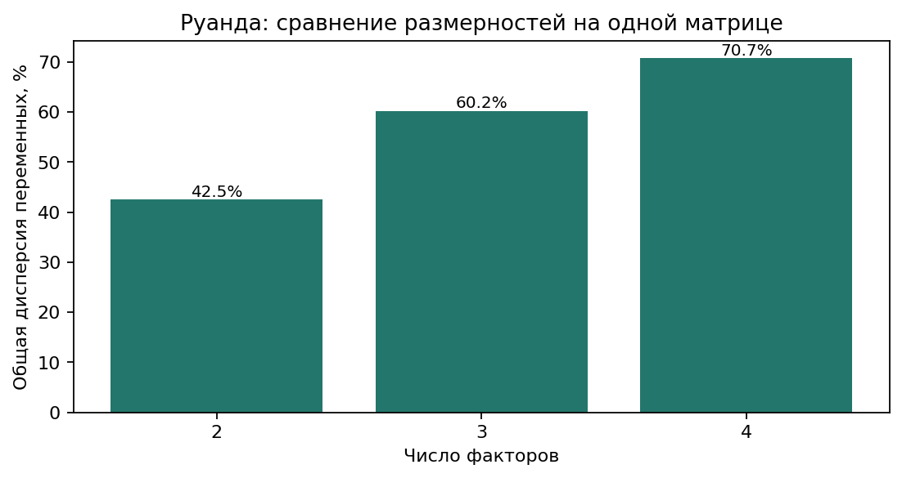

# Руанда: короткое сравнение факторных решений

**42 политика и публичных руководителя · 15.10.2021–15.10.2026 · независимые признаки 0–5.**

**Статус: предварительные факторные гипотезы.** При исключении всех оценок с контекстными оговорками остаётся 23 участника и 5 признаков — меньше принятого минимума для FA. Ни одно решение пока не подтверждено на этом строгом корпусе. [Проверка чувствительности](factor_sensitivity.md).

## Что изменилось в измерении

Из 24 утверждённых пар получены 48 самостоятельных признаков. Известный полюс сохраняется при неизвестном противоположном; разность и дополнение до фиксированной суммы не вычисляются. Однополюсная шкала также допустима. Ноль требует прямого основания, а отсутствие сведений остаётся пропуском.

Дополнительный поиск по всем 42 участникам дал 308 новых выписок; до отдельного проверенного тематического дополнения было 905 кандидатных выписок. Это не 905 независимых подтверждений: среди них есть повторные описания событий и ошибки дат. Из 774 первоначальных численных предложений отклонены 246, у 63 уточнены ссылки, 41 переоценены по якорям выраженности. Исходные ответы сохранены. Содержательная проверка относится к сохранённым выпискам с выборочным чтением первичных страниц; она не заменяет независимую человеческую экспертизу всего корпуса.

До обучения факторов отдельно проверены все 117 пропусков в шести общих признаках с покрытием от 50% до 60%. Признаки выбраны по полноте измерения, без просмотра факторных результатов. Добавлено 20 прямых ограниченных проявлений; прежние известные оценки и пороги допуска не менялись.

Сейчас известны **548 из 2016 оценок (27,18%)**. Это разведочные LLM-оценки публичных заявлений и действий, а не измерение частных убеждений или взглядов населения.

В общую факторную матрицу вошли **28 участников и 8 признаков**, покрытие — 84,38%. Все решения ниже рассчитаны по одной этой матрице. Их доли относятся к её переменным, а не ко всем 48 плановым признакам.

**Состав существенно ограничивает вывод.** В матрицу не прошли Поль Кагаме, Оливье Ндухунгирехе, Жювеналь Маризамунда и Луиза Мушикивабо. Из восьми оппозиционных и независимых участников вошли только трое. Преобладают руководители и управленцы; здесь прежде всего описываются доступные образцы публичной управленческой коммуникации, а не всё политическое сознание страны.

Оставлены восемь признаков: изменение курса; продолжение курса; поддержка курса; административное исполнение; ценности, память и символы; доступность базовых благ; раскрытие проблем; упреждение рисков.

## Сравнение решений

| Факторов | Общая объяснённая дисперсия | Что добавляется |
|---|---:|---|
| 2 | 42,53% | Поддержка курса и обновление как две связки |
| 3 | 60,21% | Ценностная преемственность в сопоставлении с профилактикой |
| 4 | 70,74% | Разделение профилактики и ценностной преемственности |

Дисперсия рассчитана по нагрузкам FA после varimax относительно общей дисперсии восьми стандартизованных переменных. 35 пропусков в 224 ячейках заполнены средним соответствующего признака перед стандартизацией. Это допущение модели, а не восстановленные факты. При изменении числа факторов вся модель переоценивается; разность общих процентов не является долей одного нового фактора.

### 2 фактора — 42,53%

**F1. Поддержка курса и доступность благ — 24,23%.** Совместно выражены поддержка действующего курса (нагрузка −0,993), доступность базовых благ (−0,641), продолжение курса (−0,522) и административное исполнение (−0,409). Это связка одобрения государственной линии с социальными целями и управленческими поручениями. Меньшая выраженность этой связки не доказывает оппозиционности.

**F2. Программное обновление и обозначение проблем — 18,30%.** Программное изменение курса (−0,994) сочетается с публичным раскрытием проблем (−0,449). Так можно описать предложение изменений рядом с обсуждением недостатков. Ось почти непосредственно воспроизводит первый признак; причинная связь и широкий психологический тип этим не установлены.

Это компактная схема двух связок. Ценностная риторика и профилактика рисков в ней почти не получают самостоятельного описания.

### 3 фактора — 60,21%

**F1. Ценностная преемственность ↔ упреждение рисков — 18,26%.** На одной стороне — аргументация через ценности, память и символы (+0,987) вместе с продолжением курса (+0,506), на другой — упреждающая подготовка (−0,450). Здесь впервые появляется содержательный контраст двух публичных акцентов. Он не означает, что ценности несовместимы с профилактикой или что у человека обязательно выражен только один из них.

**F2. Программное обновление с раскрытием проблем — 17,59%.** Изменение курса (+0,979), обозначение проблем (+0,446) и слабее доступность благ (+0,351) образуют связку обновления с обсуждением практических трудностей. Она близка F2 двухфакторного решения.

**F3. Поддержка курса и доступность благ — 24,36%.** Сохраняется связка поддержки курса (−0,966), базовых благ (−0,653), продолжения курса (−0,561) и административного исполнения (−0,418). Это наиболее воспроизводимое содержание при сравнении всех трёх решений.

Новый смысл по сравнению с двумя факторами — ценностно-мемориальное обоснование политики и его соотношение с подготовкой к рискам. Остальные две связки в основном сохраняются; номера факторов между решениями не совпадают.

### 4 фактора — 70,74%

**F1. Поддержка курса и доступность благ — 22,46%.** Поддержка курса (−0,982) и базовые блага (−0,639) остаются ядром. Продолжение курса (−0,405) и административное исполнение (−0,386) связаны с ним слабее, чем при трёх факторах.

**F2. Упреждение рисков — 15,06%.** Подготовка и снижение рисков (+0,964) выделяются в отдельную ось, с противоположной нагрузкой ценностно-мемориальной аргументации (−0,427). Основную опору даёт один прямой признак; называть это уже установленным широким типом сознания преждевременно.

**F3. Программное обновление с раскрытием проблем — 17,39%.** Сочетание изменения курса (+0,963), раскрытия проблем (+0,480) и доступности благ (+0,356) сохраняет смысл соответствующей оси трёхфакторного решения.

**F4. Преемственность, подкреплённая памятью и ценностями — 15,84%.** Продолжение курса (−0,818) соединяется с ценностями, памятью и символами (−0,749). Это отдельная связка из двух сильных признаков. Она отделяется от профилактики, но её воспроизводимость недостаточна для уверенного самостоятельного вывода.

Четыре фактора разделяют новый смысл трёхфакторной модели на профилактику рисков и ценностное обоснование преемственности. При восьми переменных модель почти исчерпывает доступные ковариации (номинальный df=2); рост процента сам по себе не обосновывает выбор.

По ограничению числа параметров не обучались: 5 факторов (df=-2), 6 факторов (df=-5), 7 факторов (df=-7). Неотрицательный df — необходимое условие, а не гарантия надёжности модели.

[Нагрузки 2 факторов](assets/factor_preview_q2.png) · [Нагрузки 3 факторов](assets/factor_preview_q3.png) · [Нагрузки 4 факторов](assets/factor_preview_q4.png). На этих диаграммах строки — признаки, столбцы — факторы, цвет и число показывают направление и силу связи. Весь знак столбца можно поменять без изменения модели; отрицательная нагрузка сама по себе не означает отрицательную оценку политика.

## Насколько это устойчиво

При 30 повторных выборках участников с возвращением наиболее воспроизводима связка поддержки курса и базовых благ: медианная схожесть нагрузок с исходными — 0,963 / 0,947 / 0,950 в решениях с 2 / 3 / 4 факторами. Ось обновления в двухфакторном варианте слабее (0,776); новая ось ценностной преемственности в четырёхфакторном — 0,785. Остальные оси также заметно меняются. Это условная проверка уже выбранной матрицы, не доказательство качества источников или охвата страны.

Без всех 41 оценок с оговорками остаётся **23 × 5**, без всех 20 новых тематических дополнений — **18 × 4**. Обе матрицы не проходят прежние пороги, FA для них не обучалась. Оговорка не равна доказанной ошибке, но результат зависит от допущения об использовании таких наблюдений. [Подробная проверка и все повторы](factor_sensitivity.md).

## Проверка отношения к России

Проверены шесть тематических контрастов как 12 самостоятельных признаков: дипломатия, оборона, экономика и технологии, образование и культура, оценки конкретных внешних действий России, санкции и изоляция. Два признака одной пары считаются одной семантической семьёй.

**Проверить долю отдельного российского фактора ≥2% пока нельзя.** Пригодные прямые основания не распределены достаточно широко по участникам; российский блок не прошёл допуск. Неизвестным позициям не присвоены нули, а российскому фактору не приписан нулевой процент.

В частности, проверены соглашение Ндухунгирехе о визовом режиме и последующие двусторонние заявления, оборонное взаимодействие Маризамунды, медицинское сотрудничество Нсанзиманы и критика российских действий Мушикивабо в роли главы OIF. Всего приняты 7 оценок отдельных российских свойств у четырёх человек; одно событие может относиться к нескольким темам и не становится независимыми событиями. Их нельзя переносить на остальных участников или смешивать с личной симпатией. [Карта источников и границы вывода](../../../research/rwanda_politicians_2021_2026/RUSSIA_INDEPENDENT_POLES_COVERAGE.md).

## Как читать результат и что выбрать

Для краткой предварительной сводки подходит решение с двумя факторами. Для содержательного обсуждения я предлагаю три: оно сохраняет основные связки и добавляет ценностно-мемориальный ракурс. Четырёхфакторное решение стоит оставить сравнительным вариантом: новая ось преемственности недостаточно воспроизводима. Пока ни один вариант нельзя считать подтверждённой стратификацией всей Руанды: измерение и состав источников требуют усиления.

Фактор с сильными нагрузками одного знака допускает однополюсный смысл. Разные знаки у разных содержательных групп могут дать два интерпретируемых полюса. Меньшая выраженность свойства не означает выраженность антонима. «Луч» здесь — содержательная метафора: центрированные FA-координаты математически допускают оба знака.

Доступность источников и публичные служебные роли неравномерны. Неизмеренные и исключённые участники не становятся нейтральными, а полученная матрица не исчерпывает политическое пространство страны. Расширенный отчёт, кластеризация и презентация ожидают выбора факторного решения.

[Полные нагрузки, исключения и диагностика](factor_preview.md) · [JSON всех решений](factor_preview.json) · [Методика независимых признаков](../../../docs/INDEPENDENT_POLES.md).
