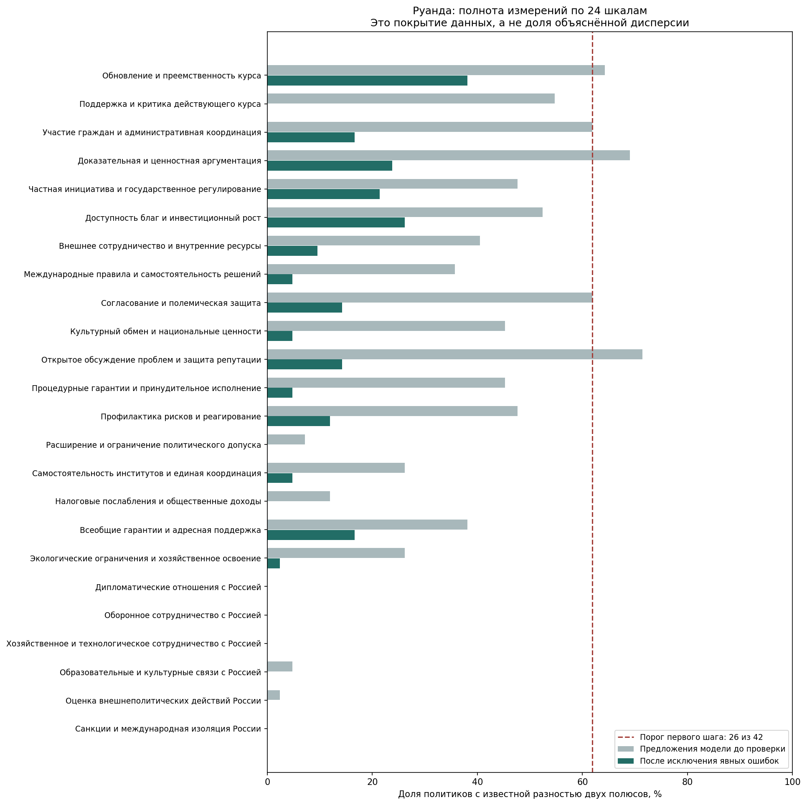

# Короткий аудит покрытия: данных для факторного анализа недостаточно

FA не запускался. Недостаточно реальных оценок: после исключения неизвестных объектов, редко измеренных и постоянных шкал нужны минимум 12 объектов и 6 шкал

Входная выборка: 42 объектов × 24 шкал. Наблюдаемых разностей: 90 из 1008 (8.9%). Неизвестных ячеек: 918.

После фиксированного отбора: 0 объектов × 0 шкал; покрытие — не определено для пустой матрицы.

На каждой итерации сначала исключаются постоянные шкалы и шкалы, измеренные менее чем у 60% текущих объектов или менее чем у 8 объектов. Затем исключаются объекты с оценками менее чем по 60% оставшихся шкал или менее чем по 4 шкалам. Процедура повторяется до стабильности состава. В итоговой матрице требуется не менее 75% известных оценок. Неизвестные значения не заменяются нулём.

Неизвестное не означает нейтральность или невыраженность свойства. Если один полюс известен, а другой неизвестен, точная разность не установлена. Пороги ради получения модели не понижались.

## Наблюдения по всем входным шкалам

Числа относятся к полной входной выборке до отбора, а не только к оставшимся объектам.

| ID | Шкала | Наблюдений | Всего объектов | Покрытие | Осталась |
|---|---|---|---|---|---|
| programmatic-renewal | Обновление и преемственность курса | 16 | 42 | 38.1% | нет |
| government-course-assessment | Поддержка и критика действующего курса | 0 | 42 | 0.0% | нет |
| participation-administrative-direction | Участие граждан и административная координация | 7 | 42 | 16.7% | нет |
| argumentation-evidence-values | Доказательная и ценностная аргументация | 10 | 42 | 23.8% | нет |
| market-state-instruments | Частная инициатива и государственное регулирование | 9 | 42 | 21.4% | нет |
| accessibility-growth-priorities | Доступность благ и инвестиционный рост | 11 | 42 | 26.2% | нет |
| external-domestic-resources | Внешнее сотрудничество и внутренние ресурсы | 4 | 42 | 9.5% | нет |
| international-rules-autonomy | Международные правила и самостоятельность решений | 2 | 42 | 4.8% | нет |
| mediation-adversarial-communication | Согласование и полемическая защита | 6 | 42 | 14.3% | нет |
| cultural-openness-national-transmission | Культурный обмен и национальные ценности | 2 | 42 | 4.8% | нет |
| problem-disclosure-reputation-defence | Открытое обсуждение проблем и защита репутации | 6 | 42 | 14.3% | нет |
| procedural-guarantees-enforcement | Процедурные гарантии и принудительное исполнение | 2 | 42 | 4.8% | нет |
| prevention-crisis-response | Профилактика рисков и реагирование | 5 | 42 | 11.9% | нет |
| electoral-access | Расширение и ограничение политического допуска | 0 | 42 | 0.0% | нет |
| institutional-autonomy-coordination | Самостоятельность институтов и единая координация | 2 | 42 | 4.8% | нет |
| taxation-burden-public-revenue | Налоговые послабления и общественные доходы | 0 | 42 | 0.0% | нет |
| universal-targeted-provision | Всеобщие гарантии и адресная поддержка | 7 | 42 | 16.7% | нет |
| ecological-limits-resource-use | Экологические ограничения и хозяйственное освоение | 1 | 42 | 2.4% | нет |
| russia-diplomatic-engagement | Дипломатические отношения с Россией | 0 | 42 | 0.0% | нет |
| russia-security-cooperation | Оборонное сотрудничество с Россией | 0 | 42 | 0.0% | нет |
| russia-economic-technology-cooperation | Хозяйственное и технологическое сотрудничество с Россией | 0 | 42 | 0.0% | нет |
| russia-education-cultural-cooperation | Образовательные и культурные связи с Россией | 0 | 42 | 0.0% | нет |
| russia-conflict-policy-evaluation | Оценка внешнеполитических действий России | 0 | 42 | 0.0% | нет |
| russia-isolation-sanctions | Санкции и международная изоляция России | 0 | 42 | 0.0% | нет |

## Наблюдения по всем входным объектам

| ID | Объект | Наблюдаемых шкал | Всего шкал | Покрытие | Остался |
|---|---|---|---|---|---|
| paul-kagame | Поль Кагаме | 0 | 24 | 0.0% | нет |
| edouard-ngirente | Эдуар Нгиренте | 0 | 24 | 0.0% | нет |
| justin-nsengiyumva | Жюстен Нсенгийюмва | 2 | 24 | 8.3% | нет |
| vincent-biruta | Венсан Бирута | 2 | 24 | 8.3% | нет |
| olivier-nduhungirehe | Оливье Ндухунгирехе | 0 | 24 | 0.0% | нет |
| james-kabarebe | Джеймс Кабаребе | 1 | 24 | 4.2% | нет |
| juvenal-marizamunda | Жювеналь Маризамунда | 1 | 24 | 4.2% | нет |
| albert-murasira | Альбер Мурасира | 2 | 24 | 8.3% | нет |
| emmanuel-ugirashebuja | Эмманюэль Угирасебуджа | 3 | 24 | 12.5% | нет |
| yusuf-murangwa | Юсуф Мурангва | 5 | 24 | 20.8% | нет |
| uzziel-ndagijimana | Уззиэль Ндагиджимана | 4 | 24 | 16.7% | нет |
| paula-ingabire | Паула Ингабире | 4 | 24 | 16.7% | нет |
| sabin-nsanzimana | Сабин Нсанзимана | 5 | 24 | 20.8% | нет |
| judith-uwizeye | Жюдит Увизейе | 3 | 24 | 12.5% | нет |
| ines-mpambara | Инес Мпамбара | 1 | 24 | 4.2% | нет |
| valentine-uwamariya | Валентин Увамария | 3 | 24 | 12.5% | нет |
| jeanne-darc-mujawamariya | Жанна д’Арк Муджавамария | 2 | 24 | 8.3% | нет |
| gerardine-mukeshimana | Жерардин Мукешимана | 1 | 24 | 4.2% | нет |
| ildephonse-musafiri | Ильдефонс Мусафири | 3 | 24 | 12.5% | нет |
| jean-claude-musabyimana | Жан-Клод Мусабийимана | 1 | 24 | 4.2% | нет |
| jean-damascene-bizimana | Жан-Дамасен Бизимана | 1 | 24 | 4.2% | нет |
| clare-akamanzi | Клэр Акаманзи | 1 | 24 | 4.2% | нет |
| francis-gatare | Франсис Гатаре | 1 | 24 | 4.2% | нет |
| gertrude-kazarwa | Гертруда Казарва | 3 | 24 | 12.5% | нет |
| donatille-mukabalisa | Донатиль Мукабалиса | 1 | 24 | 4.2% | нет |
| francois-xavier-kalinda | Франсуа-Ксавье Калинда | 1 | 24 | 4.2% | нет |
| augustin-iyamuremye | Огюстен Иямуремье | 2 | 24 | 8.3% | нет |
| alvera-mukabaramba | Альвера Мукабарамба | 1 | 24 | 4.2% | нет |
| mussa-fazil-harerimana | Мусса Фазиль Хареримана | 1 | 24 | 4.2% | нет |
| pudence-rubingisa | Пуденс Рубингиса | 3 | 24 | 12.5% | нет |
| samuel-dusengiyumva | Самуэль Дусенгийюмва | 5 | 24 | 20.8% | нет |
| frank-habineza | Франк Хабинеза | 5 | 24 | 20.8% | нет |
| philippe-mpayimana | Филипп Мпайимана | 1 | 24 | 4.2% | нет |
| victoire-ingabire | Виктуар Ингабире Умухоза | 3 | 24 | 12.5% | нет |
| diane-rwigara | Диана Рвигара | 4 | 24 | 16.7% | нет |
| bernard-ntaganda | Бернар Нтаганда | 1 | 24 | 4.2% | нет |
| christopher-kayumba | Кристофер Каюмба | 1 | 24 | 4.2% | нет |
| paul-rusesabagina | Поль Русесабагина | 0 | 24 | 0.0% | нет |
| kayumba-nyamwasa | Фостен Каюмба Ньямваса | 0 | 24 | 0.0% | нет |
| louise-mushikiwabo | Луиза Мушикивабо | 2 | 24 | 8.3% | нет |
| claver-gatete | Клавер Гатете | 3 | 24 | 12.5% | нет |
| valentine-rugwabiza | Валентин Ругвабиза | 7 | 24 | 29.2% | нет |

## Тема России и пределы выводов

Статус: `insufficient_measurement`. Ни наличие, ни отсутствие отдельного российского фактора по этой матрице установить нельзя. Нагрузки и доли дисперсии не оценивались; они не равны нулю.

Дальнейший шаг — собрать дополнительные датированные свидетельства по недостающим свойствам и повторить проверку покрытия. Подробные причины исключения и все итерации отбора сохранены в JSON.

## Проверка оснований оценок

Семантическая согласованность с извлечёнными выписками; не независимая человеческая экспертиза и не полная проверка каждой исходной страницы.

Проверено 342 предложенных пар; отклонено 252, исправлены ссылки у 12, сохранены с предупреждениями 41. Новые числа не назначались.

