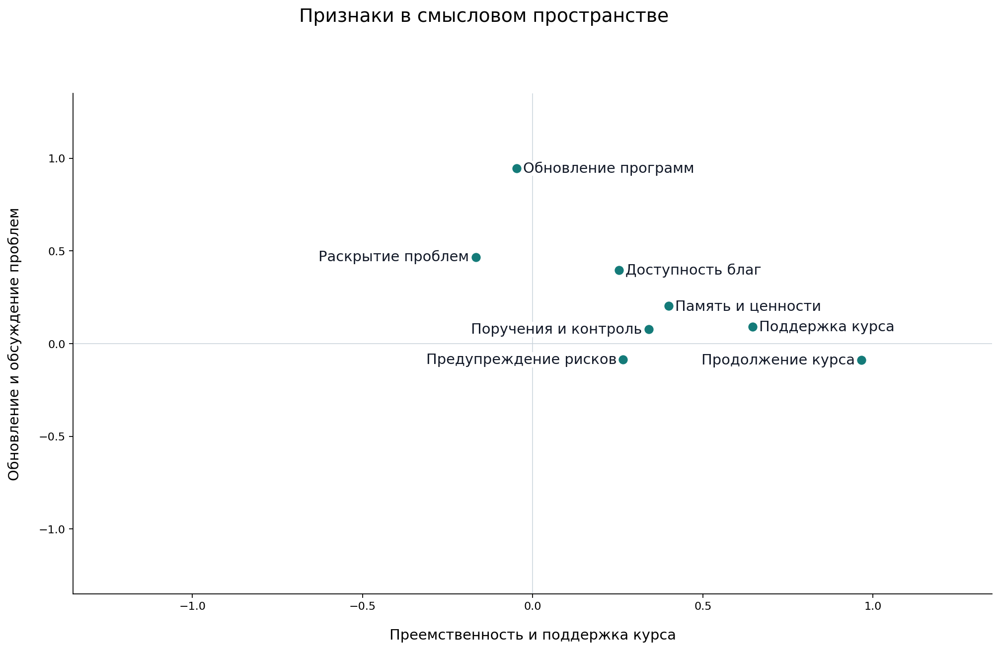
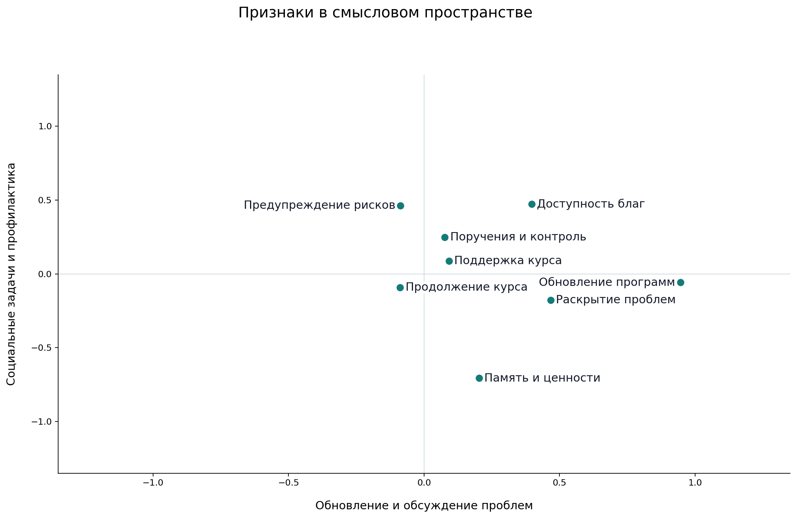
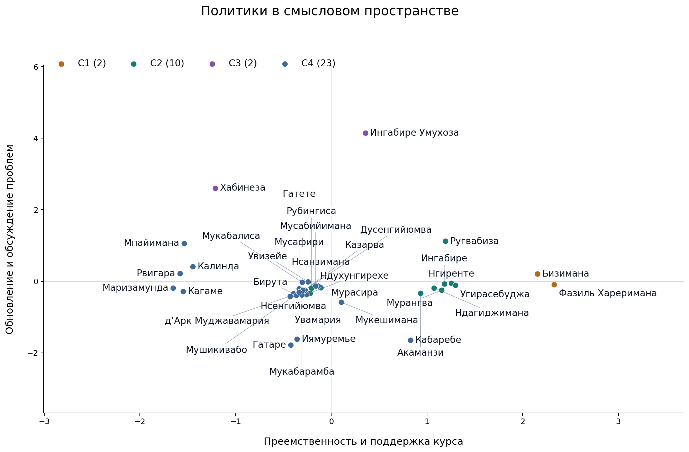
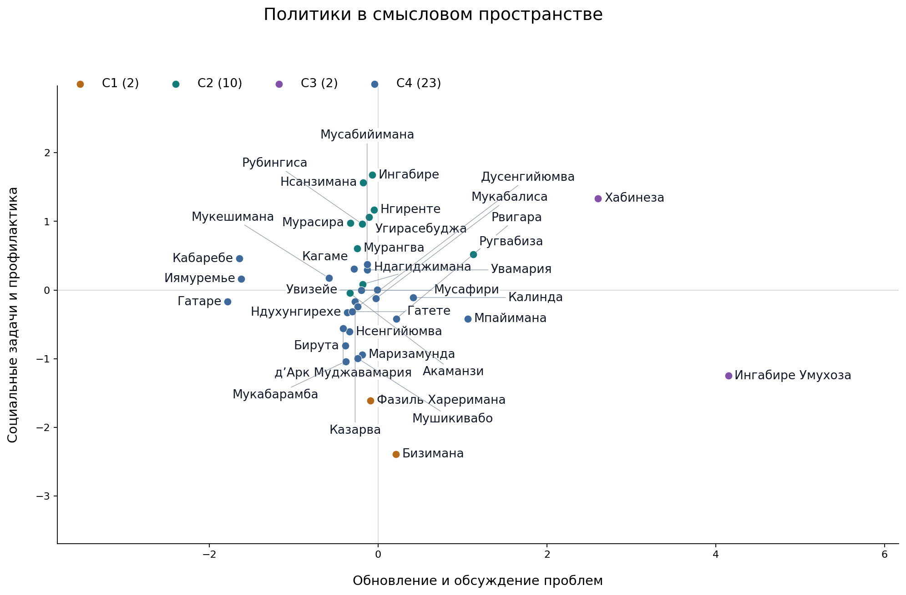
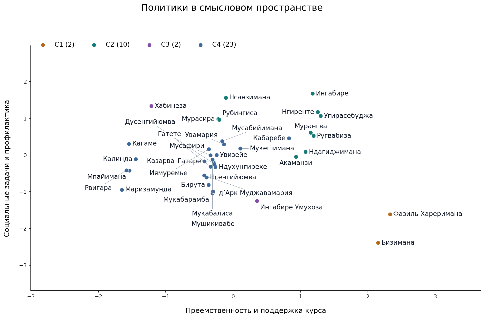

# Политическое пространство Руанды

Публичные акценты политиков и руководителей за 15 октября 2021 — 15 октября 2026 года. Политологический отчёт. Подготовлен 16 октября 2026 года.

## Основные выводы

1. В публичной политике выбранных участников различаются три смысловые линии: преемственность и поддержка курса, обновление программ с обсуждением проблем, социальные задачи и профилактика в соотношении с ценностной аргументацией.

2. Рабочая типология включает четыре группы: преемственность через ценности и память — 2 человека; социальные задачи и исполнение курса — 10; выраженные предложения обновления — 2; разнородные профили — 23. Это сочетания публичных акцентов, а не четыре партии или коалиции.

3. Сохранение общей государственной линии может сочетаться с изменением конкретных программ. Поэтому предложения реформ не принадлежат исключительно оппозиции. Отраслевой пересмотр и требование политической альтернативы нужно различать по содержанию.

4. Наибольшие формальные ресурсы власти сосредоточены в президентском центре. Кагаме и ряд руководителей исполнительной власти входят в разнородную группу C4. Их присутствие не делает остальных членов группы частью одного политического союза.

5. Доступные высказывания об отношениях с Россией показывают сочетание отраслевого сотрудничества, самостоятельного выбора партнёров и критики конкретных внешнеполитических действий. Для понимания позиции важны человек, его должность и конкретный эпизод.

6. Справочник охватывает 42 утверждённых участника, а карты — 37 достаточно описанных профилей. Выводы относятся к изученным публичным материалам. Размеры групп не показывают численность электората или распространённость убеждений среди населения.

## Участники и границы выбранного пространства

В исследование вошли президент и премьер-министры, министры и руководители ведомств, парламентские и местные руководители, кандидаты и оппозиционные фигуры. Отдельно включены три руандийца с международными мандатами. Состав охватывает разные публичные роли за пять лет и не является рейтингом популярности.

Для карты удалось сопоставить 37 участников. Инес Мпамбара, Бернар Нтаганда, Кристофер Каюмба, Поль Русесабагина и Фостен Каюмба Ньямваса остаются в справочнике, но пока не размещены на карте: по выбранному общему набору признаков им недостаёт сопоставимых материалов. Это не оценка их значимости.

| Круг участников | В справочнике | На карте |
| --- | --- | --- |
| Центральное руководство | 3 | 3 |
| Министры и руководители государственной политики | 20 | 19 |
| Руководство парламента | 6 | 6 |
| Региональное и столичное управление | 2 | 2 |
| Легальная оппозиция и независимые кандидаты | 2 | 2 |
| Незарегистрированная и ограниченная в участии оппозиция | 4 | 2 |
| Оппозиция в эмиграции и транснациональные политические фигуры | 2 | 0 |
| Международная дипломатия | 3 | 3 |

Валентин Ругвабиза выступает в материалах миссии ООН в ЦАР, Клавер Гатете — в том числе от Экономической комиссии ООН для Африки, Луиза Мушикивабо — от Франкофонии. Эти выступления показывают их работу в соответствующей роли. Их нельзя целиком приписывать правительству Руанды.

## Политическая среда

Конституция 2023 года разделяет законодательную, исполнительную и судебную власть. Исполнительную власть осуществляют президент и кабинет; президент назначает премьер-министра. Парламент двухпалатный: 80 депутатов и 26 избираемых или назначаемых сенаторов. Из депутатов 53 избираются напрямую, 24 места предназначены женщинам, два — молодёжи, одно — людям с инвалидностью.

[Constitution of the Republic of Rwanda — Official Gazette, 04.08.2023](https://www.minijust.gov.rw/fileadmin/user_upload/Minijust/Publications/Laws/Constitution.pdf)

В окончательной таблице NEC по выборам 2024 года национальный результат Кагаме — 99,18%, Хабинезы — 0,50%, Мпайиманы — 0,32%. Список FPR-Inkotanyi получил 37 из 53 напрямую избираемых мест. Это подтверждает преобладание президентского кандидата и ведущего партийного списка в официальных результатах, но не измеряет свободное распределение частных убеждений.

[NEC: final presidential and legislative election results, 22 July 2024](https://www.nec.gov.rw/fileadmin/user_upload/NEC/Publications/Elections_Results/Elections-Results-1.pdf)

На 30-й годовщине памяти геноцида против тутси 7 апреля 2024 года Кагаме связывал поминовение, примирение, единство и восстановление страны. Это конкретная публичная речь главы государства, а не свидетельство единогласия общества или всех участников исследования.

[Kwibuka 30 — address by President Kagame](https://www.paulkagame.rw/kwibuka-30-address-by-president-kagame/)

В июне 2024 года HRW описала давление на оппозицию, журналистов и гражданское общество, а также недопуск Ингабире после отказа суда снять ограничения. В июне 2025 года организация сообщила о её новом аресте. Это независимая оценка среды публичного участия; отдельное судебное дело не доказывает программных взглядов человека.

[Human Rights Watch: Rwanda — Respect Rights During Elections](https://www.hrw.org/news/2024/06/14/rwanda-respect-rights-during-elections)

[Human Rights Watch: Rwanda — Opposition Leader Arrested](https://www.hrw.org/news/2025/06/24/rwanda-opposition-leader-arrested)

Наличие формальных институтов и официальных результатов выборов нужно читать вместе с условиями участия в политике. Именно в этой среде одни люди объясняют сохранение курса, другие предлагают изменения внутри него, а третьи выступают за политическую альтернативу.

## Какие признаки вошли в итоговую карту

Исходный словарь включал 24 пары определений. Для общей карты сопоставимыми оказались восемь отдельных свойств. Каждое описывает публичное проявление, а не заранее заданный тип личности. Продолжение курса и предложение изменить программу могут встречаться у одного человека одновременно.

| Признак | Что он означает |
| --- | --- |
| Программное изменение существующего курса | Явное предложение пересмотреть приоритеты, правила или программы |
| Продолжение и закрепление действующего курса | Призыв продолжить, закрепить или ускорить уже принятую линию |
| Публичная поддержка действующего государственного курса | Положительная публичная оценка действующего государственного курса |
| Административная постановка задач и контроль исполнения | Постановка задач, поручения и контроль исполнения |
| Обоснование через ценности, память и коллективные символы | Обоснование через память, единство и коллективные символы |
| Расширение доступности базовых благ для населения | Конкретные меры расширения доступа к базовым услугам и благам |
| Публичное раскрытие проблем и недостатков исполнения | Публичное обозначение недостатков и проблем исполнения |
| Упреждающее снижение рисков и подготовка | Меры подготовки и снижения риска до наступления кризиса |

Другие свойства сохранены в словаре и индивидуальных материалах, но не определяют положение на общей карте. В частности, восемь общих признаков не дают самостоятельной оси отношения к России. Этот вопрос ниже рассматривается по конкретным высказываниям и действиям.

## Три принципа различения публичных акцентов

### Преемственность и поддержка государственного курса

На этой оси рядом оказались призывы продолжать уже принятую линию, положительная оценка государственного курса и обращение к памяти, единству и коллективным символам. Чем сильнее этот акцент, тем заметнее человек связывает свои предложения с сохранением и укреплением общей линии. Слабый акцент означает, что в изученных выступлениях такая связка выражена меньше. По нему нельзя автоматически заключить, что человек выступает против власти.

Политический смысл этой оси связан с обоснованием преемственности. Успех государства, безопасность и единство могут выступать общим языком для руководителей разных ведомств и парламентских фигур. Это помогает понять, почему публичное одобрение курса встречается вместе с обращением к коллективной памяти. При этом речь идёт о способе обосновывать политику, а не о проверке истинности каждого заявления.

Такое сочетание согласуется с устройством политического пространства вокруг президента и правящей коалиции, а также с ролью памяти о геноциде 1994 года в государственной публичной речи. Ещё одна причина относится к самой выборке: в ней много должностных лиц, которые по своей работе объясняют и исполняют государственные программы. Эти объяснения правдоподобны в контексте источников, но карта сама по себе не устанавливает причины поведения.

Иллюстрация: Поль Кагаме, 2024-04-07: «Основа всего — единство.» (перевод с английского). Иллюстрация собственного публичного тезиса; не объясняет автоматически координаты фактора или мнения населения.

[Источник цитаты и её контекст](https://www.paulkagame.rw/kwibuka-30-address-by-president-kagame/)

### Обновление программ и публичное обсуждение проблем

Здесь соединяются предложения пересмотреть действующие правила или программы, публичное обозначение недостатков и, слабее, задачи расширения доступа к базовым благам. Ось различает, насколько заметно человек предлагает изменения и говорит о проблемах, требующих этих изменений. В одном случае это может быть предложение оппозиционного кандидата, в другом — пересмотр конкретной программы министром или местным руководителем.

Политическое обновление в этой выборке имеет два источника. Критики власти предлагают расширить политическое участие или изменить правила. Действующие руководители предлагают новые отраслевые инструменты внутри общей стратегии развития. Общность слов о переменах не означает общности программ или отношения к власти. Поэтому близость по этой оси нельзя превращать в единую реформаторскую коалицию.

Сочетание преемственности и изменений согласуется с логикой долгосрочных планов развития: общие цели сохраняются, а отраслевые правила и способы исполнения пересматриваются. Новая стратегия NST2 на 2024–2029 годы прямо связывает долгосрочное видение с корректировкой политики в изменившихся условиях. На карте это позволяет увидеть обновление как часть управления, а не только как требование сменить власть.

[MINECOFIN National Strategy for Transformation NST2 2024–2029 abridged](https://www.minecofin.gov.rw/fileadmin/user_upload/Minecofin/Publications/STRATEGIES/NST_2/NST2_2024-2029_Abridged.pdf)

Иллюстрация: Клэр Акаманзи, публикация 2022-05-20: «организуя оптовую закупку ресурсов» (перевод с английского). Короткий фрагмент точной цитаты о поддержке фермеров закупками. Дата публикации не выдаётся за день интервью или дату начала реформы; сам инструмент мог существовать до окна. Не добавляет новой числовой оценки.

[Источник цитаты и её контекст](https://jamaica-gleaner.com/article/news/20220520/rwanda-shares-secrets-agricultural-success)

### Социальные задачи и профилактика в соотношении с ценностной аргументацией

Одна сторона этой оси сильнее связана с расширением доступности базовых благ и подготовкой к рискам. Другая — с обращением к памяти, ценностям и коллективным символам. Речь идёт о разных преобладающих акцентах публичных выступлений: как обеспечить конкретную услугу и предупредить проблему либо как объяснить действие через общую историю и ценности. Один человек может использовать оба способа.

Ось показывает различие между практическим обоснованием социальных задач и ценностным обоснованием политики. В руандийском контексте это особенно заметно при сопоставлении отраслей: здравоохранение, социальная защита и управление рисками требуют разговора об услугах и готовности, а работа с исторической памятью — разговора о единстве и ответственности. Значительная часть различий может отражать распределение служебных задач.

Долгосрочные планы развития делают доступность услуг и качество жизни заметными государственными приоритетами. Одновременно память о геноциде и язык национального единства занимают самостоятельное место в публичной политике. Эти задачи могут сосуществовать, но звучат с разной частотой в речи разных руководителей. Карта позволяет сформулировать это объяснение, однако не доказывает конфликт между социальной политикой и ценностями.

[MINECOFIN National Strategy for Transformation NST2 2024–2029 abridged](https://www.minecofin.gov.rw/fileadmin/user_upload/Minecofin/Publications/STRATEGIES/NST_2/NST2_2024-2029_Abridged.pdf)

Иллюстрация: Сабин Нсанзимана, 2023-02-13: «Это возможность построить более сильную систему здравоохранения.» (перевод с английского). Точный непрерывный фрагмент атрибутированного выступления о готовности к эпидемиям; не независимая оценка результатов системы.

[Источник цитаты и её контекст](https://www.moh.gov.rw/news-detail/rwanda-who-join-forces-to-boost-epidemic-preparedness)

## Как читать карты признаков

Карта признаков показывает, какие публичные акценты изменяются вместе. Точка здесь обозначает свойство, например обсуждение проблем или обращение к памяти. Близкие точки означают похожую связь с выбранными осями. Это не число сторонников соответствующей идеи и не место самого политика.

Например, продолжение курса и его публичная поддержка расположены близко по первой оси: эти акценты в изученном материале часто сочетаются. Программное обновление и раскрытие проблем сближаются по второй оси. На третьей различаются практические социальные акценты и ценностная аргументация.

Каждый рисунок показывает только две из трёх осей. Если два признака кажутся близкими на одной картинке, другая плоскость может раскрыть различие. Положение около центра означает слабую связь с показанными осями, а не отсутствие значения этого свойства в политике.

## Расположение политиков

На следующих картах точка обозначает человека. Цвет показывает одну из четырёх групп по сочетанию всех трёх осей. Близость показывает сходство выбранных публичных акцентов. Она не устанавливает союз, дружбу, общую партийность или одинаковые возможности влиять на решения.

Некоторые сведения неизвестны; расчётное заполнение пропусков помогает построить карту, но не добавляет наблюдений. Числа на осях нужны для относительного сопоставления профилей. Нулевая координата не означает нейтралитета или отсутствия убеждений.

## Четыре группы публичных профилей

| Группа | Число | Общая характеристика |
| --- | --- | --- |
| C1 | 2 | Ценностное обоснование преемственности курса |
| C2 | 10 | Практическое управление: услуги и предупреждение рисков |
| C3 | 2 | Программные альтернативы и доступность благ |
| C4 | 23 | Смешанные публичные профили |

### C1 Ценностное обоснование преемственности курса

Жан-Дамасена Бизиману и Муссу Фазиля Харериману сближает выраженное сочетание трёх публичных акцентов: ценностной и исторической аргументации, продолжения принятого курса и его положительной оценки. В этой паре ссылки на единство, коллективную память и сохранение достигнутого заметнее, чем в среднем по изученной выборке. Различие с управленческой группой связано прежде всего со способом публичного обоснования, а не с доказанной разницей в эффективности или полномочиях.

Это сочетание видно в разных служебных контекстах. На тридцатилетии PDI 30 ноября 2021 года Хареримана прямо поддержал дальнейшую совместную работу с RPF и Кагаме, связывая её с миром, единством и развитием. Бизимана 22 января 2025 года на встрече в семинарии Кабгайи призывал изучать историю геноцида и передавать объединяющую гражданскую идентичность. Примеры показывают публичное сохранение политической и мемориальной рамки; они не делают двух политиков членами одной организации или носителями всех одинаковых убеждений.

У обоих нет пригодной оценки программного изменения курса в используемой матрице. Поэтому название группы не означает отрицания реформ или отсутствия практических социальных приоритетов. Особенно важно учитывать профессиональную роль Бизиманы: работа с памятью и единством делает соответствующие сюжеты более доступными в его источниках. Это небольшая пара, сравнительно хорошо сохраняющаяся в выполненных проверках, но не доказанный самостоятельный социальный слой.

Полный состав: Жан-Дамасен Бизимана, Мусса Фазиль Хареримана.

[MINUBUMWE: Бизимана в семинарии Кабгайи](https://www.minubumwe.gov.rw/news-detail/min-dr-bizimana-yasabye-abiga-muri-seminari-nkuru-ya-kabgayi-kwimakaza-ndi-umunyarwanda)

[KT Press: Хареримана на тридцатилетии PDI](https://www.ktpress.rw/2021/12/pdi-party-marks-30-years-with-pledge-of-allegiance-to-ruling-party/)

### C2 Практическое управление: услуги и предупреждение рисков

Эта десятка объединяет публичные профили, в которых продолжение государственных программ сочетается с управленческой постановкой задач, расширением доступности базовых благ и подготовкой к рискам. Здесь находятся, в частности, Нгиренте, Мурангва, Угирасебуджа, Паула Ингабире и Нсанзимана. Их общность лучше понимать как акцент на обеспечении и организации работы: что должно быть сделано, для каких получателей и как снизить будущие угрозы.

Показателен доклад Нгиренте парламенту 1 августа 2022 года: он связывал школьную инфраструктуру, условия работы учителей и увеличение финансирования питания с доступностью и качеством образования. На передаче полномочий 25 июля 2025 года он призвал ускорять уже принятую NST2. Эти два сюжета помогают понять, как конкретные улучшения могут сочетаться с преемственностью программы, не означая отказа от обновления.

Группа не ограничена одной отраслью или исключительно внутренним правительством: Ругвабиза имеет международный управленческий контекст. Более слабая ценностная аргументация в записанных материалах не доказывает отсутствия ценностей и не позволяет автоматически назвать всех экспертами или технократами. Так же нельзя заключать, что они успешнее остальных: матрица отражает публичные акценты, а не независимый аудит результатов. Границы этой десятки могут сдвигаться при уточнении недостающих сведений.

Полный состав: Эдуар Нгиренте, Альбер Мурасира, Эмманюэль Угирасебуджа, Юсуф Мурангва, Уззиэль Ндагиджимана, Паула Ингабире, Сабин Нсанзимана, Клэр Акаманзи, Пуденс Рубингиса, Валентин Ругвабиза.

[Primature: Нгиренте о базовом образовании](https://www.primature.gov.rw/news-detail/the-prime-minister-presented-government-actions-related-to-achievements-in-basic-education-primary-secondary)

[Primature: передача полномочий премьер-министра](https://primature.prod.risa.rw/news-detail/pm-nsengiyumva-officially-sworn-in-as-prime-minister)

### C3 Программные альтернативы и доступность благ

Франка Хабинезу и Виктуар Ингабире сближает сильный акцент на программных изменениях и доступности базовых благ. Среди четырёх групп их общая позиция наиболее отчётливо связана с предложением иной политики, а не только с продолжением уже принятой программы. Это содержательное сходство помогает обсуждать альтернативную повестку, но само по себе не устанавливает союз, единую платформу или одинаковый доступ к политическому участию.

Например, на кампании в Муханге 9 июля 2024 года Хабинеза предлагал пересмотреть правила выдачи горных разрешений и одновременно расширить доступ к воде и медицинскому страхованию, изменить отдельные налоги. Это связка конкретной критики существующих правил и предложенного улучшения повседневных условий. При этом внутри пары есть существенное различие: ценностная и историческая аргументация в сохранённом профиле Ингабире выражена сильнее, чем у Хабинезы. Двух участников соединяет часть измерений, а не весь политический образ.

Название не обозначает всю оппозицию Руанды: Рвигара и Мпайимана в этой разметке находятся в другой группе, а ряд участников не получил достаточно данных для включения. У обоих здесь неизвестна положительная оценка государственного курса; это не нулевая поддержка и не самостоятельное доказательство тотального отрицания власти. При учёте разных правдоподобных недостающих оценок состав небольшой группы заметно меняется, поэтому её следует представлять как наиболее явный в текущей матрице профиль программных альтернатив.

Полный состав: Франк Хабинеза, Виктуар Ингабире Умухоза.

[The New Times: программа Хабинезы в Муханге](https://www.newtimes.co.rw/article/18346/news/elections/frank-habineza-campaigns-in-muhanga-promises-changes-in-mining-sector/amp)

### C4 Смешанные публичные профили

Самая большая группа объединяет двадцать три существенно разных политических профиля, включая Кагаме, правительственных и парламентских руководителей, международных дипломатов, Рвигару и Мпайиману. В доступных оценках у неё нет столь выраженного общего сочетания, как у трёх других групп: большинство средних акцентов сосредоточено в невысокой или средней части шкалы. Это характеристика записанных проявлений, а не политическая умеренность, отсутствие убеждений или низкая значимость участников.

Различие реальных позиций хорошо видно даже на двух известных участниках. Кагаме 23 декабря 2024 года ставил перед должностными лицами задачи мобилизации ресурсов и исполнения обязанностей. Рвигара критиковала страх и нехватку базовых благ. Эти публичные действия политически различны. Их нахождение в одной группе показывает ограниченность выбранного среза: критика власти, доступ к выборам и ряд институциональных позиций не входят в восемь оставшихся переменных, а по некоторым включённым свойствам сведения неполны.

Поэтому группу полезнее описывать через разнообразие индивидуальных сочетаний и отдельно показывать её участников на карте. Нельзя сочинять для неё общую идеологию, коалицию или отношение к президентской власти. Геометрически близкие оценки конкретных акцентов не делают Кагаме и Рвигару политическими союзниками. Дополнительное деление этой группы в варианте с пятью группами также не даёт очевидной общей политической идентичности новой пятёрке.

Полный состав: Поль Кагаме, Жюстен Нсенгийюмва, Венсан Бирута, Оливье Ндухунгирехе, Джеймс Кабаребе, Жювеналь Маризамунда, Жюдит Увизейе, Валентин Увамария, Жанна д’Арк Муджавамария, Жерардин Мукешимана, Ильдефонс Мусафири, Жан-Клод Мусабийимана, Франсис Гатаре, Гертруда Казарва, Донатиль Мукабалиса, Франсуа-Ксавье Калинда, Огюстен Иямуремье, Альвера Мукабарамба, Самуэль Дусенгийюмва, Филипп Мпайимана, Диана Рвигара, Луиза Мушикивабо, Клавер Гатете.

[Официальная речь Кагаме перед новыми должностными лицами](https://www.paulkagame.rw/remarks-by-the-president-of-the-republic-during-the-swearing-in-ceremony-of-new-government-officials-kigali-23-december-2024/)

[BBC: собственные критические слова Рвигары](https://www.bbc.com/news/articles/cw007n5pn4wo)

## Где сосредоточено политическое влияние

Политическое влияние нельзя ранжировать по размеру группы или её положению на факторной карте. Президентская должность Кагаме и правительственные должности дают доступ к постановке задач, ресурсам и исполнению государственных решений; этот институциональный ресурс отличается от публичной критики или программного предложения. В C2 и C4 есть участники с существенными управленческими полномочиями, тогда как международные роли и оппозиционная деятельность создают иные возможности воздействия. Поэтому присутствие президента делает C4 политически важной независимо от её численности, а маленький размер C1 или C3 не доказывает слабого общественного влияния. В этом исследовании влияние, сети поддержки и реальные результаты отдельно не измерялись.

[Constitution of the Republic of Rwanda — Official Gazette, 04.08.2023](https://www.minijust.gov.rw/fileadmin/user_upload/Minijust/Publications/Laws/Constitution.pdf)

## Что структура говорит о политических тенденциях

Во-первых, публичная поддержка курса и его практическая корректировка могут сосуществовать. Противопоставление сохранения власти и любых реформ слишком грубо описывает найденные сочетания. Для понимания Руанды полезно различать смену политических правил, отраслевое обновление и исполнение уже принятых целей.

Во-вторых, ценностное обоснование и забота о конкретных услугах составляют разные публичные акценты внутри одного пространства. Их различие частично связано с тем, какие задачи поручены человеку. Это позволяет описать разнообразие управленческой речи, но не даёт основания объявлять её носителей противоположными идеологическими лагерями.

В-третьих, большой разнородный круг C4 показывает пределы компактной карты. В неё попадают влиятельные руководители, парламентские деятели и отдельные критики власти. По одной близости их публичных профилей нельзя объяснить устройство всех политических отношений. Дополнительные признаки могут раскрыть различия, которые эти восемь свойств не отражают.

Почему возникли именно такие линии — политологическое объяснение на основе контекста, а не установленная причинная закономерность. Президентский центр, долгосрочное государственное планирование, память о геноциде и распределение служебных задач дают правдоподобную рамку. Проверка причин требует другого исследовательского дизайна.

## Отношения с Россией в заявлениях и действиях политиков

В доступных эпизодах сотрудничество с Россией сочетается с разными оценками её конкретных действий. Здесь важны направление работы и полномочия говорящего. Меморандум показывает договорённость, переговоры — обсуждение, а прямая речь — высказанный тезис. Эти свидетельства нельзя складывать в простой рейтинг симпатии к Москве.

### Поль Кагаме

Президент Руанды. Кагаме сочетает принципиальное неприятие вторжения с дистанцированием от выбора геополитической стороны. Отдельное высказывание о выборе партнёров делает его публичную позицию сложнее простой классификации по симпатии к Москве.

2023-09-12. В интервью он сам объясняет поддержку резолюции ООН запретом вторжения государства в другое, называя Россию и Украину. Одновременно подчёркивает возможность нейтралитета и отсутствие своей роли в конфликте.

Собственный ответ в опубликованном интервью: «мы не можем поддержать вторжение» (перевод на русский). Фрагмент принципиального объяснения голосования. В том же ответе Кагаме заявляет нейтралитет; этот контекст обязателен.

В этой позиции принцип невторжения сочетается с заявленным нейтралитетом. Кагаме сам объясняет голосование Руанды, поэтому здесь есть собственное публичное суждение президента. Его отношение к санкциям и возможному ограничению двусторонних связей в этом ответе не раскрывается.

Нейтралитет сохраняет самостоятельность политического выбора. При этом он не отменяет высказанного неприятия вторжения, а обращение к этому принципу само по себе не означает присоединения к западному политическому лагерю.

[Кагаме: интервью Франсуа Судану, раздел об Украине](https://www.newtimes.co.rw/article/10916/news/politics/kagame-the-problem-is-not-between-me-and-tshisekedi/amp)

2023-04-17. На пресс-конференции с Патрисом Талоном Кагаме отвергал исключительное право одних внешних игроков присутствовать в Африке и защищал выбор партнёров по африканским потребностям, прямо упомянув Россию и Китай.

Официально опубликованный фрагмент собственной речи: «кто предлагает то, что нам нужно» (перевод на русский). Часть аргумента о праве Африки выбирать партнёров, где непосредственно названы Россия и Китай.

Кагаме рассматривает Россию и Китай в более широкой логике самостоятельного выбора внешних партнёров африканскими государствами. Речь идёт о праве определять сотрудничество исходя из собственных потребностей.

Выступление не сообщает о конкретном расширении российско-руандийских отношений и не раскрывает оценки вторжения в Украину или позиции по санкциям. Эти вопросы остаются отдельными направлениями внешней политики.

[Кагаме о выборе африканских партнёров, пресс-конференция в Бенине](https://www.paulkagame.rw/president-kagame-visits-benin-cotonou-15-17-april-2023/)

2026-01-15. Посольство Руанды сообщает о передаче послом Нзабамвитой послания Кагаме Путину после церемонии верительных грамот. Содержание послания не опубликовано.

Передача послания подтверждает действующий канал общения между президентами через дипломатического представителя. Поскольку содержание послания не опубликовано, его темы и политические оценки остаются неизвестными.

[Посольство Руанды о вручении верительных грамот и дипломатических контактах](https://www.rwandainrussia.gov.rw/info/info-details?cHash=f16d397d5a5a23a2705acb619e74a537&tx_news_pi1%5Baction%5D=detail&tx_news_pi1%5Bcontroller%5D=News&tx_news_pi1%5Bnews%5D=56199)

### Венсан Бирута

Министр иностранных дел и международного сотрудничества Руанды. Из проверенных материалов Бирута даёт наиболее многотемное собственное описание двусторонней работы: образование, безопасность и новые отрасли. Это совместимо с его объяснением украинского голосования принципами суверенитета.

2023-06-12. Бирута подтвердил курс на укрепление отношений. Положительно оценил план бесплатного дистанционного изучения русского языка и назвал работу HEC и University of Rwanda по обеспечению доступа. Сообщил о переговорах по торговле, умным городам, космическим технологиям, здравоохранению и спорту; выразил готовность к сотрудничеству против угроз безопасности и терроризма.

Прямая реплика в журналистском французском репринте; исходный язык выступления не установлен: «продолжать тесно работать с Россией» (перевод на русский). Намерение многосторонней совместной работы. Это не слова об оправдании войны.

В образовательной части назван конкретный механизм сотрудничества, тогда как большинство отраслевых направлений находится на стадии обсуждения. Заявленные интерес и готовность к работе ещё не подтверждают вложений, поставок или выполненных проектов. Все эти аспекты обсуждались на одном дипломатическом приёме.

В материале представлены разные говорящие. Сообщение об удвоении стипендий и оправдание российской войны принадлежат послу Карену Чальяну. Публичные реплики Бируты описывают сотрудничество, поэтому соседство двух выступлений не делает позицию посла позицией руандийского министра.

[Бирута на Дне России: дипломатия, образование и отраслевые переговоры](https://rwandaises.com/2023/06/la-russie-et-le-rwanda-sengagent-a-renforcer-les-liens-diplomatiques-existants/)

2022-03-30. Бирута сам пояснил украинское голосование ссылкой на Устав ООН и суверенные права, одновременно признавая самостоятельность других государств при голосовании. В другом ответе описал угрозы для цен топлива, удобрений и поставок продовольствия и поиск альтернатив.

Собственные слова в журналистской расшифровке: «территориальная целостность, суверенитет» (перевод на русский). Названные им принципы, которыми он объясняет голосование по Украине; фрагмент не является самостоятельной полной фразой.

Бирута обосновывает позицию принципами суверенитета и территориальной целостности, одновременно признавая самостоятельность других государств при голосовании. Это объяснение дипломатической позиции, без развёрнутой отдельной оценки российского руководства.

Обсуждение экономических издержек показывает заботу о последствиях войны и санкций для Руанды. Само по себе оно не выражает ни требования снять санкции с России, ни поддержки их применения.

[Бирута и Муджавамария: ответы на вопросы Atlantic Council](https://www.topafricanews.com/2022/03/31/washington-here-are-q-a-from-dr-vincent-biruta-and-dr-mujawamariya-about-geopolitical-and-climate-issues/)

### Оливье Ндухунгирехе

Министр иностранных дел и международного сотрудничества Руанды. Его российский профиль имеет наиболее отчётливую последовательность практических контактов. Однако лишь интервью даёт собственные слова; содержание позднейших переговоров известно в редакции официальных ведомств.

2024-11-09. В Сочи подписал с Лавровым соглашение об освобождении от виз владельцев дипломатических и служебных паспортов. В интервью AFP заявил о потребности в атомной энергетике и надежде готовить специалистов при содействии России; упомянул выпускников российских вузов.

Собственные слова в прямом интервью AFP: «Руанде нужна ядерная энергия» (перевод на русский). Потребность в энергетике сопровождается надеждой на российскую подготовку специалистов; не подтверждение действующей АЭС.

Визовая договорённость касается владельцев дипломатических и служебных паспортов, а не всех граждан. Подписание и интервью относятся к одному сочинскому форуму и показывают разные стороны той же поездки: оформление официальных контактов и обсуждение подготовки кадров.

Упомянутая в статье договорённость 2019 года составляет предысторию сотрудничества. Она не подтверждает работу атомной станции, а высказывание министра на форуме описывает потребность в энергетике и подготовке специалистов.

[AFP: Ндухунгирехе о подготовке специалистов для атомной энергетики](https://www.themoscowtimes.com/2024/11/09/rwanda-counting-on-russia-to-train-nuclear-power-specialists-a86964)

[Официальное сообщение о соглашении для дипломатических и служебных паспортов](https://t.me/rusembrwanda/129)

2025-12-19. Итоговый релиз о встрече в Каире описывает поиск расширения торгово-экономического и гуманитарного взаимодействия, а также политического диалога и многосторонней координации. Руандийское посольство независимо подтверждает дату и участие министров.

Содержание встречи известно из официального итогового сообщения. Оно подтверждает переговоры и заявленную взаимную готовность к сотрудничеству, но не воспроизводит полную персональную речь Ндухунгирехе. Приведённые в том же сообщении вступительные слова принадлежат Лаврову.

[Официальный итог переговоров Ндухунгирехе и Лаврова в Каире](https://mid.ru/ru/foreign_policy/news/2067378/)

[Посольство Руанды о вручении верительных грамот и дипломатических контактах](https://www.rwandainrussia.gov.rw/info/info-details?cHash=f16d397d5a5a23a2705acb619e74a537&tx_news_pi1%5Baction%5D=detail&tx_news_pi1%5Bcontroller%5D=News&tx_news_pi1%5Bnews%5D=56199)

2026-04-18. Официальное сообщение о встрече в Анталье конкретизирует направления: торговля, мирное применение атомных технологий, образование и подготовка кадров; отмечает намерение продолжать политическое взаимодействие.

Встреча продолжает двусторонний диалог и конкретизирует направления обсуждения. Перечисленные отрасли обозначают повестку сотрудничества; сам релиз не является перечнем подписанных контрактов.

Готовность координировать работу на международных площадках не означает совпадения позиций по каждому голосованию, войне или санкциям. По этим отдельным вопросам сообщение подробностей не содержит.

[Официальный итог встречи Ндухунгирехе и Лаврова в Анталье](https://t.me/rusembrwanda/396)

### Жювеналь Маризамунда

Министр обороны Руанды. Российская связь подтверждена конкретным ведомственным механизмом, но собственные слова министра в релизе отсутствуют.

2026-05-20 — 2026-05-22. Во время седьмого заседания ежегодной военно-технической комиссии российская делегация посетила Маризамунду и руководство RDF. Встреча описана как обмен мнениями о приоритетах партнёрства. Заседание комиссии возглавляли Каруретва и Пунчук.

Текст MOD о событии; НЕ прямая речь Маризамунды: «обменяться мнениями о приоритетах двустороннего партнёрства» (перевод на русский). Ведомственное описание цели визита делегации к министру.

Заседание комиссии вели Каруретва и Пунчук, а Маризамунда участвовал в отдельном приёме российской делегации. Это разные роли внутри одного межгосударственного механизма оборонного сотрудничества.

Подтверждены участие министра и предмет разговора. Конкретная поставка оружия, подписанный им договор и собственные слова в релизе не представлены. Точный день его приёма внутри периода 20–22 мая также не назван.

[MOD Руанды: седьмая российско-руандийская военно-техническая комиссия](https://www.mod.gov.rw/docs-media/news-detail/rrdf-hosts-the-7th-meeting-of-the-rwanda-russia-joint-commission-on-military-technical-cooperation)

### Сабин Нсанзимана

Министр здравоохранения Руанды. Его профиль связан с прикладным гражданским сотрудничеством, закреплённым меморандумом. Это более конкретное действие, чем общая дипломатическая встреча, но итоговые результаты ещё не следуют из документа.

2026-05-19. Нсанзимана и Михаил Мурашко подписали межведомственный меморандум. В сообщении перечислены развитие систем здравоохранения, подготовка медработников, исследования, регулирование медицинской продукции, здоровье матери и ребёнка и ядерная медицина.

Пункт официального сообщения российского министерства; НЕ прямая речь Нсанзиманы: «ядерная медицина» (текст источника на русском). Один из заявленных предметов подписанного меморандума.

Меморандум объединяет медицинские технологии и подготовку гражданских медработников. Такое обучение отличается от военного, а ядерная медицина представляет отдельное направление сотрудничества, не тождественное строительству атомной электростанции.

Содержание договорённости известно из ведомственного сообщения; собственной цитаты Нсанзиманы о подписании в нём нет. Все перечисленные направления относятся к одному документу. Его подписание подтверждает намерение сотрудничать, но не выполненные результаты.

[Минздрав России: меморандум с министерством Нсанзиманы](https://t.me/minzdrav_ru/14879)

### Жанна д’Арк Муджавамария

Министр окружающей среды Руанды. Её собственный ответ по украинскому голосованию содержательнее биографической связи с Россией: он подтверждает публичную принципиальную позицию, но остаётся кратким.

2022-03-30. В ответ на вопрос о воздержании африканских стран она сама подчеркнула, что Руанда голосовала, руководствуясь принципами, и далее говорила о трансграничных последствиях конфликта.

Собственный ответ в журналистской расшифровке: «Мы не воздержались» (перевод на русский). Она сама разъясняет голосование Руанды в ответ на вопрос о российском вторжении; речь не выводится из её прежней посольской должности.

Муджавамария сама объясняет голосование Руанды, поэтому её публичная позиция подтверждается собственным ответом. Формулировка остаётся краткой и не содержит столь же прямого осуждения российского действия, как заявление главы OIF.

Прежняя работа послом в России и Беларуси помогает понять её дипломатическую биографию. Она не устанавливает современную симпатию к России или участие в конкретном текущем проекте.

[Бирута и Муджавамария: ответы на вопросы Atlantic Council](https://www.topafricanews.com/2022/03/31/washington-here-are-q-a-from-dr-vincent-biruta-and-dr-mujawamariya-about-geopolitical-and-climate-issues/)

### Луиза Мушикивабо

Генеральный секретарь Международной организации Франкофонии (OIF). Среди выбранных источников её именное заявление наиболее прямо квалифицирует российское действие. Однако она выступает как глава международной организации.

2023-02-24. Заявление связывает с именем Мушикивабо обеспокоенность продолжением российского нападения, внимание к гражданским жертвам и солидарность с украинским населением; отдельно отмечены беженцы, продовольственные последствия и необходимость мирного урегулирования.

Фрагмент именного официального заявления OIF; не устная цитата: «военная агрессия Российской Федерации» (перевод на русский). Слова официального заявления, прямо связанного с именем генерального секретаря OIF.

Заявление имеет институциональный характер и показывает публичную позицию Мушикивабо как генерального секретаря OIF. Оно не является заявлением правительства Руанды и не раскрывает частных убеждений, которые выходят за рамки её международной роли.

Критика российского действия здесь не сопровождается позицией по санкциям или прекращению обменов. Содержание заявления также не устанавливает взгляды всех членов OIF и других участников исследования.

[Именное заявление Мушикивабо по Украине на сайте OIF](https://www.francophonie.org/la-secretaire-generale-de-la-francophonie-demeure-extremement-preoccupee-par-la-persistance-de-2636)

У остальных участников в сопоставленном корпусе нет достаточных персональных оснований для отдельного описания отношения к России. Отсутствие найденного высказывания не означает нейтралитета. Позиция одного представителя не переносится на всю его группу.

## Краткий справочник участников

### Центральное руководство

#### Поль Кагаме

Paul Kagame. Президент Руанды; участник президентских выборов 2024 года. Инаугурация: 11.08.2024.

Глава государства, с которым связаны президентские выборы 2024 года и новый пятилетний мандат. Включён как центральный участник национальной политики, а не как представитель всех взглядов населения. Основание включения: Глава государства и центральный участник президентской политики.

На карте: C4.

[President Kagame sworn-in for a five-year term](https://www.rwandainghana.gov.rw/actualites/info-details/president-kagame-sworn-in-for-a-five-year-term)

[Rwanda: Respect Rights During Elections](https://www.hrw.org/news/2024/06/14/rwanda-respect-rights-during-elections)

#### Эдуар Нгиренте

Edouard Ngirente. Премьер-министр в первой части исследуемого периода. Роль подтверждена 25.02.2025; преемник назначен 23.07.2025; церемония передачи полномочий 25.07.2025.

Руководил правительством в первой части исследуемого окна и передал полномочия преемнику на церемонии 25 июля 2025 года. Его присутствие позволяет учитывать правительственную политику до смены премьер-министра. Основание включения: Представляет руководство правительством до смены премьера в 2025 году.

На карте: C2.

[Prime Minister’s Office: appointments at the National Bank of Rwanda](https://www.primature.gov.rw/index.php?eID=dumpFile&f=120236&t=f&token=7de66acf7742c515b4ac9071f0ea51fa31d4451e)

[Office of the Prime Minister — About: Justin Nsengiyumva and Ines Mpambara](https://www.primature.gov.rw/about)

[PM Nsengiyumva officially sworn-in as Prime Minister — oath and handover, 25 July 2025](https://primature.prod.risa.rw/news-detail/pm-nsengiyumva-officially-sworn-in-as-prime-minister)

#### Жюстен Нсенгийюмва

Justin Nsengiyumva. Назначен премьер-министром в июле 2025 года. Назначение 23.07.2025; присяга и передача полномочий 25.07.2025.

Назначен главой правительства 23 июля 2025 года; принёс присягу и принял полномочия на церемонии 25 июля. Включён для представления смены руководителя исполнительной координации внутри исследуемого периода. Основание включения: Представляет новое руководство правительством внутри пятилетнего окна.

На карте: C4.

[Office of the Prime Minister — About: Justin Nsengiyumva and Ines Mpambara](https://www.primature.gov.rw/about)

[PM Nsengiyumva officially sworn-in as Prime Minister — oath and handover, 25 July 2025](https://primature.prod.risa.rw/news-detail/pm-nsengiyumva-officially-sworn-in-as-prime-minister)

### Министры и руководители государственной политики

#### Венсан Бирута

Vincent Biruta. Министр иностранных дел в апреле 2024 года; назначен министром внутренних дел в августе 2024 года. Подтверждённые роли: апрель и август 2024.

Представляет внешнеполитическое руководство первой части окна и переход к внутреннему управлению в августе 2024 года. Смена портфеля важна для датировки его публичных выступлений. Основание включения: Связывает внешнеполитическую и внутреннюю управленческую повестку.

На карте: C4.

[MINAFFET news archive: Rwanda and Ukraine discuss bilateral relations, 18 April 2024](https://www.minaffet.gov.rw/updates/news/page?cHash=764ee7520c0d7693c560332fdd905b60&tx_news_pi1%5BcurrentPage%5D=17)

[Prime Minister’s Office: appointment of ministers, 16 August 2024](https://www.primature.gov.rw/index.php?eID=dumpFile&f=103921&t=f&token=674c3d927f1443e0309c38a0fffb76c2e7e273c3)

#### Оливье Ндухунгирехе

Olivier J. P. Nduhungirehe. Министр иностранных дел и международного сотрудничества в правительстве августа 2024 года. Подтверждённая роль: 16.08.2024.

Представлял министерство иностранных дел и международного сотрудничества в составе правительства августа 2024 года. Включён как один из участников публичной дипломатии Руанды; служебные выступления рассматриваются в соответствующей роли. Основание включения: Руководитель внешнеполитического ведомства.

На карте: C4.

[Prime Minister’s Office: appointment of ministers, 16 August 2024](https://www.primature.gov.rw/index.php?eID=dumpFile&f=103921&t=f&token=674c3d927f1443e0309c38a0fffb76c2e7e273c3)

#### Джеймс Кабаребе

James Kabarebe. Государственный министр по региональному сотрудничеству, вступивший в должность в 2023 году. Передача полномочий: 04.10.2023.

Принял портфель регионального сотрудничества в октябре 2023 года. Его включение добавляет к общему внешнеполитическому руководству уровень региональной дипломатии. Основание включения: Представляет региональную дипломатию и переход заметной военной фигуры на дипломатический пост.

На карте: C4.

[Prof. Manasseh hands over to Gen. (Rtd) Kabarebe](https://www.minaffet.gov.rw/updates/news-details/prof-manasseh-hands-over-to-gen-rtd-kabarebe)

#### Жювеналь Маризамунда

Juvenal Marizamunda. Министр обороны, принявший полномочия в июне 2023 года. Вступление в должность: 07.06.2023; подтверждён в августе 2024.

Принял полномочия министра обороны в июне 2023 года. Представляет руководство оборонным ведомством в части исследуемого периода; должность сама по себе не задаёт оценок по политическим шкалам. Основание включения: Руководитель оборонного ведомства.

На карте: C4.

[Newly appointed Minister of Defence assumes responsibilities](https://www.mod.gov.rw/docs-media/news-detail/newly-appointed-minister-of-defence-assumes-responsibilities)

[Prime Minister’s Office: appointment of ministers, 16 August 2024](https://www.primature.gov.rw/index.php?eID=dumpFile&f=103921&t=f&token=674c3d927f1443e0309c38a0fffb76c2e7e273c3)

#### Альбер Мурасира

Albert Murasira. Министр по чрезвычайным ситуациям в правительстве августа 2024 года. Подтверждённая роль: 16.08.2024.

В исследуемом окне связан с оборонным ведомством, а в составе правительства августа 2024 года — с чрезвычайными ситуациями. Позволяет учитывать разные направления государственной безопасности и гражданской защиты, сохраняя их датировку. Основание включения: Добавляет повестку безопасности населения и реагирования на чрезвычайные ситуации.

На карте: C2.

[Prime Minister’s Office: appointment of ministers, 16 August 2024](https://www.primature.gov.rw/index.php?eID=dumpFile&f=103921&t=f&token=674c3d927f1443e0309c38a0fffb76c2e7e273c3)

[Rwanda Defence Minister addresses UN Peacekeeping Ministerial Conference in Seoul](https://www.mod.gov.rw/docs-media/news-detail/rwanda-defence-minister-addresses-un-peacekeeping-ministerial-conference-in-seoul-2)

#### Эмманюэль Угирасебуджа

Emmanuel Ugirashebuja. Министр юстиции и генеральный прокурор в 2022 и 2024 годах. Подтверждённые роли: 28.09.2022 и 16.08.2024.

Представлял Министерство юстиции и должность Attorney General в датированных официальных материалах 2022–2024 годов. Включён как участник правового и административного направления государственной политики. Основание включения: Руководитель государственной правовой политики.

На карте: C2.

[Minister of Justice / Attorney General met with Government legal advisors](https://www.minijust.gov.rw/news-detail/minister-of-justice-attorney-general-met-with-government-legal-advisors)

[Prime Minister’s Office: appointment of ministers, 16 August 2024](https://www.primature.gov.rw/index.php?eID=dumpFile&f=103921&t=f&token=674c3d927f1443e0309c38a0fffb76c2e7e273c3)

#### Юсуф Мурангва

Yusuf Murangwa. Министр финансов и экономического планирования, вступивший в должность в июне 2024 года. Начало роли по EADB: 12.06.2024.

Возглавил финансово-экономический портфель в июне 2024 года. Включён для представления бюджетной и экономической политики второй части окна без переноса на него всех решений государства. Основание включения: Представляет экономическую и бюджетную политику после смены руководства ведомства.

На карте: C2.

[96% of Rwandans are financially included — FinScope Survey 2024](https://www.minecofin.gov.rw/news-detail/96-of-rwandans-are-financially-included-finscope-survey-2024)

[East African Development Bank Annual Report 2024 — Governing Council](https://www.eadb.org/site/assets/files/2279/2024_annual_report.pdf)

#### Уззиэль Ндагиджимана

Uzziel Ndagijimana. Министр финансов и экономического планирования до июня 2024 года. Завершение роли по EADB: 12.06.2024.

Руководил финансово-экономическим портфелем до июня 2024 года. Позволяет учитывать публичное обоснование бюджета и приоритетов до смены министра. Основание включения: Представляет предшествующее руководство финансовой политикой.

На карте: C2.

[East African Development Bank Annual Report 2024 — Governing Council](https://www.eadb.org/site/assets/files/2279/2024_annual_report.pdf)

#### Паула Ингабире

Paula Ingabire. Министр информационно-коммуникационных технологий и инноваций в правительстве 2024 года. Подтверждённая роль: 16.08.2024.

Представляла министерство ИКТ и инноваций в правительстве августа 2024 года. Включена как публичный участник цифрового и технологического направления государственной политики. Основание включения: Представляет цифровую модернизацию и инновационную политику.

На карте: C2.

[Prime Minister’s Office: appointment of ministers, 16 August 2024](https://www.primature.gov.rw/index.php?eID=dumpFile&f=103921&t=f&token=674c3d927f1443e0309c38a0fffb76c2e7e273c3)

#### Сабин Нсанзимана

Sabin Nsanzimana. Министр здравоохранения в 2023 году. Публичное выступление: 13.02.2023.

Выступал как министр здравоохранения, в частности при оформлении сотрудничества с ВОЗ в феврале 2023 года. Включён для представления вопросов здоровья населения и готовности системы к эпидемиям. Основание включения: Представляет здравоохранение и управление эпидемическими рисками.

На карте: C2.

[Rwanda, WHO join forces to boost epidemic preparedness](https://www.moh.gov.rw/news-detail/rwanda-who-join-forces-to-boost-epidemic-preparedness)

#### Жюдит Увизейе

Judith Uwizeye. Министр в канцелярии президента в правительстве августа 2024 года. Подтверждённая роль: 16.08.2024.

Входила в правительство августа 2024 года как министр в канцелярии президента. Её включение отражает уровень президентской администрации; содержание позиций устанавливается по собственным публичным материалам. Основание включения: Представляет политико-административное ядро президентской канцелярии.

На карте: C4.

[Prime Minister’s Office: appointment of ministers, 16 August 2024](https://www.primature.gov.rw/index.php?eID=dumpFile&f=103921&t=f&token=674c3d927f1443e0309c38a0fffb76c2e7e273c3)

#### Инес Мпамбара

Inès Mpambara. Министр в канцелярии премьер-министра. Назначение: 26.02.2020; роль повторно подтверждена 16.08.2024.

Назначена министром в канцелярии премьер-министра в феврале 2020 года; роль подтверждается внутри исследуемого окна. Представляет аппарат координации правительственной работы. Основание включения: Представляет координацию правительственного управления.

На карте: пока не размещён из-за недостатка сопоставимых материалов.

[Office of the Prime Minister — About: Justin Nsengiyumva and Ines Mpambara](https://www.primature.gov.rw/about)

[Prime Minister’s Office: appointment of ministers, 16 August 2024](https://www.primature.gov.rw/index.php?eID=dumpFile&f=103921&t=f&token=674c3d927f1443e0309c38a0fffb76c2e7e273c3)

#### Валентин Увамария

Valentine Uwamariya. Министр окружающей среды в правительстве августа 2024 года. Подтверждённая роль: 16.08.2024.

Представляла природоохранный портфель в составе правительства августа 2024 года. Включена для охвата экологической и климатической повестки, отличаемой от других направлений управления. Основание включения: Добавляет экологическую повестку на уровне руководства министерством.

На карте: C4.

[Prime Minister’s Office: appointment of ministers, 16 August 2024](https://www.primature.gov.rw/index.php?eID=dumpFile&f=103921&t=f&token=674c3d927f1443e0309c38a0fffb76c2e7e273c3)

#### Жанна д’Арк Муджавамария

Jeanne d'Arc Mujawamariya. Назначена министром государственной службы и труда в июне 2024 года. Назначение: 12.06.2024; передача полномочий: 14.06.2024.

В окне исследования выступала по экологической политике, затем в июне 2024 года приняла портфель государственной службы и труда. Справка фиксирует эти исторические роли и не утверждает сохранение июньской должности после 2024 года. Основание включения: Заметная бывшая министерская фигура; фиксируется историческая роль без утверждения о её продолжении.

На карте: C4.

[Handover ceremony of new Minister of MIFOTRA Hon. Dr Jeanne d’Arc Mujawamariya](https://www.mifotra.gov.rw/news-detail/handover-ceremony-of-new-minister-of-mifotra-hon-dr-jeanne-darc-mujawamariya)

#### Жерардин Мукешимана

Gérardine Mukeshimana. Министр сельского хозяйства и животноводства в декабре 2022 года. Подтверждённая роль: 01.12.2022.

Представляла министерство сельского хозяйства и животноводства в 2022 году. Включена для учёта аграрной политики и публичной работы с сельскохозяйственным сектором до смены руководителя. Основание включения: Представляет аграрную политику в ранней части окна и смену руководства ведомства.

На карте: C4.

[MINAGRI news archive: Musafiri appointment, 2 March 2023; Mukeshimana activity, 1 December 2022](https://www.minagri.gov.rw/updates/news/page?cHash=49ecfd44c04f184493dc7133cc4ed740&tx_news_pi1%5BcurrentPage%5D=6)

#### Ильдефонс Мусафири

Ildephonse Musafiri. Назначен министром сельского хозяйства и животноводства в 2023 году; подтверждён в августе 2024 года. Сообщение о назначении: 02.03.2023; подтверждение: 16.08.2024.

Назначен руководителем аграрного ведомства в марте 2023 года и включён в состав правительства августа 2024 года. Позволяет сопоставлять аграрное направление на разных этапах окна. Основание включения: Представляет следующее руководство аграрной политикой.

На карте: C4.

[MINAGRI news archive: Musafiri appointment, 2 March 2023; Mukeshimana activity, 1 December 2022](https://www.minagri.gov.rw/updates/news/page?cHash=49ecfd44c04f184493dc7133cc4ed740&tx_news_pi1%5BcurrentPage%5D=6)

[Prime Minister’s Office: appointment of ministers, 16 August 2024](https://www.primature.gov.rw/index.php?eID=dumpFile&f=103921&t=f&token=674c3d927f1443e0309c38a0fffb76c2e7e273c3)

#### Жан-Клод Мусабийимана

Jean Claude Musabyimana. Министр местного самоуправления в декабре 2023 и августе 2024 года. Подтверждённые роли: 15.12.2023 и 16.08.2024.

Представлял министерство местного самоуправления в датированных материалах 2023–2024 годов. Включён как участник связки между центральным правительством и территориальным управлением. Основание включения: Представляет связь центрального управления с местными органами власти.

На карте: C4.

[Dusengiyumva Samuel sworn in as the new City of Kigali Mayor](https://www.kigalicity.gov.rw/news-detail/dusengiyumva-samuel-sworn-in-as-the-new-city-of-kigali-mayor)

[Prime Minister’s Office: appointment of ministers, 16 August 2024](https://www.primature.gov.rw/index.php?eID=dumpFile&f=103921&t=f&token=674c3d927f1443e0309c38a0fffb76c2e7e273c3)

#### Жан-Дамасен Бизимана

Jean-Damascène Bizimana. Министр национального единства и гражданской активности в правительстве 2024 года. Подтверждённая роль: 16.08.2024.

Представлял министерство национального единства и гражданской активности в правительстве августа 2024 года. Включён для охвата публичной повестки памяти, единства и гражданского участия. Основание включения: Представляет государственную повестку единства, исторической памяти и гражданского участия.

На карте: C1.

[Prime Minister’s Office: appointment of ministers, 16 August 2024](https://www.primature.gov.rw/index.php?eID=dumpFile&f=103921&t=f&token=674c3d927f1443e0309c38a0fffb76c2e7e273c3)

#### Клэр Акаманзи

Clare Akamanzi. Руководитель Rwanda Development Board до сентября 2023 года. CEO RDB: 03.02.2017–27.09.2023.

Возглавляла Rwanda Development Board до сентября 2023 года, а в январе 2024 года перешла на пост генерального директора NBA Africa. Для исследования важна её прежняя государственная работа по инвестициям и развитию; последующие заявления отмечаются как сделанные в иной профессиональной роли. Основание включения: Руководитель инвестиционной и туристической политики; управленческая элита включена в границы пространства.

На карте: C2.

[Rwanda Development Board audit, year ended 30 June 2023 — Board and management](https://documents1.worldbank.org/curated/en/099053024072067506/pdf/P2523501b4222a08919ccf1c337cb47a5bb.pdf)

[NBA names Clare Akamanzi CEO of NBA Africa](https://pr.nba.com/clare-akamanzi-ceo-nba-africa/)

#### Франсис Гатаре

Francis Gatare. Руководитель Rwanda Development Board с сентября 2023 года на дату аудита. Назначение: 27.09.2023; роль подтверждена аудитом ноября 2023.

Назначен руководителем Rwanda Development Board в сентябре 2023 года; эта роль подтверждена документом аудита того периода. Включён как представитель института продвижения инвестиций и экономического развития, без предположения о неизменности должности до конца окна. Основание включения: Представляет смену руководства политикой инвестиций и развития.

На карте: C4.

[Rwanda Development Board audit, year ended 30 June 2023 — Board and management](https://documents1.worldbank.org/curated/en/099053024072067506/pdf/P2523501b4222a08919ccf1c337cb47a5bb.pdf)

### Руководство парламента

#### Гертруда Казарва

Gertrude Kazarwa. Спикер Палаты депутатов с августа 2024 года по официальной биографии. Начало роли: 14.08.2024.

Избрана спикером Палаты депутатов в августе 2024 года. Представляет руководство нижней палаты нового созыва, а не весь парламентский спектр. Основание включения: Руководитель нижней палаты парламента нового созыва.

На карте: C4.

[Parliament of Rwanda — About: presidents of the two chambers](https://www.parliament.gov.rw/about-1)

#### Донатиль Мукабалиса

Donatille Mukabalisa. Спикер Палаты депутатов в 2023 году. Официальное событие: 12.09.2023.

Возглавляла Палату депутатов в датированных парламентских материалах 2023 года. Её включение позволяет учесть руководство предыдущего созыва внутри исследуемого периода. Основание включения: Представляет руководство Палаты депутатов до выборов 2024 года.

На карте: C4.

[Parliament news archive: visit of the Vérificateur Général of Mali](https://www.parliament.gov.rw/updates/news/page?cHash=1a73af6616bebe583f8e229a45ea6028&tx_news_pi1%5BcurrentPage%5D=31)

#### Франсуа-Ксавье Калинда

François-Xavier Kalinda. Председатель Сената с января 2023 года, переизбран в сентябре 2024 года. 09.01.2023–25.09.2024; следующий срок с 26.09.2024.

Возглавил Сенат в январе 2023 года и был избран на следующий срок в сентябре 2024 года. Представляет руководство верхней палаты на двух последовательных этапах окна. Основание включения: Руководитель верхней палаты парламента.

На карте: C4.

[Parliament of Rwanda — About: presidents of the two chambers](https://www.parliament.gov.rw/about-1)

#### Огюстен Иямуремье

Augustin Iyamuremye. Председатель Сената в первой части исследуемого периода. 17.10.2019–09.12.2022.

Возглавлял Сенат до декабря 2022 года. Включён как предшествующий руководитель верхней палаты, действовавший в начале исследуемого периода. Основание включения: Представляет прежнее руководство Сената, активное внутри окна.

На карте: C4.

[Inter-Parliamentary Union Parline — Rwanda Senate: historical presidents](https://data.ipu.org/fr/parliament/RW/RW-UC01/)

#### Альвера Мукабарамба

Alvera Mukabaramba. Вице-президент Сената, избрана в руководящий состав в сентябре 2024 года. Выборы руководства: 26.09.2024.

Избрана вице-президентом Сената в сентябре 2024 года. Включена как представитель парламентского руководства; факт избрания не используется как свидетельство самостоятельной программы. Основание включения: Добавляет вторую руководящую позицию в верхней палате.

На карте: C4.

[Rwandan Embassy in DRC: Dr Kalinda reconduit à la présidence du Sénat Rwandais](https://www.rwandaincongo.gov.rw/actualites/info-details/dr-kalinda-reconduit-a-la-presidence-du-senat-rwandais)

#### Мусса Фазиль Хареримана

Mussa Fazil Harerimana. Заместитель спикера Палаты депутатов в 2023 году. Официальное событие: 12.09.2023.

Представлял руководство Палаты депутатов как заместитель спикера в 2023 году. Включён для охвата парламентского управления за пределами фигуры спикера. Основание включения: Добавляет парламентское руководство за пределами председателей палат.

На карте: C1.

[Parliament news archive: visit of the Vérificateur Général of Mali](https://www.parliament.gov.rw/updates/news/page?cHash=1a73af6616bebe583f8e229a45ea6028&tx_news_pi1%5BcurrentPage%5D=31)

### Региональное и столичное управление

#### Пуденс Рубингиса

Pudence Rubingisa. Мэр Кигали до перехода на пост губернатора Восточной провинции в декабре 2023 года. Переход между ролями: декабрь 2023.

Был мэром Кигали, затем в декабре 2023 года перешёл к руководству Восточной провинцией. Его траектория позволяет учесть столичное и провинциальное управление внутри одного окна. Основание включения: Представляет столичное и региональное управление, а не только национальный кабинет.

На карте: C2.

[Dusengiyumva Samuel sworn in as the new City of Kigali Mayor](https://www.kigalicity.gov.rw/news-detail/dusengiyumva-samuel-sworn-in-as-the-new-city-of-kigali-mayor)

[Guverineri Rubingisa yatangiye inshingano, yizeza ubufatanye mu kwihutisha iterambere rishingiye ku muturage](https://www.easternprovince.gov.rw/ibindi/guverineri-rubingisa-yatangiye-inshingano-yizeza-ubufatanye-mu-kwihutisha-iterambere-rishingiye-ku-muturage)

#### Самуэль Дусенгийюмва

Samuel Dusengiyumva. Избран мэром Кигали в декабре 2023 года. Избрание: 15.12.2023.

Избран мэром Кигали в декабре 2023 года. Включён как участник управления столицей, без предположения, что городская повестка представляет все регионы страны. Основание включения: Представляет публичное руководство столицей после смены мэра.

На карте: C4.

[Dusengiyumva Samuel sworn in as the new City of Kigali Mayor](https://www.kigalicity.gov.rw/news-detail/dusengiyumva-samuel-sworn-in-as-the-new-city-of-kigali-mayor)

### Легальная оппозиция и независимые кандидаты

#### Франк Хабинеза

Frank Habineza. Лидер Демократической зелёной партии; кандидат в президенты в 2024 году. Кандидатура подтверждена в июне–июле 2024.

Лидер Демократической зелёной партии и один из трёх допущенных кандидатов в президенты на выборах 2024 года. Его участие позволяет учитывать легальную партийную альтернативу и собственные программные предложения. Основание включения: Один из трёх допущенных кандидатов; отдельная партийная политическая позиция.

На карте: C3.

[Rwanda: Respect Rights During Elections](https://www.hrw.org/news/2024/06/14/rwanda-respect-rights-during-elections)

[Rwanda: Repression in the context of elections, AFR 47/8275/2024](https://www.amnesty.org/ar/wp-content/uploads/2024/07/AFR4782752024ENGLISH.pdf)

#### Филипп Мпайимана

Philippe Mpayimana. Независимый кандидат в президенты в 2024 году. Кандидатура подтверждена в июне–июле 2024.

Независимый кандидат, допущенный к президентским выборам 2024 года. Включён как участник электоральной конкуренции; независимый статус не означает оппозиционности каждой его позиции. Основание включения: Представляет независимое участие в выборах; независимость кандидатуры не приравнивается к оппозиционности всех взглядов.

На карте: C4.

[Rwanda: Respect Rights During Elections](https://www.hrw.org/news/2024/06/14/rwanda-respect-rights-during-elections)

### Незарегистрированная и ограниченная в участии оппозиция

#### Виктуар Ингабире Умухоза

Victoire Ingabire Umuhoza. Руководитель незарегистрированной DALFA-Umurinzi; пыталась добиться допуска к выборам 2024 года. Политическая активность и судебное ограничение кандидатуры: 2024.

Руководительница DALFA-Umurinzi, добивавшаяся возможности участвовать в выборах 2024 года. Включена для учёта политической альтернативы за пределами списка допущенных кандидатов; судебный статус не определяет её оценки по содержательным шкалам. Основание включения: Заметная внепарламентская оппозиционная фигура, не допущенная к выборам.

На карте: C3.

[Rwanda: Respect Rights During Elections](https://www.hrw.org/news/2024/06/14/rwanda-respect-rights-during-elections)

[Rwanda: Repression in the context of elections, AFR 47/8275/2024](https://www.amnesty.org/ar/wp-content/uploads/2024/07/AFR4782752024ENGLISH.pdf)

#### Диана Рвигара

Diane Shima Rwigara. Руководитель People Salvation Movement; её кандидатура не допущена на выборы 2024 года. Выдвижение и отказ в регистрации: 2024.

Общественно-политическая деятельница и инициатор независимого выдвижения на президентских выборах 2024 года, не включённая в окончательный список кандидатов. Представляет часть публичного пространства вне допущенной электоральной конкуренции. Основание включения: Публичная оппозиционная претендентка на президентский пост.

На карте: C4.

[Rwanda: Respect Rights During Elections](https://www.hrw.org/news/2024/06/14/rwanda-respect-rights-during-elections)

#### Бернар Нтаганда

Bernard Ntaganda. Основатель PS-Imberakuri; добивался восстановления права выдвижения в 2024 году. Отказ в судебной реабилитации: май 2024.

Основатель PS-Imberakuri, добивавшийся восстановления права выдвижения в 2024 году. Его политическая траектория не отождествляется с другой фракцией под тем же партийным названием, участвовавшей в официальных выборах. Основание включения: Отдельная оппозиционная траектория; не отождествляется с допущенной к выборам фракцией PS-Imberakuri.

На карте: пока не размещён из-за недостатка сопоставимых материалов.

[Rwanda: Repression in the context of elections, AFR 47/8275/2024](https://www.amnesty.org/ar/wp-content/uploads/2024/07/AFR4782752024ENGLISH.pdf)

#### Кристофер Каюмба

Christopher Kayumba. Основатель Rwandese Platform for Democracy; политическая и судебная история освещалась в 2023–2024 годах. Основание партии: 2021; публичные процессы: 2023; описание статуса: 2024.

Основатель Rwandese Platform for Democracy, чья политическая деятельность и судебные процессы освещались в 2023–2024 годах. Включён как отдельный публичный актор; категория отбора не предполагает неизменную оппозиционность всех его последующих высказываний. Основание включения: Представляет попытку создания новой политической организации внутри страны.

На карте: пока не размещён из-за недостатка сопоставимых материалов.

[Rwanda: Respect Rights During Elections](https://www.hrw.org/news/2024/06/14/rwanda-respect-rights-during-elections)

[Rwanda: Repression in the context of elections, AFR 47/8275/2024](https://www.amnesty.org/ar/wp-content/uploads/2024/07/AFR4782752024ENGLISH.pdf)

[RDF is a people’s army deserving a Nobel Peace Prize, not sanctions — signed opinion](https://www.newtimes.co.rw/article/35672/opinions/rdf-is-a-peoples-army-deserving-a-nobel-peace-prize-not-sanctions/amp)

### Оппозиция в эмиграции и транснациональные политические фигуры

#### Поль Русесабагина

Paul Rusesabagina. Оппозиционный критик правительства; освобождён из заключения в марте 2023 года. Публичная политическая и судебная история: 2021–2023.

Публичный критик правительства, освобождённый из заключения в марте 2023 года и вновь дававший интервью после освобождения. Включён как транснациональный участник политической дискуссии; его известность за рубежом не измеряет поддержку внутри страны. Основание включения: Международно заметная оппозиционная фигура с самостоятельной политической организационной траекторией.

На карте: пока не размещён из-за недостатка сопоставимых материалов.

[World Report 2024 — Rwanda](https://www.hrw.org/world-report/2024/country-chapters/rwanda)

[Join Us or Die: Rwanda’s Extraterritorial Repression](https://www.hrw.org/report/2023/10/10/join-us-or-die/rwandas-extraterritorial-repression)

[His story inspired Hotel Rwanda. Now he’s speaking out against the government — NPR interview](https://www.wlrn.org/npr-breaking-news/2024-04-15/his-story-inspired-hotel-rwanda-now-hes-speaking-out-against-the-government)

#### Фостен Каюмба Ньямваса

Faustin Kayumba Nyamwasa. Бывший глава военного штаба; сооснователь оппозиционного Rwanda National Congress в эмиграции. Оппозиционная роль рассматривается в отчёте HRW 2023 года.

Бывший руководитель военного штаба и сооснователь Rwanda National Congress в эмиграции. Включён для охвата политических акторов вне национальных государственных институтов; биографическая военная роль не заменяет собственных заявлений в исследуемом окне. Основание включения: Представляет оппозицию в эмиграции, вышедшую из прежней правящей элиты.

На карте: пока не размещён из-за недостатка сопоставимых материалов.

[Join Us or Die: Rwanda’s Extraterritorial Repression](https://www.hrw.org/report/2023/10/10/join-us-or-die/rwandas-extraterritorial-repression)

### Международная дипломатия

#### Луиза Мушикивабо

Louise Mushikiwabo. Бывший министр иностранных дел Руанды; генеральный секретарь Франкофонии, переизбрана в 2022 году. Международная роль с января 2019; переизбрание: ноябрь 2022.

Бывшая глава внешнеполитического ведомства Руанды, возглавившая Международную организацию Франкофонии с января 2019 года и переизбранная в 2022 году. В исследуемом окне её действия в OIF относятся к международному мандату и не приписываются автоматически правительству Руанды. Основание включения: Пограничный случай: заметная руандийская политическая фигура на международной должности, а не представитель правительства Руанды в этой роли.

Международная роль: Organisation internationale de la Francophonie (OIF). Генеральный секретарь. Начало исполнения январь 2019; переизбрание ноябрь 2022. Мандат OIF; не национальный внешнеполитический портфель Руанды в исследуемом окне.

На карте: C4.

[Louise Mushikiwabo — Biographie](https://www.francophonie.org/louise-mushikiwabo-2894)

#### Клавер Гатете

Claver Gatete. Постоянный представитель Руанды при ООН в 2023 году; назначен исполнительным секретарём ЭКА ООН 6 октября 2023 года. Представительство Руанды подтверждено 01.02.2023; международное назначение 06.10.2023.

Представлял Руанду при ООН, затем в октябре 2023 года был назначен исполнительным секретарём Экономической комиссии ООН для Африки. Национальный дипломатический пост и последующий международный мандат различаются при интерпретации его публичных выступлений. Основание включения: Представляет переход от национальной дипломатии к международному экономическому управлению.

Международная роль: United Nations Economic Commission for Africa (ECA/ЭКА ООН). Исполнительный секретарь; ранг Under-Secretary-General. 2023-10-06. Ранг Under-Secretary-General не равен отдельной должности заместителя генерального секретаря ООН (Deputy Secretary-General).

На карте: C4.

[Secretary-General’s Daily Schedule, 1 February 2023](https://www.un.org/sg/en/sg-daily-schedules/2023-02-01)

[UN appointment of Claver Gatete to ECA, 6 October 2023](https://www.un.org/sg/en/content/sg/personnel-appointments/2023-10-06/mr-claver-gatete-of-rwanda-executive-secretary-of-the-united-nations-economic-commission-for-africa-(eca))

[ECA SPORD update June–October 2023: appointment and rank of Under-Secretary-General](https://www.uneca.org/sites/default/files/documents/spord-brochure-2023_v03.pdf)

#### Валентин Ругвабиза

Valentine Rugwabiza. Постоянный представитель Руанды при ООН до назначения специальным представителем генсека ООН по ЦАР в феврале 2022 года. Назначение на международный пост: 23.02.2022.

Представляла Руанду при ООН до назначения в феврале 2022 года специальным представителем генерального секретаря и руководителем MINUSCA в Центральноафриканской Республике. Включена как пограничный международный актор; работа миссии ООН не является автоматически внешней политикой Руанды. Основание включения: Представляет дипломатическую элиту и переход к руководству международной миротворческой миссией; этот пост не является голосом правительства Руанды.

Международная роль: United Nations / MINUSCA. Специальный представитель генсека по ЦАР и руководитель MINUSCA. 2022-02-23. Мандат миссии ООН в ЦАР; не представительство национальной позиции Руанды.

На карте: C2.

[Secretary-General appoints Valentine Rugwabiza as Special Representative and Head of MINUSCA](https://press.un.org/en/2022/sga2101.doc.htm)

## Границы чтения результатов

Исследование описывает публичные акценты в найденных материалах за выбранный период. Оно не измеряет частные убеждения, взгляды населения или фактический состав политических союзов. При добавлении сопоставимых источников положение людей и границы групп могут измениться.

Методы построения, точные значения, проверки устойчивости и причины исключений подробно описаны в отдельном техническом отчёте. Политологические объяснения в этом документе следует рассматривать вместе с этими ограничениями.

[Отдельный технический отчёт](technical/report.html)
