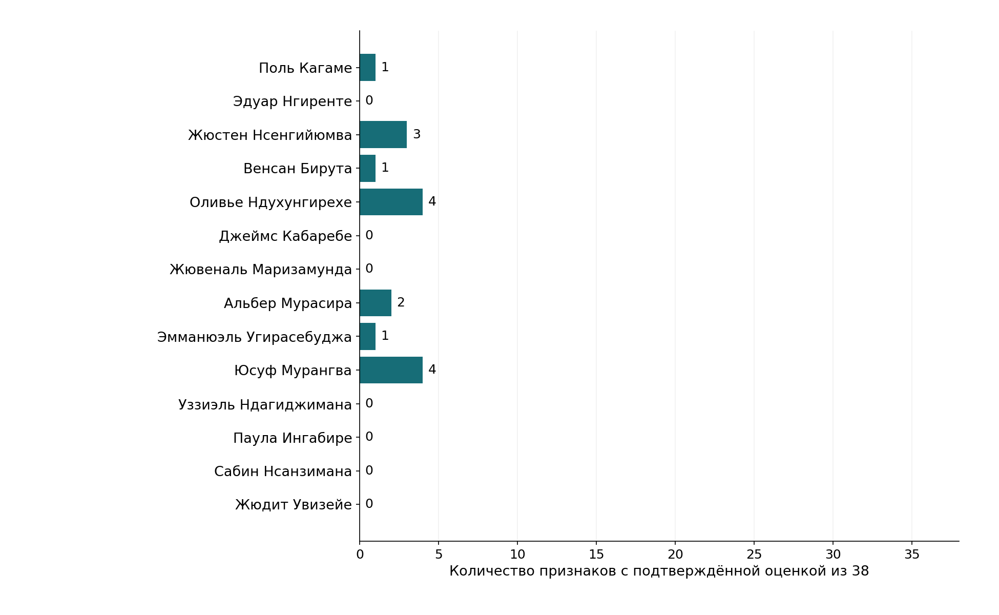
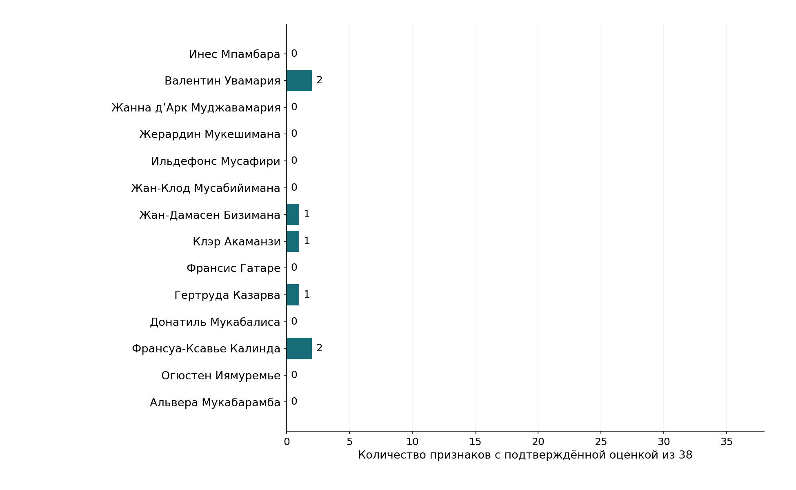
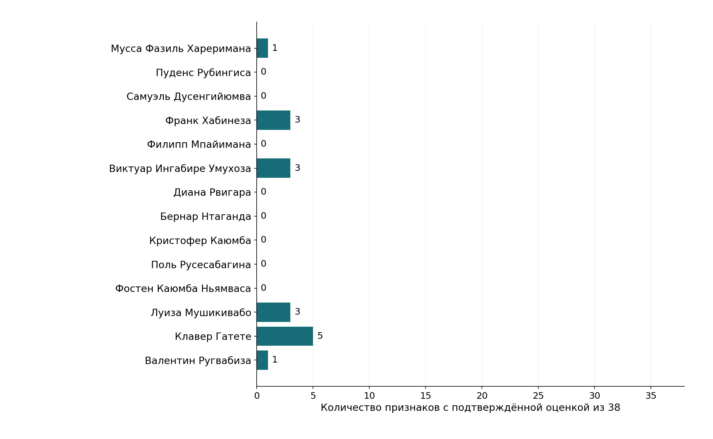

# Руанда: политические акценты в проверенных источниках

Обновление от 18 октября 2026 года. Новая версия по утверждённому словарю из 38 самостоятельных признаков. Выборка включает 42 человека. Основной массив публикаций охватывает октябрь 2025 - октябрь 2026 года, поэтому эта версия описывает подтверждённые публичные эпизоды и не заменяет полную историю пяти лет.

## Основные выводы

Общие проверки конвейера применены ко всем 11,285 ранее извлечённым фактам. Точные содержательные решения основаны на 104 разобранных случаях. Эти объёмы различаются: программное предупреждение ещё не подтверждает политическую характеристику.

После проверки источников в основной матрице есть 39 содержательных оценок у 18 из 42 участников. Они относятся к 19 из 38 признаков. Для остальных сочетаний человека и признака сохранено «нет данных». Частое упоминание имени не делает позицию более выраженной.

В проверенных высказываниях видны разные политические задачи: развитие государственных возможностей и технологий, защита прав и процедур, а также международное сотрудничество для решения конкретных задач. Это содержательные линии отдельных эпизодов. Их распространённость по всей политической системе пока нельзя оценить.

Новая матрица пока не позволяет надёжно построить общую факторную карту и статистические группы. Прежнее трёхфакторное решение остаётся отдельной исследовательской гипотезой. Его координаты и кластеры не переносятся автоматически на новые определения и более строго проверенные данные.

### Что меняет неопределённость дат

| Набор проверенных эпизодов | Известных оценок | Участников с оценками |
| --- | --- | --- |
| Основная матрица: допустимые датированные эпизоды | 39 | 18 |
| Дополнительно эпизоды с неуточнённым временем | 71 | 28 |

Вторая строка показывает, сколько содержательных оценок доступно, если отдельно рассмотреть неопределённость времени. Она не устраняет эту неопределённость и не заменяет основную матрицу. Оба набора пока не дают достаточной основы для общей статистической карты.

## Какие политические линии видны в материалах

В этом разделе используются качественно проверенные эпизоды, в том числе материалы с неуточнённой датой действия. Последние не входят в основную датированную матрицу. Примеры помогают понять содержание признаков, но не доказывают устойчивость позиции на протяжении всего периода.

### Развитие возможностей и технологий

В проверенных эпизодах Паула Ингабире связывает технологические партнёрства с самостоятельностью Руанды. Здесь важна способность выбирать условия сотрудничества и уменьшать зависимость, а не простое присутствие иностранных компаний.

Клавер Гатете подчёркивает внутренние возможности африканских стран, выступая в рамках международного мандата. Его высказывание нельзя автоматически представлять как позицию правительства Руанды.

Проверенные эпизоды: U24, U57, U60, E12. Краткие пересказы и ограничения приведены в отдельном журнале проверки.

[Журнал содержательной проверки источников](https://github.com/rdv77/political_psycology_stratification/blob/main/reports/rwanda_chat_combined_review_2026_10_18.json)

### Права, процедуры и политическое участие

В материалах об оппозиции важны собственные политические требования и действия: правовые возражения и ненасильственные способы участия. Сам факт обвинения, ареста или исключения из выборов не доказывает программу человека.

Судебная позиция представителей Виктуар Ингабире относится к конкретному делу. Её можно описывать как процессуальное требование, но нельзя расширять до полного набора убеждений. Высказывания Франка Хабинезы дают самостоятельные примеры ненасильственного участия.

Проверенные эпизоды: U18, U20, U59. Краткие пересказы и ограничения приведены в отдельном журнале проверки.

[Журнал содержательной проверки источников](https://github.com/rdv77/political_psycology_stratification/blob/main/research/rwanda_politicians_2021_2026/source_scales_v2/CHAT_REVIEW_2026-10-17.md)

### Международные связи как способ решения задач

Сотрудничество с внешними партнёрами появляется в разных сферах: медицинские технологии, оборона, возвращение беженцев и региональные переговоры. Одинаковый инструмент ещё не означает одинаковую идеологию его участников.

Краткий контакт на форуме или протокольная фотография подтверждают присутствие и встречу. Для вывода о предпочтениях нужны содержательное заявление, действие или обязательство самого политика.

Проверенные эпизоды: U19, U26, U30, U40, U44. Краткие пересказы и ограничения приведены в отдельном журнале проверки.

[Журнал содержательной проверки источников](https://github.com/rdv77/political_psycology_stratification/blob/main/research/rwanda_politicians_2021_2026/source_scales_v2/CHAT_REVIEW_2026-10-17.md)

### Единство общества и предупреждение вреда

В выступлениях Жан-Дамасена Бизиманы и Франсуа-Ксавье Калинды историческая память связана с предотвращением новых расколов. Это конкретная линия национального единства. Она не означает, что остальные участники ей противостоят.

Валентин Увамария предлагает перепись диких животных и сопоставление их численности с возможностями парков, чтобы уменьшить нападения и ущерб. Здесь видны проверяемое знание и предупреждение рисков. Сама тема животных ещё не доказывает поддержку экологических ограничений хозяйственной деятельности.

Проверенные эпизоды: E14, E17, E21. Краткие пересказы и ограничения приведены в отдельном журнале проверки.

[Журнал содержательной проверки источников](https://github.com/rdv77/political_psycology_stratification/blob/main/reports/rwanda_chat_combined_review_2026_10_18.json)

## Отношение к России: подтверждённые направления

Часть приведённых ниже эпизодов содержательно подтверждена, но имеет неуточнённую дату действия. Она рассматривается отдельно от основной матрицы и не используется для построения её факторных осей.

Сабин Нсанзимана связан с конкретным эпизодом медицинского сотрудничества с Россией: обсуждаются технологии, подготовка гражданских медицинских кадров и профилактика. Перепечатки одного соглашения образуют один эпизод.

У Жювеналя Маризамунды проверенные материалы описывают обсуждение военно-технического взаимодействия. Они подтверждают направление сотрудничества, но не доказывают исполнение всех обсуждавшихся проектов.

У Оливье Ндухунгирехе содержательная двусторонняя повестка позволяет говорить о дипломатическом и экономическом взаимодействии. Эти эпизоды не устанавливают его позицию по каждому внешнеполитическому действию России.

Из отраслевого сотрудничества нельзя вывести поддержку войны, санкционную позицию или единую ориентацию всех руководителей страны. Отдельный общий фактор отношения к России и порог 2% дисперсии по этой матрице пока не проверяются: данных недостаточно для допустимой модели.

## Сопоставление с предыдущим исследованием

| Решение | Предыдущее исследование | Новая матрица V2 |
| --- | --- | --- |
| 2 фактора | 39,73% общей дисперсии | Не оценивается |
| 3 фактора | 52,29% общей дисперсии | Не оценивается |
| 4 фактора | 61,37% общей дисперсии | Не оценивается |

Проценты относятся к прежней матрице из 37 участников и 8 переменных. Они не показывают качество новой матрицы и не дают основания сохранить прежние группы. Обновлённые определения, правило подтверждения позиции и работа с датами меняют само измерение, поэтому численное сравнение требует достаточной новой матрицы.

Объединение Кагаме и Дианы Рвигары в прежнем кластере после этой проверки не получает нового подтверждения. Это не означает доказанного расхождения: для сопоставимого профиля Рвигары пока не хватает содержательных данных.

## Что означают оценки

Каждый из 38 признаков оценивается самостоятельно от 0 до 5. Балл описывает силу позиции или действия в конкретном проверенном эпизоде. Количество публикаций учитывается отдельно. Отсутствие сообщения о позиции сохраняется как неизвестное значение. Признаки сотрудничества с Россией и дистанцирования от неё также независимы.

## Все утверждённые признаки

### Политические цели

| Признак | Что оценивается |
| --- | --- |
| Расширение частной инициативы | Поддержка самостоятельного предпринимательства, частных инвестиций и экономической активности граждан. |
| Экономические возможности недостаточно включённых групп | Поддержка устранения конкретных экономических препятствий для обозначенной группы; группа сохраняется отдельным уточнением. |
| Доступность общественных услуг | Поддержка расширения доступности, охвата и возможностей публичных систем помощи и общественных услуг. |
| Опора на внутренние возможности | Поддержка собственной ответственности и развития внутренних возможностей страны или сообщества, в том числе уменьшения зависимости от внешней помощи. |
| Ограничение экологического вреда | Поддержка конкретных требований и мер, ограничивающих вред хозяйственной деятельности природной среде. |
| Защита гражданских и политических прав | Явная защита прав участников политической и общественной жизни, процессуальных гарантий и возможностей обжалования. |
| Независимость публичных институтов | Поддержка самостоятельности суда и иных публичных институтов, разделения властей и ограничений вмешательства. |
| Передача полномочий на местный уровень | Поддержка передачи обозначенных государственных полномочий, ресурсов или самостоятельности территориальным и местным институтам. |
| Сохранение конституционного порядка | Поддержка устойчивости и преемственности конституционных правил как публичной цели. |
| Равенство и недискриминационное включение | Явная поддержка равноправия и устранения дискриминационных барьеров; основания различий сохраняются отдельно. |
| Национальная общность и преодоление расколов | Поддержка общественной общности и предотвращения новых внутренних расколов. |
| Общественное примирение | Поддержка восстановления общественных отношений после насилия и конфликтов. |
| Ответственность за причинённый общественный вред | Требование расследовать конкретный общественный вред, установить ответственность и противодействовать безнаказанности; вид вреда фиксируется отдельно. |

### Способы действия

| Признак | Что оценивается |
| --- | --- |
| Технологическая модернизация | Предложение технологий как средства решения обозначенной публичной задачи. |
| Опора на проверяемое знание | Публичное обоснование решения исследованиями, данными или профессионально обоснованной практикой. |
| Привлечение частных ресурсов к публичным задачам | Поддержка государственно-частного взаимодействия и привлечения частного капитала к конкретным публичным задачам. |
| Адресные финансовые инструменты | Предложение специального финансового механизма для обозначенной группы или публичной задачи. |
| Предупреждение рисков и подготовка | Поддержка профилактики, надзора и заблаговременного укрепления возможностей для ответа на конкретные риски. |
| Правовое оспаривание и разрешение споров | Использование или поддержка судебных, арбитражных и иных формальных правовых процедур для разрешения обозначенного спора. |
| Ненасильственное политическое действие | Явный отказ от насильственных способов достижения политических целей и поддержка мирных способов действия. |
| Получение власти через выборы | Представление выборов как предпочтительного или исключительного способа получения политической власти. |
| Переговоры и посредничество | Поддержка переговоров, посредничества и согласования конфликтующих требований. |
| Международная и региональная кооперация | Поддержка конкретных совместных действий, партнёрств и институтов международного или регионального сотрудничества. |
| Совместное представительное определение международных правил | Поддержка участия затронутых стран в выработке общих международных решений и правил. |
| Этические требования к публичной службе | Продвижение профессиональных обязанностей, дисциплины и приоритета общественного интереса в публичной службе. |
| Пересмотр устройства международных институтов | Предложение изменить несправедливые, непредставительные или непригодные международные институциональные механизмы. |

### Россия

| Признак | Что оценивается |
| --- | --- |
| Расширение дипломатического сотрудничества с Россией | Развитие дипломатических связей с Россией. Учитываются собственные публичные слова и действия человека. |
| Дипломатическое дистанцирование от России | Ограничение дипломатических связей с Россией. Учитываются собственные публичные слова и действия человека. |
| Развитие военно-технического сотрудничества с Россией | Совместная работа с Россией в обороне и военной подготовке. Учитываются собственные публичные слова и действия человека. |
| Ограничение военно-технического сотрудничества с Россией | Ограничение совместной работы с Россией в обороне и военной подготовке. Учитываются собственные публичные слова и действия человека. |
| Развитие экономических и технологических проектов с Россией | Экономические и технологические проекты с российским партнёром. Учитываются собственные публичные слова и действия человека. |
| Ограничение экономических и технологических проектов с Россией | Ограничение экономических и технологических проектов с российским партнёром. Учитываются собственные публичные слова и действия человека. |
| Расширение образовательных и культурных обменов с Россией | Образование и культура, включая подготовку гражданских специалистов при сотрудничестве с Россией. Учитываются собственные публичные слова и действия человека. |
| Ограничение образовательных и культурных обменов с Россией | Ограничение образовательных и культурных связей с Россией. Учитываются собственные публичные слова и действия человека. |
| Публичное оправдание конкретных внешнеполитических действий России | Содержательное оправдание конкретных внешнеполитических действий России. Учитываются собственные публичные слова и действия человека. |
| Публичная критика конкретных внешнеполитических действий России | Содержательная критика конкретных внешнеполитических действий России. Учитываются собственные публичные слова и действия человека. |
| Противодействие санкциям и изоляции России | Противодействие санкциям и другим мерам международной изоляции России. Учитываются собственные публичные слова и действия человека. |
| Поддержка санкций и изоляции России | Поддержка санкций и других мер международной изоляции России. Учитываются собственные публичные слова и действия человека. |

## Какие сведения доступны по участникам

## Участники и подтверждённые оценки

Справки описывают роль человека в исследуемый период. Они не подтверждают сохранение должности на дату этого отчёта. Наличие публикаций, участие в церемонии и биографические сведения сами по себе не создают оценок политических признаков.

### Поль Кагаме

Президент Руанды; участник президентских выборов 2024 года

Глава государства, с которым связаны президентские выборы 2024 года и новый пятилетний мандат. Включён как центральный участник национальной политики, а не как представитель всех взглядов населения.

| Подтверждённый признак | Балл 0-5 |
| --- | --- |
| Международная и региональная кооперация | 3 |

[President Kagame sworn-in for a five-year term](https://www.rwandainghana.gov.rw/actualites/info-details/president-kagame-sworn-in-for-a-five-year-term)

[Rwanda: Respect Rights During Elections](https://www.hrw.org/news/2024/06/14/rwanda-respect-rights-during-elections)

### Эдуар Нгиренте

Премьер-министр в первой части исследуемого периода

Руководил правительством в первой части исследуемого окна и передал полномочия преемнику на церемонии 25 июля 2025 года. Его присутствие позволяет учитывать правительственную политику до смены премьер-министра.

В основной матрице пока нет подтверждённых оценок. Неизвестные значения не заменены нулями или средними.

[Prime Minister’s Office: appointments at the National Bank of Rwanda](https://www.primature.gov.rw/index.php?eID=dumpFile&f=120236&t=f&token=7de66acf7742c515b4ac9071f0ea51fa31d4451e)

[Office of the Prime Minister — About: Justin Nsengiyumva and Ines Mpambara](https://www.primature.gov.rw/about)

### Жюстен Нсенгийюмва

Назначен премьер-министром в июле 2025 года

Назначен главой правительства 23 июля 2025 года; принёс присягу и принял полномочия на церемонии 25 июля. Включён для представления смены руководителя исполнительной координации внутри исследуемого периода.

| Подтверждённый признак | Балл 0-5 |
| --- | --- |
| Технологическая модернизация | 3 |
| Переговоры и посредничество | 5 |
| Международная и региональная кооперация | 4 |

[Office of the Prime Minister — About: Justin Nsengiyumva and Ines Mpambara](https://www.primature.gov.rw/about)

[PM Nsengiyumva officially sworn-in as Prime Minister — oath and handover, 25 July 2025](https://primature.prod.risa.rw/news-detail/pm-nsengiyumva-officially-sworn-in-as-prime-minister)

### Венсан Бирута

Министр иностранных дел в апреле 2024 года; назначен министром внутренних дел в августе 2024 года

Представляет внешнеполитическое руководство первой части окна и переход к внутреннему управлению в августе 2024 года. Смена портфеля важна для датировки его публичных выступлений.

| Подтверждённый признак | Балл 0-5 |
| --- | --- |
| Международная и региональная кооперация | 4 |

[MINAFFET news archive: Rwanda and Ukraine discuss bilateral relations, 18 April 2024](https://www.minaffet.gov.rw/updates/news/page?cHash=764ee7520c0d7693c560332fdd905b60&tx_news_pi1%5BcurrentPage%5D=17)

[Prime Minister’s Office: appointment of ministers, 16 August 2024](https://www.primature.gov.rw/index.php?eID=dumpFile&f=103921&t=f&token=674c3d927f1443e0309c38a0fffb76c2e7e273c3)

### Оливье Ндухунгирехе

Министр иностранных дел и международного сотрудничества в правительстве августа 2024 года

Представлял министерство иностранных дел и международного сотрудничества в составе правительства августа 2024 года. Включён как один из участников публичной дипломатии Руанды; служебные выступления рассматриваются в соответствующей роли.

| Подтверждённый признак | Балл 0-5 |
| --- | --- |
| Независимость публичных институтов | 4 |
| Международная и региональная кооперация | 3 |
| Расширение дипломатического сотрудничества с Россией | 3 |
| Развитие экономических и технологических проектов с Россией | 3 |

[Prime Minister’s Office: appointment of ministers, 16 August 2024](https://www.primature.gov.rw/index.php?eID=dumpFile&f=103921&t=f&token=674c3d927f1443e0309c38a0fffb76c2e7e273c3)

### Джеймс Кабаребе

Государственный министр по региональному сотрудничеству, вступивший в должность в 2023 году

Принял портфель регионального сотрудничества в октябре 2023 года. Его включение добавляет к общему внешнеполитическому руководству уровень региональной дипломатии.

В основной матрице пока нет подтверждённых оценок. Неизвестные значения не заменены нулями или средними.

[Prof. Manasseh hands over to Gen. (Rtd) Kabarebe](https://www.minaffet.gov.rw/updates/news-details/prof-manasseh-hands-over-to-gen-rtd-kabarebe)

### Жювеналь Маризамунда

Министр обороны, принявший полномочия в июне 2023 года

Принял полномочия министра обороны в июне 2023 года. Представляет руководство оборонным ведомством в части исследуемого периода; должность сама по себе не задаёт оценок по политическим шкалам.

В основной матрице пока нет подтверждённых оценок. Неизвестные значения не заменены нулями или средними.

[Newly appointed Minister of Defence assumes responsibilities](https://www.mod.gov.rw/docs-media/news-detail/newly-appointed-minister-of-defence-assumes-responsibilities)

[Prime Minister’s Office: appointment of ministers, 16 August 2024](https://www.primature.gov.rw/index.php?eID=dumpFile&f=103921&t=f&token=674c3d927f1443e0309c38a0fffb76c2e7e273c3)

### Альбер Мурасира

Министр по чрезвычайным ситуациям в правительстве августа 2024 года

В исследуемом окне связан с оборонным ведомством, а в составе правительства августа 2024 года — с чрезвычайными ситуациями. Позволяет учитывать разные направления государственной безопасности и гражданской защиты, сохраняя их датировку.

| Подтверждённый признак | Балл 0-5 |
| --- | --- |
| Переговоры и посредничество | 3 |
| Международная и региональная кооперация | 5 |

[Prime Minister’s Office: appointment of ministers, 16 August 2024](https://www.primature.gov.rw/index.php?eID=dumpFile&f=103921&t=f&token=674c3d927f1443e0309c38a0fffb76c2e7e273c3)

[Rwanda Defence Minister addresses UN Peacekeeping Ministerial Conference in Seoul](https://www.mod.gov.rw/docs-media/news-detail/rwanda-defence-minister-addresses-un-peacekeeping-ministerial-conference-in-seoul-2)

### Эмманюэль Угирасебуджа

Министр юстиции и генеральный прокурор в 2022 и 2024 годах

Представлял Министерство юстиции и должность Attorney General в датированных официальных материалах 2022–2024 годов. Включён как участник правового и административного направления государственной политики.

| Подтверждённый признак | Балл 0-5 |
| --- | --- |
| Правовое оспаривание и разрешение споров | 4 |

[Minister of Justice / Attorney General met with Government legal advisors](https://www.minijust.gov.rw/news-detail/minister-of-justice-attorney-general-met-with-government-legal-advisors)

[Prime Minister’s Office: appointment of ministers, 16 August 2024](https://www.primature.gov.rw/index.php?eID=dumpFile&f=103921&t=f&token=674c3d927f1443e0309c38a0fffb76c2e7e273c3)

### Юсуф Мурангва

Министр финансов и экономического планирования, вступивший в должность в июне 2024 года

Возглавил финансово-экономический портфель в июне 2024 года. Включён для представления бюджетной и экономической политики второй части окна без переноса на него всех решений государства.

| Подтверждённый признак | Балл 0-5 |
| --- | --- |
| Доступность общественных услуг | 3.5 |
| Опора на проверяемое знание | 3 |
| Адресные финансовые инструменты | 4 |
| Международная и региональная кооперация | 3 |

[96% of Rwandans are financially included — FinScope Survey 2024](https://www.minecofin.gov.rw/news-detail/96-of-rwandans-are-financially-included-finscope-survey-2024)

[East African Development Bank Annual Report 2024 — Governing Council](https://www.eadb.org/site/assets/files/2279/2024_annual_report.pdf)

### Уззиэль Ндагиджимана

Министр финансов и экономического планирования до июня 2024 года

Руководил финансово-экономическим портфелем до июня 2024 года. Позволяет учитывать публичное обоснование бюджета и приоритетов до смены министра.

В основной матрице пока нет подтверждённых оценок. Неизвестные значения не заменены нулями или средними.

[East African Development Bank Annual Report 2024 — Governing Council](https://www.eadb.org/site/assets/files/2279/2024_annual_report.pdf)

### Паула Ингабире

Министр информационно-коммуникационных технологий и инноваций в правительстве 2024 года

Представляла министерство ИКТ и инноваций в правительстве августа 2024 года. Включена как публичный участник цифрового и технологического направления государственной политики.

В основной матрице пока нет подтверждённых оценок. Неизвестные значения не заменены нулями или средними.

[Prime Minister’s Office: appointment of ministers, 16 August 2024](https://www.primature.gov.rw/index.php?eID=dumpFile&f=103921&t=f&token=674c3d927f1443e0309c38a0fffb76c2e7e273c3)

### Сабин Нсанзимана

Министр здравоохранения в 2023 году

Выступал как министр здравоохранения, в частности при оформлении сотрудничества с ВОЗ в феврале 2023 года. Включён для представления вопросов здоровья населения и готовности системы к эпидемиям.

В основной матрице пока нет подтверждённых оценок. Неизвестные значения не заменены нулями или средними.

[Rwanda, WHO join forces to boost epidemic preparedness](https://www.moh.gov.rw/news-detail/rwanda-who-join-forces-to-boost-epidemic-preparedness)

### Жюдит Увизейе

Министр в канцелярии президента в правительстве августа 2024 года

Входила в правительство августа 2024 года как министр в канцелярии президента. Её включение отражает уровень президентской администрации; содержание позиций устанавливается по собственным публичным материалам.

В основной матрице пока нет подтверждённых оценок. Неизвестные значения не заменены нулями или средними.

[Prime Minister’s Office: appointment of ministers, 16 August 2024](https://www.primature.gov.rw/index.php?eID=dumpFile&f=103921&t=f&token=674c3d927f1443e0309c38a0fffb76c2e7e273c3)

### Инес Мпамбара

Министр в канцелярии премьер-министра

Назначена министром в канцелярии премьер-министра в феврале 2020 года; роль подтверждается внутри исследуемого окна. Представляет аппарат координации правительственной работы.

В основной матрице пока нет подтверждённых оценок. Неизвестные значения не заменены нулями или средними.

[Office of the Prime Minister — About: Justin Nsengiyumva and Ines Mpambara](https://www.primature.gov.rw/about)

[Prime Minister’s Office: appointment of ministers, 16 August 2024](https://www.primature.gov.rw/index.php?eID=dumpFile&f=103921&t=f&token=674c3d927f1443e0309c38a0fffb76c2e7e273c3)

### Валентин Увамария

Министр окружающей среды в правительстве августа 2024 года; в проверенном выступлении 2026 года - сенатор

Представляла природоохранный портфель в составе правительства августа 2024 года. Включена для охвата экологической и климатической повестки, отличаемой от других направлений управления.

| Подтверждённый признак | Балл 0-5 |
| --- | --- |
| Опора на проверяемое знание | 4 |
| Предупреждение рисков и подготовка | 3 |

[Prime Minister’s Office: appointment of ministers, 16 August 2024](https://www.primature.gov.rw/index.php?eID=dumpFile&f=103921&t=f&token=674c3d927f1443e0309c38a0fffb76c2e7e273c3)

### Жанна д’Арк Муджавамария

Назначена министром государственной службы и труда в июне 2024 года

В окне исследования выступала по экологической политике, затем в июне 2024 года приняла портфель государственной службы и труда. Справка фиксирует эти исторические роли и не утверждает сохранение июньской должности после 2024 года.

В основной матрице пока нет подтверждённых оценок. Неизвестные значения не заменены нулями или средними.

[Handover ceremony of new Minister of MIFOTRA Hon. Dr Jeanne d’Arc Mujawamariya](https://www.mifotra.gov.rw/news-detail/handover-ceremony-of-new-minister-of-mifotra-hon-dr-jeanne-darc-mujawamariya)

### Жерардин Мукешимана

Министр сельского хозяйства и животноводства в декабре 2022 года

Представляла министерство сельского хозяйства и животноводства в 2022 году. Включена для учёта аграрной политики и публичной работы с сельскохозяйственным сектором до смены руководителя.

В основной матрице пока нет подтверждённых оценок. Неизвестные значения не заменены нулями или средними.

[MINAGRI news archive: Musafiri appointment, 2 March 2023; Mukeshimana activity, 1 December 2022](https://www.minagri.gov.rw/updates/news/page?cHash=49ecfd44c04f184493dc7133cc4ed740&tx_news_pi1%5BcurrentPage%5D=6)

### Ильдефонс Мусафири

Назначен министром сельского хозяйства и животноводства в 2023 году; подтверждён в августе 2024 года

Назначен руководителем аграрного ведомства в марте 2023 года и включён в состав правительства августа 2024 года. Позволяет сопоставлять аграрное направление на разных этапах окна.

В основной матрице пока нет подтверждённых оценок. Неизвестные значения не заменены нулями или средними.

[MINAGRI news archive: Musafiri appointment, 2 March 2023; Mukeshimana activity, 1 December 2022](https://www.minagri.gov.rw/updates/news/page?cHash=49ecfd44c04f184493dc7133cc4ed740&tx_news_pi1%5BcurrentPage%5D=6)

[Prime Minister’s Office: appointment of ministers, 16 August 2024](https://www.primature.gov.rw/index.php?eID=dumpFile&f=103921&t=f&token=674c3d927f1443e0309c38a0fffb76c2e7e273c3)

### Жан-Клод Мусабийимана

Министр местного самоуправления в декабре 2023 и августе 2024 года

Представлял министерство местного самоуправления в датированных материалах 2023–2024 годов. Включён как участник связки между центральным правительством и территориальным управлением.

В основной матрице пока нет подтверждённых оценок. Неизвестные значения не заменены нулями или средними.

[Dusengiyumva Samuel sworn in as the new City of Kigali Mayor](https://www.kigalicity.gov.rw/news-detail/dusengiyumva-samuel-sworn-in-as-the-new-city-of-kigali-mayor)

[Prime Minister’s Office: appointment of ministers, 16 August 2024](https://www.primature.gov.rw/index.php?eID=dumpFile&f=103921&t=f&token=674c3d927f1443e0309c38a0fffb76c2e7e273c3)

### Жан-Дамасен Бизимана

Министр национального единства и гражданской активности в правительстве 2024 года

Представлял министерство национального единства и гражданской активности в правительстве августа 2024 года. Включён для охвата публичной повестки памяти, единства и гражданского участия.

| Подтверждённый признак | Балл 0-5 |
| --- | --- |
| Национальная общность и преодоление расколов | 4.5 |

[Prime Minister’s Office: appointment of ministers, 16 August 2024](https://www.primature.gov.rw/index.php?eID=dumpFile&f=103921&t=f&token=674c3d927f1443e0309c38a0fffb76c2e7e273c3)

### Клэр Акаманзи

Руководитель Rwanda Development Board до сентября 2023 года

Возглавляла Rwanda Development Board до сентября 2023 года, а в январе 2024 года перешла на пост генерального директора NBA Africa. Для исследования важна её прежняя государственная работа по инвестициям и развитию; последующие заявления отмечаются как сделанные в иной профессиональной роли.

| Подтверждённый признак | Балл 0-5 |
| --- | --- |
| Расширение частной инициативы | 3 |

[Rwanda Development Board audit, year ended 30 June 2023 — Board and management](https://documents1.worldbank.org/curated/en/099053024072067506/pdf/P2523501b4222a08919ccf1c337cb47a5bb.pdf)

[NBA names Clare Akamanzi CEO of NBA Africa](https://pr.nba.com/clare-akamanzi-ceo-nba-africa/)

### Франсис Гатаре

Руководитель Rwanda Development Board с сентября 2023 года на дату аудита

Назначен руководителем Rwanda Development Board в сентябре 2023 года; эта роль подтверждена документом аудита того периода. Включён как представитель института продвижения инвестиций и экономического развития, без предположения о неизменности должности до конца окна.

В основной матрице пока нет подтверждённых оценок. Неизвестные значения не заменены нулями или средними.

[Rwanda Development Board audit, year ended 30 June 2023 — Board and management](https://documents1.worldbank.org/curated/en/099053024072067506/pdf/P2523501b4222a08919ccf1c337cb47a5bb.pdf)

### Гертруда Казарва

Спикер Палаты депутатов с августа 2024 года по официальной биографии

Избрана спикером Палаты депутатов в августе 2024 года. Представляет руководство нижней палаты нового созыва, а не весь парламентский спектр.

| Подтверждённый признак | Балл 0-5 |
| --- | --- |
| Международная и региональная кооперация | 3 |

[Parliament of Rwanda — About: presidents of the two chambers](https://www.parliament.gov.rw/about-1)

### Донатиль Мукабалиса

Спикер Палаты депутатов в 2023 году

Возглавляла Палату депутатов в датированных парламентских материалах 2023 года. Её включение позволяет учесть руководство предыдущего созыва внутри исследуемого периода.

В основной матрице пока нет подтверждённых оценок. Неизвестные значения не заменены нулями или средними.

[Parliament news archive: visit of the Vérificateur Général of Mali](https://www.parliament.gov.rw/updates/news/page?cHash=1a73af6616bebe583f8e229a45ea6028&tx_news_pi1%5BcurrentPage%5D=31)

### Франсуа-Ксавье Калинда

Председатель Сената с января 2023 года, переизбран в сентябре 2024 года

Возглавил Сенат в январе 2023 года и был избран на следующий срок в сентябре 2024 года. Представляет руководство верхней палаты на двух последовательных этапах окна.

| Подтверждённый признак | Балл 0-5 |
| --- | --- |
| Национальная общность и преодоление расколов | 5 |
| Предупреждение рисков и подготовка | 3 |

[Parliament of Rwanda — About: presidents of the two chambers](https://www.parliament.gov.rw/about-1)

### Огюстен Иямуремье

Председатель Сената в первой части исследуемого периода

Возглавлял Сенат до декабря 2022 года. Включён как предшествующий руководитель верхней палаты, действовавший в начале исследуемого периода.

В основной матрице пока нет подтверждённых оценок. Неизвестные значения не заменены нулями или средними.

[Inter-Parliamentary Union Parline — Rwanda Senate: historical presidents](https://data.ipu.org/fr/parliament/RW/RW-UC01/)

### Альвера Мукабарамба

Вице-президент Сената, избрана в руководящий состав в сентябре 2024 года

Избрана вице-президентом Сената в сентябре 2024 года. Включена как представитель парламентского руководства; факт избрания не используется как свидетельство самостоятельной программы.

В основной матрице пока нет подтверждённых оценок. Неизвестные значения не заменены нулями или средними.

[Rwandan Embassy in DRC: Dr Kalinda reconduit à la présidence du Sénat Rwandais](https://www.rwandaincongo.gov.rw/actualites/info-details/dr-kalinda-reconduit-a-la-presidence-du-senat-rwandais)

### Мусса Фазиль Хареримана

Заместитель спикера Палаты депутатов в 2023 году

Представлял руководство Палаты депутатов как заместитель спикера в 2023 году. Включён для охвата парламентского управления за пределами фигуры спикера.

| Подтверждённый признак | Балл 0-5 |
| --- | --- |
| Равенство и недискриминационное включение | 2 |

[Parliament news archive: visit of the Vérificateur Général of Mali](https://www.parliament.gov.rw/updates/news/page?cHash=1a73af6616bebe583f8e229a45ea6028&tx_news_pi1%5BcurrentPage%5D=31)

### Пуденс Рубингиса

Мэр Кигали до перехода на пост губернатора Восточной провинции в декабре 2023 года

Был мэром Кигали, затем в декабре 2023 года перешёл к руководству Восточной провинцией. Его траектория позволяет учесть столичное и провинциальное управление внутри одного окна.

В основной матрице пока нет подтверждённых оценок. Неизвестные значения не заменены нулями или средними.

[Dusengiyumva Samuel sworn in as the new City of Kigali Mayor](https://www.kigalicity.gov.rw/news-detail/dusengiyumva-samuel-sworn-in-as-the-new-city-of-kigali-mayor)

[Guverineri Rubingisa yatangiye inshingano, yizeza ubufatanye mu kwihutisha iterambere rishingiye ku muturage](https://www.easternprovince.gov.rw/ibindi/guverineri-rubingisa-yatangiye-inshingano-yizeza-ubufatanye-mu-kwihutisha-iterambere-rishingiye-ku-muturage)

### Самуэль Дусенгийюмва

Избран мэром Кигали в декабре 2023 года

Избран мэром Кигали в декабре 2023 года. Включён как участник управления столицей, без предположения, что городская повестка представляет все регионы страны.

В основной матрице пока нет подтверждённых оценок. Неизвестные значения не заменены нулями или средними.

[Dusengiyumva Samuel sworn in as the new City of Kigali Mayor](https://www.kigalicity.gov.rw/news-detail/dusengiyumva-samuel-sworn-in-as-the-new-city-of-kigali-mayor)

### Франк Хабинеза

Лидер Демократической зелёной партии; кандидат в президенты в 2024 году

Лидер Демократической зелёной партии и один из трёх допущенных кандидатов в президенты на выборах 2024 года. Его участие позволяет учитывать легальную партийную альтернативу и собственные программные предложения.

| Подтверждённый признак | Балл 0-5 |
| --- | --- |
| Равенство и недискриминационное включение | 3 |
| Национальная общность и преодоление расколов | 4 |
| Ненасильственное политическое действие | 5 |

[Rwanda: Respect Rights During Elections](https://www.hrw.org/news/2024/06/14/rwanda-respect-rights-during-elections)

[Rwanda: Repression in the context of elections, AFR 47/8275/2024](https://www.amnesty.org/ar/wp-content/uploads/2024/07/AFR4782752024ENGLISH.pdf)

### Филипп Мпайимана

Независимый кандидат в президенты в 2024 году

Независимый кандидат, допущенный к президентским выборам 2024 года. Включён как участник электоральной конкуренции; независимый статус не означает оппозиционности каждой его позиции.

В основной матрице пока нет подтверждённых оценок. Неизвестные значения не заменены нулями или средними.

[Rwanda: Respect Rights During Elections](https://www.hrw.org/news/2024/06/14/rwanda-respect-rights-during-elections)

### Виктуар Ингабире Умухоза

Руководитель незарегистрированной DALFA-Umurinzi; пыталась добиться допуска к выборам 2024 года

Руководительница DALFA-Umurinzi, добивавшаяся возможности участвовать в выборах 2024 года. Включена для учёта политической альтернативы за пределами списка допущенных кандидатов; судебный статус не определяет её оценки по содержательным шкалам.

| Подтверждённый признак | Балл 0-5 |
| --- | --- |
| Защита гражданских и политических прав | 3 |
| Независимость публичных институтов | 3 |
| Правовое оспаривание и разрешение споров | 3 |

[Rwanda: Respect Rights During Elections](https://www.hrw.org/news/2024/06/14/rwanda-respect-rights-during-elections)

[Rwanda: Repression in the context of elections, AFR 47/8275/2024](https://www.amnesty.org/ar/wp-content/uploads/2024/07/AFR4782752024ENGLISH.pdf)

### Диана Рвигара

Руководитель People Salvation Movement; её кандидатура не допущена на выборы 2024 года

Общественно-политическая деятельница и инициатор независимого выдвижения на президентских выборах 2024 года, не включённая в окончательный список кандидатов. Представляет часть публичного пространства вне допущенной электоральной конкуренции.

В основной матрице пока нет подтверждённых оценок. Неизвестные значения не заменены нулями или средними.

[Rwanda: Respect Rights During Elections](https://www.hrw.org/news/2024/06/14/rwanda-respect-rights-during-elections)

### Бернар Нтаганда

Основатель PS-Imberakuri; добивался восстановления права выдвижения в 2024 году

Основатель PS-Imberakuri, добивавшийся восстановления права выдвижения в 2024 году. Его политическая траектория не отождествляется с другой фракцией под тем же партийным названием, участвовавшей в официальных выборах.

В основной матрице пока нет подтверждённых оценок. Неизвестные значения не заменены нулями или средними.

[Rwanda: Repression in the context of elections, AFR 47/8275/2024](https://www.amnesty.org/ar/wp-content/uploads/2024/07/AFR4782752024ENGLISH.pdf)

### Кристофер Каюмба

Основатель Rwandese Platform for Democracy; политическая и судебная история освещалась в 2023–2024 годах

Основатель Rwandese Platform for Democracy, чья политическая деятельность и судебные процессы освещались в 2023–2024 годах. Включён как отдельный публичный актор; категория отбора не предполагает неизменную оппозиционность всех его последующих высказываний.

В основной матрице пока нет подтверждённых оценок. Неизвестные значения не заменены нулями или средними.

[Rwanda: Respect Rights During Elections](https://www.hrw.org/news/2024/06/14/rwanda-respect-rights-during-elections)

[Rwanda: Repression in the context of elections, AFR 47/8275/2024](https://www.amnesty.org/ar/wp-content/uploads/2024/07/AFR4782752024ENGLISH.pdf)

### Поль Русесабагина

Оппозиционный критик правительства; освобождён из заключения в марте 2023 года

Публичный критик правительства, освобождённый из заключения в марте 2023 года и вновь дававший интервью после освобождения. Включён как транснациональный участник политической дискуссии; его известность за рубежом не измеряет поддержку внутри страны.

В основной матрице пока нет подтверждённых оценок. Неизвестные значения не заменены нулями или средними.

[World Report 2024 — Rwanda](https://www.hrw.org/world-report/2024/country-chapters/rwanda)

[Join Us or Die: Rwanda’s Extraterritorial Repression](https://www.hrw.org/report/2023/10/10/join-us-or-die/rwandas-extraterritorial-repression)

### Фостен Каюмба Ньямваса

Бывший глава военного штаба; сооснователь оппозиционного Rwanda National Congress в эмиграции

Бывший руководитель военного штаба и сооснователь Rwanda National Congress в эмиграции. Включён для охвата политических акторов вне национальных государственных институтов; биографическая военная роль не заменяет собственных заявлений в исследуемом окне.

В основной матрице пока нет подтверждённых оценок. Неизвестные значения не заменены нулями или средними.

[Join Us or Die: Rwanda’s Extraterritorial Repression](https://www.hrw.org/report/2023/10/10/join-us-or-die/rwandas-extraterritorial-repression)

### Луиза Мушикивабо

Бывший министр иностранных дел Руанды; генеральный секретарь Франкофонии, переизбрана в 2022 году

Бывшая глава внешнеполитического ведомства Руанды, возглавившая Международную организацию Франкофонии с января 2019 года и переизбранная в 2022 году. В исследуемом окне её действия в OIF относятся к международному мандату и не приписываются автоматически правительству Руанды.

| Подтверждённый признак | Балл 0-5 |
| --- | --- |
| Равенство и недискриминационное включение | 3 |
| Международная и региональная кооперация | 3 |
| Пересмотр устройства международных институтов | 3 |

[Louise Mushikiwabo — Biographie](https://www.francophonie.org/louise-mushikiwabo-2894)

### Клавер Гатете

Постоянный представитель Руанды при ООН в 2023 году; назначен исполнительным секретарём ЭКА ООН 6 октября 2023 года

Представлял Руанду при ООН, затем в октябре 2023 года был назначен исполнительным секретарём Экономической комиссии ООН для Африки. Национальный дипломатический пост и последующий международный мандат различаются при интерпретации его публичных выступлений.

| Подтверждённый признак | Балл 0-5 |
| --- | --- |
| Опора на внутренние возможности | 4 |
| Технологическая модернизация | 5 |
| Опора на проверяемое знание | 3 |
| Международная и региональная кооперация | 4 |
| Совместное представительное определение международных правил | 3 |

[Secretary-General’s Daily Schedule, 1 February 2023](https://www.un.org/sg/en/sg-daily-schedules/2023-02-01)

[UN appointment of Claver Gatete to ECA, 6 October 2023](https://www.un.org/sg/en/content/sg/personnel-appointments/2023-10-06/mr-claver-gatete-of-rwanda-executive-secretary-of-the-united-nations-economic-commission-for-africa-(eca))

### Валентин Ругвабиза

Постоянный представитель Руанды при ООН до назначения специальным представителем генсека ООН по ЦАР в феврале 2022 года

Представляла Руанду при ООН до назначения в феврале 2022 года специальным представителем генерального секретаря и руководителем MINUSCA в Центральноафриканской Республике. Включена как пограничный международный актор; работа миссии ООН не является автоматически внешней политикой Руанды.

| Подтверждённый признак | Балл 0-5 |
| --- | --- |
| Международная и региональная кооперация | 4 |

[Secretary-General appoints Valentine Rugwabiza as Special Representative and Head of MINUSCA](https://press.un.org/en/2022/sga2101.doc.htm)

## Материалы для проверки

Полная матрица всех 42 участников, отдельный технический отчёт, журнал проверки эпизодов и сравнение допусков доступны рядом с этим отчётом. Исходные публикации и частные идентификаторы остаются в локальном хранилище проекта.
